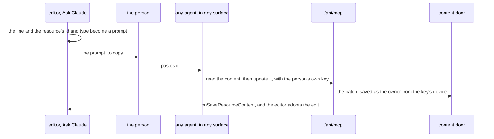

# In-product assistant

Built on the [agent content tools](../../agent-content-tools/design.md) and [live edits](../live-edits/design.md). A person working in an editor should not have to leave it to ask an agent for an edit, and asking from inside it must not open a second way in. So the assistant composes a prompt for the agent the person already runs, which then works through the tools any agent uses.

## One path

The page never calls `/api/mcp` — the endpoint refuses any request carrying an `Origin` header, which every browser request does — and no model runs inside Esposter. The editor composes the request, the person carries it to an agent on their own machine, and that agent reaches the resource through the same tools, under the same key scopes and rate limits, as a session started in a terminal. An in-product edit and an outside agent's edit are then one path: the same tools, the same door, the same activity entry naming the key.

## The command

**Ask Claude** is registered through `useCommands` from the blade header, so it sits in the toolbar and in the command palette for every type, needing nothing from any. It takes a line of text and offers the composed prompt beside a copy button once there is a line. The prompt names the resource by id and type, so the agent's first call is the describe or read tool rather than a search.

The agent reaches Esposter through the MCP server entry the follow-ups plugin ships, with the person's own key, which needs the `Resources` scope ([agent access](../../agent-access/design.md)). The dialog shows the steps to make that key when none holds the scope, and nothing else until one does. The edit lands in the open editor through live edits, so the person watches it arrive, and an edit of their own still unsaved meets it as a choice rather than being overwritten.

## Decisions

- **The person carries the prompt.** The command needs no pairing, no session picker and no folder. A paired host that received the prompt was rejected: it kept a host program, its pairing, a release asset and an Agent SDK dependency alive for one button, and it tied the feature to one agent, where a pasted prompt works in the terminal, the desktop app, an agent IDE or a harness pointed at another model. The cost is one paste where there was one click.
- **A pushed line is the upgrade.** When [channel chat](../../../../changes/infra-channel-chat/design.md) ships, Ask Claude pushes the line into the open session through the channel, and the pasted prompt stays the fallback for a surface without one.

## Free

A Claude feature in Esposter costs the person nothing beyond what the agent they already run costs. Esposter calls no model, holds no model key and meters nothing. The [SDK-driven companion](../../../../rejected/infra/sdk-driven-companion/design.md) was rejected partly for being a chat beside the work that holds none of it, and this is the reverse: the resource is the work, and the agent holds and edits it.

## Key files

| File                                                     | Role                                                                            |
| :------------------------------------------------------- | :------------------------------------------------------------------------------ |
| `apps/web/app/components/Resource/AskClaudeDialog.vue`   | the line, the steps to make a key, and the composed prompt with its copy button |
| `apps/web/app/services/resource/getAssistantPrompt.ts`   | the prompt: the resource named by id and type, then the line                    |
| `apps/web/app/services/resource/checkHasResourcesKey.ts` | whether any of the person's keys holds the Resources scope                      |
| `apps/web/app/components/Resource/Blade/Header.vue`      | registers Ask Claude for every type                                             |
| `packages/follow-ups/.mcp.json`                          | the MCP server entry an agent reaches Esposter through                          |
