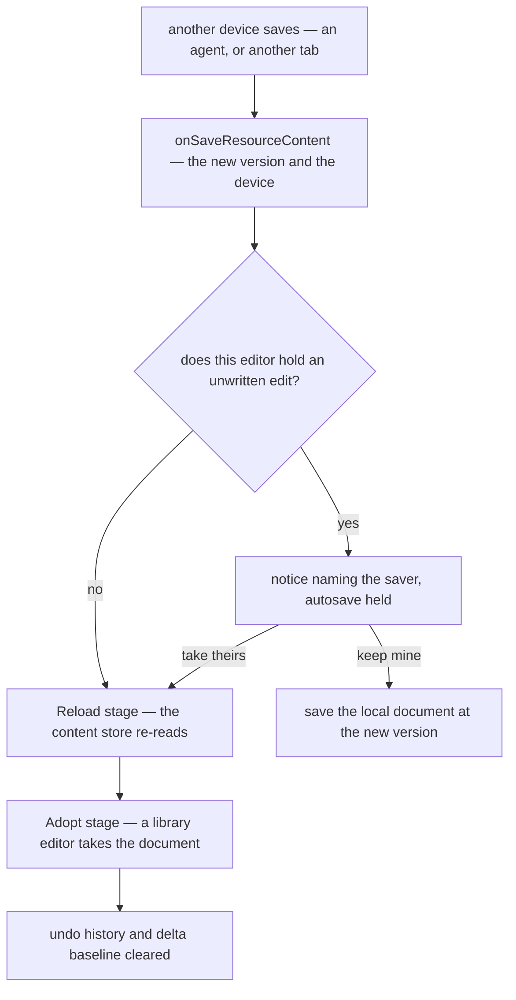

# Live edits

An open editor that does not hear another device's save keeps the version it read, and its next save is refused as stale. The notice then asks for a refresh, which reloads the page and drops whatever the person typed since their last save. A second tab meets that now and then, and an agent editing a resource the owner has open would meet it on every write. So adoption is generic, for every type, and it helps two tabs as much as an agent.

## One subscription for every type

`createResourceProcedures` already generates `onSaveResourceContent` for every type, filtered so a device never hears its own save. One generic subscription, run by the explorer (`Explorer/Index.vue`) for whichever resource is open, serves every type, so a type needs no entry anywhere. No type keeps a subscribable of its own.

The stream carries the new content version and the writing device rather than the content. The content is re-read through the reload stage a restore already runs, so a large Sheet arrives by the large-documents path rather than over the socket, and one path adopts whatever wrote the blob.

## Adopting

An open editor that holds no unwritten edit — no save pending, no autosave armed, content equal to what it last persisted — adopts the save. It stores the new version and runs `ResourceContentHookMap`'s two stages in order, as [third-party document adapters](../../third-party-document-adapters/design.md) describe for a restore: `Reload`, where each content store re-reads through `createContentData`, then `Adopt`, where a library holding its own copy — Tiptap, SurveyJS — takes the new document.

Two things describe a document that is gone, and clear. An editor's undo history clears, as a restore clears it: the Sheet's command history, the page builder's patch history once it ships. The [delta content saves](../../../resource/delta-content-saves/design.md) baseline clears too, since it names bytes the server does not hold, so one large save crosses whole before deltas resume.

The TodoList saves each edit as it happens, so it rarely holds an unwritten one, and it re-reads on another device's save in place of taking the streamed list.

## Meeting an unsaved edit

An editor holding an unwritten edit overwrites nothing in either direction. The notice comes the moment the other save lands, saying where the save came from — another device, or an agent by the key name its save carried — with two answers:

- **Take theirs** adopts as above and drops the local edit.
- **Keep mine** re-saves the local document through the existing save mutation at the newer version, replacing the other write, which stays in version history.

Until it is answered, the store's stale latch holds autosave, as it does after a refused save today. What changes is the timing and the choice: the latch is raised when the other save lands rather than at the person's next save, and a reload that drops their edit is no longer the only way out. After Keep mine, an agent's next pinned patch is stale and it reads again; an unpinned one reapplies over the owner's document under its tests.

The store holds no document, so it cannot write one. Keep mine therefore runs a `Keep` stage on `ResourceContentHookMap`: the store moves the resource to the held save's version and runs the stage, and each content store (`createContentData`) answers by saving the document it holds through its own save, so the write goes through the existing save mutation and the other write stays in version history. Taking theirs runs no stage; it reloads and drops the unwritten edit.

A save the server refuses is the one case the save stream did not deliver, so it keeps the stale-save refresh rather than a second route to the choice. A refused save names no other save, so there is no other version to choose between and no device to name. The choice is offered only where the other save is known: when it lands over an unsaved edit. The [resource page parity](../../../resource/resource-page-parity/design.md) delta records this.

## Key files

| File                                                                  | Role                                                                                               |
| --------------------------------------------------------------------- | -------------------------------------------------------------------------------------------------- |
| `apps/web/app/components/Resource/Explorer/Index.vue`                 | runs the open resource's save subscription, whatever its type                                      |
| `apps/web/app/composables/resource/useResourceSaveSubscribable.ts`    | the one save subscription every type shares; the per-type subscribables it replaces are deleted    |
| `apps/web/app/store/resource/todoList/index.ts`                       | its own adoption of a streamed list goes                                                           |
| `apps/web/app/store/resource/index.ts`                                | adopts or asks from its unwritten-edit state, and owns the notice and its answers                  |
| `apps/web/app/services/resource/createContentData.ts`                 | its reload stage is the adoption; it registers the `Keep` stage, which saves the document it holds |
| `apps/web/app/services/resource/ResourceContentHookMap.ts`            | the two stages a restore runs, and the `Keep` stage keep mine runs                                 |
| `apps/web/app/store/resource/sheet/index.ts`                          | its history clears when the content ref is replaced, which adoption does.                          |
| `apps/web/app/components/Resource/OtherSaveNotice.vue`                | the notice over an unwritten edit: names the saver, and takes theirs or keeps mine                 |
| `apps/web/server/services/resource/events/resourceEventEmitter.ts`    | the save event carries the key an agent wrote with, "" for a person's own save                     |
| `apps/web/server/trpc/procedure/resource/createResourceProcedures.ts` | the save stream carries the version and the device rather than the content                         |
