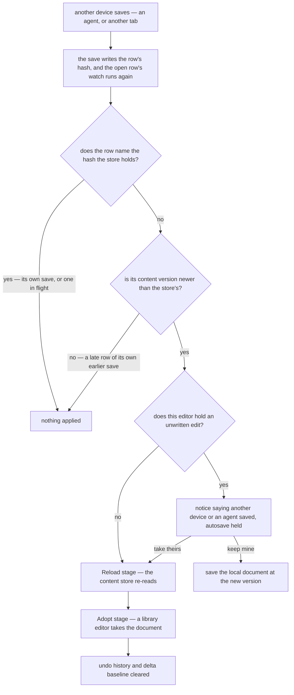

# Live edits

An open editor that does not hear another device's save keeps the version it read, and learns of the other save only when its own is refused as stale. A second tab meets that now and then, and an agent editing a resource the owner has open would meet it on every write. So adoption is generic, for every type, and it helps two tabs as much as an agent.

## One watch for every type

The page that opens a resource reads its row through `resource.readResource`, and that read stays watched on the topics the row names for as long as the page is mounted, so a change to the row runs it again. Every content save writes the row's `contentHash` with the blob it stores, and the write publishes the row's topic once it settles. The watch therefore runs again for every content write, whatever the type and whichever device made it. That watch is the one way another device's save reaches the open editor: no socket event carries a save, and no type keeps a subscription of its own, so a type needs no entry anywhere.

The watch belongs to the page rather than to a blade, and it lasts as long as the page does. The blades of one open resource share its content, so the watch has to outlive any one of them. The store outlives the page, so the watch is held by the page, since a watch held in the store would keep reading a resource nothing shows.

## Adopting by hash

The store holds the hash of the content it read or wrote. Each row the watch brings is compared with that hash, and one of three things follows:

- **The hash is the one the store holds, the row is no newer than the store's content, or a save is in flight.** Nothing is applied. An editor's own save lands here, because the save's reply sets the hash the store holds, so the row the watch re-reads names content the store already has. Quick edits issue saves back to back, and a read answered between two of them can land after the later one, naming the earlier save's hash. Its content version is at or below the one the store confirmed, so it is left alone rather than reloaded over the latest edit: only a newer content version is another writer's. A save still in flight is the store's own: its reply sets the hash, and the row it wrote is left to that reply rather than read back over the edit being saved.
- **The hash differs and the editor holds no unwritten edit.** The store adopts the content through the two stages a restore runs, as [third-party document adapters](../../third-party-document-adapters/design.md) describe. The reload re-reads the row, which brings the content version the store then holds, and each content store re-reads its content through `createContentData`. The adopt stage then hands the document to an editor that holds its own copy, such as Tiptap and the survey's Creator. The blob is read only in this case, so a large Sheet arrives by the [large-documents](../../large-documents/design.md) path rather than over the socket, and one path adopts whatever wrote the blob.
- **The hash differs and the editor holds an unwritten edit.** The store does not overwrite the edit. The notice comes up over the editor, and autosave is held until the person answers, as the next heading describes.

Two things describe a document that is gone, and clear. An editor's undo history clears, as a restore clears it: the Sheet's command history, the page builder's patch history. The [delta content saves](../../../resource/delta-content-saves/design.md) baseline clears too, since it names bytes the server does not hold, so one large save crosses whole before deltas resume.

The TodoList saves each edit as it happens, so it rarely holds an unwritten one, and it re-reads the list on another device's save like any other type.

## Why the guard rides the row, not the blob

The blob key is already a topic, since every content write goes through `writeJsonBlob`, whose `put` the bucket recorder publishes. A watch on the key would be the natural shape, but it cannot carry the guard. A watch collects only the calls a read starts before its first await, so a blob read that follows the row read is never watched. A watch on the key alone would also refetch the whole document on every write, the editor's own save included. The row's watch carries the guard instead, and the hash it compares is the one every content save writes to the row.

## Meeting an unsaved edit

An editor holding an unwritten edit overwrites nothing in either direction. The notice comes the moment the other save lands and says the save was made on another device or by an agent. The row carries no key name, so the notice cannot name the agent, and it does not say which of the two saved. The notice offers two answers:

- **Take theirs** adopts as above and drops the local edit.
- **Keep mine** re-saves the local document through the existing save mutation at the newer version, replacing the other write, which stays in version history.

An edit made while an adoption is already reading the other save's content counts the same: the read does not land over it, and the notice comes up instead, since the opening's [content sync](../../content-sync/design.md) turns an adoption an edit interrupts into a conflict. Until it is answered, the opening sends no save, as after a save refused as stale. After Keep mine, an agent's next pinned patch is stale and it reads again; an unpinned one reapplies over the owner's document under its tests.

The store holds no document, so it cannot write one. Keep mine therefore runs a `Keep` stage on `ResourceContentHookMap`: the store moves the resource to the held save's version and runs the stage, and each content store (`createContentData`) answers by saving the document it holds through its own save, so the write goes through the existing save mutation and the other write stays in version history. Taking theirs runs no stage; it reloads and drops the unwritten edit.

A save the server refuses as stale offers the same choice. The refusal proves another writer moved the version on, so the store reads the row, which names that version, and the notice answers it like any other save that met an unsaved edit. A refresh-only prompt for a refused save is rejected: it dropped the person's edit to resolve a conflict the notice resolves in place.

## Key files

| File                                                       | Role                                                                                                                  |
| ---------------------------------------------------------- | --------------------------------------------------------------------------------------------------------------------- |
| `apps/web/app/composables/resource/useReadOpenResource.ts` | the page's watched read of the open row, which applies each row it brings                                             |
| `apps/web/app/components/Resource/Explorer/Index.vue`      | mounts the held-save notice over the open resource                                                                    |
| `apps/web/app/store/resource/todoList/index.ts`            | re-reads the list on another device's save like any other type                                                        |
| `apps/web/app/store/resource/index.ts`                     | holds the content hash, adopts or holds a row by it, and owns the notice and its answers                              |
| `apps/web/app/services/resource/createContentData.ts`      | its reload stage is the adoption; it registers the `Keep` stage, which saves the document it holds                    |
| `apps/web/app/services/resource/ResourceContentHookMap.ts` | the two stages a restore runs, and the `Keep` stage keep mine runs                                                    |
| `apps/web/app/store/resource/sheet/index.ts`               | its history clears when the content ref is replaced, which adoption does                                              |
| `apps/web/app/components/Resource/OtherSaveNotice.vue`     | the notice over an unwritten edit: says another device or an agent saved, and takes theirs or keeps mine              |
| `apps/web/server/services/resource/saveResourceContent.ts` | writes the blob with the row's `contentHash` and `contentSize`, so the row's watch runs again for every content write |
