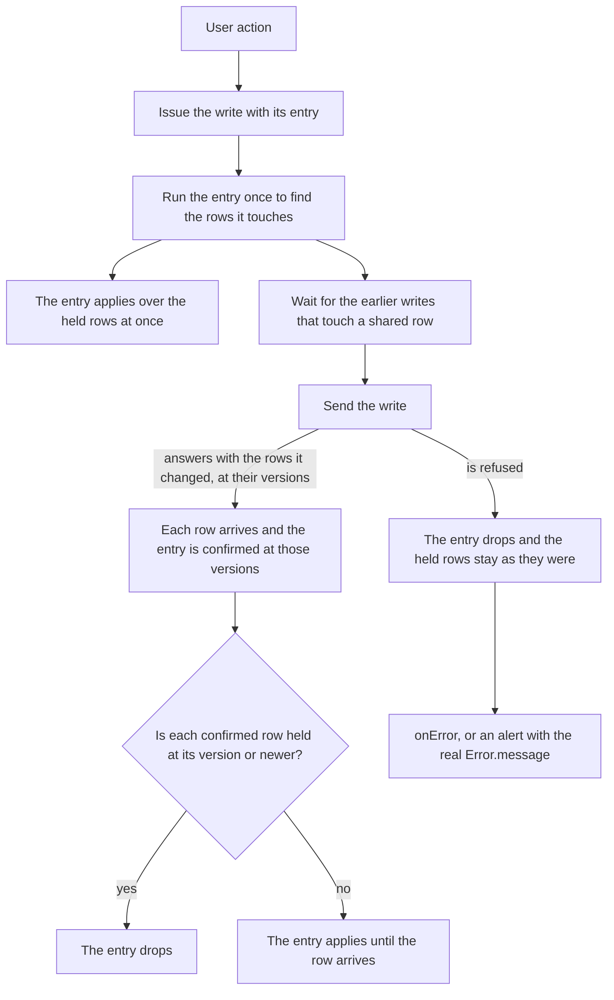

# Async Operations

Every user-facing async operation on the client declares exactly two things: **what it targets** and **whether it reads or writes**. `useMutation` (`apps/web/app/composables/shared/useMutation.ts`) derives the **default** concurrency behaviour from those two facts, and the one opt-in below — `isExclusive` — is the only thing that changes it.

## No call site orders its own async work

**No call site chains promises, holds a map of in-flight promises, or tracks a generation counter, a call id or an `isSaving` flag to order its own async work.** If an ordering is worth having, it belongs in the primitive, keyed by target — and it is already there.

The reason is not tidiness. Protection applied by hand is protection that gets forgotten: a forgotten one silently loses writes or serves stale reads, and a copy that remembers drifts into its own version of the queue, so a fix in one never reaches the others. If a surface seems to need an ordering of its own, it needs the right `key` instead.

## The principle that decides the default

Ask one question of an operation: **does discarding its result lose information?**

- A **read** loses nothing. You asked for the freshest data, a newer read is already on its way, and there is no side effect to unwind. Discarding a superseded response is exactly what you wanted.
- A **write** loses two things. It loses its **error** — the only signal that the value the user is looking at was never persisted — and it loses the **entry** that shows that value, the only thing that takes it back off the screen when the server refuses it.

So the defaults are asymmetric on purpose: **reads are latest-wins per target, writes queue on the rows they touch.** A write is dropped only when a caller says, explicitly, that dropping it is the intent.

## Targets

The `key` is the identity of the thing being operated on, and it is always explicit — the same reason a Pinia store id is. Reads and writes choose it the same way. It is resolved when the operation is **issued**, so the result is applied against the state it was issued for even if the screen has moved on by the time it lands. Choosing one is mechanical:

- **Operation on an existing entity** → its id or natural composite (`input.id`, `` `${userId}-${roleId}` ``).
- **Singleton target** — the current user's settings, the one dataset a composable shows — → the scope's id when one exists, else a stable name (`key: "userSettings"`). Keys are scoped per `useMutation()` instance, so names cannot collide across instances. An overlay write names no key at all: its queue key is the rows its entry touches.
- **Create with no id yet** → a per-call `Symbol("createRoom")`, so independent creates never queue behind each other.
- **Anything the primitive cannot take verbatim** — a key is a `PropertyKey`, and nothing else is accepted — → narrow the source type until it is one, never `String()` it. Stringifying collapses distinct keys onto a single target (`"1,2"` and `[1, 2]` both become `1,2`), which is why `IndexedDbDatabaseSchema` types every index key as a string: an IndexedDB partition is then its own target, unconverted.

Two writes that share a key are two writes to the same thing, and they run one at a time. Two writes with different keys are independent and run concurrently. Note that "same entity" is not the same question as "same value": the Attachments settings panel writes a maximum file size and a list of allowed types through one `key: room.id`, because both are writes to that room — but neither replaces the other, so both must land.

Reads and writes never share a queue, even on one key: a read waits for nobody.

## Writes queue by the rows they touch

**An overlay write queues on the rows its entry touches, across the app.** The registry (`apps/web/app/store/overlay.ts`) runs the entry once against a recording view when the write is issued. The rows the entry reads or writes are the write's touched keys, and the write waits for every earlier write whose touched keys overlap its own. Writes on unrelated rows run at once, in any store, so no two stores serialise each other. The queue is one per registry, which is one per app (`createWriteQueue`).

Touches are found by running the entry, not by naming a key, so the writer cannot forget one. The entry has to read a row another write changes to wait behind that write, since a read counts as a touch as well as a write. Two entries that read the same row therefore run one at a time; a write that reads no row another write touches runs at once.

**An awaited overlay write takes no key.** A write whose result the screen waits for has no entry, so nothing on screen is ordered against it and no key can be inferred. Its answer's rows arrive through the version gate, which orders two answers for one row by their versions, so the higher version holds whatever order the answers arrive in.

**A key queues only within one `useMutation()` instance.** The writers that have not moved onto the overlay still queue on a key, and that queue is state on the instance, not on the key. Two instances keyed on the same target therefore run concurrently while their call sites read as if they serialised. The failure mode is silent, because the key is right and the ordering it promises never existed. Writes that end the same row should therefore share one instance, held where every call site reaches it, and writes that own different fields of one entity keep their own. The test for sharing is whether one write's rollback could undo another write's landed change. The overlay has no such rollback, so its writes need no shared instance.

## The state an operation writes back is bound where the key is

The `key` is not the only thing an operation resolves when it is issued. **Every per-key slice an operation writes back is resolved at the same moment, never at the moment the response lands.** A store that keys state by the room, the tab or the post exposes that state twice: a current-key ref, which is what the rendered surface binds because it must track whatever is on screen, and a **binder** — `useDataMap`'s `getBoundData()` — which pins the key as it is right now and hands back a ref that keeps writing there. An operation takes the binder.

`useCursorPaginationDataMap` hands its operation-data composable that binder, so `readItems` / `readMoreItems` file their rows under the key the read was issued for with nothing at the call site. Anything else the same read writes back — a total, a page number, a per-role breakdown — is bound the same way, **before the read's first await**, and so is any plain value the response is interpreted against (which tab was open, which filters were applied). A read composable that calls `getBoundCount()` at the top of its query and writes `boundCount.value` after it is the shape; reading a current-key ref after an await is the defect, and it does not announce itself — the result simply appears under whatever the user switched to.

The same rule decides what a **subscription** may apply. A subscription spans every entity the client is interested in, so its payload carries the key the event happened under and the handler takes it as a parameter (`arriveLeftMember(leftMember)`, whose row names its room). A handler that resolves the key itself can only resolve the one on screen, which is the wrong one for every event that did not happen there.

## Reads — `executeQuery`

`executeQuery(query, { isExclusive, key, onError, onSuccess, runScope })` is latest-wins for its key, through the run scope its caller holds: a newer read of the key aborts the one before it, and only the newest run commits its answer and its topic watch. A superseded read never runs `onSuccess`, never runs `onError`, and never alerts — it reports `Dropped` and stays silent, because a race it lost is not something the user needs to hear about. Reads for one key otherwise run concurrently, so a slow response can never overwrite a fast one issued after it.

One opt-in narrows this:

- **`isExclusive`** — single-flight. While an `isExclusive` read with the same key is in flight, a second `isExclusive` caller issues no request of its own: it **joins** that call and resolves with its outcome. Its own `onSuccess`/`onError` do not run — the call it joined already applied the state and reported — so a joiner of a call that succeeded finds the data it asked for in the store. For the fan-out reads that every instance of a surface issues on mount: one favourites set behind a list, a blade and Home, or one room's follow state behind every follow button in it.

  **Only a call that passed the flag is joinable, so a key's reads flag all or none.** A plain read publishes nothing to join, and every read — flagged or not — supersedes whatever was joinable and takes its place. So one unflagged read on a key the rest of the surface flags costs two round trips instead of one, and the joiners of the call it superseded resolve `Dropped` over a store that read never wrote — an empty list beside a populated one, which is the outcome the flag exists to prevent. The exception below is the one place a key deliberately mixes.

A joined read is never dropped by its own caller's choice. Dropping is right for a write, whose caller wanted an effect that is already happening, and wrong for a read, whose caller wanted the data — a caller handed nothing renders an empty list beside a populated one. The one way a joiner ends `Dropped` is the case above, when a later read superseded the call it joined.

Two things `isExclusive` deliberately does **not** do:

- **It does not cache.** Only a read still in flight can be joined, so read-once-per-session and read-once-per-room are a caching concern, not a concurrency one — they belong to `useCachedRead`, which layers its gate on top of this rather than replacing it. See [caching](../caching/design.md).
- **It does not apply to an invalidating re-read.** A read issued _because_ something changed must not join the answer that the change just invalidated, so a cache's `refetch` re-reads without it and wins on latest-wins instead.

`isPending` doubles as the loading flag for a read composable — `useQuery` hands it back alongside `data` — so no composable keeps its own `isLoading` ref.

## Writes — the overlay and `executeMutation`

The overlay writes described above are the path for every store that has moved. `executeMutation(mutate, { applyOptimistic, isExclusive, key, onError, reconcile })` is the path of the writers that have not moved yet, and its rules are these.

`executeMutation` queues per key, and returns nothing: its promise floats through `getSynchronizedFunction`, so `waitForSynchronizedFunctions()` drains it with every other fire-and-forget. The awaited form takes `awaitedBecause` and `onSuccess` in place of `reconcile`, and resolves to its outcome ([client data](../client-data/design.md#optimistic-by-default)). `applyOptimistic` runs when the write is **sent**, not when it was issued, so its snapshot reflects whatever the write ahead of it stored. For the same reason, a write that reads a version token or resolves a create-or-update branch does that **inside** `mutate`, not before the call.

One opt-in narrows this, and nothing else does:

- **`isExclusive`** — single-flight. While any call with the same key is pending — a read in flight, or a write queued or in flight — the call is **dropped** outright: nothing fires, nothing is queued, and the caller gets `Dropped`. For non-idempotent creates that must never double-fire, like `createLike`.

Everything else queues. If a write is worth issuing, it is worth landing.

### A snapshot-then-compare sequence keeps the ids it has handled

The split above is about **outcomes**, not about HTTP verbs. A read loses nothing when it is discarded, but a read that snapshots state before it fires and acts on the difference afterwards holds a value across its own await, and two of them interleaved both snapshot the same "before".

The bell is the case. A delivered push reads the first page again and toasts each row the read brought that the tab did not hold before it. Two pushes that overlap would both compare against the list they began with, and each would toast the row the other brought back. So the store keeps the ids it has toasted, and it toasts each id once (`apps/web/app/store/notification.ts`). No queue orders the comparison. The set is what makes the second push skip the row.

`isExclusive` would collapse the duplicate by joining the read in flight, but it would also drop any row written after that read was issued, which is exactly the row the second push was announcing. A set of toasted ids keeps both properties: one toast per row, and every push still causes a read of its own.

## The two opt-ins at a glance

| Opt-in        | On a read                                                         | On a write                          |
| ------------- | ----------------------------------------------------------------- | ----------------------------------- |
| `isExclusive` | Joins another `isExclusive` call in flight and shares its outcome | Drops the duplicate — nothing fires |

## Outcomes

The operation's own rejection never escapes: a read and an awaited write resolve to an outcome discriminated on `MutationStatus`, which is the only signal a call did not land. An optimistic write hands its caller nothing, so its outcome is the alert's alone.

A **callback** is the exception. A throw from `applyOptimistic`, from the rollback it returns, or from `onSuccess`/`reconcile`/`onError` on `executeMutation` rejects the promise the entry point returned, and nothing catches it — the pending bookkeeping still unwinds, but the caller gets a rejection instead of an outcome, and a caller that stored the promise without a rejection handler gets an unhandled rejection. A callback body that can fail therefore produces its own result rather than throwing.

| Status      | For a read                                                                                                                       | For a write                                                                                  |
| ----------- | -------------------------------------------------------------------------------------------------------------------------------- | -------------------------------------------------------------------------------------------- |
| `Succeeded` | Fetched while still the latest for its target — carries the data, which `onSuccess` has already applied                          | Persisted — carries the server-authoritative result                                          |
| `Failed`    | Rejected while still the latest. Nothing was applied, so nothing is unwound, and the error is reported or alerted                | Rejected. The write's entry has been dropped and the error reported or alerted by this point |
| `Dropped`   | Superseded by a newer read of the same key before it committed. Silent — no callbacks, no alert, whether it resolved or rejected | With `isExclusive`, behind an in-flight sibling. Never sent                                  |

A joined read reports the outcome of the call it joined — failures and `Dropped` included, so a joiner resolves `Dropped` when a later read superseded the call it was waiting on.

## Read lifecycle

```mermaid
flowchart TD
  Need[Surface needs data] --> Exclusive{isExclusive and an isExclusive read for this key still in flight?}
  Exclusive -->|yes| Join[Join it — no request is issued]
  Exclusive -->|no| Bind[Bind to the target key, claim latest-for-target, drop whatever was joinable]
  Join --> Shared[Resolve with that call's outcome — Dropped if a later read superseded it]
  Bind --> Send[Send the read]
  Send -->|resolves| Superseded{Superseded by a newer read?}
  Send -->|rejects| Lost{Superseded by a newer read?}
  Superseded -->|no| Success[onSuccess with the fetched data]
  Superseded -->|yes| Discard[Dropped — discard the older response]
  Lost -->|no| Report[onError, or an alert with the real Error.message]
  Lost -->|yes| Silent[Dropped — silent, nothing was applied]
  Success --> Store[(Store)]
```

## Write lifecycle

## Key files

| File                                                           | Role                                                                                                                   |
| -------------------------------------------------------------- | ---------------------------------------------------------------------------------------------------------------------- |
| `apps/web/app/store/overlay.ts`                                | The overlay registry: the write queue by touched rows, the entries, the arrival gate and the view                      |
| `apps/web/app/services/shared/overlay/createWriteQueue.ts`     | The queue a write waits in behind the earlier writes whose touched rows overlap its own                                |
| `apps/web/app/services/shared/overlay/recordTouches.ts`        | The one run of an entry that finds the rows it touches, so the queue needs no key from the writer                      |
| `apps/web/app/composables/shared/useMutation.ts`               | The write primitive for the writers not yet on the overlay, and `executeQuery`, the read primitive for every live read |
| `apps/web/app/composables/shared/useRunScope.ts`               | The run scope a read or a local run is ordered by: a newer run of a key aborts the one before it                       |
| `apps/web/app/models/shared/MutationStatus.ts`                 | The outcomes a call can settle to                                                                                      |
| `packages/shared/src/util/function/getSynchronizedFunction.ts` | Fires an async operation from a sync callback slot                                                                     |

## Notes

- **Not only tRPC.** Both entry points take a plain `() => Promise<T>`, so an IndexedDB write or any other local async work is ordered the same way — `usePaginationCache` keys its cache writes on the partition, so one partition's rewrites run in order while another partition's never wait behind them.
- **A guard is handed to you, never built.** A task that has to check mid-flight — a multi-step local media switch — is run by a run scope, which hands it the run's abort signal. It checks that signal and never tracks whether it is still the latest for its key itself.
- **Latest-wins is per target, so a switch away still needs its own check.** A read whose target moved on entirely — the room changed while IndexedDB answered — was never superseded, because the new read has a different key. Re-check the source after the await and bail.
- **Latest-wins protects state, and a read that forwards its signal protects the server too.** A superseded run aborts the signal it handed its read, so a read that passes that signal to its request, as `useDataset` does with `readDataset`, cancels the request. A read that does not still sends its request, and only its answer is discarded. Preventing a second trigger while the first is in flight belongs to the surface — see [in-flight guarding](../client-data/design.md#in-flight-guarding).
- **Search-as-you-type cancels the way a signal-forwarding read does.** `useAutoSearch` (see [Search](../search/design.md)) cancels the superseded request with an `AbortController` instead of ignoring its response, which is the cancellation a read gets by forwarding the signal it is handed.
