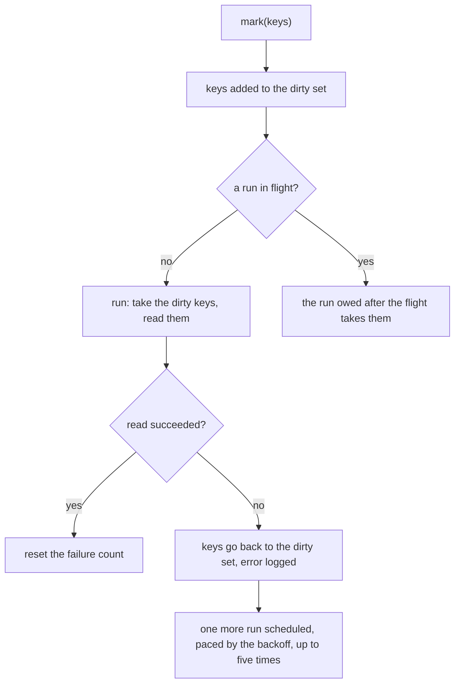

# Batched Refresh

A value the server derives from many rows is re-read, never moved by the client. A re-read is cheap to batch, and a batch read through one owner cannot race itself, so the primitive that does it is one: `createBatchedRefresh` in `apps/web/app/services/shared/createBatchedRefresh.ts`. Its owner passes a function that re-reads a list of keys, and gets back a function that marks keys as changed and runs the re-read.

## The contract

A run takes every key marked before it starts, so a batch is one read. Runs do not overlap: a mark made during a run is read by the run owed after it, and the run that finishes last is always the newest. A run with no dirty keys makes no read.

The caller that starts a flight awaits the run owed after it, and so does every call made while the flight is in progress: they all join that one run, so each settles only once the newest value is in. A mark made during a run is never answered with a value the run owed after it has not read.

## Failure

A run that fails puts its keys back in the dirty set and logs the error, so the next mark reads them again. It also schedules one more run without a mark, paced by the backoff from [retry and backoff](../retry-and-backoff/design.md). A success resets the count. After five retries in a row the keys stay dirty until the next mark, so a server that stays down is not asked forever. The wait does not reset when the retries stop: the next mark's read runs only after the backoff's last wait, the thirty-second maximum, so a server that recovered is read within that window rather than at once.

The primitive never rejects. Its callers do not need to wrap a call in a result, because the failure is already logged and retried.

## Owners

- **Post counts.** `usePostCountStore` is the one owner of the post counts the server keeps. A write that changes a count, a reply, a removal or an edit's response, reads the counts back through it. The read is applied to every copy the stores hold through `postCountHooks`, so one read reaches the feed and the thread.
- **Room member totals.** `useMemberStore` owns the member count and the per-role groups of each room, and re-reads them on every role-membership write and every join or leave.

A new owner is a new store with its own `createBatchedRefresh`, and it is the decision of the surface that holds the copies. Two owners of the same copies would order their reads against each other, so a value with copies in more than one store has one owner, and the owner applies the read through a hook.

## Write paths that bring a copy back

A write that brings a copy from the server's response takes its counts from a read, not from the response, because a response is as old as the moment the server answered it. A rejected delete restores the copy it removed, and the restored copy reads its count back, because a count that moved while it was out of the list reached no copy.
