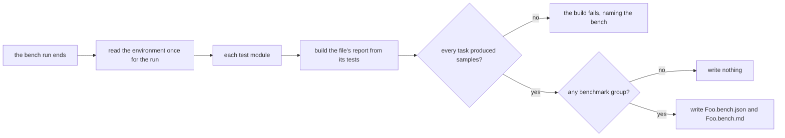

# Benchmark Reporting

Each `*.bench.ts` file that a Vitest run executes leaves two committed artifacts beside it, `*.bench.json` and `*.bench.md`. The reporter in `@esposter/shared-node/reporter` writes them when the run ends. The Markdown holds one table per benchmarked test, ranked fastest first against a baseline, under an environment block that names the host and the commit. The rules are the requirements in [the spec](spec.md).

## How it works

Vitest calls the reporter once with every test module the run executed. The environment is read once for the whole run, and each module's tests are projected into a report that holds one file. A module with no benchmark groups writes nothing, so a shared helper with no benches of its own leaves no files behind. A task with no samples is a bench that threw on every iteration, and its build stops before any artifact is written.

## Projection and writing

A benchmark lives inside a test, so the group is the test, named by its full name. A test that ran more than one comparison names each group after its comparison as well, so two tables never share a heading. Tasks are ordered by the rank Vitest reports, which keeps a file's rows in the same order from run to run.

The JSON is the report as recorded. Its file path is the module's path relative to its project, so no home directory reaches a committed file. The Markdown comes from `formatBenchmarkMarkdown`. A failed write of either file is raised with the path in the error. A `*.platform.bench.ts` source writes files suffixed with the platform name, so each host updates only its own pair.

## Rendering

The Markdown opens with a fixed note on how to read the tables, then an Environment section carrying the block, then one section per group. Each section is a table with the columns task, vs base, mean (ms), ±rme, p99 (ms) and samples. The vs base column divides the baseline's mean by the task's mean. The baseline is the task named by `BASELINE_TASK_NAME` when the group has one, and otherwise its fastest task. A ratio of one or more prints with two decimals, and a smaller one with two significant digits, so a much slower task keeps its precision. Columns are padded to equal width, so a generated file already has the shape the formatter would give it. Pipes in a benchmark name are escaped so the name stays in its cell.

The environment block comes from `readBenchmarkEnvironment`. It holds the commit from `git rev-parse --short HEAD` (or `unknown` outside a checkout), the node version, the platform, release and architecture, the CPU model with the padding some platforms add trimmed, the core count, and the memory in GiB.

## Run options and wiring

`BENCHMARK_RUN_OPTIONS`, exported from `@esposter/shared-node/bench`, zeroes both time budgets and names the iteration counts. A bench passes it as the last argument to `bench.compare`, so the sample count is a property of the bench rather than of the host it ran on. The counts and the reasoning sit beside the constant.

`getBenchmarkReporters` in `packages/configuration` adds the reporter's path string to Vitest's reporters, and only when the Vitest subcommand is `bench`. The path is a string rather than an import because `configuration` builds before this package. `default` comes first, because naming reporters replaces Vitest's default list, and the default is what prints the terminal table.

## Notes

- The reports are committed and read in review, not gated in CI. The Bench workflow in `.github/workflows/Bench.yaml` runs every bench on each push to prove each still executes, and it commits nothing. Thresholds are the `bench` skill's to set.
- Every bench file must commit its report pair. `scripts/src/workspace/benchArtifacts.test.ts` fails a bench that does not, and a file that only declares `describe.todo` beside shared code is exempt.
- The bundle-size snapshots in `packages/shared-node/src/index.test.ts` are the package's size gate. They measure the bench and reporter entrypoints, since the reporter is the one that a Vitest run loads.
- A committed number is only comparable within one host, which is why the environment block travels with it.

## Key files

| File                                                                 | Role                                                                   |
| -------------------------------------------------------------------- | ---------------------------------------------------------------------- |
| `packages/shared-node/src/services/BenchmarkMarkdownReporter.ts`     | the reporter Vitest loads, exported by default at the reporter subpath |
| `packages/shared-node/src/services/buildBenchmarkFileReport.ts`      | turns one file's tests into groups of tasks                            |
| `packages/shared-node/src/services/buildBenchmarkFileReport.test.ts` | the tests whose titles are the projection scenarios                    |
| `packages/shared-node/src/services/formatBenchmarkMarkdown.ts`       | renders the report as Markdown tables                                  |
| `packages/shared-node/src/services/formatBenchmarkMarkdown.test.ts`  | the tests whose titles are the rendering scenarios                     |
| `packages/shared-node/src/services/writeBenchmarkReport.ts`          | writes the JSON and Markdown reports beside the source                 |
| `packages/shared-node/src/services/readBenchmarkEnvironment.ts`      | records the machine and checkout a run used                            |
| `packages/shared-node/src/services/constants.ts`                     | the run options and the baseline task's name                           |
| `packages/shared-node/src/index.test.ts`                             | the bundle-size snapshots that gate the package's size                 |
| `packages/configuration/src/services/getBenchmarkReporters.ts`       | adds the reporter only when Vitest runs bench                          |
| `scripts/src/workspace/benchArtifacts.test.ts`                       | every bench must commit its report pair                                |
