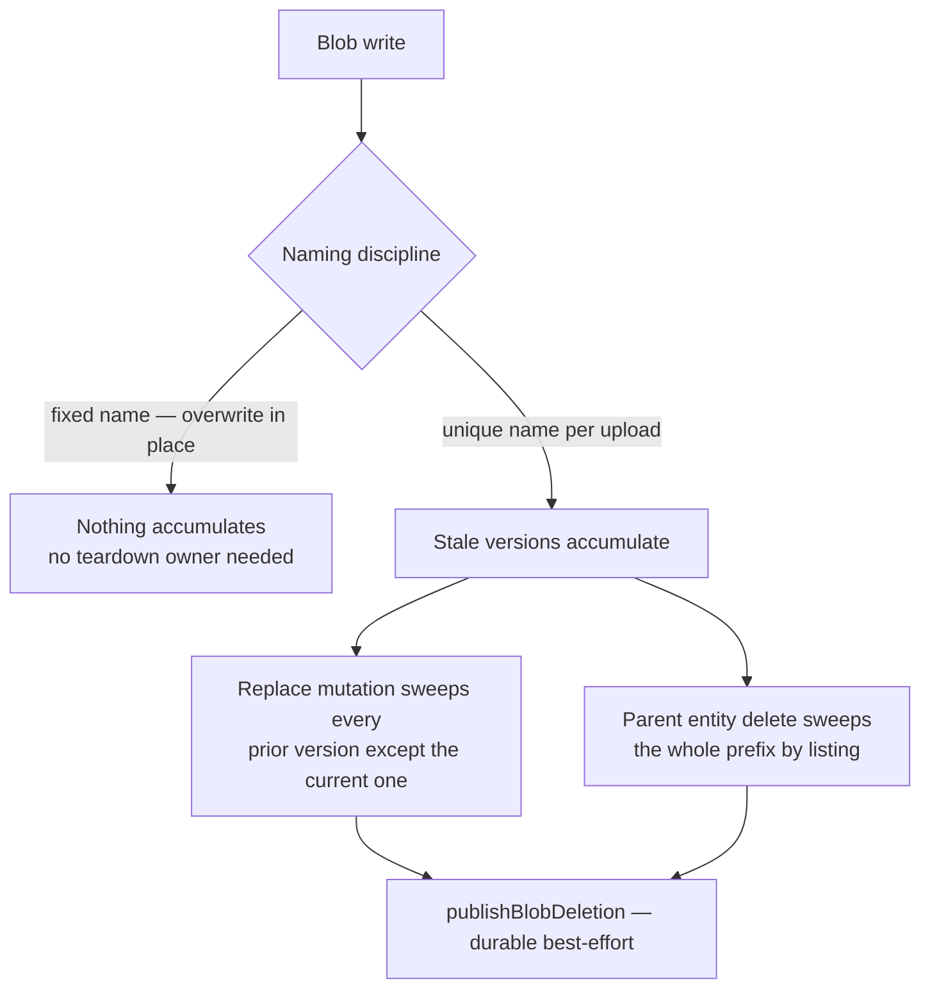

# Blob Lifecycle Ownership

Which mutations tear down which blobs is decided **here**, once — not re-derived per feature or per review. Every user-written blob prefix appears in the table below with its naming discipline and the mutations that sweep it. A new blob write is not complete until it has a row; a delete-path mutation is not complete until it covers every row keyed by the entity it deletes.

## Naming decides teardown

- **Fixed name, overwritten in place** — one blob per slot, replaced by the next upload. Nothing accumulates, so no mutation owns a sweep.
- **Unique name per upload** — chosen where overwrite-in-place would race (a delayed cleanup could delete a concurrent re-upload) or where snapshots must be immutable. The cost of uniqueness is that stale versions accumulate, so **both** the replace path and the parent-delete path must sweep them.

Every sweep goes through a durable publisher — `publishBlobDeletion` for a set of named blobs, `publishBlobPrefixDeletion` for a whole prefix — the best-effort escalation of [persist then notify](../persist-then-notify/design.md). Inline `deleteIfExists` calls at mutation sites are banned; a parent-entity sweep lists the prefix inside the publish thunk rather than reconstructing blob names it cannot know.

## Who may name a blob for deletion

A sweep that walks a persisted entity is authorized by that entity — `deleteMessage` reads the message's own `files`, so the caller can only ever name what the guard already let them delete. **A delete whose blob names come from the request body has no such backing**, and room membership is not a substitute: an unreferenced composer upload and a posted attachment share one `{roomId}/…` namespace, and every member receives every attachment's `id` and `filename` on the wire. Membership alone therefore lets any member permanently destroy any other member's posted files, leaving no entity that records it happened.

So a client-named delete carries proof of the grant that created the blob. `message.generateUploadFileSasEntities` mints `createUploadFileToken(userId, roomId, id)` — an HMAC over the grant, keyed by the app secret — beside each presigned write URL, and `message.deleteUploadFiles` rejects the whole request unless every file's token verifies for the calling user (`checkIsUploadFileTokenValid`, compared with `timingSafeEqual`). Only the member the write target was minted for holds it, so knowing an id buys nothing. The consequence is accepted deliberately: **a composer that loses its tokens (a reload mid-upload) can no longer reclaim those blobs**, and they stay until the room is deleted — the alternative is a delete anyone in the room can aim at anyone else.

The grant **expires with the presigned write URL it was minted beside** (`WRITE_SAS_DURATION_MS`), and the expiry is signed with the rest of the token so it cannot be edited. That bounds the window rather than closing it: the token is a timer, not a reference check, so within that hour it still authorizes deleting a blob the member has since attached to a sent message — which leaves that message listing an attachment nobody can download. Bounding it is the accepted trade, because the alternative is a per-delete scan of the room's message table on a path whose whole purpose is reclaiming bytes nothing references. Do not read the expiry as "the grant dies once the upload lands"; nothing observes that event.

Nothing is added to the namespace to make this checkable — the token is the check. A new client-named delete path either carries a grant token or does not ship.

## A name from the request body is one segment, never a path

The grant authorizes _which_ blob, not _what it is called_. Blob names are assembled by interpolation, and a presigned URL is built by parsing the key as a URL path, which normalizes `..` away — so a caller-supplied `filename` or `blobPath` carrying a separator or a dot segment walks the delete straight out of the prefix the grant covered, and out of the bucket. Every client-supplied piece of a blob name is therefore constrained to a single separator-free, non-dot segment at its schema (`BLOB_SEGMENT_REGEX` on `fileEntitySchema.filename` and on resource `deleteFile`'s `blobPath`), which covers the upload's presigned write target and every delete that names the file in one place.

The same applies to a name reconstructed from a **stored** column: `roomsInMessage.image` is free text, so `updateRoom`'s sweep never derives a delete target from it at all. It deletes only names its own listing produced (`listRoomProfileImageBlobNames`, over the prefix from `getRoomProfileImageBlobPrefix`), and reads the column solely to _exclude_ the current image from that set. Round-tripping a value through the database does not make it ours.

## Prefix deletions are bounded twice

`publishBlobPrefixDeletion` exists for a set the request path cannot afford to enumerate (a room's whole attachment directory), so the handler lists it at delivery time instead. Delivery is at-least-once, and a retry can arrive hours after the publish, which makes the delivery-time listing a different set from the one the publisher decided on:

- **Bounded in time, when the prefix has a future.** The publisher stamps `createdBefore: new Date()` into the event and the handler passes it to `listBlobNames`. Without it, a redelivered unpublish deletes the snapshot of a _republish_ that happened in between — the publication row still says published, and every asset 404s. Named-blob events carry no timestamp because their set was fixed when they were published. Every caller states the bound explicitly (`publishBlobPrefixDeletion`'s `createdBefore` has no default), because the room-deletion sweep is the one that must **omit** it: the room row is gone, so no writer can ever re-own `MessageAssets/{roomId}/` for a replay to destroy, and this is that prefix's only teardown — a cutoff would permanently strand any attachment whose presigned write URL was still live when the owner deleted, billed and downloadable with no later sweep to reach it.
- **Bounded in width.** The deletes go out in waves of `MAX_CONCURRENT_BLOB_DELETIONS` rather than one `Promise.all` over the whole listing. A room with tens of thousands of attachments would otherwise fire that many simultaneous deletes: the storage API throttles a fan-out that size, one rejection fails the batch, and the redelivery repeats the same fan-out, so the blobs are never actually deleted. A key already gone is not an error on R2's `delete`, so a replay converges instead of failing on what the first attempt removed. `deleteDirectory` carries its own width bound for the same reason in a different shape: `deleteBlobs` sends the listing in requests of `MAX_DELETE_KEYS_PER_REQUEST` keys, each sent after the one before it lands, rather than handing the whole listing to one call.

## Resource files are named by their content

A file under `{id}/files/` is named by the SHA-256 of its bytes ([content-addressed assets](../../resource/content-addressed-assets/design.md)), so a name holds the same bytes wherever it is written. A duplicate writes its copies to the destination's own names and skips any name the destination already holds. No other path rebuilds a file's name from a source.

## A sweep runs only on a real replacement

The replace-path sweep fires on a **changed** value, never on the field merely being present in the input. `updateRoom` compares the submitted `image` against the row it read moments earlier and does nothing when they match — otherwise a save that only renamed the room puts two blob listings on the request path to drop nothing.

That comparison alone does not decide which blobs are safe, because the submitted url is whatever the form loaded with: when another admin uploaded in between, it is a **stale** url and the sweep runs against a row the caller never saw. So **the age filter is the whole rule, and nothing bypasses it** — the sweep deletes only versions older than `WRITE_SAS_DURATION_MS`, never the version the row is dropping just because it is being dropped. That value is exactly the one that can name the other admin's seconds-old avatar, and deleting it leaves the room pointing at a blob nobody can restore. The accepted cost: an avatar replaced twice inside that window leaves the intermediate blob until the next image change (or `deleteRoom`) collects it — the same deferral every other in-flight upload gets.

## The ownership table

Every bucket is private unless its name starts with `public-`, so a row's bucket says who can read it, and per-user data never goes in a public bucket.

| Blob (bucket · prefix)                                     | Naming             | Written by                                                                   | Torn down by                                                                                                                                                                                                                                             |
| ---------------------------------------------------------- | ------------------ | ---------------------------------------------------------------------------- | -------------------------------------------------------------------------------------------------------------------------------------------------------------------------------------------------------------------------------------------------------- |
| `MessageAssets` · `{roomId}/…` files + thumbnails          | unique per upload  | message attachment upload                                                    | `message.deleteFile` (one file + its thumbnail), `deleteMessage` (all the message's files + thumbnails), `deleteUploadFiles` (a composer revert, grant-token authorized), `deleteRoom` (whole `{roomId}/` prefix)                                        |
| `PublicUserAssets` · `rooms/{roomId}/ProfileImage/{uuid}`  | unique per upload  | room `generateProfileImageUploadUrl`                                         | `updateRoom` on image change, under the replace-path rule above, `deleteRoom` (whole prefix)                                                                                                                                                             |
| `PublicGenshinAssets` · `<dataset>/{sha256}.json`          | content-addressed  | `genshin:assets` publish (create-only, both accounts)                        | `genshin:data prune`: no live lock reaches it and it is older than 90 days                                                                                                                                                                               |
| `PublicGenshinAssets` · `characterPacks/{avatarId}/{path}` | fixed, overwritten | `genshin:assets character-packs` publish (replaces in place, both accounts)  | none — overwrite in place; a file a pack drops is not unpublished, and prune never names it (it reaches only game data datasets)                                                                                                                         |
| `PublicUserAssets` · `{userId}/ProfileImage`               | fixed, overwritten | user `generateProfileImageUploadUrl`                                         | `DeleteOrphanedProfileImage` on the blob's own event once its account is gone; replace overwrites the single blob otherwise                                                                                                                              |
| `ResourceAssets` · `{id}/files/{sha256}`                   | content-addressed  | resource asset upload (create-only), duplicate's copy (`cloneContentAssets`) | `releaseResourceAssets` (a file no version row or working-copy row names, outside the grace window; from `deleteFile`, an eviction, an unpublish, a rewritten version or a save that drops working-copy rows), `purgeResource` (whole `{id}/` directory) |
| `ResourceAssets` · `{id}/objects/{hash}`                   | content-addressed  | `writeSnapshotVersion` (a publish or a revision take), create-only           | `collectSnapshotObjects` (an eviction or an unpublish, only what no version row still names), `purgeResource`                                                                                                                                            |
| `ResourceAssets` · `{id}/content.json`                     | fixed, overwritten | `saveResourceContent`                                                        | `purgeResource`                                                                                                                                                                                                                                          |
| `ClickerAssets` · `{userId}/save.json`                     | fixed, overwritten | game save writes                                                             | none — overwrite in place                                                                                                                                                                                                                                |
| `UserAssets` · `{userId}/save.json`                        | fixed, overwritten | game save writes                                                             | none — overwrite in place                                                                                                                                                                                                                                |

Soft-deleting a resource deliberately keeps every `ResourceAssets` blob — restore must hand back a whole resource, so `purgeResource` is the only sweep of the `{id}/` directory ([recycle bin](../../resource/recycle-bin/design.md)).

## Notes

- A profile image that lands after its account is gone is deleted by its own object-create event (`DeleteOrphanedProfileImage`), not by a sweep. The age filter guards a listing that could catch a blob another upload is still writing; a landing whose account is gone has nothing left to protect, and every later landing is checked the same way. The notification that feeds the job is declared with its bucket in Pulumi, and a delivery that fails past its retries waits in the job's dead-letter queue ([Cloudflare services](../cloudflare-services/design.md)).
- A job's dead-letter queue is not user data: it holds what failed past the job's retries, and no mutation sweeps it ([Cloudflare services](../cloudflare-services/design.md)).
