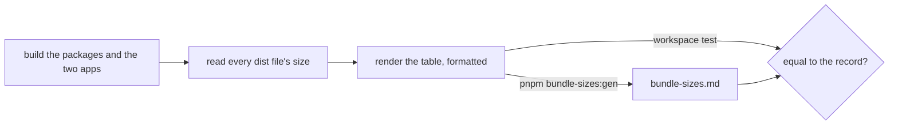

# Bundle sizes

`bundle-sizes.md` at the repository root is the committed size of everything the workspace builds. `pnpm bundle-sizes:gen` writes it from the built `dist/` folders, and `scripts/src/workspace/bundleSizes.test.ts` fails when a fresh build differs from it.

## Decisions

- **The size is the record, and the test only holds the record to a build.** A review reads exact bytes in the diff of one file, shrinks included, where a ceiling in each package's test saw growth past a number and nothing else. Rejected: [a ceiling per file](../../../rejected/architecture/bundle-size-ceilings/design.md), and before it [a quantised band](../../../rejected/architecture/bundle-size-bands/design.md).
- **One record, not one per package or platform.** The builds are byte-identical on Windows and Linux and from any checkout folder, so a single file serves every machine and CI.
- **A chunk's content hash is masked in its name.** The hash changes with the very size being recorded, so a chunk that grew would read as one file removed and another added. The row's name is the file with its hash as `[hash]`.
- **The record is committed as the formatter writes it.** The table passes through the repository formatter, so `format:check` has nothing to say about it and the test compares the rendered text.
- **The largest file is first.** The point of the record is where the bytes are, so the rows run from the largest file down, and a tie falls in package and file order so the order depends on the build alone.
- **The total is a line under the table**, in bytes, KiB and MiB.

## Key files

| Path                                                    | Role                                                 |
| :------------------------------------------------------ | :--------------------------------------------------- |
| `bundle-sizes.md`                                       | the record                                           |
| `scripts/src/bundleSizes/index.ts`                      | `pnpm bundle-sizes:gen`                              |
| `scripts/src/services/bundleSizes/readBundleSizes.ts`   | every built package's files and sizes, hashes masked |
| `scripts/src/services/bundleSizes/renderBundleSizes.ts` | the formatted table and its total                    |
| `scripts/src/services/bundleSizes/constants.ts`         | the record's name                                    |
| `scripts/src/workspace/bundleSizes.test.ts`             | holds the record to a fresh build                    |

## Notes

- The record reads `dist/`, so it is checked after the packages and the two apps are built, as the size tests were. A built package with no `dist` fails the read rather than dropping out of the record.
- A change that moves a bundle regenerates the record in the same commit: `vp run build:packages`, then `pnpm -C apps/functions build` and `pnpm -C apps/infra build`, then `pnpm bundle-sizes:gen`. The `build` skill's `references/dist-size.md` says what to read before a size is accepted.
