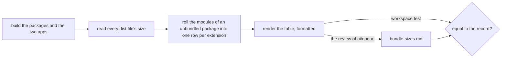

# Bundle sizes

`bundle-sizes.md` at the repository root is the committed size of everything the workspace builds. The review of `ai/queue` writes it from the Linux build of the queue's tip (`openspec/specs/infra/review/design.md`, "The bundle-size record"), and `scripts/src/workspace/bundleSizes.test.ts` fails on `main` when a fresh build differs from it.

## Decisions

- **The size is the record, and the test only holds the record to a build.** A review reads exact bytes in the diff of one file, shrinks included, where a ceiling in each package's test saw growth past a number and nothing else. Rejected: [a ceiling per file](../../../rejected/architecture/bundle-size-ceilings/design.md), and before it [a quantised band](../../../rejected/architecture/bundle-size-bands/design.md).
- **One record, not one per package or platform.** The builds are byte-identical from any checkout folder, and on Windows and Linux alike but for `genshin-world`, so a single file serves every machine and CI, and it is the Linux build's.
- **The modules of an unbundled package are one row per extension.** A package builds one file per source module, which would put a row in the record for every module and bury the packages whose total moved. A file nested under `dist` is a module, so the modules of one package and extension share a row named `**/*` and the extension (`**/*.js`, `**/*.d.ts`, `**/*.css`), and a file at the root of `dist`, an entry, keeps its own row. A module added or removed moves its package's row, and the diff shows it.
- **A chunk's content hash is masked in its name.** The hash changes with the very size being recorded, so a chunk that grew would read as one file removed and another added. The row's name is the file with its hash as `[hash]`.
- **The review writes it, from the Linux build of the queue's tip.** The one writer is the review, which builds the tip it commits onto, so the record is the Linux build's and a session never copies a size from a local build or from CI's diff. A record commit's body lists every row that moved, and the growth a reader checks is read there, not in a session's diff. Rejected: a session regenerating the record, which goes stale while it lands (the review's decisions say why).
- **The record is committed as the formatter writes it.** The table passes through the repository formatter, so `format:check` has nothing to say about it and the test compares the rendered text.
- **The largest file is first.** The point of the record is where the bytes are, so the rows run from the largest file down, and a tie falls in package and file order so the order depends on the build alone.
- **The total is a line under the table**, in bytes, KiB and MiB.

## Key files

| Path                                                          | Role                                                   |
| :------------------------------------------------------------ | :----------------------------------------------------- |
| `bundle-sizes.md`                                             | the record                                             |
| `scripts/src/bundleSizes/index.ts`                            | `pnpm bundle-sizes:gen`                                |
| `scripts/src/services/bundleSizes/readBundleSizes.ts`         | every built package's files and sizes, hashes masked   |
| `scripts/src/services/bundleSizes/rollUpBundleSizes.ts`       | the modules of one package and extension as one row    |
| `scripts/src/services/bundleSizes/renderBundleSizes.ts`       | the formatted table and its total                      |
| `scripts/src/services/bundleSizes/constants.ts`               | the record's name, its commit prefix and its read mark |
| `scripts/src/services/bundleSizes/parseBundleSizes.ts`        | the rows of a committed record, read back              |
| `scripts/src/services/bundleSizes/checkIsPureSizeUpdate.ts`   | whether a record change moves sizes only               |
| `scripts/src/services/bundleSizes/renderBundleSizeChanges.ts` | the record commit's body, one line per row that moved  |
| `scripts/src/workspace/bundleSizes.test.ts`                   | holds the record to a fresh build                      |

## Notes

- The record reads `dist/`, so it is checked after the packages and the infra app are built, as the size tests were. A built package with no `dist` fails the read rather than dropping out of the record.
- A change that moves a bundle commits no record. The review of `ai/queue` writes it after the change lands, and its commit body lists every row that moved. The `build` skill's `references/dist-size.md` says what to read there before a size is accepted. `pnpm bundle-sizes:gen` writes the same record from a local build, for reading one locally; a session never commits its output.
