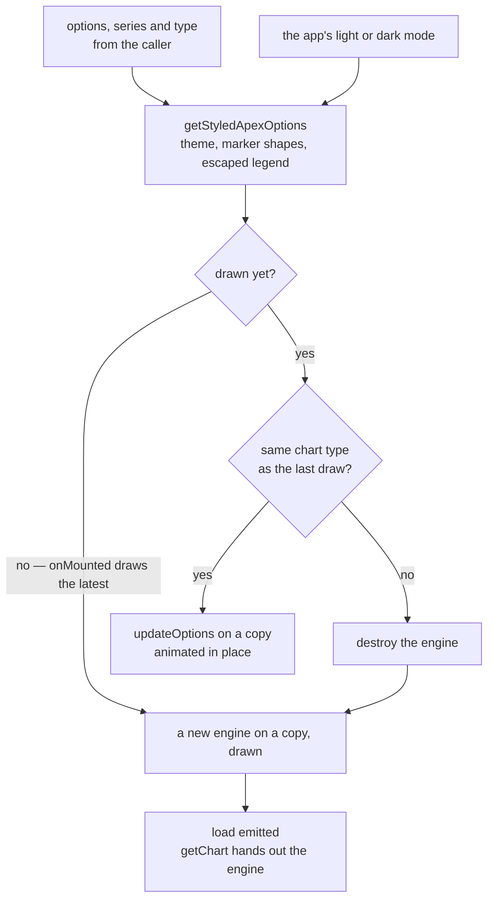

# Charts

`apps/web/app/components/Styled/ApexChart.vue` is the app's one chart: every dashboard visual, the survey response summary and the sheet's column chart mount it. It mounts ApexCharts directly and replaced `vue3-apexcharts`, a component wrapper whose whole job was that mount. It is a component of the app rather than a package, because what it adds over the engine (the app's theme, its tokens and where the engine sits in a component's lifecycle) is this app's alone ([dependency admission](../dependency-admission/design.md)).

## How a chart is drawn

- **The options are styled in one function.** `getStyledApexOptions` pins the engine's theme mode to the app's, gives each series its own marker shape (sized for a line or an area, whose markers the engine hides by default), and escapes every legend entry after the caller's own formatter, since the engine writes an entry as HTML and a single-series chart's entries are data a survey respondent typed. Everything else the caller passes reaches the engine as given: its size, its callbacks under `chart.events`, its locale and every feature option. The series is set over the merged options rather than merged into them, since the merge would concatenate the two arrays.
- **The engine is drawn in `onMounted` and never on the server.** The container renders on the server at the size its parent gives it and stays empty until the browser draws into it. ApexCharts exports a server build under the `node` condition, so the static import is safe there. The engine's own server rendering is not used: it needs the chart's width and height as numbers, which the server does not know for a chart that fills its tile, and a server-drawn chart at a guessed size would shift once the browser laid it out.
- **The engine gets a copy.** It writes into the config it is handed: hiding a series from the legend empties that series' data in the engine's own config ([apexcharts.js #5118](https://github.com/apexcharts/apexcharts.js/issues/5118)). `clonePlainDeep` from `@esposter/shared` copies every array and plain object and keeps functions, dates and cycles as they are, so a formatter survives the copy and the caller's data, and the reactive proxies over it, are never written to.
- **One change, one update.** The styled options are one computed over the theme and the three props, so options and series changed in the same tick reach the engine as one update rather than one cancelling the other's animation. A type change, whether passed as the type prop or inside the options, rebuilds the chart, since the engine draws a different set of layers for each type; anything else updates in place.
- **The engine is reached through the engine.** `getChart()` returns the instance, typed as possibly undefined because it exists only between mount and unmount, and the `load` event says when it has drawn, so a caller restoring a saved view (the dashboard's [chart interaction](../../resource/dashboard-chart-interaction/design.md)) waits for it. Every engine method and every engine callback is reached on the instance or in the options, never through a second copy on the component.
- **The theme reaches the engine's own elements a scope deeper.** The component's scoped style sets the tokens ApexCharts reads on its tooltips, toolbar and menus ([design language](../design-language/design.md)).

## Decisions

- **No deep watch over the series.** The upstream wrapper deep-watched every series so a caller mutating a point in place was seen. Every caller here passes a new series when its data changes, as Vue's one-way props expect, and a deep watch would walk every point on every change while skipping Vue's own changed check.
- **No component events for the engine's callbacks.** The upstream wrapper re-emitted eighteen engine events as component events beside the callbacks in the options, which made two ways to reach one callback. The options' `chart.events` are the one way.
- **No plugin and no global.** The upstream wrapper registered itself as a plugin and set the engine on `window` on every mount. A component imported where it is used needs neither.
- **The full bundle over the lean core.** Measured on the [chart interaction](../../resource/dashboard-chart-interaction/design.md) page: the chart types the app draws cost more as per-type entries than as the full bundle.

## Upstream

Every issue of `apexcharts/vue3-apexcharts` has one verdict, open or closed, read with its comments and checked against the 1.11.3 source. Five defects are in scope. Two of them are ruled out by construction rather than by a test: a caller cannot reach a destroyed instance, since a rebuild assigns the new instance before it draws and the getter's type makes the unmounted case the caller's to handle. A "fixed upstream" row is a fix the wrapper made that this component keeps by the design above.

| Upstream                                                         | Verdict                         | Proof                                                                                                                                                                                 |
| :--------------------------------------------------------------- | :------------------------------ | :------------------------------------------------------------------------------------------------------------------------------------------------------------------------------------ |
| [#1](https://github.com/apexcharts/vue3-apexcharts/issues/1)     | False positive — docs           | README still shows the Vue 2 Vue.use/Vue.component setup; closed stale 2020-11-05, no code change                                                                                     |
| [#2](https://github.com/apexcharts/vue3-apexcharts/issues/2)     | False positive — fixed upstream | Missing declaration file; typings rewritten for Vue 3 in PR 22, merged the day the issue closed                                                                                       |
| [#3](https://github.com/apexcharts/vue3-apexcharts/issues/3)     | False positive — fixed upstream | Duplicate chart on re-render; init re-run guard (02b0a1af9, PR 50 merged 2022-10-15)                                                                                                  |
| [#4](https://github.com/apexcharts/vue3-apexcharts/issues/4)     | False positive — fixed upstream | Props-driven series not updating; toRefs (PR 16) and deep series watch (PR 17) cover it                                                                                               |
| [#5](https://github.com/apexcharts/vue3-apexcharts/issues/5)     | False positive — usage          | Quasar import of the 2020 common.js build; closed stale 2020-12-28; current ESM/UMD builds import cleanly in Node                                                                     |
| [#8](https://github.com/apexcharts/vue3-apexcharts/issues/8)     | False positive — usage          | Five tabs each with one chart instance; render-order question, closed stale 2024-08-06                                                                                                |
| [#9](https://github.com/apexcharts/vue3-apexcharts/issues/9)     | False positive — usage          | ERESOLVE from the reporter's own vue/apexcharts pins; 1.11.3 peers are vue >=3.0.0 and apexcharts >=5.10.0                                                                            |
| [#10](https://github.com/apexcharts/vue3-apexcharts/issues/10)   | False positive — fixed upstream | Exports and typings lost in 1.2.x; typings and named exports restored, explicit types condition in PR 99                                                                              |
| [#11](https://github.com/apexcharts/vue3-apexcharts/issues/11)   | False positive — fixed upstream | zoomX not exposed on the component; PR 22 (6728fc63c) exposes the hidden chart methods                                                                                                |
| [#12](https://github.com/apexcharts/vue3-apexcharts/issues/12)   | False positive — fixed upstream | Type switch threw on a null chart ref; destroy now nulls the ref and the type watch refreshes                                                                                         |
| [#13](https://github.com/apexcharts/vue3-apexcharts/issues/13)   | Out of scope — ApexCharts       | 'n is undefined' inside apexcharts.common.js value(); not reproduced on apexcharts 8.2 with the wrapper                                                                               |
| [#18](https://github.com/apexcharts/vue3-apexcharts/issues/18)   | False positive — fixed upstream | Typings imported vue/types/plugin (Vue 2); replaced by Vue 3 plugin typings in PR 22                                                                                                  |
| [#19](https://github.com/apexcharts/vue3-apexcharts/issues/19)   | False positive — usage          | rangeBar data built from ref() with getTime() pairs; closed 2024-08-12 with no wrapper change named                                                                                   |
| [#20](https://github.com/apexcharts/vue3-apexcharts/issues/20)   | False positive — fixed upstream | options.chart.events handlers never called after emit; d72c6a26f (PR 105, 2024-06-05) calls them                                                                                      |
| [#21](https://github.com/apexcharts/vue3-apexcharts/issues/21)   | False positive — fixed upstream | 'Invalid watch source: undefined' from a non-ref watch target; toRefs change 8e9c7e115 (PR 16)                                                                                        |
| [#23](https://github.com/apexcharts/vue3-apexcharts/issues/23)   | False positive — usage          | Nested mutation of a reactive options object is not seen; README says replace the outermost options object; deep watch refused in PR 14                                               |
| [#24](https://github.com/apexcharts/vue3-apexcharts/issues/24)   | Out of scope — ApexCharts       | Brush 'preventDefault inside passive event listener' is raised by apexcharts' own brush listener                                                                                      |
| [#25](https://github.com/apexcharts/vue3-apexcharts/issues/25)   | False positive — usage          | No chart symptom described; body is an axios call, no wrapper behaviour to reproduce                                                                                                  |
| [#26](https://github.com/apexcharts/vue3-apexcharts/issues/26)   | False positive — fixed upstream | Double chart on re-render is the double-init case guarded by 02b0a1af9 (PR 50)                                                                                                        |
| [#27](https://github.com/apexcharts/vue3-apexcharts/issues/27)   | Out of scope — ApexCharts       | Legend click behaviour is apexcharts legend.onItemClick; the wrapper exposes toggleSeries/showSeries/hideSeries only                                                                  |
| [#28](https://github.com/apexcharts/vue3-apexcharts/issues/28)   | False positive — usage          | insertBefore error on editing a Nuxt component in HMR; no wrapper change named, not reproduced                                                                                        |
| [#29](https://github.com/apexcharts/vue3-apexcharts/issues/29)   | False positive — usage          | Expected deep reactivity of options; README documents replacing the outermost options property; deep watch refused in PR 14                                                           |
| [#30](https://github.com/apexcharts/vue3-apexcharts/issues/30)   | Out of scope — ApexCharts       | Bars black while legend and tooltip colours are right; bar fill path is apexcharts plotOptions/colors                                                                                 |
| [#31](https://github.com/apexcharts/vue3-apexcharts/issues/31)   | Out of scope — ApexCharts       | Hover states option is apexcharts' own states config; the wrapper forwards options unchanged                                                                                          |
| [#32](https://github.com/apexcharts/vue3-apexcharts/issues/32)   | In scope — defect               | "#32 keeps the chart height the options name"; the component adds no height or width of its own, so the options' own reach the engine                                                 |
| [#33](https://github.com/apexcharts/vue3-apexcharts/issues/33)   | Out of scope — ApexCharts       | Route change inside an apex event callback; error raised from apexcharts' handler after the chart is destroyed; not reproduced                                                        |
| [#34](https://github.com/apexcharts/vue3-apexcharts/issues/34)   | False positive — usage          | Boxplot maximum shown twice is an apexcharts boxplot data/label question; the linked demo is apexcharts' own                                                                          |
| [#35](https://github.com/apexcharts/vue3-apexcharts/issues/35)   | Out of scope — ApexCharts       | Bar chart category and x-axis behaviour is apexcharts xaxis/bar config; no wrapper step involved                                                                                      |
| [#36](https://github.com/apexcharts/vue3-apexcharts/issues/36)   | Out of scope — ApexCharts       | Timeline rangeBar crash on datetime data; the error originates in apexcharts timeline rendering                                                                                       |
| [#37](https://github.com/apexcharts/vue3-apexcharts/issues/37)   | Out of scope — ApexCharts       | rangeBar + datetime recursion inside apexcharts rendering; same class as #125 (apexcharts registry recursion, fixed in apexcharts 4.3.0)                                              |
| [#38](https://github.com/apexcharts/vue3-apexcharts/issues/38)   | False positive — fixed upstream | Quasar SSR window error; module import is window-free (checked in Node); SSR components ApexChartsServer/Hydrate shipped                                                              |
| [#39](https://github.com/apexcharts/vue3-apexcharts/issues/39)   | False positive — fixed upstream | Series from a global store not reflected; deep series watch (PR 17) and copied series in 1.11.0 cover it                                                                              |
| [#40](https://github.com/apexcharts/vue3-apexcharts/issues/40)   | False positive — fixed upstream | Script-tag use; dist/vue3-apexcharts.umd.cjs sets globalThis.VueApexCharts from Vue and ApexCharts globals                                                                            |
| [#41](https://github.com/apexcharts/vue3-apexcharts/issues/41)   | False positive — fixed upstream | Conflicting peer vue@3.2.31; 1.11.3 declares peer vue >=3.0.0 in its manifest                                                                                                         |
| [#42](https://github.com/apexcharts/vue3-apexcharts/issues/42)   | Out of scope — ApexCharts       | Log axis via xaxis.logarithmic is an apexcharts option; the wrapper forwards options unchanged                                                                                        |
| [#43](https://github.com/apexcharts/vue3-apexcharts/issues/43)   | Out of scope — ApexCharts       | autoScaleYaxis under zoom is apexcharts zoom behaviour; the report links apex issue 134 (apex path error)                                                                             |
| [#44](https://github.com/apexcharts/vue3-apexcharts/issues/44)   | False positive — docs           | Demo imports a relative module that is not in the repo tree; demo-only error, closed 2024-08-11                                                                                       |
| [#45](https://github.com/apexcharts/vue3-apexcharts/issues/45)   | In scope — defect               | "#45 emits load once the chart has rendered, and hands out its instance from then on"                                                                                                 |
| [#46](https://github.com/apexcharts/vue3-apexcharts/issues/46)   | False positive — usage          | datetime x-axis fed string dates; apexcharts parses the data and the wrapper passes series through                                                                                    |
| [#47](https://github.com/apexcharts/vue3-apexcharts/issues/47)   | False positive — fixed upstream | Asks for a lighter import; the ./core modular entry (441, 1.11.0) answers it, see #49 and #149                                                                                        |
| [#48](https://github.com/apexcharts/vue3-apexcharts/issues/48)   | False positive — usage          | Empty report; a comment about a date string format                                                                                                                                    |
| [#49](https://github.com/apexcharts/vue3-apexcharts/issues/49)   | False positive — fixed upstream | Bundle size; ./core entry imports apexcharts/core instead of the full bundle (1.11.0)                                                                                                 |
| [#52](https://github.com/apexcharts/vue3-apexcharts/issues/52)   | False positive — usage          | Flexbox min-height request; the chart sizes from its height prop and options.chart.height, not CSS min-height (uncertain)                                                             |
| [#53](https://github.com/apexcharts/vue3-apexcharts/issues/53)   | False positive — usage          | Inline options literal is a new object every render, so watch(options) runs updateOptions each render; a usage cost, not a defect                                                     |
| [#54](https://github.com/apexcharts/vue3-apexcharts/issues/54)   | Out of scope — ApexCharts       | X-axis kept when all legend items are hidden is apexcharts legend/xaxis behaviour                                                                                                     |
| [#55](https://github.com/apexcharts/vue3-apexcharts/issues/55)   | False positive — usage          | Zoom out from scroll or click; apexcharts toolbar and zoom API, and the wrapper exposes zoomX and resetSeries                                                                         |
| [#56](https://github.com/apexcharts/vue3-apexcharts/issues/56)   | False positive — fixed upstream | rangeArea hang in production build; series passed raw before 1.11.0 and copied since (uncertain, not reproduced)                                                                      |
| [#57](https://github.com/apexcharts/vue3-apexcharts/issues/57)   | Out of scope — ApexCharts       | radialBar label change shrinks the chart; apexcharts radialBar layout                                                                                                                 |
| [#58](https://github.com/apexcharts/vue3-apexcharts/issues/58)   | Out of scope — ApexCharts       | Path d 'null' when a series selection empties; apexcharts path generation with null values                                                                                            |
| [#59](https://github.com/apexcharts/vue3-apexcharts/issues/59)   | Out of scope — ApexCharts       | 'SVG is not defined' from the apexcharts common build under vite/histoire; not reproduced on 8.2                                                                                      |
| [#60](https://github.com/apexcharts/vue3-apexcharts/issues/60)   | Out of scope — ApexCharts       | Donut toolbar placement is apexcharts' toolbar option                                                                                                                                 |
| [#61](https://github.com/apexcharts/vue3-apexcharts/issues/61)   | False positive — fixed upstream | Standalone page without npm; UMD build shipped (see #131 and #40)                                                                                                                     |
| [#62](https://github.com/apexcharts/vue3-apexcharts/issues/62)   | False positive — fixed upstream | Triple chart from repeated init; PR 50 guards init (02b0a1af9); no second init path found by reading; not reproduced                                                                  |
| [#63](https://github.com/apexcharts/vue3-apexcharts/issues/63)   | False positive — usage          | Nuxt3 heatmap import via a client plugin; reporter's own setup, cf. #9                                                                                                                |
| [#64](https://github.com/apexcharts/vue3-apexcharts/issues/64)   | Out of scope — ApexCharts       | rangeBar 'p is not a function' inside the apexcharts minified bundle; no wrapper call site                                                                                            |
| [#65](https://github.com/apexcharts/vue3-apexcharts/issues/65)   | False positive — usage          | Height 100% inside a fieldset; apexcharts sizes from chart height in a constrained box (uncertain whether the height default contributes)                                             |
| [#66](https://github.com/apexcharts/vue3-apexcharts/issues/66)   | Out of scope — ApexCharts       | Legend HTML placed inside foreignObject differently by build; apexcharts rendering                                                                                                    |
| [#67](https://github.com/apexcharts/vue3-apexcharts/issues/67)   | False positive — usage          | Asks for a deep watch of options; documented as 'update the outermost property'; deep watch refused in PR 14                                                                          |
| [#68](https://github.com/apexcharts/vue3-apexcharts/issues/68)   | Out of scope — ApexCharts       | tickAmount on grid lines is apexcharts xaxis.tickAmount behaviour                                                                                                                     |
| [#69](https://github.com/apexcharts/vue3-apexcharts/issues/69)   | Out of scope — ApexCharts       | Stacked bar 100 with changing categories and series; apexcharts updateOptions path, no wrapper-specific step                                                                          |
| [#70](https://github.com/apexcharts/vue3-apexcharts/issues/70)   | False positive — usage          | Donut labels; the linked docs are apexcharts' labels option                                                                                                                           |
| [#71](https://github.com/apexcharts/vue3-apexcharts/issues/71)   | False positive — usage          | 'properties of undefined (reading 0)' under Nuxt3; no reproduction, closed 2025-04-22 (uncertain)                                                                                     |
| [#72](https://github.com/apexcharts/vue3-apexcharts/issues/72)   | Out of scope — ApexCharts       | Moving the toolbar into a custom div is apexcharts toolbar layout; the wrapper has no toolbar slot                                                                                    |
| [#73](https://github.com/apexcharts/vue3-apexcharts/issues/73)   | False positive — usage          | Prop passing in the user's own parent component; the wrapper root is a single div                                                                                                     |
| [#74](https://github.com/apexcharts/vue3-apexcharts/issues/74)   | Out of scope — ApexCharts       | Blank holes after resize on a stacked chart; apexcharts resize and legend handling                                                                                                    |
| [#75](https://github.com/apexcharts/vue3-apexcharts/issues/75)   | Out of scope — ApexCharts       | this.xaxisTooltip null from apexcharts' tooltip code, the apex tooltip listener (full text read)                                                                                      |
| [#76](https://github.com/apexcharts/vue3-apexcharts/issues/76)   | False positive — fixed upstream | Plugin install typing error; Vue 3 plugin typings from PR 22 (uncertain which later change closed it)                                                                                 |
| [#77](https://github.com/apexcharts/vue3-apexcharts/issues/77)   | Out of scope — ApexCharts       | Width 100% computed without vertical scrollbar width; apexcharts width calculation, options forwarded unchanged                                                                       |
| [#78](https://github.com/apexcharts/vue3-apexcharts/issues/78)   | Out of scope — ApexCharts       | boxPlot update goes blank; apexcharts updateSeries path for boxPlot                                                                                                                   |
| [#79](https://github.com/apexcharts/vue3-apexcharts/issues/79)   | Out of scope — ApexCharts       | updateSeries with a different data length on boxPlot throws inside apexcharts.common.js                                                                                               |
| [#80](https://github.com/apexcharts/vue3-apexcharts/issues/80)   | False positive — fixed upstream | Nuxt3 SSR 'window is not defined'; the import is window-free today (checked); window touched only in onBeforeMount                                                                    |
| [#81](https://github.com/apexcharts/vue3-apexcharts/issues/81)   | In scope — defect               | by construction: a rebuild assigns the new instance before it renders, and the instance getter is typed as possibly undefined, so a caller handles the unmounted case at compile time |
| [#82](https://github.com/apexcharts/vue3-apexcharts/issues/82)   | False positive — fixed upstream | Vite dev 'does not provide an export' from the vue.js import; ESM build with explicit exports shipped in PR 92                                                                        |
| [#83](https://github.com/apexcharts/vue3-apexcharts/issues/83)   | False positive — usage          | Vue Suspense boundary structure in the reporter's app; not a wrapper behaviour                                                                                                        |
| [#84](https://github.com/apexcharts/vue3-apexcharts/issues/84)   | Out of scope — ApexCharts       | DAY label injected on a datetime range xAxis at midnight; apexcharts xaxis label logic                                                                                                |
| [#85](https://github.com/apexcharts/vue3-apexcharts/issues/85)   | Out of scope — ApexCharts       | Multi y-axis removal through the yaxis array; apexcharts updateOptions handling (uncertain)                                                                                           |
| [#86](https://github.com/apexcharts/vue3-apexcharts/issues/86)   | Out of scope — ApexCharts       | Treemap dataLabels background is apexcharts dataLabels style                                                                                                                          |
| [#87](https://github.com/apexcharts/vue3-apexcharts/issues/87)   | Out of scope — ApexCharts       | Rangebar legend deselect errors come from apexcharts series toggle path                                                                                                               |
| [#88](https://github.com/apexcharts/vue3-apexcharts/issues/88)   | Out of scope — ApexCharts       | No animation after series and categories update from empty; apexcharts updateSeries/animate path (uncertain)                                                                          |
| [#89](https://github.com/apexcharts/vue3-apexcharts/issues/89)   | Out of scope — ApexCharts       | 'normalizeKey is not a function': the symbol is not in the wrapper dist; no reproduction (uncertain)                                                                                  |
| [#90](https://github.com/apexcharts/vue3-apexcharts/issues/90)   | False positive — docs           | Syncing example depends on a generator from another site that the example omits                                                                                                       |
| [#91](https://github.com/apexcharts/vue3-apexcharts/issues/91)   | False positive — fixed upstream | Nuxt 3.9 HMR broken after loading the package; ESM build (PR 92, 2024-02-11) closed it                                                                                                |
| [#93](https://github.com/apexcharts/vue3-apexcharts/issues/93)   | Out of scope — ApexCharts       | Marker not visible for some decimal values; apexcharts marker rendering                                                                                                               |
| [#94](https://github.com/apexcharts/vue3-apexcharts/issues/94)   | False positive — fixed upstream | 1.5.0 pointed at a dist that did not exist; ESM/UMD dist build from PR 92 and the 1.5.x line                                                                                          |
| [#95](https://github.com/apexcharts/vue3-apexcharts/issues/95)   | False positive — fixed upstream | TS7016 declaration not found in TS 5; explicit types condition in package exports (PR 99, 2024-03-09)                                                                                 |
| [#96](https://github.com/apexcharts/vue3-apexcharts/issues/96)   | False positive — fixed upstream | './src/vue3-apexcharts' not exported; ESM build with an exports map (PR 92)                                                                                                           |
| [#97](https://github.com/apexcharts/vue3-apexcharts/issues/97)   | False positive — docs           | Nuxt3 SSR example missing from docs; ApexChartsServer/ApexChartsHydrate are the SSR path                                                                                              |
| [#98](https://github.com/apexcharts/vue3-apexcharts/issues/98)   | False positive — fixed upstream | Missing declaration file after update; explicit types condition (PR 99)                                                                                                               |
| [#100](https://github.com/apexcharts/vue3-apexcharts/issues/100) | False positive — fixed upstream | Request to publish the PR 99 typings fix; shipped as 1.5.3                                                                                                                            |
| [#101](https://github.com/apexcharts/vue3-apexcharts/issues/101) | False positive — usage          | Reading series on a point click; dataPointSelection emits apexcharts' arguments, usage question                                                                                       |
| [#102](https://github.com/apexcharts/vue3-apexcharts/issues/102) | Out of scope — ApexCharts       | Dashed forecast segment per point is apexcharts stroke.dashArray; no wrapper option                                                                                                   |
| [#103](https://github.com/apexcharts/vue3-apexcharts/issues/103) | False positive — fixed upstream | Types cannot resolve from package.json; explicit types condition (PR 99)                                                                                                              |
| [#106](https://github.com/apexcharts/vue3-apexcharts/issues/106) | False positive — fixed upstream | apexcharts was bundled inside the wrapper; now external in the vite config (PR 113, 2024-08-01)                                                                                       |
| [#107](https://github.com/apexcharts/vue3-apexcharts/issues/107) | Out of scope — ApexCharts       | xaxis.labels.style.cssClass ignored on radar; apexcharts radar renderer, the wrapper forwards options                                                                                 |
| [#108](https://github.com/apexcharts/vue3-apexcharts/issues/108) | False positive — usage          | Title-only report with no body                                                                                                                                                        |
| [#109](https://github.com/apexcharts/vue3-apexcharts/issues/109) | False positive — usage          | 5th area series disappears; reporter wraps the chart instance in a deep ref (1.11.3 keeps the instance shallow, e164876e7)                                                            |
| [#110](https://github.com/apexcharts/vue3-apexcharts/issues/110) | Out of scope — ApexCharts       | Custom tooltip containing another chart; apexcharts tooltip rendering                                                                                                                 |
| [#111](https://github.com/apexcharts/vue3-apexcharts/issues/111) | False positive — fixed upstream | zoomed event not firing; options.chart.events now run after emit (PR 105)                                                                                                             |
| [#112](https://github.com/apexcharts/vue3-apexcharts/issues/112) | False positive — usage          | Handler typing error on zoomed; the user's handler signature, not a wrapper defect                                                                                                    |
| [#114](https://github.com/apexcharts/vue3-apexcharts/issues/114) | Out of scope — ApexCharts       | Annotations and hot reload inside a top-layer dialog; apexcharts annotations on a moved DOM node                                                                                      |
| [#115](https://github.com/apexcharts/vue3-apexcharts/issues/115) | False positive — fixed upstream | options.chart made mandatory by 1.6.0 events assignment; props.options.chart guard (27756711e) fixes it                                                                               |
| [#117](https://github.com/apexcharts/vue3-apexcharts/issues/117) | Out of scope — ApexCharts       | Pie legend hover 't3 is undefined' inside apexcharts; fixed upstream in apexcharts 3.54.0 per the thread                                                                              |
| [#118](https://github.com/apexcharts/vue3-apexcharts/issues/118) | Out of scope — ApexCharts       | Pie legend hover 'toString' of undefined; fixed upstream in apexcharts 3.54.0 per the thread                                                                                          |
| [#119](https://github.com/apexcharts/vue3-apexcharts/issues/119) | False positive — fixed upstream | v-if on chart labels overflowing the stack after 1.6.0; the chart guard in 27756711e (PR 105 follow-up)                                                                               |
| [#120](https://github.com/apexcharts/vue3-apexcharts/issues/120) | False positive — fixed upstream | Reading 'events' of undefined on pie/donut; options.chart guard (27756711e)                                                                                                           |
| [#121](https://github.com/apexcharts/vue3-apexcharts/issues/121) | False positive — fixed upstream | Reading 'events' of undefined on donut init; same guard (27756711e)                                                                                                                   |
| [#122](https://github.com/apexcharts/vue3-apexcharts/issues/122) | Out of scope — ApexCharts       | pieClicked data on donut click is apexcharts' dataPointSelection payload                                                                                                              |
| [#124](https://github.com/apexcharts/vue3-apexcharts/issues/124) | Out of scope — ApexCharts       | there is no plugin to configure; a locale is the engine's own chart.locales and chart.defaultLocale options, which reach it unchanged                                                 |
| [#125](https://github.com/apexcharts/vue3-apexcharts/issues/125) | False positive — fixed upstream | 'too much recursion' on responsive config; chart ref made shallowRef in 1.11.3 (e164876e7); apexcharts 4.3.0 registry fix                                                             |
| [#126](https://github.com/apexcharts/vue3-apexcharts/issues/126) | In scope — defect               | the same construction as #81                                                                                                                                                          |
| [#127](https://github.com/apexcharts/vue3-apexcharts/issues/127) | False positive — fixed upstream | v-if on chart labels stack overflow; chart guard in 27756711e (persistence in 1.7.0 not reproduced)                                                                                   |
| [#128](https://github.com/apexcharts/vue3-apexcharts/issues/128) | Out of scope — ApexCharts       | Bar chart overflow at page init with width 100%; apexcharts width calculation on first render                                                                                         |
| [#129](https://github.com/apexcharts/vue3-apexcharts/issues/129) | In scope — defect               | "#129 rebuilds the chart when its options change the chart type"; the chart type is read from the merged options, not only the type prop                                              |
| [#130](https://github.com/apexcharts/vue3-apexcharts/issues/130) | False positive — fixed upstream | TypeError on bar chart after 1.7.0; destroy/ref handling changed in PR 123 (2024-10-09) (uncertain)                                                                                   |
| [#131](https://github.com/apexcharts/vue3-apexcharts/issues/131) | False positive — fixed upstream | Asks for a UMD file in dist; dist/vue3-apexcharts.umd.cjs now ships                                                                                                                   |
| [#132](https://github.com/apexcharts/vue3-apexcharts/issues/132) | Out of scope — ApexCharts       | Console error adding opposite y-axes through the yaxis array update; apexcharts yaxis handling                                                                                        |
| [#133](https://github.com/apexcharts/vue3-apexcharts/issues/133) | False positive — usage          | ERESOLVE from the user's dependency tree; 1.11.3 peers are vue >=3.0.0 and apexcharts >=5.10.0                                                                                        |
| [#134](https://github.com/apexcharts/vue3-apexcharts/issues/134) | Out of scope — ApexCharts       | path d 'Expected number' from an apexcharts arc path; not reproduced by the wrapper                                                                                                   |
| [#135](https://github.com/apexcharts/vue3-apexcharts/issues/135) | False positive — fixed upstream | Chart breaks on height change; height watch refreshes (destroy then init) and destroy nulls the ref (PR 123)                                                                          |
| [#136](https://github.com/apexcharts/vue3-apexcharts/issues/136) | False positive — fixed upstream | Series and options changed together; scheduleUpdate merges them into one updateOptions (1.11.0)                                                                                       |
| [#137](https://github.com/apexcharts/vue3-apexcharts/issues/137) | False positive — fixed upstream | Dynamic width not applied; width watch calls refresh() in 1.11.3, so the chart is rebuilt with the new width                                                                          |
| [#138](https://github.com/apexcharts/vue3-apexcharts/issues/138) | Out of scope — ApexCharts       | Stacked horizontal bar 'call' of undefined; apexcharts stacked horizontal path                                                                                                        |
| [#139](https://github.com/apexcharts/vue3-apexcharts/issues/139) | Out of scope — ApexCharts       | 'call' of undefined on page refresh with no comments; not reproduced (uncertain)                                                                                                      |
| [#140](https://github.com/apexcharts/vue3-apexcharts/issues/140) | False positive — usage          | series passed as a single object instead of an array; the prop is typed Array                                                                                                         |
| [#141](https://github.com/apexcharts/vue3-apexcharts/issues/141) | False positive — fixed upstream | Global plugin typing mismatch with Vue 3.5.x; install typings corrected in the 1.9.x line (uncertain which change closed it)                                                          |
| [#142](https://github.com/apexcharts/vue3-apexcharts/issues/142) | Out of scope — ApexCharts       | Only pie charts animate on load; apexcharts animations option                                                                                                                         |
| [#143](https://github.com/apexcharts/vue3-apexcharts/issues/143) | Out of scope — ApexCharts       | rangeBar selection 'niceMin' of null; apexcharts selection path                                                                                                                       |
| [#144](https://github.com/apexcharts/vue3-apexcharts/issues/144) | False positive — fixed upstream | Props not inferred in templates; type prop typing corrected with NonNullable (PR 147)                                                                                                 |
| [#145](https://github.com/apexcharts/vue3-apexcharts/issues/145) | False positive — fixed upstream | Methods became required props in 1.9.0; PR 146 makes them optional                                                                                                                    |
| [#148](https://github.com/apexcharts/vue3-apexcharts/issues/148) | Out of scope — ApexCharts       | Duplicated x-axis labels on apexcharts' own demo page; apexcharts bar chart                                                                                                           |
| [#149](https://github.com/apexcharts/vue3-apexcharts/issues/149) | False positive — fixed upstream | Release request for the modular import; the ./core entry shipped in 1.11.0                                                                                                            |
| [#150](https://github.com/apexcharts/vue3-apexcharts/issues/150) | False positive — fixed upstream | formatter dropped by JSON copy on options update; copyValue keeps functions (1.11.2)                                                                                                  |
| [#151](https://github.com/apexcharts/vue3-apexcharts/issues/151) | False positive — fixed upstream | yaxis formatter lost on series/xaxis update; function-preserving copy (1.11.2) and Date/RegExp-safe copy (PR 153)                                                                     |
| [#152](https://github.com/apexcharts/vue3-apexcharts/issues/152) | False positive — fixed upstream | Client-only import wanted; ./core entry imports apexcharts/core without the SSR bundle (1.11.0); closed stale 2026-09-11                                                              |

Verdict counts: 5 in-scope defects, 49 fixed upstream and kept, 49 out of scope (ApexCharts), 27 usage questions, 4 documentation gaps.

## Key files

| Path                                                        | Role                                                                   |
| :---------------------------------------------------------- | :--------------------------------------------------------------------- |
| `apps/web/app/components/Styled/ApexChart.vue`              | Mounts, updates, rebuilds and destroys the engine; the engine's tokens |
| `apps/web/app/services/styled/getStyledApexOptions.ts`      | The theme mode, the marker shapes and the escaped legend               |
| `apps/web/app/services/styled/ApexChartMarkerShapes.ts`     | Which shape marks each series, so one reads apart without its colour   |
| `packages/shared/src/util/object/clonePlainDeep.ts`         | The copy the engine is handed                                          |
| `apps/web/app/components/Styled/ApexChart.test.ts`          | The lifecycle tests, each titled with its upstream issue               |
| `apps/web/app/services/styled/getStyledApexOptions.test.ts` | The options tests, each titled with its upstream issue                 |

## Sources

- [apexcharts/vue3-apexcharts](https://github.com/apexcharts/vue3-apexcharts), whose source was read at 1.11.3 and whose tracker the Upstream table judges.
- The engine's [methods](https://apexcharts.com/docs/methods/) and [events](https://apexcharts.com/docs/options/chart/events/) documentation, for what is reached on the instance and in the options.
- The engine's update helpers in [apexcharts/apexcharts.js](https://github.com/apexcharts/apexcharts.js), for the config it writes into.
