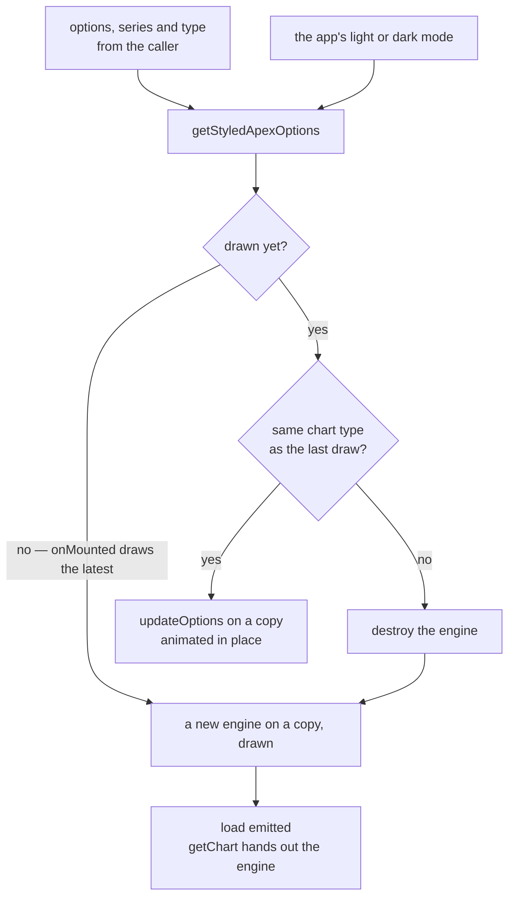

# Charts

`apps/web/app/components/Styled/ApexChart.client.vue` is the app's one chart: every dashboard chart visual, the survey response summary and the sheet's column chart mount it. It mounts ApexCharts directly, with no component wrapper, since that mount is all a wrapper would add. It is a component of the app rather than a package, because what it adds over the engine (the app's theme, its tokens and where the engine sits in a component's lifecycle) is this app's alone ([dependency admission](../dependency-admission/design.md)).

## How a chart is drawn

- **The options are styled in one function.** `getStyledApexOptions` pins the engine's theme mode to the app's, gives each series its own marker shape (sized for a line or an area, whose markers the engine hides by default), and escapes every legend entry after the caller's own formatter, since the engine writes an entry as HTML and a single-series chart's entries are data a survey respondent typed. Everything else the caller passes reaches the engine as given: its size, its callbacks under `chart.events`, its locale and every feature option. The series is set over the merged options rather than merged into them, since the merge would concatenate the two arrays.
- **The engine is drawn in `onMounted` and never on the server.** The container renders on the server at the size its parent gives it and stays empty until the browser draws into it. ApexCharts exports a server build under the `node` condition, so the static import is safe there. The engine's own server rendering is not used: it needs the chart's width and height as numbers, which the server does not know for a chart that fills its tile, and a server-drawn chart at a guessed size would shift once the browser laid it out.
- **The engine gets a copy.** It writes into the config it is handed: hiding a series from the legend empties that series' data in the engine's own config ([apexcharts.js #5118](https://github.com/apexcharts/apexcharts.js/issues/5118)). `clonePlainDeep` from `@esposter/shared` copies every array and plain object and keeps functions, dates and cycles as they are, so a formatter survives the copy and the caller's data, and the reactive proxies over it, are never written to.
- **One change, one update.** The styled options are one computed over the theme and the three props, so options and series changed in the same tick reach the engine as one update rather than one cancelling the other's animation. A type change, whether passed as the type prop or inside the options, rebuilds the chart, since the engine draws a different set of layers for each type; anything else updates in place.
- **The engine is reached through the engine.** `getChart()` returns the instance, typed as possibly undefined because it exists only between mount and unmount, and the `load` event says when it has drawn, so a caller restoring a saved view (the dashboard's [chart interaction](../../resource/dashboard-chart-interaction/design.md)) waits for it. Every engine method and every engine callback is reached on the instance or in the options, never through a second copy on the component.
- **The theme reaches the engine's own elements a scope deeper.** The component's scoped style sets the tokens ApexCharts reads on its tooltips, toolbar and menus ([design language](../design-language/design.md)).

## Decisions

- **No deep watch over the series.** The upstream wrapper deep-watched every series so a caller mutating a point in place was seen. Every caller here passes a new series when its data changes, as Vue's one-way props expect, and a deep watch would walk every point on every change while skipping Vue's own changed check.
- **No component events for the engine's callbacks.** The upstream wrapper re-emitted eighteen engine events as component events beside the callbacks in the options, which made two ways to reach one callback. The options' `chart.events` are the one way.
- **No plugin and no global.** The upstream wrapper registered itself as a plugin and set the engine on `window` on every mount. A component imported where it is used needs neither.
- **The full bundle over the lean core.** Measured on the [chart interaction](../../resource/dashboard-chart-interaction/design.md) page: the chart types the app draws cost more as per-type entries than as the full bundle.

## Upstream

Every issue of `apexcharts/vue3-apexcharts` has one verdict, open or closed, read with its comments and checked against the 1.11.3 source. Five defects are in scope. Two of them are ruled out by construction rather than by a test: a caller cannot reach a destroyed instance, since a rebuild assigns the new instance before it draws and the getter's type makes the unmounted case the caller's to handle. A "fixed upstream" verdict is a fix the wrapper made that this component keeps by the design above. The in-scope items are listed below, each with its proof. The rest are counted here and stay on the [tracker](https://github.com/apexcharts/vue3-apexcharts/issues?q=is%3Aissue):

- False positive, fixed upstream: 49
- Out of scope, ApexCharts: 49
- False positive, usage: 27
- False positive, docs: 4

| Upstream                                                         | Verdict           | Proof                                                                                                                                                                                 |
| :--------------------------------------------------------------- | :---------------- | :------------------------------------------------------------------------------------------------------------------------------------------------------------------------------------ |
| [#32](https://github.com/apexcharts/vue3-apexcharts/issues/32)   | In scope — defect | "#32 keeps the chart height the options name"; the component adds no height or width of its own, so the options' own reach the engine                                                 |
| [#45](https://github.com/apexcharts/vue3-apexcharts/issues/45)   | In scope — defect | "#45 emits load once the chart has rendered, and hands out its instance from then on"                                                                                                 |
| [#81](https://github.com/apexcharts/vue3-apexcharts/issues/81)   | In scope — defect | by construction: a rebuild assigns the new instance before it renders, and the instance getter is typed as possibly undefined, so a caller handles the unmounted case at compile time |
| [#126](https://github.com/apexcharts/vue3-apexcharts/issues/126) | In scope — defect | the same construction as #81                                                                                                                                                          |
| [#129](https://github.com/apexcharts/vue3-apexcharts/issues/129) | In scope — defect | "#129 rebuilds the chart when its options change the chart type"; the chart type is read from the merged options, not only the type prop                                              |

## Key files

| Path                                                        | Role                                                                   |
| :---------------------------------------------------------- | :--------------------------------------------------------------------- |
| `apps/web/app/components/Styled/ApexChart.client.vue`       | Mounts, updates, rebuilds and destroys the engine; the engine's tokens |
| `apps/web/app/services/styled/getStyledApexOptions.ts`      | The theme mode, the marker shapes and the escaped legend               |
| `apps/web/app/services/styled/ApexChartMarkerShapes.ts`     | Which shape marks each series, so one reads apart without its colour   |
| `packages/shared/src/util/object/clonePlainDeep.ts`         | The copy the engine is handed                                          |
| `apps/web/app/components/Styled/ApexChart.test.ts`          | The lifecycle tests, each titled with its upstream issue               |
| `apps/web/app/services/styled/getStyledApexOptions.test.ts` | The options tests, each titled with its upstream issue                 |

## Sources

- [the vue3-apexcharts repository](https://github.com/apexcharts/vue3-apexcharts), whose source was read at 1.11.3 and whose tracker the Upstream table judges.
- The engine's [methods](https://apexcharts.com/docs/methods/) and [events](https://apexcharts.com/docs/options/chart/events/) documentation, for what is reached on the instance and in the options.
- The engine's update helpers in [the apexcharts.js repository](https://github.com/apexcharts/apexcharts.js), for the config it writes into.
