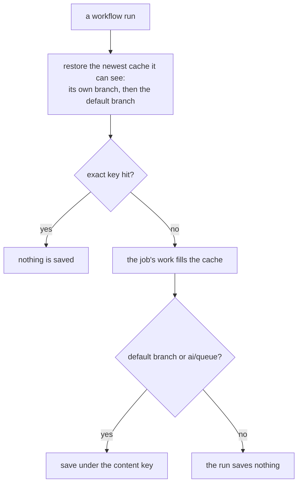

# CI caches

Which CI runs save a cache, and which only read one. A cache is written from the default branch and `ai/queue`, and every other branch restores what those two saved. The game-data mirror is keyed on its content, so a save happens only when that key is new. The pnpm store is not cached at all. The requirements of record are in `spec.md`.

## Why the branches split

GitHub scopes a cache to the branch that wrote it, and a run reads only its own branch's caches and the default branch's. A cache written on a Renovate or pull request branch therefore serves that branch alone. Every such write still counts toward the repository's ten-gigabyte cap, and the cap evicts the least recently used entry, so a write that no other run will read pushes out one that will. The mirror of the game data is the entry the coverage shards depend on, and when it was evicted each run downloaded it again from the dev account.

`main` is the one scope every run can read, and `ai/queue` is the scope most runs write. So those two write, and the rest read.

## How it works

The game-data mirror is keyed on the lock's hash, and `build-packages` fills it and saves it under that key. The vp task cache is keyed per run, so it is the one cache that changes on every executed run; it is small, and its save is gated the same way as the others.

## What the regression test checks

`scripts/src/workspace/ciCaches.test.ts` scans every workflow and composite action. It fails if a file uses the combined cache action, which saves on every run, or if a cache save step lacks the default-branch-and-`ai/queue` condition. It names the file, so a new save added without the condition fails the workspace suite.

## Key files

| File                                          | Role                                                                    |
| --------------------------------------------- | ----------------------------------------------------------------------- |
| `.github/actions/run-cached-task/action.yaml` | restores and saves the vp task cache; the save is gated                 |
| `.github/workflows/build-packages.yaml`       | restores the game-data mirror everywhere; fills and saves it on the two |
| `.github/workflows/CI.yaml`                   | the coverage shards restore the mirror and never save it                |
| `scripts/src/workspace/ciCaches.test.ts`      | the guard: no combined cache action, gated saves                        |

## Notes

- A branch's first run finds no cache of its own and falls back to the default branch's, so a Renovate or pull request branch's first run reads `main`'s mirror, and fetches only what their lock adds.
- A cache is evicted by least recent use once the repository passes its cap, so the mirror survives because the two saving branches read it on every run.
- The lockfile verification cache that `pnpm/setup` saves on every branch is one small entry per lockfile and branch, so a run on another branch still saves that entry. CodeQL's internal cache is not written by this repository's workflows. Neither is governed by this rule.

## Settled

- **The pnpm store is not cached.** It was kept under the lockfile's hash by a hand-written restore and save, and the setup action's own `cache: true` was weighed as the replacement. Both are rejected. The store was about three gigabytes compressed, so every job paid over a minute to restore it whatever it installed: the format job restored it to install the root project alone in seconds, and each lockfile version held a third of the repository's ten-gigabyte cap. A job now installs from the registry only what its filter selects. `cache: true` was turned down on its own account: its save key carries a random identifier per job, so every parallel job that changes the store writes its own copy, and it saves at the end of the job, which a superseding push can cancel.
