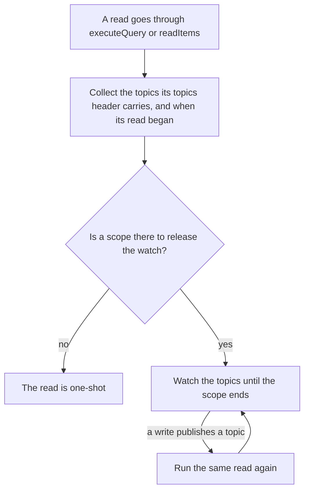
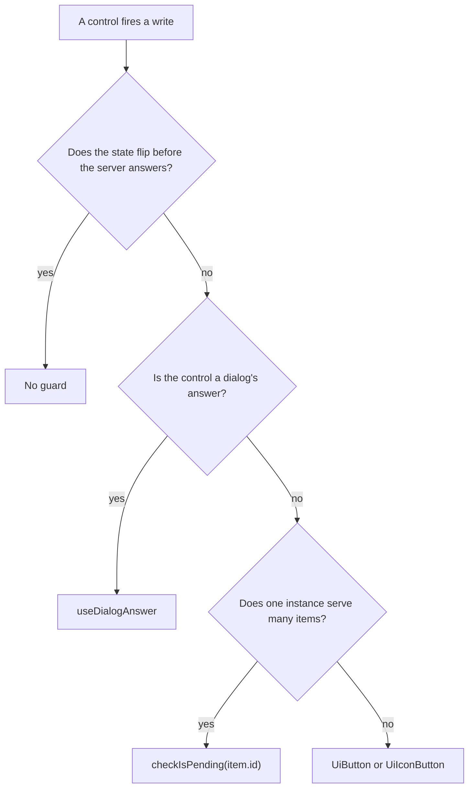

# Client Data Access

Every user-facing tRPC call on the client goes through one of two symmetric primitives, both in `apps/web/app/composables/shared/`:

- **`useQuery`** — reads. Fetches without blocking setup, populates reactive data, surfaces errors.
- **`useMutation`** — writes. Awaits the server's answer or applies an optimistic entry through the overlay, and surfaces errors.

A third primitive sits beside them for the reads many stores share:

- **`useCachedRead`** — a store's shared read, cached until a write invalidates its tag. Covered in [caching](../caching/design.md).

Both share the same error stack (`getResultAsync` → `createAlert`) and the concurrency model in [Async operations](../async-operations/design.md), so no call site re-implements loading, error handling, or race protection.

## useQuery

`useQuery` (`apps/web/app/composables/shared/useQuery.ts`) replaces top-level `await $trpc.x.query(...)` in a **component** whose read is ancillary — one that should render immediately and populate when data lands. A top-level await forces the component under a `<Suspense>` boundary and throws on failure; `useQuery` fetches in the background instead, so neither a `Suspense` nor a `NuxtErrorBoundary` is needed.

It is **not** for page-level loaders that must gate rendering or 404 on a missing resource — those keep the top-level `await` and `throw createError(...)` / navigate on failure (see the page-level bullet under [When not to use them](#when-not-to-use-them)).

```ts
const { data, refresh } = useQuery(() => $trpc.invite.readMyInvite.query({ roomId }), {
  onSuccess: (result) => {
    // rare: derive local state from the loaded result
  },
});
```

- `query` — the tRPC read. The only required argument.
- `data` — a `shallowRef` holding the result, `undefined` until the first fetch resolves. Render loading/empty state off `data.value === undefined`.
- `refresh` — re-runs the query (retry after a failure, or refetch on demand). The initial fetch fires automatically on setup.
- `onSuccess` — rare; for seeding local state from the loaded result.
- `isInlineError` — the surface renders the failure itself (a `UiErrorState` with a retry), so no toast is raised; `error` carries the message.
- `isLazy` — no fetch on setup; the read waits for the first `refresh`. For a lens the surface opens on demand, such as the explorer's summary cards, where a fetch at setup spends a round trip on a read nothing renders yet.

On failure `data` stays `undefined`, so the component falls back to its empty state, and the real `Error.message` is raised as an alert — unless `isInlineError` is set, which carries it on `error` for the surface to render instead. A superseded fetch (a newer `refresh`, a remounted component) can never overwrite a newer result.

`useQuery`'s data is **per instance**, so two components calling it fetch twice. A read that several surfaces share, and that should be read once per session, is `useCachedRead` on a store instead — see [caching](../caching/design.md).

## Live reads

The server decides whether a read is live, and no call site does. A query's topics are inferred rather than declared. The statements its request awaits are recorded, the read set is walked from each statement's Drizzle builder (its tables, scope equalities, join keys and subqueries), an object call it made answers the read set its object reported, and a blob it read names its key. That set is sent back with the answer and the time the read began. A query whose answer nothing outside its own write changes declares a `staticReason` instead and is watched by no topic. A mutation publishes the topics its writes changed once it settles, whichever way it ends: the recorder adds `RETURNING` to each write so every changed row is named by its scope values, on the web Worker and in the jobs' units alike, and an object publishes its own writes from its `invoke`. `inferTopicsMiddleware` (`apps/web/server/trpc/middleware/inferTopicsMiddleware.ts`) applies the rules on the web, and the [cloudflare services design](../cloudflare-services/design.md) describes the recording. The tests hold the inference to account with a wake check: after each write of a suite it reruns the suite's recorded reads and fails when a write changed an answer and no topic that write published woke the read. A read is therefore covered by the check whether or not anyone wrote its topics down. A read stays current by going through the primitives that watch those topics, never by an event written for it:

- **`executeQuery`** collects the topics its answer names, with the time its read began, and watches them for as long as the scope of the `useMutation()` instance lives — the surface that called it, or the store it was created in. A write that changed one runs the same read again, on the same key. Each read runs in the run scope its caller holds: a newer read of its key aborts the one before it, and only the newest run commits its answer and its watch. `useQuery`, `useCachedRead` and every read built on `executeQuery` are live through it, with nothing at their own call sites.
- **`readItems`** does the same for a paged list's first page. The write's invalidation reads that page again and updates, by id, the rows it names, so a reader who has paged on keeps their place: the later pages and the cursor are left as they are. A row another writer added or removed waits for the next refresh, unless the list passes `onTopicChange`, which is handed a read that adds the rows the page has and the reader does not, at the head, and keeps the pages after the first: the notifications bell does, since a push's row has to reach it. A server render puts the topics and the time its read began in the payload beside its page, so a hydrated list is watched from that time without a second read.
- **A read made with no scope** takes no watch, since nothing would release it, and a read that answers after its scope has gone takes none either.
- **A one-shot read** passed `isUnwatched` takes no watch even inside a scope that would hold one. A store outlives the screen it serves, so the store's own refresh of the open resource takes none: the page that opened the resource holds its live read, and a watch in the store would keep re-reading a resource after the page had gone.
- **A watch made from a read's start time is told of every publish since then**: the subscription carries the server time the read began, taken before the read runs, and the topic's object invalidates the subscriber at once when the topic's last publish is at or after that time less a second of clock skew, so a write published while the read was in flight reaches the list without waiting for the topic's next publish.



The watch itself is `useWatchTopics`: one watch per target, kept while a refreshed read names the same topics, with the newest refetch being the one that runs.

The one exception is the room list's reorder: the room object's alarm writes a room's last-message time and sends `roomActivity` to its online members, which carries the row the write returned, at its version, as the row change itself, since the alarm publishes no topic a refetch of the first page could follow.
The rule is enforced by `RealtimeEventClassMap` (`packages/db-schema/src/models/realtime/RealtimeEventClassMap.ts`): every realtime event type must name the class its frame carries, no class is a refresh of a stored read, so a new event fails to typecheck until its author says what it carries instead. The classes are `Ephemeral`, `MessageStream`, `RowChange`, `ValuePush`, and `Command`, an instruction the client carries out that no stored read answers (leaving a call, dropping a room row, showing an alert).

Four alternatives lost, each for a reason that still holds:

- **A query cache keyed by path and input, replacing the stores' own copies.** The stores already are the client's cache, and they carry what a query cache would have to be taught: the overlay's entries and arrivals, the typed events' echoes, and the offline copy. A second cache beside them would disagree with them, and one in place of them is the whole client rewritten for the dedupe of identical reads, which the batching link already gives a tick's worth of.
- **A topic per row for the feed.** The feed's one topic costs one cheap D1 read per change per watcher, inside the coalescing window. A topic per row would trade that for a subscription on a Topic object and a storage write for every row on every tab, which is the dearer side of the Cloudflare bill.
- **A lint ban on a raw `$trpc` read outside the primitives.** A selector cannot tell a raw read from one handed to a primitive under another name (a page function `readItems` calls later, a renamed `executeQuery`), from a read composed into a write, or from a room read its events keep current, so most of what it flags would carry a disable — a roster of exceptions, which no enforcer is allowed to carry. A surface that shows a stale read is fixed by moving that read onto a primitive, as the post page, the program status blade and the survey responses were.
- **A hand-kept list of the live query paths, to narrow that ban.** Nearly every query procedure is live through its inferred topics, so the list would filter almost nothing, and a test holding it equal to the router would be one more thing to update with every procedure.

## useMutation

`useMutation` (`apps/web/app/composables/shared/useMutation.ts`) returns `{ checkIsPending, executeMutation, executeQuery, isPending, whenSettled }`. Its `executeQuery` is the read every live read passes through. Its `executeMutation` is the write path of the writers the overlay has not taken yet. A store on the overlay writes through the overlay instead.

**The overlay is the write path of a store's rows.** Its registry, `useOverlayStore` (`apps/web/app/store/overlay.ts`), is one Pinia store per app, and it holds the server's rows of every overlay table, the pending entries and the write queue:

- **A write with an entry** goes through `writeOptimistic(mutate, { entry, onError })`. The entry is a pure function over the held rows, and it shows the change when the write is issued. The registry runs the entry once against a recording view to find the rows it touches, and queues the write behind the earlier writes whose touched rows overlap its own. No caller names a queue key.
- **A write without an entry** goes through `writeAwaited(mutate, { awaitedBecause, onError })`, naming the reason it waits as the awaited form does. The screen waits for it, so it has nothing to show and takes no queue key. Its answer is an arrival, and the version gate orders the answers of two such writes to one row.
- **An answer** brings the rows it returned, each an arrival, and names the version of each row the write changed. An entry drops once every row it confirmed is held at that version or above. A refused write drops its entry at once and leaves the held rows as they were.
- **A store reads its rows** through the view it returns, which is computed from the held rows with the pending entries applied in issue order. Components read the view. Only the overlay writes held rows.

**The writers still on `executeMutation`.** A write with no `awaitedBecause` is the background form: nothing on the screen waits for it, its outcome is `onError`, and it queues on its `key`, which keeps one queue per `useMutation()` instance. The writers that use it are the ones whose calls must run in order with no screen to draw: a save chained on its etag, a subscription and its revoke, the app badge, and the IndexedDB rewrites. The account-settings cards (`ProfileCard`, `SessionsCard`, `ApiKeysCard` and `LinkedAccountsCard`) are awaited writes now, so no writer restores a value.

- `mutate` — the tRPC call.
- `key` — on `executeMutation`, the identity of the target. It scopes that instance's queue, its pending state and its exclusivity. Calls with different keys are independent. How to choose one is in [Async operations](../async-operations/design.md#targets). Never call `useMutation()` inside an action to fake isolation; key the shared store-root instance instead.
- `awaitedBecause` — the awaited form of `executeMutation`, which names one of the reasons in [Optimistic by default](#optimistic-by-default) and resolves to the outcome.

**A refused write restores what the server stored, and never what a form still holds.** A refused entry drops, so the store shows the row it held, which a later write or read may already have moved. Whether a form keeps its typed value follows its surface: a settings panel that is still on screen keeps the entered value and stays marked unsaved, and a dialog that closed on submit re-seeds from the row when it reopens (the `vue` skill's watch decision tree owns the mechanics).

**Call `useMutation()` once per logical action.** Each instance owns its own queue and pending bookkeeping, so two independent actions must never share one. A shared instance makes unrelated actions on the same entity id contend for one target. In a store with several mutations, declare one named instance per action through destructure renames. A single flow that branches into two tRPC calls (create-or-update save) correctly shares one instance, because its calls are successive writes to one target. One instance serving many sibling items of the same action is the `key` case, not a reason for per-item instances.

**A create is keyed by the id the client gives it** (`createRole`, `createComment`), so successive creates are independent. The exception is a create the server places after the last row it stored, such as a room category. Its position is computed inside the insert statement, so two concurrent creates take distinct positions and need no client queue.

## In-flight guarding

Queueing protects **state**, not **the server**: every `executeMutation` call still fires its network write (only an `isExclusive` drop prevents one), it just waits its turn. The surface that triggers a write is therefore responsible for making a pointless second trigger impossible while the first is in flight. Exactly one guard applies per surface — pick by shape, never hand-roll a pending flag:



- **Dialogs** — free. `UiConfirmDialog`, `StyledDialog`, `StyledFormDialog` and `StyledEditFormDialog` answer through `useDialogAnswer`, which closes the dialog the moment its write is called, so a second press finds it closed. Consumers wire nothing. A dialog whose write waits passes `awaited-because` with its reason, and only then does the answer drive the confirm button's spinner and `disabled`, closing once the write settles unless it settled `false`.
- **Plain buttons firing a non-optimistic write** (save, delete, publish, duplicate, deploy, generate, restore) — bind the instance's `isPending` as the button's `is-pending` — `UiButton` and `UiIconButton` own the rest of the pending state (the `ui-library` skill's buttons page), so no call site draws its own spinner or folds the pending flag into `:disabled`. When the mutation lives in a store or composable, it exposes the ref under a name that says which write is pending (`isPublicationPending`, `isDuplicatePending`) and that name threads down as an ordinary prop; overflow/action list items bind it as `disabled`. For per-item surfaces (each table row has its own button), bind `checkIsPending(item.id)` instead so one row's in-flight write doesn't disable its siblings.
- **Per-item creates through a shared instance** — `key` + `isExclusive` (`createLike`), so one item's in-flight create drops only its own duplicates while sibling items stay live.
- **Optimistic writes** — no guard. The state flips synchronously, so a second click reads the new state and means something new (a favorite toggle un-favorites); disabling the control would swallow real intent, and the second write simply queues behind the first.
- **Fields that commit on blur and on Enter** — guard with a dirty check against the value last stored (`isDirty`), so the second emit for an unchanged field never issues a write at all.
- **Synchronous unmount** — closing/unmounting the triggering control before the round trip (a dialog's answer, a selection toolbar cleared on click) is a complete guard by construction; don't add a second one. Where the mutation resolves its own target from the dialog store target (`renamingId` → the list row), **call it before the close and await the promise after** — closing first clears the target out from under it, and the mutation silently no-ops. `useDialogAnswer` calls every answer that names no reason in that order.

## Optimistic by default

**A write with a visible effect applies through an overlay entry, and a write waits for the server only for a reason the server alone can answer.** The entry shows the change when the write is issued. It drops when the server refuses the write, or when the server's answer confirms each row the write changed at the version the answer names. A live event that echoes the change brings the same row at the same version, so it changes nothing further. Waiting for the round trip before the screen reflects a change is a bug, not a default, unless a reason below applies.

**A create draws its row under the id the client gives it.** A create whose row appears in an on-screen list and is keyed by a text id takes a `uuidv7()` id from the client, and the procedure's input picks `id` from the row's own select schema, so the same `z.uuidv7()` checks it. The row is drawn at once under its real id, and the server's answer and the room's echo land on the row already drawn: `createRoomCategory`, `createRole` and `createComment` work this way. A row the server fills with relations is built from what the client holds: the reader is a comment's author, it inherits its parent's chain and depth, a new reply has no votes or replies, and its ranking is `getPostRanking` (`packages/shared/src/services/post/getPostRanking.ts`), the server's own sort key. The counts it moves on the posts above it are read back, by the aggregate rule below.

A message is the exception, because its room numbers it: that integer orders the room and keys its search index. The send draws a `reactive()` placeholder under a negative id (`createOptimisticMessage`), and `Object.assign(placeholder, serverRow)` swaps in the room's row on the **same reactive object**, so the bubble keeps its list position instead of being removed and re-appended. A placeholder the overlay draws carries `NO_ROW_VERSION` (`packages/db-schema/src/createMetadataSchema.ts`), below every stored version, so the server's first row for it applies.

A create that opens the page of what it created keeps the server's id and waits: `createPost`, `createRoom`, resource create and `duplicate` navigate to a page whose loader reads the new row from the server, so the row must exist before the page loads. A create the server deduplicates against existing rows (`createSearchHistory`, `requestDataExport`, `createDirectMessage`) waits for the same reason the table below gives: the row it answers with is the server's to pick.

**A write waits only for a reason the server alone can answer, and the reason is named.** The table is the rule for when a write waits. `useMutation`'s awaited form takes `awaitedBecause`, one value of `AwaitedReason` (`apps/web/app/models/shared/AwaitedReason.ts`), so an options object naming neither an optimistic apply nor a reason does not compile. The overlay's awaited write (`writeAwaited`) takes the same `awaitedBecause`, so its type holds the table for those writes too: a call without a reason does not compile.

| Reason                 | When                                                                                                                                                       | Examples                                                                                                    |
| :--------------------- | :--------------------------------------------------------------------------------------------------------------------------------------------------------- | :---------------------------------------------------------------------------------------------------------- |
| `ServerIssuedValue`    | What the reader sees next is a value only the server mints: a token, a link, a presigned URL, server-rendered output, or an id resolved against other rows | `createInvite`, `createWebhook`, `regenerateToken`, `joinRoom`, `createDirectMessage`, resource `duplicate` |
| `ServerDecidedOutcome` | The server decides what happens, so nothing correct can be drawn first                                                                                     | `executeAdminAction`, call admission, a blueprint deploy, a survey response                                 |
| `IrreversibleStep`     | The step after the write cannot be undone if the write is refused                                                                                          | Signing out after the account delete, the reload that takes back a game lease                               |

What is not a reason:

- **A version token.** A stale `contentVersion`, `modelVersion` or `publishVersion` is a refusal like any other: the refused entry drops and `onError` shows the refresh prompt, while the bumped token arrives with the answer.
- **A row nobody can see.** A create landing in a list that is not on screen does not wait by itself: an entry changes nothing visible, and the dialog that sent it closes at once. A create whose id the server mints waits under `ServerIssuedValue`, as the schedule dialogs do, so a refusal leaves their draft in place.
- **A single-flight hazard.** `createLike` draws the viewer's vote at once, and its entry touches the vote's row, so a rapid second press queues behind the create. A press on the same arrow is the withdrawal of the vote just drawn, so it never sends a second create.

A resource's content save follows the same rule one level up. It is an entry over the resource row, so the store changes its content at once and a refused save drops its entry. The answer to a save is an arrival the store applies, and no component closes a dialog or moves a row on it.

## Server-side effects a mutation does not return

A mutation often changes more than the row it was asked to change: creating a reply auto-follows its thread, a moderation action stamps a timeout, a send touches the room's ordering. A store that loaded the affected state once per room and never revisits it will render the stale version indefinitely — a follow button offering **Follow** for a thread the user is already following, and cannot turn off.

The rule is per side effect, decided by who can construct the result:

- **The client can construct it** → mirror it locally at the call site that caused it, through the store function that takes only what the caller holds (`followThread(roomId, threadRootId)`). No round trip, and the mirror is idempotent so a subscription echo re-applying the same value is a no-op.
- **Only the server can construct it** (it resolves an entity, an ordinal, or an aggregate the client never had) → re-read that slice after the write, and say so in a comment. Following a thread is the other shape: the button holds the loaded root message, so the follow mirrors it into the drawer's list at once, and a follow before the root loads does nothing.

Both shapes are correct; what is never correct is leaving the state stale because the mutation "was only about something else". An asymmetry between two neighbouring actions (one mirrors, one re-reads) is a deliberate consequence of this rule, not an oversight.

## Server-owned aggregates are re-read, never adjusted

A count the server derives from many rows (a room's member total, a group's members per role, a post's likes or replies) is **never** moved by the client through a delta, `+1` for a join or `-1` for a leave. A delta is exact only when the client provably holds the state it is changing against, and the client never does for every change: a member whose roles it never read has no prior role to subtract, a read can already include a change whose event then arrives and is added on top (counted twice), and two reads can finish out of order. Each of those drifts the count with no later write to correct it.

The rule is therefore:

- **Every change to an aggregate's inputs re-reads the aggregate** from the server — the write itself, the live event echo, and a refused write alike. An echo is a notice that the inputs changed, not a number to add.
- **Reads of one aggregate are ordered per room (or per entity), latest started wins.** A read that started before a newer one can finish after it, and its value would then overwrite the newer one, so a read applies its result only if no later read of the same aggregate has started. The latest read started after every change the client has been told of, so it reflects them all.
- **An optimistic prediction is allowed for display only**, and the settled server value replaces it. The viewer's own vote is an entry over its row, so the vote shows at once and a refused vote drops it. Its count is the server's: the client does not move it before the vote is kept. The count is read back once the write settles, whatever its answer, since another viewer's vote the client never saw is what the read-back adds. Every other count waits for its read.
- **Tests that wait on a re-read observe the store's own write** (a watcher on the aggregate), not a timer or a retry. Production answers the reads sent in one tick as one batched response, but the test build's client sends each read as its own request, so a test that holds one read open does not hold the others.

Derived in the client, not re-read: values the client computes from data it already holds exactly (the roleless group is `total - sum(role groups)` of two server-read numbers, not a third number to maintain).

**The membership and role rows carry a version, and the rule does not use it for deltas.** `usersToRooms` and the role tables carry a `version` the database raises, so the overlay orders their arrivals by it ([cloudflare services](../cloudflare-services/design.md#row-versions-and-tombstones)). A version orders an arrival; it does not make a delta safe. No client computes a count change from a row, so the version is never used to add to or subtract from one.

The rule is the same shape as the server-side effects rule above (re-read what only the server can construct), applied to aggregates. The consequence the member list shows is the test of it: a role change to a member outside the loaded pages re-reads the room's group totals, and a leave of any member does too.

## The batched refresh primitive

The primitive's contract, its retry and its owners are specified in [batched refresh](../batched-refresh/design.md), which the stores use through `services/shared/createBatchedRefresh.ts`.

Post counts have one owner, `usePostCountStore`: a write that changes a count asks it to re-read, and the one read is held once, by post id and version-gated, and every copy of a post reads its counts from it. Copies in different stores therefore never order their own reads against each other. Every other owner calls the primitive per instance, and writes only the copies it holds.

## Anti-patterns

Each entry names a shape to avoid and the shape that takes its place. The check that stops it coming back is its enforcer's, not restated here.

- **A count moved by a delta.** `count++` on a join, `commentCount += 1` on a reply, a live event's echo added to a `likeCount`. Use a re-read of the aggregate. No site moves a count at once, the viewer's own vote included: the vote's row is drawn at once and its counts wait for the read-back.
- **A delta from an event payload.** A live event echo read as a number to add to the count. An echo says the inputs changed; the count is read again.
- **Guessing an unknown prior state.** Treating a member with no read roles as roleless (`?? ""`), or a read-tracking set that says whether the roles were read. An unknown prior state is not a value. The owner re-reads the aggregate instead of computing a change it cannot prove. The review lane checks it, since no mechanism does yet.
- **Ordering reads one at a time.** `createBatchedRefresh` runs one read at a time per owner: reads never overlap, the newest is always last, and a change marked during a read is read by the run after it. An older read can therefore never finish last and overwrite the newer one.
- **One read per element.** A loop of `readPost` over the ancestors of a reply. Use a batch read keyed by the ids, one statement per set (`post.readPostCounts`, capped at `MAX_POST_COUNTS_PER_READ`, so a larger set is read a chunk at a time, each awaited before the next).
- **A count moved before its vote is kept.** The viewer's own vote shows at once, but its count waits for the read-back, so a refused vote has no count to take back. Every delta on a count is refused by the `no-restricted-syntax` selectors.
- **A refresh fired from inside `onSuccess` and not awaited.** The mutation settles before the count does, so a caller that reads the count next sees the old value. `onSuccess` is awaited by `useMutation`; the re-read is awaited inside it.
- **A read with no index on its filter.** A room-wide count or a feed by author on a table whose only index leads with another column. Every re-read of it becomes a scan, and the cost grows with the table, not the answer. The index follows the read, per the drizzle skill's constraint reference (`references/table-constraints.md`).
- **Adjusting a counter with no bound.** A `>= 0` check on a column whose sign is the domain (`likeCount`, a signed vote sum) refuses a correct write. A count the server adjusts gets the check; a signed sum does not.
- **Testing a re-read by waiting on a timer.** A `setTimeout`, a retry loop, or `vi.waitFor`. Tests wait on the store's own write, a watcher on the aggregate, so the wait ends on the change and not on a clock.
- **Two reads sent in one tick, one held open.** Production tRPC batches requests in one tick into one response, so a test that holds one read open while another waits behind it deadlocks.
- **A mock that leaves a read unanswered.** A write that re-reads a count, with no handler for that read, makes the MSW layer answer "no procedure" and fail the test far from its cause. Every read a write triggers is mocked in the test that writes.

## When not to use them

`useQuery` is the wrapper for a fetch on setup or — `isLazy` — on the first `refresh`, and an inline error panel is its `isInlineError` option rather than a reason to leave it. A read whose state shape differs — its own cursor, a page that accumulates — skips the wrapper but still goes through `executeQuery` on a `useMutation()` instance of its own (`useDataset`, `useReadResourcesPage`) or through `readItems` for a paged list, so it inherits the latest-wins guarding, the pending flag and the [live watch](#live-reads) without owning any of them. These stay off both wrappers entirely:

- **Search-as-you-type reads** go through `useAutoSearch` (see [Search](../search/design.md)) — it shares the `getResultAsync` → `createAlert` error stack but cancels the superseded request with an `AbortController` instead of merely ignoring its result.
- **Background bookkeeping writes** (mark-read + mention-count clear on room enter, typing pings, push-subscription registration) — the user didn't act, so surfacing a failure as an alert would be noise; they stay raw fire-and-forget calls. The one that does go through `executeMutation` is the [offline cache](../../esbabbler/offline-cache/design.md) write, because it needs the per-partition queue — and it passes `onError: console.error` for exactly this reason. Wanting the ordering is not wanting the alert.
- **Composed upload flows** (generate the presigned URL → one PUT → assign the public URL) — the mutation is one step of a multi-step flow whose error/loading handling belongs to the composing function, like the device-coupled call operations.
- **The message send path** (`createMessage` in `store/message/data.ts`) — a bespoke optimistic flow (reactive `isLoading` placeholder + `MessageHookMap` hooks) that predates and exceeds what an overlay entry models. `storeCreateMessage` is shared with the live event handler, so **the push/hook order is a parameter, not a constant**: the sender's own message renders before its hooks (`isOptimistic`) because it has a loading bubble to keep responsive and an entry it drops if the send is refused, while a message from anyone else waits for them — pushed first it renders every attachment as a broken image until the url fetch lands, and pushed first on a rejected fetch it renders broken forever.
- **Message edit, attachment removal and poll vote** (`updateMessage`, `deleteFile` and `votePoll` in `store/message/data.ts`) — awaited raw calls, not `useMutation`, with no key and no rollback, under `ServerDecidedOutcome`. A vote's one pending state is the store's set of polls with a vote out, which the poll's radio group reads. Why they carry no overlay entry, and how the room's answer lands on every held copy, is the overlay's decision ([optimistic overlay](../../../changes/architecture-optimistic-overlay/design.md), "A message's edit, attachment removal and poll vote are awaited writes").
- **Call-session lifecycle operations** — `createCall` / `joinCall` / `joinCallByRoomId` / `leaveCall` (`store/message/room/call/index.ts`) stay on raw `getResultAsync(...).match(...)` (or a bare `await` when only the return value is needed). They can't use `useMutation` because they (a) consume the mutation's **return value** — `authToken`, `participantMap`, `callSessionId` — to drive the RealtimeKit join step, and (b) compose a local RealtimeKit `join`/`leave` teardown with the remote sync. `setCameraEnabled` / `setMuted` are **not** in that family: each writes one field of the participant row as an entry over that row, so a camera toggle and a mute on one row queue behind each other. What the composing `toggle*` / `joinCall` / `selectVirtualBackground` flow branches on is the **local RealtimeKit device call** (`setCamera` / `setMicrophone`), which is the only half that can leave nothing to sync — a camera that never turned on has nothing to composite a background onto. A rejected server flag has dropped its entry and reported its error by the time the flow resumes, and must not cancel local work that already succeeded or tear down a call that is already connected. (The lobby's knock, let-in and dismissal sit on the overlay: a knock is awaited, and a let-in or a dismissal is answered with the knocker's row as a tombstone at its version.)
- **Page-level gating loaders** — a page (or a publish-view root component like `ResourceDashboardView`) whose read _is_ the reason to render keeps the top-level `await` and, on failure, `throw createError({ status: 404 })` or navigates away. The failure must block/redirect, not render an empty component behind an alert, so `useQuery`'s non-blocking background fetch is the wrong tool. Event-triggered imperative reads (fetch on button click, not on setup) likewise stay on `getResultAsync(...).match(..., createAlert)` — `useQuery` auto-fetches on setup and can't be deferred to a user action.
- **A game's own save** (`readClicker` and `readDungeons`, read by `useReadClicker` and `useReadDungeons`) stays raw and never goes live: a save is read once at the start of a session, because a refetch would overwrite the state a player has in play, and a save has one writer.

## Key files

| File                                                                                  | Role                                                                                                                                                                                                                   |
| ------------------------------------------------------------------------------------- | ---------------------------------------------------------------------------------------------------------------------------------------------------------------------------------------------------------------------- |
| `apps/web/app/composables/shared/useQuery.ts`                                         | The read primitive                                                                                                                                                                                                     |
| `apps/web/app/composables/shared/useMutation.ts`                                      | The write primitive: the awaited form (`awaitedBecause`), the background form for the writers not yet on the overlay (keyed and queued, with `reconcile`), and `executeQuery`, the read every live read passes through |
| `apps/web/app/store/overlay.ts`                                                       | The overlay registry, one Pinia store per app: the held rows, the pending entries, the write queue, the arrival gate and the view                                                                                      |
| `apps/web/app/composables/shared/useRunScope.ts`                                      | The run scope that orders a read or a local run of its key: a newer run aborts the one before it, and only the newest commits                                                                                          |
| `apps/web/app/composables/shared/useWatchTopics.ts`                                   | The watch a read takes on its topics, released with the scope that read it                                                                                                                                             |
| `apps/web/server/trpc/middleware/inferTopicsMiddleware.ts`                            | The server side: names a query's topics in its answer, names a mutation's changed rows in its header, and publishes a mutation's writes once it settles                                                                |
| `apps/web/app/composables/data/pagination/cursor/useCursorPaginationOperationData.ts` | `readItems`, which watches a paged list's first page and updates its rows by id                                                                                                                                        |
| `apps/web/app/services/shared/createBatchedRefresh.ts`                                | The batched re-read every server-owned count is read back through                                                                                                                                                      |
| `apps/web/app/store/post/like.ts`                                                     | The like store: a vote is an entry over its row, and the count is read back once the vote is kept                                                                                                                      |
| `apps/web/app/services/trpc/createHttpBatchingLink.ts`                                | The batch choice: production batches a tick's calls, the test build sends each as its own                                                                                                                              |
| `packages/configuration/eslint/serverCountFields.js`                                  | The one list of server-derived count fields, read by the selectors                                                                                                                                                     |
| `packages/configuration/eslint/restrictedSyntaxes.js`                                 | The `no-restricted-syntax` selectors that fail a delta on a count field                                                                                                                                                |
| `packages/db-schema/src/models/realtime/RealtimeEventClassMap.ts`                     | The class of every realtime event type, which the Live reads rule's enforcer typechecks                                                                                                                                |
