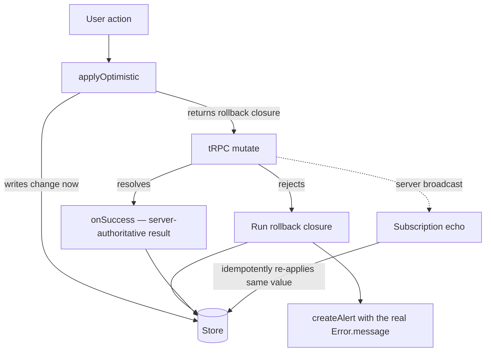
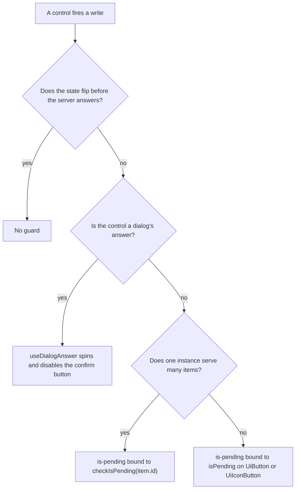

# Client Data Access

Every user-facing tRPC call on the client goes through one of two symmetric primitives, both in `apps/web/app/composables/shared/`:

- **`useQuery`** — reads. Fetches without blocking setup, populates reactive data, surfaces errors.
- **`useMutation`** — writes. Applies optimistically, rolls back on failure, surfaces errors.

A third primitive sits beside them for the reads many stores share:

- **`useCachedRead`** — a store's shared read, cached until a write invalidates its tag. Covered in [caching](../caching/design.md).

Both share the same error stack (`getResultAsync` → `createAlert`) and the concurrency model in [Async operations](../async-operations/design.md), so no call site re-implements loading, error handling, or race protection.

## useQuery

`useQuery` (`composables/shared/useQuery.ts`) replaces top-level `await $trpc.x.query(...)` in a **component** whose read is ancillary — one that should render immediately and populate when data lands. A top-level await forces the component under a `<Suspense>` boundary and throws on failure; `useQuery` fetches in the background instead, so neither a `Suspense` nor a `NuxtErrorBoundary` is needed.

It is **not** for page-level loaders that must gate rendering or 404 on a missing resource — those keep the top-level `await` and `throw createError(...)` / navigate on failure (see the page-level bullet under [When not to use them](#when-not-to-use-them)).

```ts
const { data, refresh } = useQuery(() => $trpc.invite.readMyInvite.query({ roomId }), {
  onSuccess: (result) => {
    // rare: derive local state from the loaded result
  },
});
```

- `query` — the tRPC read. The only required argument.
- `data` — a `shallowRef` holding the result, `undefined` until the first fetch resolves. Render loading/empty state off `data.value === undefined`.
- `refresh` — re-runs the query (retry after a failure, or refetch on demand). The initial fetch fires automatically on setup.
- `onSuccess` — rare; for seeding local state from the loaded result.
- `isInlineError` — the surface renders the failure itself (a `UiErrorState` with a retry), so no toast is raised; `error` carries the message.
- `isLazy` — no fetch on setup; the read waits for the first `refresh`. For a lens the surface opens on demand, such as the explorer's summary cards, where a fetch at setup spends a round trip on a read nothing renders yet.

On failure `data` stays `undefined`, so the component falls back to its empty state, and the real `Error.message` is raised as an alert — unless `isInlineError` is set, which carries it on `error` for the surface to render instead. A superseded fetch (a newer `refresh`, a remounted component) can never overwrite a newer result.

`useQuery`'s data is **per instance**, so two components calling it fetch twice. A read that several surfaces share, and that should be read once per session, is `useCachedRead` on a store instead — see [caching](../caching/design.md).

## useMutation

`useMutation` (`composables/shared/useMutation.ts`) returns `{ executeMutation, executeQuery, checkIsPending, isPending }` and bundles the four things every write needs:

- **Optimistic apply + rollback** — write the change to the store immediately, roll it back if the server rejects it.
- **Concurrency by target** — writes to one `key` run one at a time, so two controls writing different fields of the same entity both land; reads for one `key` are latest-wins. The full model, the opt-ins, and the outcome statuses live in [Async operations](../async-operations/design.md).
- **Pending state** — `isPending` is true while any of the instance's calls is in flight; `checkIsPending(key)` scopes it to one key for per-item surfaces (a table row's own button). They are what the triggering button binds as `is-pending` (see [In-flight guarding](#in-flight-guarding)).
- **Error surfacing** — a failed mutation raises the actual error message as an alert; no call site writes `try`/`catch` or bespoke alert strings.

```ts
const { executeMutation, checkIsPending, isPending } = useMutation();

await executeMutation(mutate, {
  applyOptimistic: () => {
    // write the change to the store now
    return () => {
      // rollback closure — undo the write
    };
  },
  key: input.id,
  onSuccess: (result) => {
    // rare: write a server-authoritative result
  },
});
```

- `mutate` — the tRPC call.
- `key` — **required**: the identity of the mutation's target. It scopes the write queue, the pending state, and exclusivity; calls with different keys are fully independent. How to choose one is in [Async operations](../async-operations/design.md#targets). Never call `useMutation()` inside an action to fake isolation — that leaks a detached effect scope, and the `setup-scope` lint plugin fails the call; key the shared store-root instance instead.
- `applyOptimistic` — the normal path. Apply the local change and return its rollback closure. It runs when the write is sent, so a queued write snapshots the state its predecessor stored. On failure the rollback runs. Where the entity has a subscription, the confirming server state also arrives through it and idempotently re-applies the same value — but not every mutation has one, so the rollback is what the correctness rests on, never the echo.
- `onSuccess` — the rare path, for mutations whose result the client can't predict (server-generated ids/tokens like `createInvite`). Omit `applyOptimistic` and take the server result here.
- `onError` — replaces the default alert, only for surfaces that own a different error channel: the platform resource operations route failures into the [notifications bell](../../resource/notifications/design.md), including the stale-`contentVersion` warning with its Refresh action. Everything else omits it and gets the alert.

**A rollback restores the store row, never the control the value was typed into.** Whether the form's own copy follows it back is a separate decision, and it is made by asking whether the surface holding that copy is still on screen when the rejection lands. A settings panel is: it keeps the entered value, stays dirty, and the next save retries it. A menu or dialog that closed on submit is not, so its draft re-seeds from the row — otherwise it reopens showing a value the server refused, beside a readout of the row that never took it. The `vue` skill's watch decision tree owns the mechanics.

The optimistic apply and the server's own broadcast coexist — the write lands locally at once, and the echo re-applies the same value when it arrives:



Call `useMutation()` once per logical action — each instance owns its own queue and pending bookkeeping, so two independent actions must **never** share one. A shared instance makes unrelated actions on the same entity id contend for one target: fire `deleteRole` while `createRole` is in flight and the delete waits behind a create it has nothing to do with, while `isPending` disables both surfaces. In a store with several mutations, declare one named instance per action via destructure renames (`const { executeMutation: executeCreateRoleMutation } = useMutation();`, with `isPending: isCreateRolePending` where the pending state is consumed); a single flow that branches into two tRPC calls (create-or-update save) correctly shares one instance, because its successive calls are successive writes to one target. One instance serving many sibling **items** of the same action is the `key` case, not a reason for per-item instances.

**Placeholder creates stay on the shared store-root instance with a per-call `Symbol` key** (`createRoomCategory`). Each call owns a distinct placeholder object, so successive creates are genuinely independent operations — a shared key would serialize them behind one another for no reason, and every create is free to run at once.

## In-flight guarding

Queueing protects **state**, not **the server**: every `executeMutation` call still fires its network write (only an `isExclusive` drop prevents one), it just waits its turn. The surface that triggers a write is therefore responsible for making a pointless second trigger impossible while the first is in flight. Exactly one guard applies per surface — pick by shape, never hand-roll a pending flag:



- **Dialogs** — free. `UiConfirmDialog`, `StyledDialog` and `StyledFormDialog` answer through `useDialogAnswer`, which early-returns a re-entrant answer and drives the confirm button's spinner and `disabled`. Consumers wire nothing. An optimistic write passes `isOptimistic`, and the dialog closes the moment it is called.
- **Plain buttons firing a non-optimistic write** (save, delete, publish, duplicate, deploy, generate, restore) — bind the instance's `isPending` as the button's `is-pending` — `UiButton` and `UiIconButton` own the rest of the pending state (the `ui-library` skill's buttons page), so no call site draws its own spinner or folds the pending flag into `:disabled`. When the mutation lives in a store or composable, it exposes the ref under a name that says which write is pending (`isPublicationPending`, `isDuplicatePending`) and that name threads down as an ordinary prop; overflow/action list items bind it as `disabled`. For per-item surfaces (each table row has its own button), bind `checkIsPending(item.id)` instead so one row's in-flight write doesn't disable its siblings.
- **Per-item creates through a shared instance** — `key` + `isExclusive` (`createLike`), so one item's in-flight create drops only its own duplicates while sibling items stay live.
- **Optimistic writes** — no guard. The state flips synchronously, so a second click reads the new state and means something new (a favorite toggle un-favorites); disabling the control would swallow real intent, and the second write simply queues behind the first.
- **Fields that commit on blur and on Enter** — guard with a dirty check against the value last stored (`isDirty`), so the second emit for an unchanged field never issues a write at all.
- **Synchronous unmount** — closing/unmounting the triggering control before the round trip (an `isOptimistic` dialog, a selection toolbar cleared on click) is a complete guard by construction; don't add a second one. Where the mutation resolves its own target from the dialog store target (`renamingId` → the list row), **call it before the close and await the promise after** — closing first clears the target out from under it, and the mutation silently no-ops. `useDialogAnswer` calls an optimistic answer in that order.

## Optimistic by default

**Every `useMutation` write applies optimistically (`applyOptimistic`) unless it falls into a documented exception below.** Waiting for the server round-trip before the UI reflects a change is a bug, not a default — the user acted, so the UI updates now and rolls back only if the server rejects it. When a subscription echoes the change back to the caller (most room/message/friend/role actions), the optimistic apply and the idempotent echo coexist: apply immediately, the echo re-applies the same value on success, the rollback undoes it on failure.

A **server-generated id alone is not an exception.** When the created row appears in an on-screen list **and the client can faithfully build it**, insert a **temp placeholder row** optimistically and reconcile the real row in `onSuccess` — the `createMessage` flow in `store/message/data.ts` is the reference, and `createRoomCategory` follows it for its flat row. The client invents a throwaway `crypto.randomUUID()` id (the store keys by id), then `Object.assign(placeholder, serverRow)` swaps in the real one on the **same reactive object**, so the row keeps its list position instead of being removed and re-appended. The placeholder must be `reactive()` — `createItem` pushes the raw object into a `ref([])`, and mutating a raw target there wouldn't trigger the re-render.

Two tests gate this, and both must pass — otherwise the ceremony is pure cost:

1. **Faithful** — if the placeholder would have to guess server-computed or relational fields the client doesn't have, it renders **wrong data** for a frame (see the relational-row exception below).
2. **On-screen** — the list must actually be visible when the create fires (see the off-screen exception below).

A mutation may skip `applyOptimistic` **only** in these cases (surface the result via `onSuccess`/`onError` instead):

- **Relational / server-computed row** — the created row carries fields the client cannot faithfully fabricate: aggregate counts + author/relation graphs (`createPost`, `createComment`) or a server-assigned ordinal/permission bitfield (`createRole`). A guessed placeholder would flash incorrect data, and where the create also has a subscription echo (`createRole`, `sendFriendRequest`) the server-id row races the temp-id placeholder into a transient duplicate. Take the real row in `onSuccess`; the echo (if any) reconciles the other clients.
- **Off-screen create** — the created row lands in a view that isn't visible at creation time, so an optimistic apply updates a list nobody can see and buys nothing. `scheduleMessage`/`scheduleReminder` land in the drafts/sent list on another view. `createSearchHistory` is the subtler case: it fires from `useReadSearchedMessages` at the moment the right drawer switches to **results**, while the history list itself lives in the search field's panel (`UiTokenField`) — which is closed by then. Hand-fabricating the row there would cost ~20 lines for zero perceived UX. Use `onSuccess`.
- **The server-generated value _is_ the visible result** — the mutation exists to reveal data the client cannot predict: a secret token or share link (`createInvite`, `createWebhook`, `rotateToken`), or a dedup-resolved id used only to navigate (`joinRoom`, `createDirectMessage`, resource `duplicate`). There is no on-screen state to pre-apply.
- **Optimistic-concurrency writes** — the server returns a bumped version token that drives the _next_ write, and a stale token must surface a refresh prompt: `saveResourceContent` (`contentVersion`), survey `createSurveyResponse`/`updateSurveyResponse` (`modelVersion`), resource `publish` (`publishVersion`). Handle the conflict in `onError`.
- **Server-authoritative outcome** — moderation (`executeAdminAction`): the effect shape (ban / mute / kick / timeout) is decided server-side and applied via the subscription echo, so there is nothing correct to apply before the server responds.
- **Rapid-fire integrity hazard** — `createLike`: a temp local like lets a rapid second click fire another `createLike` and hit the likes primary-key constraint; guarded single-flight with `{ isExclusive: true, key: postId }` instead of an optimistic row.

Any new non-optimistic mutation must justify itself against this list; if it doesn't fit, it is optimistic.

## Server-side effects a mutation does not return

A mutation often changes more than the row it was asked to change: creating a reply auto-follows its thread, a moderation action stamps a timeout, a send touches the room's ordering. A store that loaded the affected state once per room and never revisits it will render the stale version indefinitely — a follow button offering **Follow** for a thread the user is already following, and cannot turn off.

The rule is per side effect, decided by who can construct the result:

- **The client can construct it** → mirror it locally at the call site that caused it, through a `store*` function that takes only what the caller holds (`storeFollowThread(roomId, threadRootRowKey)`). No round trip, and the mirror is idempotent so a subscription echo re-applying the same value is a no-op.
- **Only the server can construct it** (it resolves an entity, an ordinal, or an aggregate the client never had) → re-read that slice after the write, and say so in a comment. Following a thread from the drawer re-reads because the drawer lists the **root message entity**, which the button holds no copy of.

Both shapes are correct; what is never correct is leaving the state stale because the mutation "was only about something else". An asymmetry between two neighbouring actions (one mirrors, one re-reads) is a deliberate consequence of this rule, not an oversight.

## Server-owned aggregates are re-read, never adjusted

A count the server derives from many rows (a room's member total, a group's members per role, a post's likes or replies) is **never** moved by the client through a delta, `+1` for a join or `-1` for a leave. A delta is exact only when the client provably holds the state it is changing against, and the client never does for every change: a member whose roles it never read has no prior role to subtract, a read can already include a change whose event then arrives and is added on top (counted twice), and two reads can finish out of order. Each of those drifts the count with no later write to correct it.

The rule is therefore:

- **Every change to an aggregate's inputs re-reads the aggregate** from the server — the write itself, the subscription echo, and a rollback alike. An echo is a notice that the inputs changed, not a number to add.
- **Reads of one aggregate are ordered per room (or per entity), latest started wins.** A read that started before a newer one can finish after it, and its value would then overwrite the newer one, so a read applies its result only if no later read of the same aggregate has started. The latest read started after every change the client has been told of, so it reflects them all.
- **An optimistic prediction is allowed for display only**, and the settled server value replaces it. Where the optimistic change is the viewer's own vote on a row the client holds exactly (`viewerLike`), the rollback restores that row and the settled value still comes from the server.
- **Tests that wait on a re-read observe the store's own write** (a watcher on the aggregate), not a timer or a retry. Production answers the reads sent in one tick as one batched response, but the test build's client sends each read as its own request, so a test that holds one read open does not hold the others.

Derived in the client, not re-read: values the client computes from data it already holds exactly (the roleless group is `total - sum(role groups)` of two server-read numbers, not a third number to maintain).

**Why the membership and role rows carry no version.** A version or sequence column on `usersToRooms` and `usersToRoomRoles` would let a client order a change against a read, and that is the only thing a delta needs. Under this rule no client computes a delta, so ordering is never needed, and the column would add a write to every membership change for a question nothing asks. Revisit it only if a reader is added that must apply changes incrementally, such as a sync log for offline clients; the schema change for it belongs with that reader, not here.

The rule is the same shape as the server-side effects rule above (re-read what only the server can construct), applied to aggregates. The consequence the member list shows is the test of it: a role change to a member outside the loaded pages re-reads the room's group totals, and a leave of any member does too.

## The batched refresh primitive

The primitive's contract, its retry, and its owners are specified in [batched refresh](../batched-refresh/design.md).

What the stores get from `services/shared/createBatchedRefresh.ts`, beyond the contract above:

- **One run in flight per owner.** It is built on `createSingleFlight`, so a mark that lands during a run is taken by the run owed after it, and no two reads of the same keys overlap. The one to finish last is always the newest, which is why it needs no sequence numbers.
- **Batched.** Every key marked before a run starts is read by that one run. A room's totals, or a list of post ids, is one request, not one per key.
- **Failure is kept.** A failed read retries itself on the backoff, and after five retries it waits for the next mark, as [batched refresh](../batched-refresh/design.md) states.

Post counts have one owner, `usePostCountStore`: a write that changes a count asks it to re-read, and the one read is applied to every copy by the stores that hold copies, through `postCountHooks`. Copies in different stores therefore never order their own reads against each other. Every other owner calls the primitive per instance, and writes only the copies it holds.

## Anti-patterns, and what enforces each

Each entry is a shape to keep out of the code, with the shape to use instead and the check that stops it., with the shape that replaced it and the check that now stops it coming back.

- **A count moved by a delta.** `count++` on a join, `likeCount += delta` on a vote, `commentCount += 1` on a reply. Replaced by a re-read of the aggregate. **Enforced** by the `no-restricted-syntax` selectors in `packages/configuration/eslint/restrictedSyntaxes.js`, which fail a `++`, `--`, `+=` or `-=` on a server-derived count field, and a count set to a sum or difference (`likeCount = likeCount + n`). A delta computed into a variable first (`const next = count + 1; count = next`) is not matched; review owns that case.
- **A delta from an event payload.** A subscription echo read as a number to add to the count. An echo says the inputs changed; the count is read again. **Enforced** by the same lint selectors: a payload's count added to the stored one is a `+=` or a sum on a count field.
- **Guessing an unknown prior state.** Treating a member with no read roles as roleless (`?? ""`), or a read-tracking set that says whether the roles were read. An unknown prior state is not a value. The owner re-reads the aggregate instead of computing a change it cannot prove. **Not yet mechanically enforced**; the review lane owns it, and the entries above are its reference.
- **Ordering reads one at a time.** `createBatchedRefresh` runs one read at a time per owner: reads never overlap, the newest is always last, and a change marked during a read is read by the run after it. An older read can therefore never finish last and overwrite the newer one. **Enforced** by its own suite (`services/shared/createBatchedRefresh.test.ts`) and by every store that uses it.
- **One read per element.** A loop of `readPost` over the ancestors of a reply. Replaced by a batch read keyed by the ids, one statement per set (`post.readPostCounts`, bounded to `MAX_POST_COUNTS_PER_READ`). **Enforced** by the runtime-efficiency rule and the server test that reads several posts in one call.
- **An optimistic count.** Moving a displayed count before the server answers. The viewer's own vote is optimistic, since the client holds it exactly; the count is not, and it is read back when the write settles. **Enforced** by the `count-write-after-settle/no-count-write-before-settle` oxlint rule (`scripts/src/oxlint/countWriteAfterSettle.ts`), which fails a write to a server-derived count that comes before the await settling the function's first mutation, including a write inside a mutation's `applyOptimistic`; and by the like store's tests, which assert the count holds while its write is in flight. A count written after its write settles and before the re-read lands is not matched, and review owns that case.
- **A refresh fired from inside `onSuccess` and not awaited.** The mutation settles before the count does, so a caller that reads the count next sees the old value. `onSuccess` is awaited by `useMutation`; the re-read is awaited inside it. **Enforced** by the store tests, which read the count straight after the write resolves.
- **A read with no index on its filter.** A room-wide count or a feed by author on a table whose only index leads with another column. Every re-read of it becomes a scan, and the cost grows with the table, not the answer. The index follows the read, per the drizzle skill's constraint reference (`references/table-constraints.md`). **Enforced** by review against that reference, and by the migration reviewed in the change that adds the read.
- **Adjusting a counter with no bound.** A `>= 0` check on a column whose sign is the domain (`likeCount`, a signed vote sum) refuses a correct write. A count the server adjusts gets the check; a signed sum does not. **Enforced** by the same reference.
- **Testing a re-read by waiting on a timer.** A `setTimeout`, a retry loop, or `vi.waitFor`. Tests wait on the store's own write, a watcher on the aggregate, so the wait ends on the change and not on a clock. **Enforced** by the repository's no-polling rule.
- **Two reads sent in one tick, one held open.** Production tRPC batches requests in one tick into one response, so a test that holds one read open while another waits behind it deadlocks. **Enforced** structurally: the test build's client takes the unbatched branch of `createHttpBatchingLink` (`apps/web/app/services/trpc/createHttpBatchingLink.ts`), so no read waits on another, and a unit test of that function pins that production still batches.
- **A mock that leaves a read unanswered.** A write that re-reads a count, with no handler for that read, makes the MSW layer answer "no procedure" and fail the test far from its cause. Every read a write triggers is mocked in the test that writes. **Enforced** by the test harness failing on unhandled requests.

## When not to use them

`useQuery` is the wrapper for a one-shot fetch, on setup or — `isLazy` — on the first `refresh`, and an inline error panel is its `isInlineError` option rather than a reason to leave it. A read whose state shape differs — its own cursor, a page that accumulates — skips the wrapper but still goes through `executeQuery` on a `useMutation()` instance of its own (`useDataset`, `useReadResourcesPage`), so it inherits the latest-wins guarding and the pending flag without owning either. These stay off both wrappers entirely:

- **Search-as-you-type reads** go through `useAutoSearch` (see [Search](../search/design.md)) — it shares the `getResultAsync` → `createAlert` error stack but cancels the superseded request with an `AbortController` instead of merely ignoring its result.
- **Background bookkeeping writes** (mark-read + mention-count clear on room enter, typing pings, push-subscription registration) — the user didn't act, so surfacing a failure as an alert would be noise; they stay raw fire-and-forget calls. The one that does go through `executeMutation` is the [offline cache](../../esbabbler/offline-cache/design.md) write, because it needs the per-partition queue — and it passes `onError: console.error` for exactly this reason. Wanting the ordering is not wanting the alert.
- **Composed SAS-upload flows** (generate upload URL → `uploadBlocks` → assign public URL) — the mutation is one step of a multi-step flow whose error/loading handling belongs to the composing function, like the device-coupled call operations.
- **The message send path** (`createMessage` in `store/message/data.ts`) — a bespoke optimistic flow (reactive `isLoading` placeholder + `MessageHookMap` hooks) that predates and exceeds what `applyOptimistic` models. `storeCreateMessage` is shared with the subscription handler, so **the push/hook order is a parameter, not a constant**: the sender's own message renders before its hooks (`isOptimistic`) because it has a loading bubble to keep responsive and a rollback if they reject, while a message from anyone else waits for them — pushed first it renders every attachment as a broken image until the url fetch lands, and pushed first on a rejected fetch it renders broken forever.
- **Call-session lifecycle operations** — `createCall` / `joinCall` / `joinCallByRoomId` / `leaveCall` (`store/message/room/call/index.ts`) stay on raw `getResultAsync(...).match(...)` (or a bare `await` when only the return value is needed). They can't use `useMutation` because they (a) consume the mutation's **return value** — `liveKitToken`, `liveKitUrl`, `participantMap`, `callSessionId` — to drive the LiveKit connect step, and (b) compose a local LiveKit `connect`/`disconnect` teardown with the remote sync. `setCameraEnabled` / `setMuted` are **not** in that family: each writes one field of the participant row and goes through `useMutation` keyed on the participant, exactly like `setHandRaised`. What the composing `toggle*` / `joinCall` / `selectVirtualBackground` flow branches on is the **local LiveKit device call** (`setCamera` / `setMicrophone`), which is the only half that can leave nothing to sync — a camera that never turned on has nothing to composite a background onto. A rejected server flag has been rolled back and reported by the primitive by the time the flow resumes, and must not cancel local work that already succeeded or tear down a call that is already connected. (The lobby `knock`/`admit`/`dismiss` actions in `knocker.ts` are likewise ordinary user actions on `useMutation` with `applyOptimistic`.)
- **Page-level gating loaders** — a page (or a publish-view root component like `ResourceDashboardView`) whose read _is_ the reason to render keeps the top-level `await` and, on failure, `throw createError({ status: 404 })` or navigates away. The failure must block/redirect, not render an empty component behind an alert, so `useQuery`'s non-blocking background fetch is the wrong tool. Event-triggered imperative reads (fetch on button click, not on setup) likewise stay on `getResultAsync(...).match(..., createAlert)` — `useQuery` auto-fetches on setup and can't be deferred to a user action.

## Key files

| File                                                   | Role                                                                                      |
| ------------------------------------------------------ | ----------------------------------------------------------------------------------------- |
| `apps/web/app/composables/shared/useQuery.ts`          | The read primitive                                                                        |
| `apps/web/app/composables/shared/useMutation.ts`       | The write primitive, with `applyOptimistic` and the rollback it returns                   |
| `apps/web/app/services/shared/createBatchedRefresh.ts` | The batched re-read every server-owned count is read back through                         |
| `apps/web/app/composables/post/useLikeOperations.ts`   | The like store, which reads the post counts back once a vote settles                      |
| `apps/web/app/services/trpc/createHttpBatchingLink.ts` | The batch choice: production batches a tick's calls, the test build sends each as its own |
| `packages/configuration/eslint/serverCountFields.js`   | The one list of server-derived count fields, read by the selectors and the oxlint rule    |
| `packages/configuration/eslint/restrictedSyntaxes.js`  | The `no-restricted-syntax` selectors that fail a delta on a count field                   |
| `scripts/src/oxlint/countWriteAfterSettle.ts`          | The oxlint plugin that fails a count written before its mutation's await settles          |
