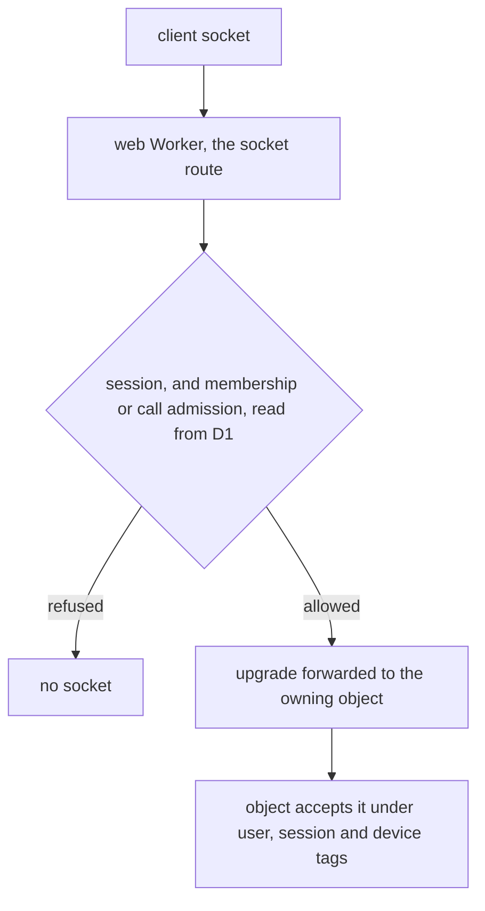
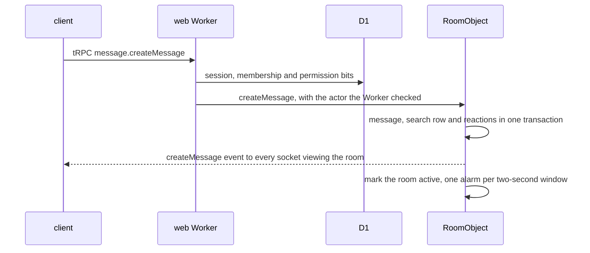
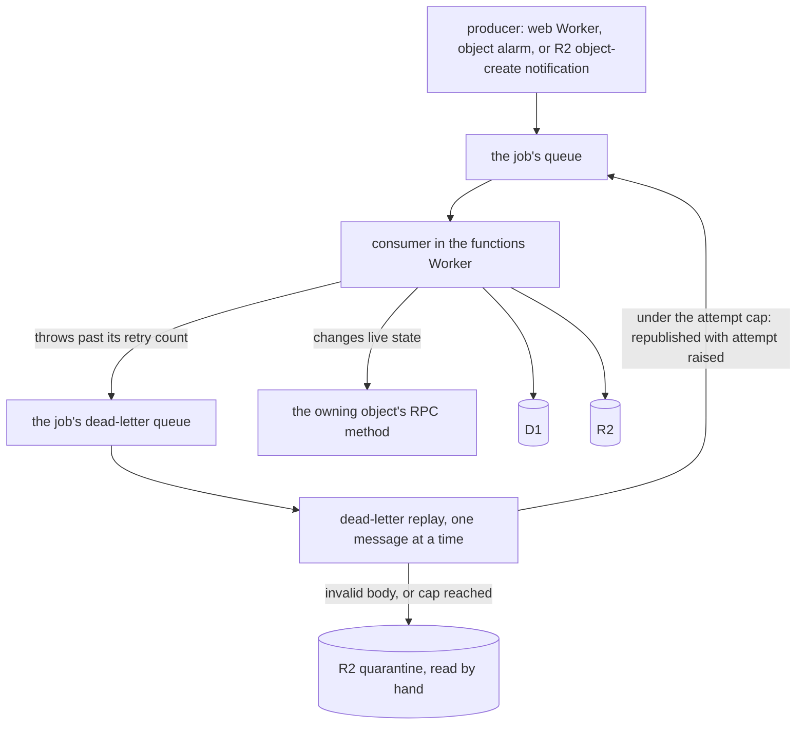

# Cloudflare Services

Which Cloudflare services the app runs on, what each one owns, and which package reaches it. The app is one stateless web Worker, one functions Worker that owns the queues and the live objects, D1 for every relational row, R2 for every file, and Durable Objects for the state that is live: a room, a call and a person.

## Service map

| Service                   | What it stores or does                                                                                                              | Primary access point                                     |
| :------------------------ | :---------------------------------------------------------------------------------------------------------------------------------- | :------------------------------------------------------- |
| **Workers**, web          | Serves SSR, tRPC over HTTP, the webhooks and the MCP route from any isolate. Holds no state between requests                        | `apps/web/configuration/nitro.ts`                        |
| **Workers Static Assets** | Serves the built client bundle without invoking the Worker                                                                          | the web build's output                                   |
| **Workers**, functions    | Consumes the queues, runs the nightly purge on a Cron Trigger, and exports the three realtime objects                               | `apps/functions/src/worker.ts`                           |
| **D1**                    | The `core` database: every relational table, and the typed tables for the moderation, resource activity, survey and program rows    | `apps/web/server/db/index.ts`                            |
| **R2**                    | One bucket per storage container: profile images, message attachments, resource content and snapshots, save files, public game data | `packages/db-schema/src/models/storage/StorageBucket.ts` |
| **Durable Objects**       | `RoomObject`, `CallObject` and `UserObject`: one per room, call and person, each holding its live state and its sockets             | `apps/functions/src/durableObjects/`                     |
| **Queues**                | One queue and one dead-letter queue per job, fed by the web Worker, the objects and R2's object-create notifications                | `packages/db-schema/src/models/queue/QueueJob.ts`        |
| **Cron Triggers**         | The nightly purge of deleted resources                                                                                              | `apps/functions/wrangler.jsonc`                          |
| **RealtimeKit**           | Audio and video for calls: the SFU, TURN and signalling, with participant webhooks back to the web Worker                           | the [calls](../../esbabbler/calls/README.md) pages       |
| **Miniflare**             | The D1, R2 and Queues bindings in tests, with no account needed                                                                     | `packages/db-mock/src/createMockDb.ts`                   |

Every binding comes from `cloudflare:workers`'s `env`, read once per Worker and passed to the code that uses it as a parameter. No binding is a module-scope client, so a test passes Miniflare's.

## Where each kind of data lives

| Data                                                                                   | Holder                                      | Why there                                                                                                                   |
| :------------------------------------------------------------------------------------- | :------------------------------------------ | :-------------------------------------------------------------------------------------------------------------------------- |
| Users, rooms, members, roles, bans, invites, friends, posts, resources, call sessions  | D1 `core`                                   | Relational, queried across owners, joined and foreign-keyed                                                                 |
| A room's messages, reactions and full-text search                                      | that room's `RoomObject`, in its own SQLite | The one data set that grows without bound, read almost only inside its room, and written with the sockets that broadcast it |
| A call's participants, knockers and admissions                                         | that call's `CallObject`, in its storage    | Live state for the life of one call                                                                                         |
| A person's sockets, sent-message index, scheduled-message index and TodoList reminders | that person's `UserObject`, in its storage  | Live state for one person, across their tabs                                                                                |
| Files: attachments, profile images, resource content, save files, public game data     | R2, one bucket per container                | Bytes with no query; a public bucket is served on a custom domain                                                           |

A new feature picks D1 when it holds relational or queryable data. It picks an object's SQLite only for message-like data that belongs to one room, and an object's storage only for live state that belongs to one call or one person.

## Live state

Three Durable Objects hold live state, and each owns the sockets viewing it:

| Object       | One per      | Owns                                                                                                                 | Its sockets                                |
| :----------- | :----------- | :------------------------------------------------------------------------------------------------------------------- | :----------------------------------------- |
| `RoomObject` | room         | messages, reactions and search in its SQLite; scheduled messages; the members online in the room                     | everyone viewing the room                  |
| `CallObject` | call session | participants, knockers and admitted maps; the call's start time; the RealtimeKit participant map                     | everyone joined to or knocking on the call |
| `UserObject` | person       | the person's sockets across devices; their sent and scheduled indexes; their TodoList reminders; their online status | every signed-in tab of the person          |

A socket is accepted with the WebSocket hibernation API under tags for its user, session and device. An object is evicted while no message is in flight, so an idle socket costs no duration, and a broadcast is a loop over the sockets a tag names, writing one JSON frame each. Every frame is a member of a discriminated union declared once in `packages/db-schema/src/models/realtime/`: `RoomEvent`, `CallEvent` or `UserEvent`. The objects write those types and the client reads them. Queries and mutations stay on tRPC over HTTP; there are no tRPC subscriptions and no in-process emitters.

A client holds at most three sockets: the user socket on every signed-in page, a room socket while a room is open, and a call socket while in a call. The web Worker opens each at `/ws/user`, `/ws/room/:roomId` or `/ws/call/:callSessionId`:

The Worker authorises against D1, because the relational tables live there, and then forwards the upgrade with the verified identity in headers only the object reads. The object trusts the identity its caller passes, and only the two Workers can reach it.

Who hears what follows from who holds the state. A person is online while their `UserObject` holds a socket. Its first socket attaches the person to each of their rooms' objects, and its last close detaches them, so a room knows its online members without a query and fans room-level events out only to them. A room's events reach its viewers, and the room-level events (renames, joins, leaves, mention counts) reach the online members' tabs through their user objects. A call's events reach the call's sockets. A revoked session closes its sockets on every object it reached.

## A message's path

The message, its reactions and its search row are one SQLite transaction inside the room's object, so a sent message is searchable at once and the three can never disagree. The room-list bump, which moves the room to the top of each member's list, is debounced to one fan-out per window and goes only to the members online at the time.

## Background work

Work that need not block a request is a job on a queue. Each job has its own queue and dead-letter queue, named from its value in `QueueJob`, so one job's retries and failures never touch another's. The functions Worker's queue handler dispatches each batch to the handler for its queue. A message is acknowledged when its handler resolves; a handler that throws is retried up to the job's retry count, then its message goes to the job's dead-letter queue.

A dead letter recovers by itself, and the functions Worker's dead-letter consumer is the same dispatch: each message is handled alone. Its body is parsed by its job's schema, and a body that fails it, a delivery that reaches `DEAD_LETTER_CONSUMER_MAX_RETRIES`, or a body whose `attempt` has reached `MAX_DEAD_LETTER_ATTEMPTS`, is written once as its raw body to `quarantine/<queue>/<id>.json` in the private `user-assets` bucket and logged. Any other dead letter is republished to its job's queue with `attempt` raised. Every queue message carries `attempt` in its own body, through one shared envelope that defaults it to 0, so the count survives each round trip. The cap is counted per message, so a poison message never holds back the transient failures beside it. The last delivery is quarantined rather than republished, so it always lands in R2; only a quarantine write that fails on that delivery is dropped, since the dead-letter consumer has no dead-letter queue of its own. A quarantined message is read by hand, and nothing alerts on it.

Delayed work is an alarm, not a queue delay. A queue holds a message for at most a day, and a scheduled message or a TodoList reminder has no upper bound, so each is a row in its owner's storage: the room's for a scheduled message, the person's for a reminder. The owner's one alarm is set to its earliest due row, runs every row that is due, and re-arms for the next. A queue consumer that changes live state calls the owner's RPC method directly; it never sends a message to an intermediary that then calls the object.

The nightly purge of deleted resources is the one timed job that is not a queue job. It runs on a Cron Trigger of the functions Worker.

## Search

Message search is an FTS5 table inside each room's object. A message is indexed in the same transaction that writes it, so there is no indexer schedule and no lag. A search across several rooms asks each listed room's object in parallel and merges the results by rank, so the fan-out is bounded by the rooms the caller asked for. Resource search is an FTS5 table in D1 over the searched columns, ranked by bm25.

## Calls

A call session is a RealtimeKit meeting. The web Worker creates the meeting through RealtimeKit's REST API and stores its id on the session row, adds each joining participant with a preset, and removes a participant the same way. RealtimeKit's participant webhooks return to the web Worker, which updates the call's object so every non-participant sees the same state. Media never crosses our Workers. The user-facing behaviour is in the [calls](../../esbabbler/calls/README.md) pages.

## Choosing a service for a new feature

- Relational, queryable or cascading data goes in D1 `core`.
- Message-like, time-ordered data that belongs to one room goes in that room's object.
- Live state that belongs to one call or one person goes in that object's storage.
- A file goes in an R2 bucket, public only when its content is public by design.
- A delay is an alarm on the owner's object. A queue is for work that can wait without a clock.

The decisions behind this split, and the alternatives they beat, are recorded in the [Cloudflare program](../../../changes/infra-cloudflare-program/design.md).

## Key files

| File                                                                        | Role                                                                |
| :-------------------------------------------------------------------------- | :------------------------------------------------------------------ |
| `apps/web/configuration/nitro.ts`                                           | the web Worker's Nitro build                                        |
| `apps/web/configuration/wrangler.ts`                                        | the web Worker's wrangler configuration, from its bindings          |
| `apps/web/server/db/index.ts`                                               | the Drizzle client over the `core` binding                          |
| `apps/web/server/routes/ws/`                                                | the three socket routes: user, room and call                        |
| `apps/web/server/services/realtime/forwardSocket.ts`                        | authorises an upgrade and forwards it to the owning object          |
| `apps/functions/src/worker.ts`                                              | the functions Worker: queue handler, Cron Trigger, exported objects |
| `apps/functions/src/durableObjects/RealtimeObject.ts`                       | the socket behaviour the three objects share                        |
| `apps/functions/src/durableObjects/RoomObject.ts`                           | a room's messages, search, scheduled messages and online members    |
| `apps/functions/src/durableObjects/CallObject.ts`                           | a call's participants, knockers and admissions                      |
| `apps/functions/src/durableObjects/UserObject.ts`                           | a person's sockets, indexes, reminders and online status            |
| `apps/functions/src/handlers/`                                              | the handler each queue job runs                                     |
| `apps/functions/wrangler.jsonc`                                             | the functions Worker's bindings, queues and Cron Trigger            |
| `packages/db-schema/src/models/queue/QueueJob.ts`                           | the job names, one queue each                                       |
| `packages/db-schema/src/models/storage/StorageBucket.ts`                    | the bucket names, one R2 bucket each                                |
| `packages/db-schema/src/models/realtime/`                                   | the `RoomEvent`, `CallEvent` and `UserEvent` unions                 |
| `packages/db-schema/src/services/cloudflare/CloudflareCoreDatabaseIdMap.ts` | each environment's D1 database id                                   |
| `packages/db-mock/src/createMockDb.ts`                                      | Miniflare's D1 for tests                                            |
| `apps/infra/src/cloudflare/`                                                | the Cloudflare resources the Pulumi program declares                |
| `.github/workflows/CI.yaml`                                                 | the checks and the deploy that runs on `main`                       |

## Sources

- [WebSocket hibernation](https://developers.cloudflare.com/durable-objects/best-practices/websockets/): `acceptWebSocket` with tags, `getWebSockets`, no duration while hibernated.
- [Durable Objects alarms](https://developers.cloudflare.com/durable-objects/api/alarms/): one alarm per object, at-least-once with retries, which is why the alarm runs every due row.
- [D1 limits](https://developers.cloudflare.com/d1/platform/limits/) and [D1 SQL statements](https://developers.cloudflare.com/d1/sql-api/sql-statements/): the database limits, and FTS5 support.
- [Queues limits](https://developers.cloudflare.com/queues/platform/limits/): message size, the delay of at most a day, and dead-letter queues per consumer.
- [R2 event notifications](https://developers.cloudflare.com/r2/buckets/event-notifications/): object-create events delivered to a queue.
- [RealtimeKit webhooks](https://developers.cloudflare.com/realtime/realtimekit/webhooks/): the participant join and leave events the call's state follows.
