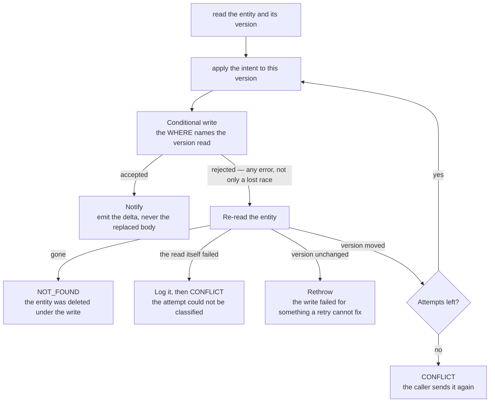

# Conditional Writes

A procedure that reads an entity, computes something from it, and writes the result back is not one operation — it is two, with a gap in between that another caller can write into. A write that rewrites a whole entity carries the whole version the procedure read. Two of them running at once both compute from that same version, and the later write echoes back a body that never saw the earlier change.

Nothing surfaces. There is no error, no log, and the caller whose write landed first was already told it succeeded. The change is simply gone, and the only witness is a user who watches their edit revert.

So: **a write derived from what the procedure just read is conditional on the version it read.** This is [Persist Then Notify](../persist-then-notify/design.md)'s persist phase under concurrency — the guard/persist/notify ordering is unchanged, the persist step just carries the version it depends on.

## Which writes this covers

A write is a read-modify-write whenever the value it stores could not have been computed without first reading the entity:

| Write                              | Why it qualifies                                                                                                        |
| ---------------------------------- | ----------------------------------------------------------------------------------------------------------------------- |
| A map or array rewritten wholesale | `votePoll` stores the whole votes map; `deleteFile` stores the whole surviving `files` array                            |
| Any `"Replace"`                    | Merge cannot unset a property, so clearing one (`deleteLinkPreviewResponse`, `unpinMessage`) has to write the full body |
| A counter or accumulator           | The new value is the old value plus one                                                                                 |

A `"Merge"` of fields taken straight from the caller's input is **not** one — `updateMessage` writing the text the user typed, or `pinMessage` setting `isPinned: true`, depends on nothing it read.

The `"Replace"` row is the one that gets missed, and it is the worst of the three: the write carries every property, so replaying it from a stale read reverts _all_ concurrent changes to that entity, not just the field the procedure meant to touch.

## The lifecycle

The loop back to applying the intent is the whole design: **the retry re-applies the intent, it does not replay the body.** "Record this vote", "drop this file", "clear this field" are all still valid after losing a race — only the body computed against the version that moved is stale. Writing that body again is the bug the conditional write exists to prevent.

`updateEntityConditionally` (`apps/web/server/services/streams/`) owns this loop. A caller supplies a function that receives the **fresh** entity on every attempt, and a write that decides the mode and whether the write stamps message metadata. Do not hand-roll the loop per procedure.

## Rules that fall out of it

The lifecycle above is one helper, and the rules it holds every caller to are these: the intent is re-applied to the version re-read rather than to the body first computed; the retry is bounded; exhaustion is an outcome the call chooses; only a lost race retries; the delta is the payload; and follow-up work is derived from the attempt that won. A caller reads the version in the same statement as the entity wherever a shared procedure already reads it.

One rule is the page's own because it is about what a status code cannot say: **an absent entity and a failed read are different facts.** A read returns nothing only when no row or object exists, and every other fault propagates — collapsing them is how a throttled re-read gets reported to a voter as `NOT_FOUND` for the message they are looking straight at, where `CONFLICT`, logged with its real cause, tells them to send it again.

## The same hazard, without a version on the row

The hazard the version answers is general: **a write derived from a view that another writer can invalidate before it lands.** There are three ways to be safe from it, and they are not the same mechanism.

**Serialize**, so no stale view can exist. A read and the write it decides are one synchronous transaction inside a room's object, with no await between them, so nothing else can run in the gap: the second writer reads after the first has committed rather than beside it. Nothing is compared and nothing is rejected — the read and the write are simply not interleaved. D1 has no interactive transaction to hold a row open across a round trip, so a read that must not interleave with another writer's is never split from its write.

**Or carry a version token**, where waiting is impossible because the competing writer is not a transaction you can block — it is another process, or an event that has already been delivered. Then the write states which version it depends on and is rejected if that has moved.

**Or make the check the write**, where the condition is one the row can answer for itself. A `SELECT` that decides whether to write is a check-then-act: every concurrent caller reads the same pre-write row, so every one of them passes. Moving the predicate into the `UPDATE`'s own `WHERE` hands the decision to the database — the caller that gets a row back holds the claim and the one that gets none was beaten to it. This is what throttles an automatic [resource revision](../../resource/resource-snapshots/design.md) to one per interval, and it is the shape to reach for whenever a check reads "has enough time passed" or "is this still unclaimed": those are the row's questions, and asking them anywhere else is asking a copy.

| Where                                          | How it is made safe                                                      | What that stops                                                   |
| ---------------------------------------------- | ------------------------------------------------------------------------ | ----------------------------------------------------------------- |
| A D1 row read-modify-write                     | claim — one batch whose `UPDATE` names the state it read                 | two writers computing from one value concurrently                 |
| A room's messages, reactions and search        | serialized — read and write in one synchronous transaction in the object | a write landing between another write's read and its write        |
| An event handler writing what an event reports | token — the event's ordering value                                       | an older event delivered after a newer one                        |
| A throttle or a once-per-interval gate         | claim — the predicate in the `WHERE`                                     | two callers passing a check made from the same pre-write row      |
| A save blob (Clicker, Dungeons, Genshin)       | token — the object's `etag`, as the condition of a conditional put       | a save written over one another session changed since it was read |

The storage ledger's reconcile is the claim row at work: its batch's counter update applies only while the ledger row still holds the state the delta was computed from, so two events cannot both measure the same `countedBytes`.

The event-handler row is the one that gets missed, because a handler can pass every idempotency check and still be wrong. **Idempotent is not order-independent.** Idempotency asks "does running this twice differ from running it once" — a redelivery computing a zero delta answers yes and is genuinely safe. Ordering asks a question idempotency never poses: _does an older event arriving after a newer one leave the wrong state behind?_ Replaying the stale event is a well-behaved no-op by every idempotency measure and still overwrites the current value with a superseded one.

Queues deliver at least once and in no guaranteed order, and each job's dead-letter queue covers the deliveries it gives up on ([Cloudflare services](../cloudflare-services/design.md)). So a handler whose write depends on _when_ its event happened needs the event to say so:

- **R2's object-create notification carries `eventTime`, the only field in its body that says when the write happened.** R2 gives no per-object ordering token, so two writes to one key are ordered by it, at the millisecond it carries. The body is `R2ObjectCreatedQueueMessage` in `packages/db-schema/src/models/queue/`.
- **The token is stored beside the value it ordered, so the next event has something to compare against** — the ledger keeps it beside `countedBytes` ([storage quotas](../../resource/storage-quotas/design.md)).
- **A writer with no position passes no token and clears none, but it does not wait for one either.** The server's own provisional charge writes bytes without an ordering token. Clearing the stored one would leave the next stale event comparing against nothing and being applied, so the token it cannot rank against is the token it leaves alone. Making it _yield_ to that token is the tempting third rule and the wrong one: the blob it measures is rewritten under one name on every save, so an untokened writer that stood down after the first event never wrote again ([storage quotas](../../resource/storage-quotas/design.md) has what that cost). An unordered writer that cannot know it is not overwriting a newer measurement is instead made to be the one whose figure the next tokened write measures over.

A handler that writes nothing derived from its event's moment — one that deletes by name, or sets a flag — needs none of this. The question to answer per handler is whether two events for the same subject can carry _different_ values for what it writes; if they can, order decides which is right.

### Testing delivery order

The delivery order is an argument, so the test is the two calls in the wrong order — no mock of the notification required. Assert the newest value survives **and** that the stale event still reports having found its subject, or a caller that retries on a miss will retry forever on a correctly-dropped event.

## Testing it

Miniflare's D1 and R2 honour the condition, so the loop is testable against them. A test that makes its two writes one after the other, each awaited before the next starts, never overlaps them: it has to hold the first write open with a promise the test resolves itself, so the second write runs against a version the first has not yet landed. A green `Promise.all` that never interleaved reports the hazard as covered.
