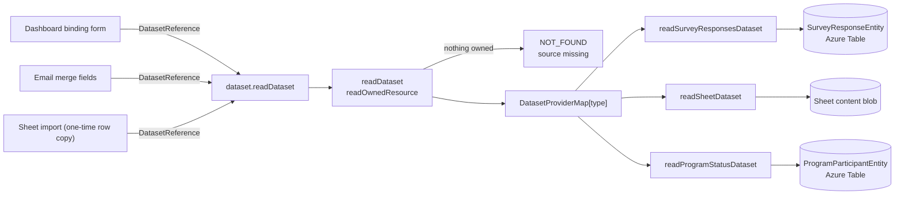

# Datasets

The standard for serving tabular data across products. Whenever one product needs to read another product's data (survey responses in a dashboard, file rows in an import), it goes through this contract — never through product-specific reads.

Serving is the **DatasetProvider capability** ([resources](../resource/design.md)): a resource type opts in via `ResourceDefinitionMap`, and `DatasetProviderType` keys the provider map so a declared-but-unregistered provider is a compile error. _Consuming_ is not a capability — it is just calling `dataset.readDataset` from a component (dashboard binding form, email merge fields).

## Contract

Shared models in `apps/web/shared/models/dataset/` (one type + schema per file, interface-first). `ColumnType` and `ColumnValue` are reused from the Sheet resource models — they are already the canonical cell-type vocabulary.

```ts
interface DatasetColumn {
  name: string;
  title?: string; // the header a file prints in place of the name
  type: DatasetColumnType; // ColumnType minus Computed — a computed column is served as the type it yields
}

interface Dataset {
  columns: DatasetColumn[];
  rows: Record<string, ColumnValue>[];
  totalRows?: number; // when present, the uncapped count — truncation is detectable only for providers that supply it
  partialColumns?: string[]; // columns the read could not fill in full, named in the truncation warning
}

enum DatasetProviderType {
  ProgramStatus = "ProgramStatus",
  Sheet = "Sheet",
  SurveyResponses = "SurveyResponses",
}

interface DatasetReference extends ItemEntityType<DatasetProviderType> {
  id: string; // the resource id
}
```

A reference is just a resource id — a Sheet resource _is_ the dataset, so a reference carries no sub-item selector. `DatasetProviderType` (server-resolvable references) is a different axis from `DataSourceType` (Csv/Json/Xlsx — file formats parsed client-side). Do not merge them: one describes _where data lives_, the other _how a file is encoded_.

## Serving

One procedure resolves every reference:

| Procedure             | Auth           | Input              | Purpose                            |
| --------------------- | -------------- | ------------------ | ---------------------------------- |
| `dataset.readDataset` | Resource owner | `DatasetReference` | Resolve a reference to a `Dataset` |

Public viewers never call this: published resources bake resolved datasets in at publish time.



Server structure (`server/services/dataset/`): `DatasetProviderMap.ts` maps `DatasetProviderType` → the provider and the resource type it reads, one provider per folder. `readDataset` is the only way into a provider: it resolves the reference to a resource the caller owns, of that type, before the provider runs — so a provider is handed an owned resource and has no auth check of its own to forget. Each provider owns its column/row derivation:

- **`readSurveyResponsesDataset`** — columns from the survey model's questions (name + question-type → `ColumnType` mapping, carrying each question's title); rows flattened from `SurveyResponseEntity` JSON in Azure Table, a checkbox's answers joined with `; `, other non-primitive answers JSON-stringified. A submission time column leads, and an Identified survey adds a respondent column keyed by `publicId`.
- **`readSheetDataset`** — reads the Sheet resource's content blob and converts `content.data` via `dataSourceToDataset`.
- **`readProgramStatusDataset`** — participant/addedAt/responded rows from `ProgramParticipantEntity` in Azure Table, keyed by the non-secret `publicId` (never the token — dashboards bake dataset snapshots into public publishes).

## Rules

- **Row cap** — `AZURE_MAX_PAGE_SIZE` on every provider; datasets are for visualization and import, not bulk export. **Truncation is `totalRows > rows.length`, or a column the read could not fill in full (`partialColumns`), never the presence of `totalRows`** — a provider that can count cheaply always reports the uncapped total, which equals the row count on an uncapped read. `getDatasetTruncation` is the one place that check lives, so a warning can never disagree with the rows on screen; a provider that cannot count omits the field and its consumers simply never warn, because truncation is then unknowable rather than absent. Add pagination only when a real consumer hits the cap ([deferred](../../../deferred/resource/dataset-row-cap-pagination/design.md)).
- **Consumers choose copy or reference.** Import (Sheet resource) copies rows once. Binding (dashboard visuals, email editor merge fields) stores the `DatasetReference` and re-resolves on load; its `id` is a declared `Dataset` link, so every binding is in the [resource-link index](../resource-links/design.md). All call the same procedure.
- **A reference whose source is gone reads as missing, and is never rewritten.** `readDataset` answers a reference it cannot resolve to a resource the caller owns — its source deleted, in the recycle bin, or never the caller's — with `NOT_FOUND`, one answer for all three so it confirms nothing about anyone else's resource. `getDatasetErrorMessage` turns that answer into `getMissingResourceMessage`'s, which tells the owner to pick another source or restore this one, and `useDataset` drops the dataset it held, so no consumer offers the previous source's columns under it. Every consumer shows the message where it holds the reference. A Dashboard tile re-reads its source when its bound reference changes or its `refresh()` is called, and a restore calls neither, so a tile that held the message reads the restored source once its reference changes or it mounts afresh. The consumer's content keeps the reference untouched, so a restore heals each consumer the next time it reads its reference ([dangling reference cleanup](../../../rejected/resource/dangling-reference-cleanup/design.md)).
- **Fetch on load + manual refresh.** No live subscriptions through this layer ([deferred](../../../deferred/resource/realtime-dataset-refresh/design.md)).
- **No external providers** (HTTP APIs, SQL) until secret storage and injection-safety work is scoped ([deferred](../../../deferred/resource/api-sql-dataset-providers/design.md)) — the enum grows one value per new provider, nothing else changes.
