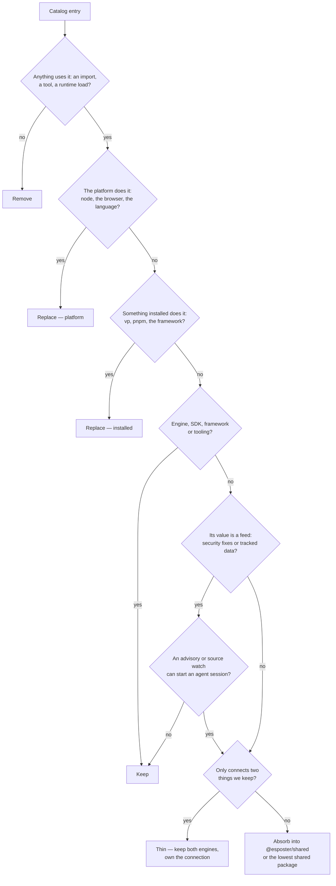
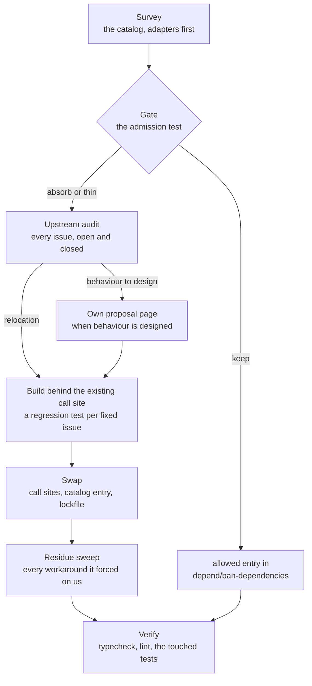
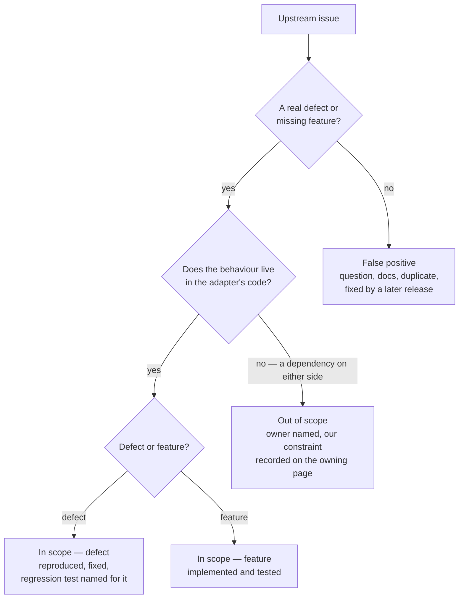

# Dependency Admission

Every version in the workspace lives in one place — the `catalog` block of `pnpm-workspace.yaml`, with `catalogMode: strict` so no package may pin its own. That single file makes the whole dependency surface readable in one sitting, which is what makes an initiative like this possible at all: the question "what are we paying for" has one answer, not fourteen.

This page owns the **rule** for what a third-party package must earn, and the **gap analysis** that applies it once. It is deliberately not a list of rewrites. Most of the catalog passes the test, several entries that look absorbable are the ones we most want to keep, and the honest output of the analysis is a short backlog rather than a long one — which lives on the roadmap of the area whose component carries the dependency, never here. When an item is big enough to need a design, it graduates to its own proposal page — this page never grows into the spec.

## What actually costs us

The instinct is that dependencies cost bytes. They mostly do not — the bundler drops what nothing imports, and the packages that dominate installed size are the engines we would never write: the game engine, the PDF renderer, the diagram renderer, the survey builder. Weight is a symptom worth reading, not the charge.

Three costs are real:

- **A behaviour we cannot change.** A library that owns DOM, keyboard handling and CSS decides the product's interaction model. When our answer to "make it behave the way the reference product does" is "the library doesn't do that", the library has taken a product decision away from us. This is the cost that matters, and it is the one the emoji work removed.
- **A version we do not control.** A wrapper is pinned behind the thing it wraps, so every upgrade of the underlying library waits for a maintainer who is not us. Refusing to wait means an `overrides` entry forcing the wrapper onto a renderer major it never declared. That works, but nothing except our own reading verifies that it does, and each renderer bump is us accepting that library's compatibility testing as our own. The [PDF viewer](../pdf-viewer/design.md) draws over the renderer directly for that reason, so a renderer bump answers to our own tests. Two of the page-builder plugins arrive at the same cost from the other direction, imported through `@ts-expect-error no d.ts file`.
- **A second way to do something we already do.** When two packages each do half of one job, a reader has to learn which one answers a question, and each brings its own dependencies to do its half. The PDF thumbnail and viewer are one renderer's components for that reason, with no wrapper between them and it.

Bytes, imports and call sites are the evidence; those three are the charge. A package that is large, old and imported once but costs us none of the three stays.

## The admission test

The same gate decides a package we are considering adding and one already in the catalog. Maintenance is an agent's compute rather than a person's time, so a small utility costs almost nothing to own, and owning it pays: it is rewritten to our conventions, built as ESM by our own tsdown, carries no CommonJS interop, and leaves every upstream issue fixed with a regression test naming it rather than inherited. What a dependency still buys is a size we would not write, a feed of fixes or data we would not otherwise see, and the tooling the rest of the pipeline stands on.

The order is the point: the platform and what is already installed come before any code of ours, and the only packages the gate keeps by category are the ones whose size or churn would make owning them a standing cost — engines, SDKs, the framework and the tooling, which is delegated rather than rebuilt. Everything else is a utility, and a utility is absorbed unless its value is a feed nobody would send us. A package we want an opinion about is not deleted either: its engine stays and the connection is ours, which is the thin branch below.

### Adapters

An **adapter** is a package whose every runtime dependency and peer is already in the catalog, and whose own code does nothing but connect them — a test mock joining two libraries, a framework module joining a library to the framework's request and fetch primitives, a component wrapping an engine's view for the UI framework. It is the thin branch by construction: both engines stay, and what goes is the connection, which is small because the engines on either side already did the work.

An adapter is the cheapest item this page finds and the one that costs the most per line, because it sits on the seam between two things we upgrade independently. It is pinned behind both, it re-implements whatever it cannot reach through their public APIs, and the workarounds it forces land in our code rather than its own — a type shim for a declaration it inlined, a build entry it needed once, a test-only branch in production code because it could not serve what the real transport sends. The signal is mechanical — its manifest's dependencies against the catalog — so the survey below reads every entry for it rather than waiting for a symptom.

## The absorb score

`pnpm ai:dependencies:score` scores every catalog entry out of 100 for how sensibly it could be absorbed into our own code. A high score is a strong candidate, and each ledger verdict is read against it. Four dimensions, each read from something the repo already holds:

- **Size, 35.** The lines of the package's runtime module graph: its entry for the `import` condition (else `require`, else `main`), followed through its relative imports. Declarations, source maps and minified copies are left out, so a package shipping CJS, ESM and UMD builds of one module is counted once. Fewer lines score higher.
- **Stability, 25.** Releases in the last two years. Few releases means little upstream to track once we own it.
- **Format, 20.** CommonJS scores highest, since our ESM build gains the most from owning it. Dual scores less, and ESM or types-only scores 0.
- **Self-containment, 20.** The package's own dependency count. None scores highest.

The package's own dependencies' lines, its importing files, the manifests that list it and its type shims are shown as unscored context, beside two costs the command measures from the install. The bundle is the gzipped bytes the package adds to the app's client build, read from the raw-data report the score asks its own `nuxt analyze` run for, since a run by hand writes the treemap the command serves instead: each module is attributed to the package it sits under in `node_modules`, a workspace package by its folder, or the app itself, and a package the client build does not contain reads as `not in client`. `--analyze` builds that report first; without it the score reads the last build's report and prints its age. `--sort bundle` orders the rows by it and the report ends on its largest. The install is the package's own bytes plus every package it reaches, each once, and flags a dependency another catalog entry also reaches. A type shim is a `declare module` over the package, or a `@ts-expect-error` or an `as unknown as` cast beside its import or call, and a package with shims is one absorbing it fixes at the root. The weights and bands are named in `scripts/src/services/dependencies/score/constants.ts`.

The command's Disagreements are rows to re-judge, never errors: a Keep whose reason is outside the exempt list (engine, SDK, framework, tooling, types, hold, free) that scores 60 or more is an absorb candidate its verdict missed, a Keep outside the shim-exempt reasons (engine, SDK, framework, tooling) that has type shims is one too, and an Absorb scoring under 30 is one the score does not back.

## The precedent

The emoji picker is the shape every absorption on this page should take. What was removed was a package that owned the dataset, the search behaviour and the failure mode all at once, and threw on a query made of punctuation. What replaced it was not a rewrite of any of that. Two data packages generated from the Unicode spec were kept, a general-purpose search engine was kept, and what we wrote was the part that was always ours: which fields are boosted, that an exact shortcode outranks a longer match, that a room's own emoji lead the results, and that a query matching nothing renders the empty state.

The rule that generalises: **keep the data and the hard algorithm, take back the layer that decided behaviour.** Absorbing the dataset would have meant tracking Unicode releases forever, and absorbing the ranking would have meant writing BM25. Neither was the reason the picker was wrong.

The first adapter absorbed is [trpc-msw](../../trpc-msw/README.md), and it is the shape an adapter's absorption takes. `msw-trpc` joined the request interceptor to the RPC framework by re-implementing the framework's wire format, so everything the framework's own handlers already did — batching, the error formatter, non-JSON input, subscriptions — was either missing or a hand-kept copy. The replacement keeps both engines and writes only the connection: a router built from registered resolvers, handed to the framework's own handlers. Its spec carries the upstream triage every absorption owes.

The second is [trpc-nuxt-module](../../trpc-nuxt-module/README.md), the shape an absorption takes when the adapter is a framework integration. `trpc-nuxt` left the handler routes, the WebSocket bridge, the plugin and a `build.transpile` entry to every app that used it, because a library cannot register itself; the replacement is a Nuxt module that does, over tRPC's own fetch and WebSocket adapters, so the app keeps only the link chain that is genuinely its own. It also showed the audit's limit: an issue can be settled upstream by a neighbour rather than the adapter — h3 2.x reads a request body once by design, which turned the middleware-read body hang from a defect into the platform's rule — and the verdict says so rather than claiming a regression test that cannot fail on the code it replaces.

The third is [pitch-transcription](../../pitch-transcription/README.md), the shape an absorption takes around a trained model. `@spotify/basic-pitch` held every consumer to an old TensorFlow.js major because it loaded and ran its network through its own copy. The replacement keeps the engine as a peer and the weights as shipped data, and takes back only the layer between them — the windows, the model call and the note creation — following the model repository wherever the port had drifted from it. The engine then moved from TensorFlow.js, which had stopped, to ONNX Runtime, which the repository already installed, and the weights to the model repository's own ONNX export, so the package's runtime is a maintained one the workspace already carried.

The fourth is [nuxt-security-module](../../nuxt-security-module/README.md), the first security-shaped package absorbed under the exception the stop list below now carries. The app runs it in place of nuxt-security. The fifth is [sanitize-html](../../shared/sanitize-html/design.md), the second security-shaped absorption: the parser that did not read markup as a browser does is replaced by the standard's own parser, and the upstream's feed of bypasses is replaced by a watch on its advisories and on DOMPurify's, read when the suite runs.

The sixth is [drag reorder](../drag-reorder/design.md), the first package taken off the stop list by reading its item again. `vue-draggable-plus` was kept as accessibility-shaped, but the keyboard reorder and its announcement were already the UI library's, and what it did — through the SortableJS it bundled — was only the pointer drag. That drag is now a composable on Pointer Events, which never hands the browser a native drag and never moves a row Vue rendered.

The seventh is [tresjs-nuxt](../../tresjs-nuxt/README.md), the first Nuxt module absorbed as an adapter. `@tresjs/nuxt` joined the renderer to Nuxt, but its own dependencies took in a UI library and its font package for a devtools tab the app never used, and a dependency on a second engine it never called. The replacement keeps both engines and writes only the connection: it reads export names from source instead of importing the renderer at configuration time, and it drops the tab with everything that tab pulled in.

The eighth is [charts](../charts/design.md), the first component wrapper absorbed, and the shape that takes. `vue3-apexcharts` mounted the chart engine and added a second copy of everything the engine already offers: a component event per engine callback, a method per engine method, a plugin and a global. Its replacement stays in the app, because it adds only the app's theme and lifecycle over the engine, and it reaches the engine only through the engine: the options pass through as given and the instance is handed out.

## The stop list

These stay packages whatever their size or call-site count, so the initiative cannot talk itself into the expensive mistake later:

- **Engines.** Anything implementing a large algorithm as its product — the game, 3D, diagram, page-builder, survey and editor runtimes. The plugins around an engine are a separate question from the engine.
- **SDKs and the framework.** The cloud SDKs, the framework and its modules: their surface follows a service or a release train that changes without us.
- **Tooling.** The build, lint, test and type tooling the pipeline is built on, delegated to the tool rather than rebuilt (the `dependency-updates` skill owns its bumps).
- **Accessibility-shaped.** Anything whose real surface is focus management, ARIA and keyboard semantics — the component framework, the rich text and code editors. Our own version reliably ships worse here, because the part we would reimplement is the part we would not think to test.
- **A feed with no watch.** A security-shaped package (HTML sanitisation, auth, push encryption, rate limiting) is valuable for the bypasses researchers report to it, and a data-tracking one (media types, top-level domains, user agents, emoji) for the registry it follows. Either is absorbed only with that feed replaced: a security-shaped absorption carries the full upstream audit, a regression test for every in-scope defect and advisory, a security review, and a watch on the upstream's GitHub advisories that starts an agent session to port each new fix; a data-tracking one becomes a generator over the registry's own source, rerun when the source changes. [nuxt-security-module](../../nuxt-security-module/README.md), which replaces `nuxt-security`, is the first security-shaped absorption.

## The register and the score

Every catalog entry's verdict is a row in `.agents/ledgers/dependencies.md`, with its reason. The catalog derives the rows, so a new dependency opens there unjudged and nothing goes untracked. `pnpm ai:dependencies:score` scores every entry out of 100 for how sensible absorbing it is — its lines of code, its releases over the last two years, whether it is CommonJS, and its own dependency count — and lists where the score disagrees with the ledger's verdict. The score ranks; the verdict decides, because only the gate above tells an engine from a utility.

## Gap analysis

The ledger is the gap analysis, one verdict per entry. What it cannot hold is a finding about a cluster, and two clusters are recorded here.

A `@types/x` entry is read against the package it types rather than against a call site of its own: one whose runtime package now ships its own declarations is residue, and one whose major trails the package it types is describing an API we no longer install.

The page-builder plugin belt is the one thinning left open: around a dozen single-purpose plugins, several unmaintained and two imported through `@ts-expect-error`. The large ones — the webpage preset, the image editor, the exporter, the MJML and PostCSS integrations — are engines; the small ones register a block and a trait, and are replaced by the page builder's node types ([page builder proposal](../../../changes/resource-page-builder-program/design.md)). The component wrappers are the other cluster: each mounts one engine's view and does nothing else, and each is replaced by a component of the app's own over the same engine, as the standard below sets out.

## Executing an absorption

An **absorption** is the whole move from a catalog entry to code of our own, and it runs in named stages. The gate is the point of the first half — most items never reach a proposal, and one that does is a case where behaviour is being _designed_ rather than merely relocated. The upstream audit and the residue sweep are the point of the second, because they are the two stages that decide whether the absorption is _complete_ rather than merely compiling.

- **Upstream audit.** The package's issue tracker is read whole, open and closed, before anything is written. The tracker is where every bug the replacement could reintroduce is already written down, and where the workarounds in our own code are explained; an absorption that skips it rebuilds the package's known bugs along with its features. Every issue gets one verdict from the triage below, and the verdicts are recorded in the replacement's own spec, each linked to its issue — that page is where the next reader of a stranded upstream link finds out what became of it.
- **Residue sweep.** An adapter's cost is mostly in our code rather than its own, so deleting it is not finished at its last import. Every `@TODO` citing its tracker, every type shim for a declaration it shipped, every build or pre-bundle entry that named it, every test-only branch in production code that existed to accommodate it is deleted or given its real reason — in the commit that deletes the catalog entry, because the next reader has no way to tell a stranded workaround from a live one.

Two rules bind the whole pipeline. **The catalog entry is deleted in the same commit that removes its last import** — a dependency kept "until we are sure" is a dependency nobody removes, and the lockfile is the record of what we actually stopped paying for. And **a thinning is built behind the call site it will replace**, so the swap is one import change and the revert is one import change. A rewrite landing as a big-bang replacement of a working feature is how this initiative would earn a bad reputation. The `dependency-absorption` skill owns how each stage is run, and the rewrite rule the build stage follows.

### The standard an absorption meets

A small utility we have no opinion about lands in `packages/shared` and is done when its call sites are. An adapter is different: it is a seam generic over two engines, so it is absorbed as **a workspace package of its own**, publishable, and held to a higher bar than the package it replaces — **feature parity or better, with every issue in its scope closed**. Parity is measured against the upstream package's surface, not against what our app happens to call: a replacement that drops the half we do not use is a fork with gaps, and the next consumer — ours or anyone's — finds them one at a time. Parity stops at what the engines themselves still stand behind: a shape an engine has deprecated is never carried over, because the replacement carries only the latest shapes and no debt the upstream package was carrying for its own older users. How the replacement is written is the `dependency-absorption` skill's rewrite rule, not this page's.

A **component wrapper** — an adapter whose only connection is mounting one engine's view as a component — is the exception to the package. It is absorbed as **a component of the app that mounts it**, because once it is ours the generality is gone: what it adds over the engine is the app's styling, the theme handoff and where the engine sits in the component's lifecycle, and a package would carry a styling contract no other consumer wants. Its parity is measured against the engine rather than against the wrapper's copy of it: every option reaches the engine as given and the engine's instance is handed out, so nothing the wrapper proxied is out of reach, and nothing it re-emitted is copied a second time. The engine mounts once the component does and draws nothing on the server, so no build entry, pre-bundling exclusion or client-only shell is needed for it. Its capability page carries the same upstream audit an adapter's spec does.

**Behaviour of its own makes the rewrite a package again.** Sometimes the rewrite holds logic that another consumer would otherwise rebuild: an algorithm, such as a grid's placement, or the state that a viewer's controls drive. That half becomes a headless workspace package, published and carrying no styling. It is the skeleton, in the way `@vuetify/v0` is the skeleton under the UI library, and the app's component styles it. The case against a package was the styling contract, and a headless package carries none. A rewrite that is only the mount, like the charts or the code view, stays an app component.

### Triage

Each upstream issue is reproduced or read against the source before it is given a verdict, and a verdict without its evidence is not one. The order matters: the first question is whose code the behaviour lives in, because an issue filed against the adapter is often the adapter being blamed for a dependency on either side of it.

- **In scope — defect.** Reproduced against the upstream package first, so the regression test is known to fail on the code it replaces, then fixed. The test names the issue.
- **In scope — feature.** Implemented and tested, whether or not our app calls it — that is what parity means.
- **Out of scope.** The behaviour lives in a dependency on either side — the framework, the security middleware, the engine. The verdict names that owner, and whatever constraint it leaves us is recorded on the page that owns our side of it. One issue can split: the part in the adapter's code is fixed, and the part in its neighbour is out of scope.
- **False positive.** A usage question, a documentation gap, a duplicate, or a defect a later upstream release already fixed. The verdict says which, and links the evidence — the answering comment, the duplicate, the release.

## Handing the standing part to the enforcer

The recurring half of this work is already automated and should stay that way. `depend/ban-dependencies` runs over every `package.json` in the repo and fails lint on a dependency with a native or simpler replacement, with an explicit `allowed` list for the ones we have decided to keep anyway. That is the mechanism that stops the catalog re-growing, and it is why this page is a one-time analysis rather than a standing sweep.

So the follow-through from any decision here is an `allowed` entry carrying the reason, or nothing at all. A package we consciously keep against the enforcer's advice belongs on that list; a package we absorb disappears from it. Neither is a docs edit.

The catalog's own standing check is `scripts/src/workspace/deprecatedPackages.test.ts`, which fails on a direct dependency npm has deprecated, and `supersededPackages.test.ts`, which fails on a predecessor the superseded map names. Both run offline in the workspace suite.

## Key files

| File                                              | Role                                                                      |
| ------------------------------------------------- | ------------------------------------------------------------------------- |
| `pnpm-workspace.yaml`                             | The catalog — every version in the workspace, under `catalogMode: strict` |
| `packages/configuration/eslint/plugins/depend.js` | `depend/ban-dependencies` and its `allowed` escape hatch                  |
| `packages/shared/src`                             | Where an absorbed utility lands                                           |
| `scripts/src/services/dependencies/score`         | The absorb score, its dimensions and the disagreement filter              |
| `apps/web/app/services/message/emoji`             | The precedent — data and search engine kept, behaviour taken back         |
