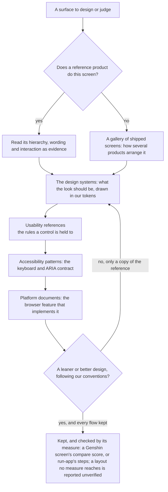

# Design Sources

Nothing in the app's interface is designed from memory. A surface is laid out after looking at how a shipped product arranges the same screen, drawn in tokens whose values come from a design system that explains why they work, and given the keyboard contract a published accessibility pattern describes. This page is the one list of those sources, with what each one gave the app, so an idea that shaped a surface is never lost when the surface is rewritten.

The rules that use these sources live elsewhere: where an action goes is the `ux` skill's, the design pass every unit of the UI library walks is the `ui-library` skill's, and the look itself is the [design language](../design-language/design.md)'s. This page only says where to look, and in what order.

## The order they are consulted in

The last gate is the design pass's own question. A reference product is evidence and inspiration, not the goal: a design departs from it wherever a leaner or better design follows our conventions, and each departure is argued in the area's design, with the commit body saying how it is better and citing the source it came from.

## References each area studies

Each product area studies one product that already solved its domain. The product is evidence for the arrangement, the copy and the behaviour the area takes, and the area departs from it where a leaner design follows our conventions. How a screenshot of the reference product is used is the `ux` skill's.

| Area                                                       | Reference product                                                                                                      | What it gave                                                                                                                                                                                                                                   |
| :--------------------------------------------------------- | :--------------------------------------------------------------------------------------------------------------------- | :--------------------------------------------------------------------------------------------------------------------------------------------------------------------------------------------------------------------------------------------- |
| [Esbabbler](../../esbabbler/README.md)                     | [Discord](https://discord.com/) on desktop and on its phone app, then Slack                                            | Room settings' information architecture, roles, invites, custom emoji, threads, push to talk, webhooks, mention badges, the composer's create menu; on a phone, one channel header and a keyboard raised only by a tap; Slack's pins as a pane |
| [Calls](../../esbabbler/calls/README.md)                   | [Google Meet](https://meet.google.com/)                                                                                | Share-link calls, fullscreen of the whole call view during a screen share, picture in picture                                                                                                                                                  |
| [Clicker](../../clicker/README.md)                         | [Cookie Clicker](https://orteil.dashnet.org/cookieclicker/)                                                            | The store's rows: a price green while affordable and red while not, the count owned beside it                                                                                                                                                  |
| [Webpage](../../resource/webpage-social-preview/design.md) | [Webflow](https://webflow.com/)                                                                                        | The page settings' meta description and Open Graph image, over the site's own                                                                                                                                                                  |
| [Resource explorer](../../resource/explorer/design.md)     | [The Azure portal](https://portal.azure.com/)                                                                          | The explorer's blades, and the breadcrumb trail as "where did I come from"                                                                                                                                                                     |
| [Calendar](../calendar/design.md)                          | [Outlook](https://outlook.live.com/calendar/), then [Google Calendar](https://calendar.google.com/)                    | Outlook's four views in its order and its view shortcuts, the month navigator, the shaded working day, the current-time line, a double click to create and a drag to move; Google Calendar's single keys for today, next and previous          |
| [Sheets](../../resource/sheet/README.md)                   | Excel and Google Sheets                                                                                                | Clipboard semantics: a copy lands as a table wherever it is pasted                                                                                                                                                                             |
| [Note](../../resource/note-resource/design.md)             | [Notion](https://www.notion.com/)                                                                                      | A to-do list inside a document, started by typing `[ ]` and a space at the start of a line                                                                                                                                                     |
| [Program](../../resource/program-resource/design.md)       | [Qualtrics](https://www.qualtrics.com/support/survey-platform/distributions-module/email-distribution/personal-links/) | Personal links: generating them downloads one row per contact with their own survey link, for another mailer's merge                                                                                                                           |
| [TodoList](../../resource/todolist-task-rows/design.md)    | [Microsoft To Do](https://to-do.office.com/)                                                                           | The task row: the title with one metadata line under it, a whole row that opens the task's detail view, the checkbox and Completed section, and the completion chime; not its hidden notes, which the row draws in full                        |
| [Genshin](../../genshin/README.md)                         | [Genshin Impact](https://genshin.hoyoverse.com/), as a player sees it                                                  | The environment look: a stepped ramp, shade in the sky's colour, a rim, outlines, soft far shadows, god rays and a haze in the sky's colour; its GDC and Unity Dojo talks for how each is drawn                                                |

## Design systems

These are where the look comes from: the palette's structure, the surfaces, the type, the motion and the density. A value in the tokens is chosen against one of them, never picked by eye alone.

| Source                                                                                                                                                                                                          | What it gave                                                                                                                                                                                                         |
| :-------------------------------------------------------------------------------------------------------------------------------------------------------------------------------------------------------------- | :------------------------------------------------------------------------------------------------------------------------------------------------------------------------------------------------------------------- |
| [Material 3](https://m3.material.io/)                                                                                                                                                                           | The reference for the standard style's drawing: its type roles, spacing grid, and when a surface earns elevation or a tonal fill                                                                                     |
| [Material 3's color roles](https://m3.material.io/styles/color/roles)                                                                                                                                           | Surface containers told apart by tone rather than by line: standard's frame, lifted panel and filled field                                                                                                           |
| [Material 3's states](https://m3.material.io/foundations/interaction/states/overview)                                                                                                                           | The state layer, one translucent overlay of the content's colour per state: standard's hover and pressed fills and its tonal button                                                                                  |
| [Material 3's window size classes](https://m3.material.io/foundations/layout/applying-layout/window-size-classes) and [canonical layouts](https://m3.material.io/foundations/layout/canonical-layouts/overview) | One layout that adapts across compact, medium and expanded windows rather than one per device: the `sm` cut at a compact window's edge, and the list-detail and supporting-pane shapes the room shell's drawers take |
| [Material 3's shape](https://m3.material.io/styles/shape/corner-radius-scale)                                                                                                                                   | A container rounding more than the controls inside it: standard's container and control radii, and the pill a search field takes                                                                                     |
| [Material 3's easing and duration](https://m3.material.io/styles/motion/easing-and-duration/tokens-specs)                                                                                                       | The one decelerating curve every transition uses, and how long a change of each size takes                                                                                                                           |
| [Material 3's checkbox](https://m3.material.io/components/checkbox/specs)                                                                                                                                       | An empty box drawn as an outline, the one control standard outlines, since a box of the panel's tone alone does not read as something to tick; a hover state layer on the box                                        |
| [Pixelarticons](https://pixelarticons.com/)                                                                                                                                                                     | The library's icon set, drawn on a 24-unit pixel grid to sit on a voxel surface                                                                                                                                      |
| [Design Tokens Format Module 2025.10](https://www.designtokens.org/tr/drafts/format/)                                                                                                                           | The split of primitive and semantic tokens that the layout tier and the design style's tier follow                                                                                                                   |
| [Radix Themes, theme overview](https://www.radix-ui.com/themes/docs/theme/overview)                                                                                                                             | Radius, scaling and panel background as theme-level settings: the precedent for a design style above the palette                                                                                                     |
| [Nuxt UI's CSS variables](https://ui.nuxt.com/docs/getting-started/theme/css-variables) and [design system](https://ui.nuxt.com/docs/getting-started/theme/design-system)                                       | The standard style's token vocabulary — a background, an elevated fill, a border, one radius — and its neutral scale                                                                                                 |
| [Radix Colors, understanding the scale](https://www.radix-ui.com/colors/docs/palette-composition/understanding-the-scale)                                                                                       | Which step of a neutral scale is a background, a component, a border and a text colour: the standard palettes' slate                                                                                                 |
| [Linear's design refresh](https://linear.app/now/behind-the-latest-design-refresh) and [how Linear redesigned its UI](https://linear.app/now/how-we-redesigned-the-linear-ui)                                   | Quieter chrome so the content leads, and a theme generated from a few inputs: the standard style's density and Inter face                                                                                            |
| [Lucide](https://lucide.dev/)                                                                                                                                                                                   | The standard style's icon set, the one Nuxt UI and shadcn ship                                                                                                                                                       |

## Galleries of shipped screens

- **[Mobbin](https://mobbin.com/)** — a library of real app and web screens and flows, for how several products arrange the same thing when no one reference product owns it.
- **[GrapesJS](https://github.com/GrapesJS/grapesjs)** — the open-source web builder whose block manager lays each block out as a tile of one width with its name and icon, the palette the page builder follows; its [layer manager](https://grapesjs.com/docs/modules/Layers.html), the page's component tree as its own panel, which the Layers tab follows; its [device manager](https://grapesjs.com/docs/api/device_manager.html), where a device sets the canvas width and a separate width for media queries, which the device toggle follows; and its [components](https://grapesjs.com/docs/modules/Components.html), whose droppable option restricts what may be dropped into a component, the idea behind a slot's accepted kinds.
- **[email-builder-js](https://github.com/usewaypoint/email-builder-js)** — an email template editor, one reference for how an email's block kinds are arranged.
- **[Excalidraw](https://raw.githubusercontent.com/excalidraw/excalidraw/master/packages/excalidraw/components/Toolbar.tsx)** — the freeform editor's arrangement: a strip of a few direct tools with the rest and the shape variants in one menu, a properties panel shown while something is selected or a drawing tool is in hand, an element drawn by choosing its tool, and, from its [mobile toolbar](https://raw.githubusercontent.com/excalidraw/excalidraw/master/packages/excalidraw/components/MobileToolbar.tsx), a bottom bar on a phone with items folding into overflow.
- **[tldraw](https://tldraw.dev/sdk-features/ui-components)** — a toolbar that keeps a minimum and a maximum of visible tools and folds the rest ([default toolbar](https://raw.githubusercontent.com/tldraw/tldraw/main/packages/tldraw/src/lib/ui/components/Toolbar/DefaultToolbar.tsx)), a style panel behind a button on a narrow window ([mobile style panel](https://raw.githubusercontent.com/tldraw/tldraw/main/packages/tldraw/src/lib/ui/components/MobileStylePanel.tsx)), and named UI slots an embedder can hide or replace.
- **[Figma](https://help.figma.com/hc/en-us/articles/360039832014-Design-Prototype-and-view-Code-in-the-Properties-Panel)** — with nothing selected, the properties panel shows the document's own settings, the nothing-selected state of every contextual panel.
- **[SurveyJS Creator](https://surveyjs.io/survey-creator/documentation/end-user-guide/user-interface)** — the Designer and Preview as the creator's modes, and a property grid scoped to a question, a page or the survey, the inspector's scopes.
- **[Microsoft Forms](https://support.microsoft.com/en-us/office/use-branching-logic-in-your-form-0a092a1c-8fe4-441c-9fc6-cd0aad3b52b2)** — a branch target offered from the later questions only, a constraint by construction in the survey's logic.
- **[Google Forms](https://support.google.com/docs/answer/141062?hl=en)**, with its [question settings](https://support.google.com/docs/answer/2839737?hl=en) — a routing list that offers sections only, its choices narrowed before the author picks, and settings reached from the question itself.
- **[Typeform](https://help.typeform.com/hc/en-us/articles/5821097529620-Why-doesn-t-my-question-work-with-logic)** — a condition picker that lists only the question kinds a condition can be built on, the condition kinds the logic builder offers.
- **[Tally](https://tally.so/help/create-a-form)** — a block inserted where the reader is, by typing a slash, which the insertion menu follows.
- **[MJML](https://documentation.mjml.io/)** — the nesting an email is built of: sections hold columns, columns hold content, and no section sits in a section, which the document's accepted types hold and the email's insertion menu mirrors.
- **[Beefree](https://docs.beefree.io/beefree-sdk/readme/installation/configuration-parameters)** — what an email editor exposes to its embedder, a mobile design width and merge tags, which the device toggle and the dataset picker are.
- **[Stripo](https://support.stripo.email/en/articles/6448082-new-editor-how-does-stripo-editor-work)**, with its [spam testing](https://stripo.email/blog/email-spam-testing-what-triggers-spam-filters-and-how-to-avoid-them-with-stripo/) — blocks and structures in panels on the left, a settings panel, a desktop and mobile switch in the top toolbar, and a spam check run inside the editor and reported to the author, the shape of the problems surface's email findings.
- **[Klaviyo](https://help.klaviyo.com/hc/en-us/articles/4407911841435)** — a preview with desktop and mobile layouts, which the email's device toggle applies in both modes, and a Styles tab beside the content.
- **[Mailchimp](https://mailchimp.com/help/design-an-email-new-builder/)** — content blocks, layouts and a desktop and mobile switch in one editor.
- **[Unlayer's content audit](https://docs.unlayer.com/builder/content-settings/content-audit)** — the checks of missing alternative text, missing links in buttons and menus and missing image addresses, which the problems surface keeps to those a document answers without a service.
- **[Puck's overrides](https://next.puckeditor.com/docs/api-reference/overrides)**, with its [slot field](https://puckeditor.com/docs/api-reference/fields/slot) — an outline and a fields panel as separate replaceable parts, the fields following the selected item, and a slot's allow list of component names, the rule the webpage's accepted types already hold.
- **[Webflow's Navigator](https://help.webflow.com/hc/en-us/articles/33961320786451-Navigator)** — a tree of the page's elements in a panel at the left of the editor, the place the Layers tab takes.
- **[Wix Studio's layers panel](https://support.wix.com/en/article/studio-editor-using-the-layers-panel)** — the same tree of a page's elements, in its layers panel.
- **[Power BI's report view](https://learn.microsoft.com/en-us/power-bi/create-reports/desktop-report-view)** — a visualisation pane beside a canvas that redraws as a visual is changed, the dashboard's inspector beside its grid.
- **[FlexLayout](https://github.com/caplin/FlexLayout)** — a layout held as a serialisable tree that names panels by id, with the reader's sizes kept apart from it.
- **[Dockview](https://github.com/mathuo/dockview)** — a serialisable layout that names panels by id, and a panel's minimum and maximum size and its collapse.
- **[rc-dock](https://github.com/ticlo/rc-dock)** — a serialisable layout that names panels by id.
- **[golden-layout](https://github.com/golden-layout/golden-layout)** — a serialisable layout that names panels by id.
- **[Lumino](https://github.com/jupyterlab/lumino)** — a layout held as a serialisable tree that names panels by id, with the reader's sizes kept apart from it.
- **[Zag's splitter](https://zagjs.com/components/react/splitter)** — panel ids, a minimum and a maximum size, collapsible panels and a controlled size, the limits a layout's regions are resized between.

## Absorptions that draw an interface

An absorption that draws an interface surveys its design sources in the order above, as [dependency admission](../dependency-admission/design.md) requires. The sources the survey consulted are written into the replacement's own design page with what each gave the surface, so the arrangement it settled on survives the next rewrite. The procedure is the `dependency-absorption` skill's `references/design-survey.md`, and the stage it runs in is `openspec/specs/architecture/dependency-admission/design.md`'s "Executing an absorption".

## Usability

| Source                                                                                                               | What it gave                                                                                                                                                                                                                                                                                                                              |
| :------------------------------------------------------------------------------------------------------------------- | :---------------------------------------------------------------------------------------------------------------------------------------------------------------------------------------------------------------------------------------------------------------------------------------------------------------------------------------- |
| [Nielsen Norman Group, modal and nonmodal dialogs](https://www.nngroup.com/articles/modal-nonmodal-dialog/)          | A modal only for what must interrupt; anything else is a popover or a panel beside the content                                                                                                                                                                                                                                            |
| [Nielsen Norman Group, confirmation dialogs](https://www.nngroup.com/articles/confirmation-dialog/)                  | A confirmation's answer named by the act rather than "OK" — its "only before what cannot be undone" is [rejected here](../../../rejected/architecture/no-confirm-for-undoable-deletes/design.md) for deletes                                                                                                                              |
| [Apple's Human Interface Guidelines on motion](https://developer.apple.com/design/human-interface-guidelines/motion) | Motion says where something came from or went, never decorates a frequent action, and never carries a meaning alone                                                                                                                                                                                                                       |
| [Laws of UX](https://lawsofux.com/)                                                                                  | The Doherty threshold (feedback within 400ms), [Fitts's law](https://lawsofux.com/fittss-law/) for target size and placement, [Hick's law](https://lawsofux.com/hicks-law/) for how many choices a menu offers, and the [aesthetic-usability effect](https://lawsofux.com/aesthetic-usability-effect/) for why the look is worth the work |
| [Firefox's address bar ranking](https://firefox-source-docs.mozilla.org/browser/urlbar/ranking.html)                 | Frecency, which ranks the dock's recent pages and the command palette's places                                                                                                                                                                                                                                                            |

## Accessibility

- **[WAI-ARIA Authoring Practices](https://www.w3.org/WAI/ARIA/apg/)** — the keyboard contract of every library component: the [menu button](https://www.w3.org/WAI/ARIA/apg/patterns/menubar/), [listbox](https://www.w3.org/WAI/ARIA/apg/patterns/listbox/), [combobox](https://www.w3.org/WAI/ARIA/apg/patterns/combobox/), [modal dialog](https://www.w3.org/WAI/ARIA/apg/patterns/dialog-modal/), [grid](https://www.w3.org/WAI/ARIA/apg/patterns/grid/), [date picker dialog](https://www.w3.org/WAI/ARIA/apg/patterns/dialog-modal/examples/datepicker-dialog/), [breadcrumb](https://www.w3.org/WAI/ARIA/apg/patterns/breadcrumb/), [disclosure navigation](https://www.w3.org/WAI/ARIA/apg/patterns/disclosure/examples/disclosure-navigation/), [window splitter](https://www.w3.org/WAI/ARIA/apg/patterns/windowsplitter/) and [toolbar](https://www.w3.org/WAI/ARIA/apg/patterns/toolbar/) patterns.
- **[WCAG 2.2 contrast minimum](https://www.w3.org/WAI/WCAG22/Understanding/contrast-minimum.html)** — the ratio every foreground token is tested against on every surface token.
- **MDN on [forced colours](https://developer.mozilla.org/en-US/docs/Web/CSS/@media/forced-colors), [reduced motion](https://developer.mozilla.org/en-US/docs/Web/CSS/@media/prefers-reduced-motion) and [colour scheme](https://developer.mozilla.org/en-US/docs/Web/CSS/@media/prefers-color-scheme)** — why a shadow-drawn edge also carries a transparent border, why the motion tokens are the one reader of the preference, and how the theme follows the system.
- **[Game accessibility guidelines](https://gameaccessibilityguidelines.com/full-list/)** — the menus reachable without the play itself, and support for several input devices.

## Platform

- **The top layer** — [the Popover API](https://developer.mozilla.org/en-US/docs/Web/API/Popover_API), [the top layer](https://developer.mozilla.org/en-US/docs/Glossary/Top_layer) and [anchor positioning](https://developer.mozilla.org/en-US/docs/Web/CSS/Reference/Properties/position-anchor), which every menu, select, tooltip and dialog is built on, and [Chrome's entry and exit animations](https://developer.chrome.com/blog/entry-exit-animations), for how they arrive and leave.
- **The document's chrome** — [scrollbar colour](https://developer.mozilla.org/en-US/docs/Web/CSS/scrollbar-color), [easing functions](https://developer.mozilla.org/en-US/docs/Web/CSS/transition-timing-function) and the [context menu event](https://developer.mozilla.org/en-US/docs/Web/API/Element/contextmenu_event).
- **The headless layer** — Vuetify 0's [building frameworks](https://0.vuetifyjs.com/guide/fundamentals/building-frameworks), [styling](https://0.vuetifyjs.com/guide/fundamentals/styling), [theming](https://0.vuetifyjs.com/guide/features/theming) and [testing](https://0.vuetifyjs.com/guide/tooling/testing) guides: behaviour and ARIA in the primitive, the look in our wrapper, state reaching the style as data attributes.
- **Dates** — [Temporal](https://developer.mozilla.org/en-US/docs/Web/JavaScript/Reference/Global_Objects/Temporal), whose plain dates every calendar walks so a time zone never moves a day.
- **The icon engine** — UnoCSS's [icons preset](https://unocss.dev/presets/icons), which turns a whole icon class into one masked SVG rule.

## Notes

- **A source weighed and not taken stays with the decision that weighed it**, as Reka UI does on the [UI library](../ui-library/design.md#rejected) page.
- **A new source is added the day a surface takes something from it**, with the one line saying what it gave. A link without that line is a bookmark, and it is not kept.

## Key files

| File                                                    | Role                                                                            |
| :------------------------------------------------------ | :------------------------------------------------------------------------------ |
| `.agents/skills/ux/references/visual-design-sources.md` | How an agent uses the reference product and the design systems while laying out |
| `.agents/skills/ui-library/references/design-pass.md`   | The questions every unit is asked, the last of which is this page's final gate  |
