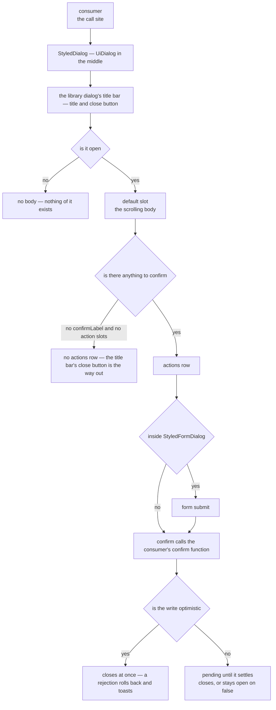

# Dialog Shell

`StyledDialog` is the shell every dialog with an actions row composes, with one documented exception below. It is the UI library's dialog (`UiDialog`) in the middle of the page, with its title bar and close button, a padded scrollable body and an actions row of library buttons, so the contract is its `title`, what confirming does (`confirmLabel`) and bare body content in the default slot. Only the title and the body are really required: a dialog with nothing to confirm omits `confirmLabel`, and loses the actions row with it unless one of the two slots below fills the row. Two optional slots sit alongside — `#prepend-actions` for the row's leading edge, and `#prepend-confirm` for a third decision in the trailing group. A call site names how wide the dialog stands with `size`, Medium when none is named, and the widths themselves are held in `UiDialogSizeClassMap`. The body's padding and gap come from the base dialog's body region, not from the shell. Nothing else in the app hand-rolls a dialog and confirm-button pair.

The body mounts with each open and goes once the close has played, held for the dialog's leave (`DIALOG_BODY_TRANSITION_DURATION`) so the dialog rises out with what it showed rather than as an empty frame. The library's dialog is the browser's own, which stays mounted while shut, so this is what keeps a closed dialog's viewer, query or form state from existing, and what makes every open start from what its model says.

Two shells build on it. `StyledFormDialog` wraps the base around a `UiForm` with a generated form id, so its confirm button is the form's submit: it stands disabled while the form has a failing field, pending while an awaited submit is out, and disabled on whatever else the consumer passes as `isConfirmDisabled`. `StyledEditFormDialog` is the editor-shaped sibling rather than a third layer: it is the library's dialog high on the page, expandable over the whole page, in the library's own title bar. The bar holds the item's kind over its name — the kind a label the consumer passes as `itemType`, so an item needs no type field to be edited, and the name following the name field as the reader types — then, in the bar's `actions` slot, the validity mark, the consumer's own commands from `#prepend-actions`, Save as the one labelled accent button, pending while the awaited save is out, and delete as a quiet icon button, before the dialog's own full screen and close, because an editor's actions live at the top where the form below can scroll past them. The close is the title bar's, which asks the dialog's model, so a close with unsaved changes opens the save, discard or cancel question instead of closing. A delete is a [destructive confirmation](../destructive-confirmation/design.md), never this shell.

## How one dialog renders

## The rules the shell enforces

**Body content is the default slot.** The shell's props are the library's words — a title, a confirm label, whether the confirm may be pressed — and never a prop bag passed through to the dialog underneath, so a message is always children, landing in the base dialog's scrolling body, which sets the column rhythm for every dialog.

**The actions row belongs to the shell.** Cancel is the shell's and closes the dialog. A third choice — discard, skip, "export anyway" — is a decision the same weight as the other two, so it goes in `#prepend-confirm` and sits between them: the whole trailing group reads cancel → alternative → confirm, and every decision the dialog offers is under the pointer at once. `#prepend-actions` is the other edge and is not for decisions: it carries what annotates the row rather than answers it — a `3/10 options` counter, a hint — kept away from the buttons so it is not clicked as one.

**The confirm button comes from the shell, not from the caller.** It is the library's button in the accent, the dialog's one action, and says what it does in `confirmLabel`. A destructive answer is not drawn here at all: it is the danger button of a [destructive confirmation](../destructive-confirmation/design.md).

**Confirming is a function the dialog awaits, and the dialog closes itself.** `StyledDialog` takes `confirm`, `StyledFormDialog` takes `submit` and `StyledEditFormDialog` takes `save`, and all three answer through `useDialogAnswer`, as `UiConfirmDialog` does. The answer runs through `useMutation`, so a function that rejects keeps the dialog open and raises the error alert any other write does. Which answer mode a consumer picks, and when the dialog closes under each, is owned by [destructive confirmation](../destructive-confirmation/design.md).

## Dialogs with nothing to confirm

A dialog that only shows something, a reference sheet, composes the same shell. Omitting `confirmLabel` and passing no action slot drops the whole actions row, cancel included: there is no pending change for cancel to abandon, and a read-only dialog forced to carry one button it never wanted is a dialog that re-rolls the frame to get rid of it. The title bar's close button is its dismissal.

The command palette, the keyboard shortcuts dialog and the settings dialogs are not on this shell. They have no actions row to give, so they are the library's own dialog directly ([command palette](../command-palette/design.md)).

## When a dialog may keep its own shell

The pinned **footer** is the base dialog's `#footer` slot rather than the shell's. The shell's actions row is drawn into it, and so are the dialogs that write their own footer, so a footer no longer keeps a dialog off the shell.

`MessageModelMessageForwardRoomDialog` is the one dialog with an actions row that does not compose `StyledDialog`, and that is settled. Its preview and rich-text editor are in the scrolling body, and its Cancel and Send are the `#footer`. What keeps it off the shell is its Send: a component that runs its own write, and on success clears the forward store that opens the dialog and, for one room, navigates to that room. The dialog closes from that store, not from an answer the shell awaits. Composing the shell with the Send as its `confirm` was the alternative, and it lost: the Send's own mutation would sit inside the shell's answer, so one press would pass through two mutation wrappers and close the dialog twice.

## Key files

| File                                                          | Role                                                                                                 |
| ------------------------------------------------------------- | ---------------------------------------------------------------------------------------------------- |
| `app/components/Styled/Dialog.vue`                            | The shell — the library dialog, the body mounted while open, the actions row                         |
| `app/components/Styled/FormDialog.vue`                        | Adds the `UiForm`, submit wiring, validity and pending state to the shell                            |
| `app/components/Styled/EditFormDialog/Index.vue`              | Editor-shaped dialog — the item's kind and commands in the library's title bar, dirty-close question |
| `app/components/Styled/EditFormDialog/ConfirmCloseDialog.vue` | Save / discard / cancel on a dirty close, composed on the shell with `prepend-confirm`               |
| `app/components/Ui/Dialog.vue`                                | The library dialog underneath, whose Escape and close button ask the model rather than closing it    |
