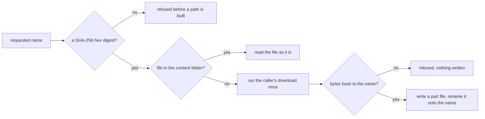

# Download Cache

One cache per machine for downloaded objects, each named by the hex SHA-256 of its bytes. A caller asks for an object by that name and supplies the download itself. The cache answers from disk when the object is already there and runs the download once when it is not. The function is `readContentAddressedObject`, exported from `@esposter/shared-node/cache`, and its rules are the requirements in [the spec](spec.md).

## How it works

The name is matched against a pattern of sixty-four lowercase hex digits before anything joins it into a path, so a name carrying separators or parent segments never reaches the filesystem. A held object is read without being hashed again, because the only way a file gets under its name is a verified download. A miss runs the caller's download function once, hashes the result with node's `crypto`, and compares the digest with the name. Only a match creates the content folder, writes the bytes to a part file named with a random UUID beside the target, and renames that file onto the object's name.

Two callers can fetch the same object at once. The later rename fails because the earlier one has already put the file in place. The later caller then deletes its own part file and returns its bytes, since both wrote identical content. The error is rethrown only when the target is still missing after the failed rename.

## Where the cache lives

`CACHE_ROOT` is the `cache` folder inside a folder named for the site under the user's home directory, and `CONTENT_CACHE_DIRECTORY` is the `content` folder inside it. Both are constants in `services/cache/constants.ts`. Every checkout on a machine reads the same root, so a worktree or an ephemeral run reuses a download an earlier run already made. The path itself is not a requirement, since a test that pinned it would only repeat the constant. Specs name that root `{data-root}`, so `CACHE_ROOT` is `{data-root}/cache` and the content folder is `{data-root}/cache/content`. The folder's name is the site constant's alone, so renaming the project changes that constant and no page (`.agents/skills/openspec/references/repo-owned-facts.md`, "Machine roots").

## Notes

- Keying by the hash of the bytes rather than by the URL that served them is deliberate. Two sources that serve the same bytes share one copy, and the name is the integrity check, so nothing else has to be agreed between the callers.
- A refused download leaves nothing behind. A part file exists only under its random name until the rename, so an interrupted write cannot be mistaken for a complete object.
- Nothing in this package removes a cached object. The content folder grows until someone deletes it, and that is safe because a name only ever matches the bytes it was computed from.
- The callers are the game data readers, `readPublishedGameDataObject` and `readPublishedGameDataObjectIfStored` in `scripts/src/services/gameData`, and `readMirroredGameDataObject` in `packages/genshin-world/scripts/gameData/mirror`. The [hosted game data](../../genshin/hosted-game-data/design.md) page owns the flow they serve. Several other scripts take `CACHE_ROOT` as the parent of their own folders.

## Key files

| File                                                                           | Role                                                           |
| ------------------------------------------------------------------------------ | -------------------------------------------------------------- |
| `packages/shared-node/src/cache.ts`                                            | re-exports the cache pieces under the subpath                  |
| `packages/shared-node/src/services/cache/readContentAddressedObject.ts`        | reads an object by hash, downloading and checking it on a miss |
| `packages/shared-node/src/services/cache/constants.ts`                         | where the cache folder and its content folder are named        |
| `packages/shared-node/src/services/cache/readContentAddressedObject.test.ts`   | the tests whose titles are this capability's scenarios         |
| `scripts/src/services/gameData/readPublishedGameDataObject.ts`                 | a caller that reads a published game data object by its hash   |
| `packages/genshin-world/scripts/gameData/mirror/readMirroredGameDataObject.ts` | a caller that reads a mirrored object by its hash              |
