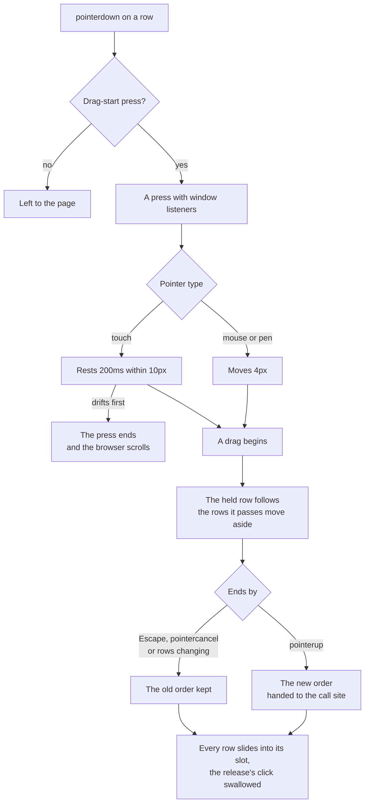

# Drag reorder

`useDragReorder` moves a row by pointer: a row is pressed and dragged to a new place in its list, table or sidebar, and the call site is handed the new order. The keyboard half — Alt+Up and Alt+Down, read out through a live region — is `useReorder`'s, and both make their move through `getMovedItems`. The drag is a composable in the [UI library](../ui-library/design.md), written on Pointer Events in place of [vue-draggable-plus](https://github.com/Alfred-Skyblue/vue-draggable-plus), a Vue wrapper bundling [SortableJS](https://github.com/SortableJS/Sortable). How it works, what it leaves out, and every upstream issue with its verdict are below, as [dependency admission](../dependency-admission/design.md) requires of an absorbed package.

## Why it is ours

Keeping vue-draggable-plus as an engine would rest on the [stop list](../dependency-admission/design.md#the-stop-list)'s accessibility item. Neither reason holds:

- **The accessible half was already ours.** `UiList` and `UiDataTable` already move a row by Alt and an arrow ([UI library](../ui-library/design.md)), and the room categories move by the same keys. SortableJS did only the pointer drag, which has no focus, role or announcement of its own.
- **The algorithm is small.** The call sites use one vertical container, an optional handle, a touch delay, rows moving aside and autoscroll. SortableJS's other surfaces — groups, cloning, multi-drag, swap, grids — were never called.
- **It joined nothing.** It is no adapter between two engines we keep: it bundled an engine the catalog never named.

Vuetify 0's [`useDragDrop`](https://0.vuetifyjs.com/composables/system/use-drag-drop) was weighed first, as the platform the library already stands on, and not taken. It has no touch delay, no `touch-action` handling and no pointer capture. Its drop zones are measured once and go stale on a scroll. It moves nothing on screen. Its keyboard adapter would compete with the rows' own keys.

Only the web app drags rows, so, like [SQL highlighting](../sql-highlight/design.md), the drag is no package: it is a composable beside the components that call it, with this page.

## How it works

`useDragReorder()` returns a builder. A call site hands it three things:

- the values, in their rendered order;
- the callback that takes a new order;
- optionally, a handle selector.

The call site spreads the result on the container, whose element children are the rows, one for each value. `UiList` spreads it on each group, `UiDataTable` on its one body with the handle column's class, and the room sidebar on its categories with their headers' handles.

- **Starting.** Only a primary press counts: the main button, or the first finger. With a handle, the press must land inside it. A press in a field, a select or an editable region keeps its own meaning: its caret, selection, slider or menu. Mouse and pen start a drag once the press moves `DRAG_START_DISTANCE`, so a press released short of it is a plain click. A finger must rest `TOUCH_DRAG_DELAY_MS` within `LONG_PRESS_MOVE_TOLERANCE`. A swipe before that ends the press and the browser scrolls, and a longer rest still reaches the context menu. In nested containers the innermost claims the press.
- **While a press is down.** The browser's own drag and a text selection are both cancelled, since either would take the pointer. Each listener sits on the window and goes with the press.
- **Following.** The held row moves by the CSS `translate` property, which composes with any `transform` the row carries. It is clamped between the first and last slot, and divided by the container's scale on screen, so a zoomed or transformed ancestor keeps it under the pointer. It captures the pointer, so nothing it passes over takes a hover. It wears `REORDER_GHOST_CLASS`, drawn as a lifted row over the rest.
- **Choosing a slot.** The slot is the one whose offset is nearest where the row is held, from the rows' places when the drag began. So rows of unequal height change places once, midway. The rows between the old slot and the new move aside by the held row's height and the gap after it, over `REORDER_SLIDE_TRANSITION`, the short motion that reduced motion zeroes.
- **Scrolling.** The innermost scroller that can still scroll toward the pointer scrolls: the container and its overflow ancestors, then the page. It starts within `DRAG_AUTOSCROLL_EDGE` of the scroller's top or bottom, or past it, and runs at up to `DRAG_AUTOSCROLL_SPEED`, faster nearer the edge. Each step is instant, so a smooth `scroll-behavior` cannot ease it away. Any scroll, the wheel's included, re-reads where the held row is, so its slot stays right.
- **Holding the page.** Once a touch drag has started, the container cancels its own `touchmove`, so the page stays still under the finger. The listener is on the container before the touch begins, because a browser decides as a touch starts whether it may scroll.
- **Ending.** A release hands the call site the new order through `getMovedItems`, and nothing when the order did not change. No row is ever moved in the DOM: Vue renders the new order. The rows keep where they were let go until the next frame, which is painted only after the call site's render has landed, even one an optimistic store makes a few microtasks on. Each then slides from there to where it lands — its first and last place read, an inverse translate written, then the transition let go. The click a release raises is swallowed, and only that one: the next press or key disarms it, since a touch drag raises none.
- **Giving way.** Escape cancels and goes no further, so a dialog the list sits in stays open. A `pointercancel` cancels. So does a row added or removed under the drag, whose slots are then stale. Unmounting ends the press with every listener and timer.

## What it leaves out

The surface is what the three call sites use. None of these are offered:

- moving a row to another list or group, cloning, multi-drag and swap mode;
- filters, per-row disabling, and callbacks other than the new order;
- horizontal, grid, wrapped and right-to-left layouts, and virtual scrolling;
- custom drag images, a directive and a component API.

An issue asking for one of them is out of scope on that ground. A reorder is never pointer-only: the keyboard path stays `useReorder`'s.

## Upstream

Two trackers were read.

- **vue-draggable-plus**: all 265 items, 200 issues and 65 pull requests, open and closed.
- **SortableJS**: 810 of its 2,351 items, 682 issues and 128 pull requests. These are the items whose titles touch the behaviour rebuilt: handles, touch and delay, order and position, scrolling, animation, nesting, clicks and fields inside a row, tables, and the pointer and ghost. Titles about a surface not offered here (multi-drag, swap, clone, group pull and put) or about another framework's wrapper were left out.

Each item was read with every comment and given one verdict from the [dependency admission triage](../dependency-admission/design.md). A pull request takes the verdict of the issue it fixes or the change it makes.

Verdicts by count:

| Verdict                               | vue-draggable-plus | SortableJS |
| :------------------------------------ | -----------------: | ---------: |
| In scope: fixed                       |                 22 |        263 |
| In scope: implemented                 |                  6 |         44 |
| Out of scope: surface we do not offer |                142 |        286 |
| Out of scope: owned by a neighbour    |                 18 |         34 |
| False positive                        |                 45 |        178 |
| Noise                                 |                 32 |          5 |
| Total                                 |                265 |        810 |

Only the in-scope items are listed below, each with its proof. Every other item is counted in the table above and stays on its tracker: [vue-draggable-plus issues](https://github.com/Alfred-Skyblue/vue-draggable-plus/issues?q=is%3Aissue) and [SortableJS issues](https://github.com/SortableJS/Sortable/issues?q=is%3Aissue).

Every in-scope item is proven by a regression test in `useDragReorder.test.ts`, each titled with the item leading its class. Every item of the class cites that test in the Proof column, by the item its title starts with.

The suite was run once against vue-draggable-plus 0.6.1, through a throwaway copy that mounted the wrapper's component with the call sites' old props. Most of the tests fail there. The ones that pass are recorded as pins:

- the short press and the drift before the delay;
- a secondary button and a second finger;
- a field inside a row;
- an unchanged drop and the click after a drop that raised none;
- `pointercancel` and an unmount;
- a row added under the drag.

Most of the failures come from SortableJS doing nothing on a mouse in the harness. It hands a mouse drag to the browser's native drag and drop, which happy-dom does not run, and that native drag is itself the class of defect this replacement removes (vue-draggable-plus#35).

### vue-draggable-plus

| Upstream item                                                           | Verdict               | Evidence                                                                                                                                                                                                           | Proof                                           |
| :---------------------------------------------------------------------- | :-------------------- | :----------------------------------------------------------------------------------------------------------------------------------------------------------------------------------------------------------------- | :---------------------------------------------- |
| [#9](https://github.com/Alfred-Skyblue/vue-draggable-plus/issues/9)     | In scope: fixed       | After dragging the last item upward, a newly added item renders second to last though it is last in the array (scrollSensitivity also ignored); reporter gave a stackblitz and a video, no fix.                    | the vue-draggable-plus#173 test, fails upstream |
| [#12](https://github.com/Alfred-Skyblue/vue-draggable-plus/issues/12)   | In scope: fixed       | A list assigned after mount (async fetch) snaps back to its old order on release; maintainer: the directive unwraps the ref so the reassignment 'cannot be monitored', no fix.                                     | the vue-draggable-plus#12 test, fails upstream  |
| [#23](https://github.com/Alfred-Skyblue/vue-draggable-plus/issues/23)   | In scope: fixed       | onUpdate removes and reinserts the dragged DOM node, and insertNodeAt used firstChild, catching Vue text or comment nodes and breaking Vue's diff; maintainer fixed it and says the DOM moves serve the animation. | the vue-draggable-plus#173 test, fails upstream |
| [#35](https://github.com/Alfred-Skyblue/vue-draggable-plus/issues/35)   | In scope: fixed       | In Firefox a finished drag opens a search page (not in Chrome or Edge); maintainer's workaround is preventDefault on the body's drop event, which the reporter confirmed works.                                    | the vue-draggable-plus#35 test, fails upstream  |
| [#42](https://github.com/Alfred-Skyblue/vue-draggable-plus/issues/42)   | In scope: fixed       | After dragging the bottom item up, a newly created item renders in the wrong place while the array is right; a commenter fixed it by not keying by index, as the FAQ advises.                                      | the vue-draggable-plus#173 test, fails upstream |
| [#62](https://github.com/Alfred-Skyblue/vue-draggable-plus/issues/62)   | In scope: fixed       | Dragging goes wrong when the root node has CSS zoom; maintainer linked a known SortableJS issue and a commenter asks why there is still no fix, noting browser page zoom works.                                    | the vue-draggable-plus#62 test, fails upstream  |
| [#68](https://github.com/Alfred-Skyblue/vue-draggable-plus/issues/68)   | In scope: implemented | Wants dragging to start only from a grip icon, since otherwise clicks are swallowed and text in inputs cannot be selected; maintainer pointed to the handle option, reporter: 'perfect'.                           | the vue-draggable-plus#68 test, fails upstream  |
| [#105](https://github.com/Alfred-Skyblue/vue-draggable-plus/issues/105) | In scope: implemented | Asks how to cancel a drag by pressing Escape; another user wants the same, and a commenter links a SortableJS workaround. No built-in support.                                                                     | the vue-draggable-plus#105 test, fails upstream |
| [#113](https://github.com/Alfred-Skyblue/vue-draggable-plus/issues/113) | In scope: fixed       | ghostClass and dragClass are not applied when v-model is not used; a second user confirms it 'does not seem to apply correctly with the function'. No maintainer reply.                                            | the vue-draggable-plus#113 test, fails upstream |
| [#120](https://github.com/Alfred-Skyblue/vue-draggable-plus/issues/120) | In scope: fixed       | cursor: grabbing does not apply while dragging in Chrome (fine in Firefox), also seen in Safari; maintainer: 'looks like a browser issue'. The native drag ignores the cursor.                                     | the vue-draggable-plus#35 test, fails upstream  |
| [#151](https://github.com/Alfred-Skyblue/vue-draggable-plus/issues/151) | In scope: fixed       | scrollSensitivity did nothing until forceFallback: true was set, per SortableJS issue 1443; a commenter also passed the scroll container in by hand. Autoscroll failed in native drag mode.                        | the vue-draggable-plus#151 test, fails upstream |
| [#163](https://github.com/Alfred-Skyblue/vue-draggable-plus/issues/163) | In scope: implemented | Asked whether items in nested lists can be limited to reordering within their own level; no reply.                                                                                                                 | the sortablejs#328 test, fails upstream         |
| [#167](https://github.com/Alfred-Skyblue/vue-draggable-plus/issues/167) | In scope: implemented | Reported no transition while dragging, the two divs just swap; a commenter suggested ghostClass and a hand-made demo. Upstream animation is an opt-in option.                                                      | the vue-draggable-plus#167 test, fails upstream |
| [#173](https://github.com/Alfred-Skyblue/vue-draggable-plus/issues/173) | In scope: fixed       | Moving the last item above the others, then pushing a new item, rendered the new item out of place; the maintainer only linked the FAQ. The rendered order diverged from the data.                                 | the vue-draggable-plus#173 test, fails upstream |
| [#199](https://github.com/Alfred-Skyblue/vue-draggable-plus/issues/199) | In scope: fixed       | After a drop the element's styles did not follow it; two reporters confirmed force-fallback, the non-native drag mode, fixed it.                                                                                   | the vue-draggable-plus#35 test, fails upstream  |
| [#202](https://github.com/Alfred-Skyblue/vue-draggable-plus/issues/202) | In scope: fixed       | Dragging without changing the order, then appending, put the new item out of place even in the official demo; the maintainer fixed it in #205 for text anchors in childNodes.                                      | the vue-draggable-plus#173 test, fails upstream |
| [#205](https://github.com/Alfred-Skyblue/vue-draggable-plus/issues/205) | In scope: fixed       | Merged fix for #202: text anchors in childNodes misplaced the restored node when the order was unchanged, so Vue inserted the DOM in the wrong order.                                                              | the vue-draggable-plus#173 test, fails upstream |
| [#209](https://github.com/Alfred-Skyblue/vue-draggable-plus/issues/209) | In scope: fixed       | Merged PR: in pointer fallback mode a leftover node broke the length check, so dropping on the same position swapped the first two elements in the DOM.                                                            | the vue-draggable-plus#173 test, fails upstream |
| [#223](https://github.com/Alfred-Skyblue/vue-draggable-plus/issues/223) | In scope: fixed       | Dragging worked in a browser but not in Tauri; two users fixed it with dragDropEnabled: false, which hands HTML5 drag events back to the page.                                                                     | the vue-draggable-plus#35 test, fails upstream  |
| [#239](https://github.com/Alfred-Skyblue/vue-draggable-plus/issues/239) | In scope: implemented | Requested lockAxis so a drag moves on one axis only, as smooth-dnd offers; no reply.                                                                                                                               | the vue-draggable-plus#252 test, fails upstream |
| [#244](https://github.com/Alfred-Skyblue/vue-draggable-plus/issues/244) | In scope: fixed       | Dragging a column whose inner table was scrolled showed unrelated content in the drag representation; the browser's drag image captured overflow beyond the column.                                                | the vue-draggable-plus#252 test, fails upstream |
| [#251](https://github.com/Alfred-Skyblue/vue-draggable-plus/issues/251) | In scope: fixed       | The mouse wheel could not scroll the page while dragging; a commenter said forceFallback true, the non-native mode, fixes it. The reporter moved to Svelte.                                                        | the vue-draggable-plus#251 test, fails upstream |
| [#252](https://github.com/Alfred-Skyblue/vue-draggable-plus/issues/252) | In scope: fixed       | Wanted to drop the translucent drag preview, or show it opaque and hide the original; a commenter hid .sortable-drag with CSS.                                                                                     | the vue-draggable-plus#252 test, fails upstream |
| [#259](https://github.com/Alfred-Skyblue/vue-draggable-plus/issues/259) | In scope: fixed       | Items pushed after load jump to the container's top while dragged though sorting works; items present at load behave. No reply.                                                                                    | the vue-draggable-plus#12 test, fails upstream  |
| [#260](https://github.com/Alfred-Skyblue/vue-draggable-plus/issues/260) | In scope: implemented | Asked for the parent to autoscroll while dragging near its bottom edge; it only triggered occasionally and was not sensitive. No reply.                                                                            | the vue-draggable-plus#151 test, fails upstream |
| [#264](https://github.com/Alfred-Skyblue/vue-draggable-plus/issues/264) | In scope: fixed       | Screenshot only: the cursor flickers when the pointer reaches the edge of the dragged element; no reply.                                                                                                           | the vue-draggable-plus#35 test, fails upstream  |
| [#265](https://github.com/Alfred-Skyblue/vue-draggable-plus/issues/265) | In scope: fixed       | Destroying the dragged item's container before the drop threw while removing event listeners; a video shows it and another user hit the same.                                                                      | the vue-draggable-plus#265 test, a pin          |
| [#275](https://github.com/Alfred-Skyblue/vue-draggable-plus/issues/275) | In scope: fixed       | On mobile with TransitionGroup, dragging an item and releasing it back at its origin swapped the first two elements but not the data, even in the official demo.                                                   | the vue-draggable-plus#173 test, fails upstream |

### SortableJS

| Upstream item                                               | Verdict               | Evidence                                                                                                                                                                                                    | Proof                                                                     |
| :---------------------------------------------------------- | :-------------------- | :---------------------------------------------------------------------------------------------------------------------------------------------------------------------------------------------------------- | :------------------------------------------------------------------------ |
| [#23](https://github.com/SortableJS/Sortable/issues/23)     | In scope: fixed       | An input inside a draggable item cannot be focused on mobile Chrome; a commenter notes native DnD lets text inputs work in Firefox but not Chrome. No fix in the thread.                                    | the sortablejs#972 test, a pin                                            |
| [#25](https://github.com/SortableJS/Sortable/issues/25)     | In scope: implemented | Request for autoscroll when a drag nears the viewport border on long lists; a commenter calls the browser's native drag autoscroll strange.                                                                 | the vue-draggable-plus#151 test, fails upstream                           |
| [#27](https://github.com/SortableJS/Sortable/issues/27)     | In scope: implemented | Asks for a delay between touch and sorting because a full-width list blocks page scrolling on mobile; maintainer tried, failed and asked for a PR.                                                          | the sortablejs#56 test, fails upstream; the sortablejs#27 test, a pin     |
| [#33](https://github.com/SortableJS/Sortable/issues/33)     | In scope: fixed       | On mobile an ordered list shows the number 6 while an item moves, because the touch fallback appends a clone to the list; maintainer only said mobile has no native dnd.                                    | the vue-draggable-plus#252 test, fails upstream                           |
| [#36](https://github.com/SortableJS/Sortable/issues/36)     | In scope: fixed       | On touch the position fixed ghost lands in the wrong place when a parent has a CSS transform, a Chromium quirk; the fix PR #37 was not merged.                                                              | the vue-draggable-plus#62 test, fails upstream                            |
| [#37](https://github.com/SortableJS/Sortable/issues/37)     | In scope: fixed       | Fix PR for #36, the touch ghost mispositioned under a transformed parent; maintainer disliked relying on a positioned parent and it closed unmerged.                                                        | the vue-draggable-plus#62 test, fails upstream                            |
| [#41](https://github.com/SortableJS/Sortable/issues/41)     | In scope: fixed       | After a first drag with a handle the item keeps draggable=true and can then be dragged from outside the handle; maintainer acknowledged with 'thx' and fixed it.                                            | the vue-draggable-plus#68 test, fails upstream                            |
| [#47](https://github.com/SortableJS/Sortable/issues/47)     | In scope: implemented | Merged PR making the hardcoded ignore list for a and img configurable, so drags can start on links and images whose native drag Sortable had disabled.                                                      | the vue-draggable-plus#35 test, fails upstream                            |
| [#49](https://github.com/SortableJS/Sortable/issues/49)     | In scope: implemented | Merged PR adding IE10+ touch support and handling touchcancel, raised when a phone call or the home button interrupts a touch.                                                                              | the sortablejs#49 test, a pin                                             |
| [#56](https://github.com/SortableJS/Sortable/issues/56)     | In scope: implemented | PR adding a touch delay for #27; maintainer closed it because the delay must be configurable and cover both mouse and touch.                                                                                | the sortablejs#56 test, fails upstream; the sortablejs#27 test, a pin     |
| [#58](https://github.com/SortableJS/Sortable/issues/58)     | In scope: fixed       | Links inside a sortable item cannot be tapped on iPhone or iPad; maintainer called it 'a feature' and gave a filter workaround, and a later comment notes the click fires onEnd.                            | the sortablejs#1184 test, fails upstream; the sortablejs#2365 test, a pin |
| [#66](https://github.com/SortableJS/Sortable/issues/66)     | In scope: fixed       | Merely clicking the handle made the rest of the item draggable so its text could no longer be selected; fixed on the dev branch and confirmed by the reporter.                                              | the vue-draggable-plus#68 test, fails upstream                            |
| [#88](https://github.com/SortableJS/Sortable/issues/88)     | In scope: fixed       | On iPad a click handler on the drag handle never fires and inputs get no keyboard once Sortable is attached; maintainer suggested touchstart, then the filter option.                                       | the sortablejs#1184 test, fails upstream; the sortablejs#2365 test, a pin |
| [#93](https://github.com/SortableJS/Sortable/issues/93)     | In scope: fixed       | A right click on an item runs the tap-start handler; the reporter proposed ignoring non-primary buttons and confirmed the dev-branch fix.                                                                   | the sortablejs#93 test, a pin                                             |
| [#96](https://github.com/SortableJS/Sortable/issues/96)     | In scope: fixed       | Animation branch bugs: no animation when items carry their own CSS transition, and fast drags to the first or last slot sometimes do not sort; maintainer fixed both.                                       | the vue-draggable-plus#167 test, fails upstream                           |
| [#104](https://github.com/SortableJS/Sortable/issues/104)   | In scope: fixed       | On mobile a swipe over the list drags an item instead of scrolling the page; maintainer said sorting starts on touchstart and to scroll outside the list.                                                   | the sortablejs#56 test, fails upstream; the sortablejs#27 test, a pin     |
| [#124](https://github.com/SortableJS/Sortable/issues/124)   | In scope: implemented | PR scrolling the window when the pointer leaves the viewport; maintainer called it partial because a list may sit in its own overflow container.                                                            | the vue-draggable-plus#151 test, fails upstream                           |
| [#126](https://github.com/SortableJS/Sortable/issues/126)   | In scope: implemented | Autoscroll PR for scroll containers; maintainer specified finding the nearest scrollable parent or the window and built it on the scroll branch (#134).                                                     | the vue-draggable-plus#151 test, fails upstream                           |
| [#134](https://github.com/SortableJS/Sortable/issues/134)   | In scope: implemented | Spec for autoscroll that finds the scrollable parent or the window; testers found it stopping once the pointer passed the viewport and when children overflowed, both fixed.                                | the sortablejs#1240 test, fails upstream                                  |
| [#144](https://github.com/SortableJS/Sortable/issues/144)   | In scope: implemented | Asks for a jQuery UI style drop placeholder; maintainer pointed to ghostClass as the similar option.                                                                                                        | the vue-draggable-plus#167 test, fails upstream                           |
| [#145](https://github.com/SortableJS/Sortable/issues/145)   | In scope: fixed       | With a long animation an item jumps from slot 3 to 1 at the very end of the move; maintainer had 'no idea how to fix it' and capped animation at 150 to 200 ms.                                             | the sortablejs#1804 test, fails upstream                                  |
| [#162](https://github.com/SortableJS/Sortable/issues/162)   | In scope: fixed       | With handles, items added to a list that started empty could not be dragged; maintainer reproduced it and fixed it on dev, confirmed by the reporter.                                                       | the vue-draggable-plus#12 test, fails upstream                            |
| [#166](https://github.com/SortableJS/Sortable/issues/166)   | In scope: fixed       | Sortable's native drags reach a page's file-upload drop handler and bubble to outer containers; maintainer added stopPropagation in dragover on dev.                                                        | the vue-draggable-plus#35 test, fails upstream                            |
| [#167](https://github.com/SortableJS/Sortable/issues/167)   | In scope: implemented | A long list does not autoscroll when the drag leaves the visible area; maintainer pointed to the new scroll option on dev.                                                                                  | the vue-draggable-plus#151 test, fails upstream                           |
| [#185](https://github.com/SortableJS/Sortable/issues/185)   | In scope: fixed       | On touch, items stop moving when the drop targets have an overlay, since the element under the finger is not an item; maintainer fixed it on dev and the reporter confirmed.                                | the sortablejs#1686 test, fails upstream                                  |
| [#200](https://github.com/SortableJS/Sortable/issues/200)   | In scope: fixed       | Firefox stops dragging when setData is disabled, and a drag over a text field appends the item's HTML into it; both are native DataTransfer behaviour.                                                      | the vue-draggable-plus#35 test, fails upstream                            |
| [#208](https://github.com/SortableJS/Sortable/issues/208)   | In scope: fixed       | Sorting tr rows in a tbody works on desktop but not on touch devices, while a ul works; maintainer had 'No ideas'.                                                                                          | the sortablejs#1686 test, fails upstream                                  |
| [#211](https://github.com/SortableJS/Sortable/issues/211)   | In scope: fixed       | On iOS after a pinch zoom, the drag indicator drifts further from the finger the more the page is zoomed; no reply.                                                                                         | the vue-draggable-plus#251 test, fails upstream                           |
| [#222](https://github.com/SortableJS/Sortable/issues/222)   | In scope: fixed       | The dragged element shows as a translucent native drag image in Firefox and Chrome on Windows; maintainer answered 'Yes and no', see #146.                                                                  | the vue-draggable-plus#252 test, fails upstream                           |
| [#246](https://github.com/SortableJS/Sortable/issues/246)   | In scope: fixed       | During a drag the grabbing cursor reverts to default in Chrome and Safari; commenters trace it to native DnD and note Dragula and forceFallback, which avoid it, keep the cursor.                           | the vue-draggable-plus#35 test, fails upstream                            |
| [#250](https://github.com/SortableJS/Sortable/issues/250)   | In scope: fixed       | Items that should drag or open a link on tap only ever drag on touch devices, and a ghost shows on touchstart; fixed later by #441.                                                                         | the sortablejs#1184 test, fails upstream; the sortablejs#2365 test, a pin |
| [#254](https://github.com/SortableJS/Sortable/issues/254)   | In scope: fixed       | Sortable's dragover preventDefault blocks dropping text from another window into inputs inside the list; fixed on a drop-text branch, then regressed in 1.1.1.                                              | the vue-draggable-plus#35 test, fails upstream                            |
| [#256](https://github.com/SortableJS/Sortable/issues/256)   | In scope: fixed       | The page never autoscrolled in Firefox, the scroll demo included, and scrolling down was unreliable; fixed on the scroll branch. The cross-list part is not offered.                                        | the vue-draggable-plus#151 test, fails upstream                           |
| [#261](https://github.com/SortableJS/Sortable/issues/261)   | In scope: fixed       | On Android a translate3d left on a sortable element after sorting disables scrolling of its overflow wrapper; the reporter's workaround removes the transform on end.                                       | the sortablejs#1804 test, fails upstream                                  |
| [#270](https://github.com/SortableJS/Sortable/issues/270)   | In scope: implemented | Asks to make sub-lists sortable while keeping their items from leaving their container; maintainer showed nested sorting on dev.                                                                            | the sortablejs#328 test, fails upstream                                   |
| [#271](https://github.com/SortableJS/Sortable/issues/271)   | In scope: fixed       | On touch a height 100% scroll container never autoscrolled because the window was scrolled instead; fixed on the scroll branch and confirmed by the reporter.                                               | the vue-draggable-plus#151 test, fails upstream                           |
| [#285](https://github.com/SortableJS/Sortable/issues/285)   | In scope: fixed       | Sorting failed in Safari 8 because ng-repeat comment nodes sat among the items and the nextSibling check hit them; fixed on dev and confirmed by the reporter.                                              | the vue-draggable-plus#173 test, fails upstream                           |
| [#286](https://github.com/SortableJS/Sortable/issues/286)   | In scope: fixed       | Dragging a small item over a tall one makes the tall one bounce back and forth; maintainer later said it was solved in 1.8.0.                                                                               | the sortablejs#1686 test, fails upstream                                  |
| [#289](https://github.com/SortableJS/Sortable/issues/289)   | In scope: fixed       | Items would not move in Safari 8 because dataTransfer.effectAllowed was never move in dragover unless command was held; fixed in release 1.1.1.                                                             | the vue-draggable-plus#35 test, fails upstream                            |
| [#291](https://github.com/SortableJS/Sortable/issues/291)   | In scope: fixed       | In Safari the drag image includes text from sibling elements, tied to children with max-height and overflow hidden or a ripple; native drag snapshot behaviour.                                             | the vue-draggable-plus#252 test, fails upstream                           |
| [#294](https://github.com/SortableJS/Sortable/issues/294)   | In scope: implemented | Asks to start a drag only after a long press; maintainer said no such option at the time.                                                                                                                   | the sortablejs#56 test, fails upstream; the sortablejs#27 test, a pin     |
| [#299](https://github.com/SortableJS/Sortable/issues/299)   | In scope: fixed       | On mobile the fallback ghost is appended to the end of the list, so the item shows at the bottom while dragging; maintainer did not understand the problem.                                                 | the vue-draggable-plus#252 test, fails upstream                           |
| [#304](https://github.com/SortableJS/Sortable/issues/304)   | In scope: fixed       | With Bootstrap fixed top and bottom navbars the page never autoscrolls on Firefox and tablets, and only in bursts on IE11; the reporter's workaround is an inner scroll box.                                | the sortablejs#1240 test, fails upstream                                  |
| [#306](https://github.com/SortableJS/Sortable/issues/306)   | In scope: fixed       | The table case was a missing tbody, but a commenter's fiddle shows a dragged table row's content does not follow the pointer as a list item does.                                                           | the vue-draggable-plus#252 test, fails upstream                           |
| [#311](https://github.com/SortableJS/Sortable/issues/311)   | In scope: implemented | Empty PR adding a delay between touchstart and the drag, superseded by #312 and #325.                                                                                                                       | the sortablejs#56 test, fails upstream; the sortablejs#27 test, a pin     |
| [#312](https://github.com/SortableJS/Sortable/issues/312)   | In scope: implemented | PR adding a configurable delay before a drag starts; review found it broke native drag on desktop and fired onStart twice, so it was reopened against dev as #325.                                          | the sortablejs#56 test, fails upstream; the sortablejs#27 test, a pin     |
| [#314](https://github.com/SortableJS/Sortable/issues/314)   | In scope: fixed       | Tapping a text input inside a sortable never opens the keyboard on Android or iOS; the workaround was the handle option.                                                                                    | the sortablejs#972 test, a pin                                            |
| [#318](https://github.com/SortableJS/Sortable/issues/318)   | In scope: fixed       | Sorting items inside a nested section also runs the outer sections list's onUpdate; maintainer said try dev.                                                                                                | the sortablejs#328 test, fails upstream                                   |
| [#324](https://github.com/SortableJS/Sortable/issues/324)   | In scope: implemented | PR adding the touchstart delay against dev, following #312; replaced by #325.                                                                                                                               | the sortablejs#56 test, fails upstream; the sortablejs#27 test, a pin     |
| [#325](https://github.com/SortableJS/Sortable/issues/325)   | In scope: implemented | Merged PR adding the delay before a drag starts; a later comment reports 'Cannot set property draggable of null' when clicking items with a delay set.                                                      | the sortablejs#56 test, fails upstream; the sortablejs#27 test, a pin     |
| [#326](https://github.com/SortableJS/Sortable/issues/326)   | In scope: fixed       | During a drag on the scroll demo neither the mouse wheel nor the arrow keys scroll the page, a limit of native drag and drop; no reply.                                                                     | the vue-draggable-plus#251 test, fails upstream                           |
| [#328](https://github.com/SortableJS/Sortable/issues/328)   | In scope: fixed       | PR stopping tap-start propagation so a drag in a nested sortable does not take the outer list's index; maintainer rejected the approach.                                                                    | the sortablejs#328 test, fails upstream                                   |
| [#329](https://github.com/SortableJS/Sortable/issues/329)   | In scope: fixed       | A range input inside a sortable item stops moving its thumb, even with the input set as a filter; no reply.                                                                                                 | the sortablejs#972 test, a pin                                            |
| [#348](https://github.com/SortableJS/Sortable/issues/348)   | In scope: fixed       | Setting the delay option breaks all sorting in Firefox, later IE11 too, while Chrome and Safari work; two users still saw it after it closed.                                                               | the sortablejs#1482 test, a pin                                           |
| [#363](https://github.com/SortableJS/Sortable/issues/363)   | In scope: fixed       | In nested sortables the tap-start handler runs twice, so the outer list overwrites the inner item's oldIndex; maintainer fixed it on dev.                                                                   | the sortablejs#328 test, fails upstream                                   |
| [#368](https://github.com/SortableJS/Sortable/issues/368)   | In scope: fixed       | A button hidden in onStart still shows in the drag image because the native snapshot is taken first; PR #389 proposed hiding it through ghostClass.                                                         | the vue-draggable-plus#252 test, fails upstream                           |
| [#370](https://github.com/SortableJS/Sortable/issues/370)   | In scope: fixed       | A button used as a handle cannot start a drag in Firefox or Edge; maintainer cited Firefox bugs on native drag inside buttons, and forceFallback, which skips native DnD, works.                            | the vue-draggable-plus#68 test, fails upstream                            |
| [#371](https://github.com/SortableJS/Sortable/issues/371)   | In scope: fixed       | On iOS Safari the ghost disappears when some list items are hidden by CSS; open with no reply.                                                                                                              | the vue-draggable-plus#252 test, fails upstream                           |
| [#379](https://github.com/SortableJS/Sortable/issues/379)   | In scope: implemented | Asks for a long press to start sorting; the delay option worked on mobile but not desktop, and repeated taps within the delay triggered a drag.                                                             | the sortablejs#56 test, fails upstream; the sortablejs#27 test, a pin     |
| [#389](https://github.com/SortableJS/Sortable/issues/389)   | In scope: fixed       | PR for #368 letting ghostClass hide the ghost or its children, since a hidden child still showed in the drag image; asked to resubmit against dev.                                                          | the vue-draggable-plus#252 test, fails upstream                           |
| [#393](https://github.com/SortableJS/Sortable/issues/393)   | In scope: fixed       | Asks how to remove the translucent copy shown while sorting on iOS; pointed to #146 on the browser's drag image.                                                                                            | the vue-draggable-plus#252 test, fails upstream                           |
| [#400](https://github.com/SortableJS/Sortable/issues/400)   | In scope: fixed       | With a fixed navbar, autoscroll up fails in Firefox, IE11 and on mobile while down works; maintainer blamed Firefox, others reproduced it for years.                                                        | the sortablejs#1240 test, fails upstream                                  |
| [#409](https://github.com/SortableJS/Sortable/issues/409)   | In scope: fixed       | The delay timer was cleared only on touchmove, so another touchstart within the delay counted toward it; fixed on dev.                                                                                      | the sortablejs#56 test, fails upstream; the sortablejs#27 test, a pin     |
| [#410](https://github.com/SortableJS/Sortable/issues/410)   | In scope: fixed       | Moving an item out and back to its own slot reports oldIndex 1 and newIndex 0 after a few rounds; maintainer fixed it on dev.                                                                               | the sortablejs#410 test, a pin                                            |
| [#411](https://github.com/SortableJS/Sortable/issues/411)   | In scope: fixed       | Merged PR for #250 so taps on touch devices still click, calling preventDefault only after a real drag; a commenter found it broke iPhone and pointed to #441.                                              | the sortablejs#1184 test, fails upstream; the sortablejs#2365 test, a pin |
| [#422](https://github.com/SortableJS/Sortable/issues/422)   | In scope: fixed       | In fallback mode the ghost clone appended to the container makes the last-item check fail when moving within the own list; fixed by #458.                                                                   | the sortablejs#1686 test, fails upstream                                  |
| [#432](https://github.com/SortableJS/Sortable/issues/432)   | In scope: fixed       | On a touch-screen Windows laptop drags never start in IE, and in Firefox a vertical drag scrolls the page; open, and hybrid touch-and-mouse devices still fail.                                             | the sortablejs#973 test, fails upstream                                   |
| [#436](https://github.com/SortableJS/Sortable/issues/436)   | In scope: fixed       | Anchors, buttons and labels inside sortable items fire no click on touch, blocking React onClick; traced to preventDefault in drop and fixed by #411.                                                       | the sortablejs#1184 test, fails upstream; the sortablejs#2365 test, a pin |
| [#440](https://github.com/SortableJS/Sortable/issues/440)   | In scope: fixed       | Inside a scaled element in Firefox the dragged element is not aligned with the mouse; maintainer blamed the browser.                                                                                        | the vue-draggable-plus#62 test, fails upstream                            |
| [#441](https://github.com/SortableJS/Sortable/issues/441)   | In scope: fixed       | Merged PR fixing clicks on touch devices and old browsers (#250, #411, #436) with a polyfilled drag; a user confirmed Android and iPhone now work.                                                          | the sortablejs#1184 test, fails upstream; the sortablejs#2365 test, a pin |
| [#447](https://github.com/SortableJS/Sortable/issues/447)   | In scope: fixed       | newIndex goes wrong when an item is picked up and dropped back in its old slot after several drags; maintainer fixed it on dev and the reporter confirmed.                                                  | the sortablejs#410 test, a pin                                            |
| [#455](https://github.com/SortableJS/Sortable/issues/455)   | In scope: fixed       | Dropping an item outside its container in Firefox Developer Edition loads the item's text as a URL; maintainer called it a Firefox bug.                                                                     | the vue-draggable-plus#35 test, fails upstream                            |
| [#457](https://github.com/SortableJS/Sortable/issues/457)   | In scope: fixed       | Merged PR removing native drag and drop handlers in forceFallback mode to stop native drags running alongside the emulated one; maintainer agreed.                                                          | the vue-draggable-plus#35 test, fails upstream                            |
| [#458](https://github.com/SortableJS/Sortable/issues/458)   | In scope: fixed       | Merged fix for #422, where the fallback clone appended to the container broke moves to the bottom of the own list.                                                                                          | the sortablejs#1686 test, fails upstream                                  |
| [#459](https://github.com/SortableJS/Sortable/issues/459)   | In scope: implemented | Merged PR tightening the fallback drag-over loop so the emulated drag feels as fluid as native drag and drop.                                                                                               | the sortablejs#1686 test, fails upstream                                  |
| [#462](https://github.com/SortableJS/Sortable/issues/462)   | In scope: fixed       | Clicks in an input inside an item cannot move the caret or select text in Firefox and Edge, even with a handle set; preventOnFilter false was the workaround.                                               | the sortablejs#972 test, a pin                                            |
| [#467](https://github.com/SortableJS/Sortable/issues/467)   | In scope: fixed       | On IE11 and Edge Mobile touch, dragging 'freezes after dragging past another LI' and handle drags scroll the page; a reporter fixed it with touch-action none on the container.                             | the sortablejs#973 test, fails upstream                                   |
| [#470](https://github.com/SortableJS/Sortable/issues/470)   | In scope: fixed       | Firefox shows 'The address isn't valid' after a drop inside an iframe because the native drag sets the item's text as drag data; still reported later.                                                      | the vue-draggable-plus#35 test, fails upstream                            |
| [#480](https://github.com/SortableJS/Sortable/issues/480)   | In scope: fixed       | In 1.2.0 a plain click without any drag fired the store set (save), shown in a jsbin; the maintainer fixed it in 1.2.1.                                                                                     | the sortablejs#1482 test, a pin                                           |
| [#484](https://github.com/SortableJS/Sortable/issues/484)   | In scope: fixed       | Dragging an img inside a nested tile list runs the press handler twice, once for the img list and once for the parent .tile list, so oldIndex is wrong; the maintainer said try dev.                        | the sortablejs#328 test, fails upstream                                   |
| [#490](https://github.com/SortableJS/Sortable/issues/490)   | In scope: implemented | Asks how to animate sorting when the items have different sizes; the maintainer answered 'Alas, no way'.                                                                                                    | the vue-draggable-plus#167 test, fails upstream                           |
| [#492](https://github.com/SortableJS/Sortable/issues/492)   | In scope: fixed       | In Firefox, dropping a dragged image opens it in the window, and with delay set a row containing a link never drags; both come from native drag and drop.                                                   | the vue-draggable-plus#35 test, fails upstream                            |
| [#504](https://github.com/SortableJS/Sortable/issues/504)   | In scope: implemented | PR adds a class when the hold delay elapses so the user sees exactly when the row becomes draggable; the maintainer asked for a demo and docs.                                                              | the vue-draggable-plus#113 test, fails upstream                           |
| [#516](https://github.com/SortableJS/Sortable/issues/516)   | In scope: implemented | Wants a long press to start the drag on touch without lifting the finger; the maintainer pointed to delay plus chosenClass, and a commenter said the delay did not work.                                    | the sortablejs#56 test, fails upstream; the sortablejs#27 test, a pin     |
| [#520](https://github.com/SortableJS/Sortable/issues/520)   | In scope: fixed       | PR aims to fix nested child-sort bugs (#331, #363) by cancelling the event in the inner list; the maintainer rejected it as 'a crutch', not a fix.                                                          | the sortablejs#328 test, fails upstream                                   |
| [#523](https://github.com/SortableJS/Sortable/issues/523)   | In scope: fixed       | Since iOS 8.4.1, items can be picked up in Safari but no drop position is recognised on any demo; fixed on the dev branch and confirmed by the reporter.                                                    | the sortablejs#1686 test, fails upstream                                  |
| [#526](https://github.com/SortableJS/Sortable/issues/526)   | In scope: fixed       | Merged PR stops a HierarchyRequestError raised when nested lists try to append a parent into its own child during a drag.                                                                                   | the sortablejs#328 test, fails upstream                                   |
| [#532](https://github.com/SortableJS/Sortable/issues/532)   | In scope: fixed       | On iOS 8.4.1 any touched element is thrown to the bottom of the list; Safari rejects setting draggable to true under strict mode. Fixed by #537.                                                            | the sortablejs#1686 test, fails upstream                                  |
| [#537](https://github.com/SortableJS/Sortable/issues/537)   | In scope: fixed       | Merged PR fixing #532 on iOS 8.4.1 and IE9/10 by taking the dragged element out of hit testing with pointer-events.                                                                                         | the sortablejs#1686 test, fails upstream                                  |
| [#538](https://github.com/SortableJS/Sortable/issues/538)   | In scope: fixed       | A plain click on an item disabled hover events in an iframe in Chrome and Safari because mouseup was prevented; the dev branch prevents it only while dragging, confirmed.                                  | the sortablejs#1482 test, a pin                                           |
| [#541](https://github.com/SortableJS/Sortable/issues/541)   | In scope: fixed       | In IE11 an input inside a draggable li shows no caret on a single click; the maintainer traced it to the IE bug with draggable=true on the li.                                                              | the sortablejs#972 test, a pin                                            |
| [#554](https://github.com/SortableJS/Sortable/issues/554)   | In scope: fixed       | The ghost class sets a cursor but the default cursor shows while dragging; a commenter confirmed it with forceFallback.                                                                                     | the vue-draggable-plus#35 test, fails upstream                            |
| [#567](https://github.com/SortableJS/Sortable/issues/567)   | In scope: fixed       | Asks to scroll the page with the middle mouse button while sorting; the maintainer said 'there is no such possibility' under native drag and drop.                                                          | the vue-draggable-plus#251 test, fails upstream                           |
| [#618](https://github.com/SortableJS/Sortable/issues/618)   | In scope: fixed       | With nested sortables, onEnd gives the outer group's index as oldIndex for any inner item; fixed by PR #624 on dev and confirmed by a commenter.                                                            | the sortablejs#328 test, fails upstream                                   |
| [#619](https://github.com/SortableJS/Sortable/issues/619)   | In scope: fixed       | PR for #618 stopping the parent container's drag handler from overwriting the inner item's oldIndex; reopened against dev as #624.                                                                          | the sortablejs#328 test, fails upstream                                   |
| [#621](https://github.com/SortableJS/Sortable/issues/621)   | In scope: fixed       | Wants the dragged item not translucent; the maintainer said the browser controls the native drag image, and the workarounds swap in a setDragImage clone.                                                   | the vue-draggable-plus#252 test, fails upstream                           |
| [#624](https://github.com/SortableJS/Sortable/issues/624)   | In scope: fixed       | Merged PR for #618 and #597: the parent container's drag event no longer changes the dragged inner item's oldIndex.                                                                                         | the sortablejs#328 test, fails upstream                                   |
| [#628](https://github.com/SortableJS/Sortable/issues/628)   | In scope: fixed       | With forceFallback in Safari the clone drags and the real item only moves after release, because draggable=true still starts a native drag; dev fixed it.                                                   | the vue-draggable-plus#35 test, fails upstream                            |
| [#659](https://github.com/SortableJS/Sortable/issues/659)   | In scope: fixed       | With delay set, the drag never starts in Firefox, IE and iPad because native dragstart does not fire; only forceFallback worked until a fix landed on master.                                               | the sortablejs#56 test, fails upstream; the sortablejs#27 test, a pin     |
| [#674](https://github.com/SortableJS/Sortable/issues/674)   | In scope: fixed       | The native drag image grows or sits far off in Chrome on Ubuntu with high-DPI screens; traced to a Chromium bug, fixed in Chrome 53.                                                                        | the vue-draggable-plus#252 test, fails upstream                           |
| [#680](https://github.com/SortableJS/Sortable/issues/680)   | In scope: fixed       | With forceFallback, dragging an item holding radio buttons clears their checked state because the clone shares their name; fixed in a commit.                                                               | the vue-draggable-plus#252 test, fails upstream                           |
| [#691](https://github.com/SortableJS/Sortable/issues/691)   | In scope: fixed       | On mobile, dragging on the demo scrolls the page, always when zoomed; the maintainer pointed to scroll false, a workaround the reporter noted also disables scrolling.                                      | the vue-draggable-plus#151 test, fails upstream                           |
| [#702](https://github.com/SortableJS/Sortable/issues/702)   | In scope: fixed       | On touch, the position fixed clone lands far off inside a translate3d container; the maintainer advised dropping translate3d and the reporter used fallbackOnBody.                                          | the vue-draggable-plus#62 test, fails upstream                            |
| [#710](https://github.com/SortableJS/Sortable/issues/710)   | In scope: fixed       | On Firefox for Android a touch drag scrolls the page and the item gets stuck; a commenter traced it to the long-press selection beating preventDefault on touchmove. Still open.                            | the sortablejs#973 test, fails upstream                                   |
| [#761](https://github.com/SortableJS/Sortable/issues/761)   | In scope: fixed       | Under iScroll the touch-dragged clone appears about 150px below the finger because getBoundingClientRect is off; the reporter fixed it by positioning with offsets.                                         | the vue-draggable-plus#62 test, fails upstream                            |
| [#776](https://github.com/SortableJS/Sortable/issues/776)   | In scope: fixed       | In Firefox the caret in an input inside a sortable item cannot be placed where clicked; the reporter worked around it with a handle because the item blocks selection.                                      | the sortablejs#972 test, a pin                                            |
| [#820](https://github.com/SortableJS/Sortable/issues/820)   | In scope: implemented | Asks to keep the dragged item within the container's bounds; the maintainer said native drag and drop cannot do it.                                                                                         | the vue-draggable-plus#252 test, fails upstream                           |
| [#826](https://github.com/SortableJS/Sortable/issues/826)   | In scope: fixed       | In Firefox, inline-block children can be dragged from their text but not from their empty area; the maintainer called it a Firefox bug.                                                                     | the vue-draggable-plus#35 test, fails upstream                            |
| [#837](https://github.com/SortableJS/Sortable/issues/837)   | In scope: fixed       | Aurelia, Vue and lit users want drops to leave the DOM alone and let the framework re-render; one says both editing the DOM caused 'unwanted behaviors and duplication'.                                    | the vue-draggable-plus#173 test, fails upstream                           |
| [#846](https://github.com/SortableJS/Sortable/issues/846)   | In scope: fixed       | When the container is taller than the screen, an item that started off-screen sits offset from the pointer while dragged; a commenter patched the delta with scrollTop.                                     | the vue-draggable-plus#251 test, fails upstream                           |
| [#899](https://github.com/SortableJS/Sortable/issues/899)   | In scope: implemented | Asks for a revert or drop animation besides the sort animation; the maintainer said 'Nohow'.                                                                                                                | the sortablejs#1804 test, fails upstream                                  |
| [#913](https://github.com/SortableJS/Sortable/issues/913)   | In scope: fixed       | Merged PR adds Pointer Events so touch works on IE and Windows touch devices, with touch-action none; a tester noted a button click inside a tile stopped firing.                                           | the sortablejs#973 test, fails upstream                                   |
| [#914](https://github.com/SortableJS/Sortable/issues/914)   | In scope: fixed       | With a fixed header and footer, page autoscroll only works at the top edge; reproduced in a jsbin, answered only with a CSS workaround, still open.                                                         | the sortablejs#1240 test, fails upstream                                  |
| [#917](https://github.com/SortableJS/Sortable/issues/917)   | In scope: fixed       | Just clicking the handle leaves stale drag state because Sortable.active is null in _nulling, so sorting stops working; many confirmed the one-line patch.                                                  | the sortablejs#1482 test, a pin                                           |
| [#920](https://github.com/SortableJS/Sortable/issues/920)   | In scope: fixed       | In IE11 elementFromPoint returns the dragged item when it has pseudo-elements, so it is dropped at the end of the list; fixed by #923.                                                                      | the sortablejs#1686 test, fails upstream                                  |
| [#921](https://github.com/SortableJS/Sortable/issues/921)   | In scope: fixed       | PR for #920 adding a disabledPointerEvents option so IE11 hides the dragged item from hit testing; superseded by #923.                                                                                      | the sortablejs#1686 test, fails upstream                                  |
| [#922](https://github.com/SortableJS/Sortable/issues/922)   | In scope: fixed       | Duplicate PR of #921 for #920, hiding the dragged item from IE11 hit testing; superseded by #923.                                                                                                           | the sortablejs#1686 test, fails upstream                                  |
| [#923](https://github.com/SortableJS/Sortable/issues/923)   | In scope: fixed       | Merged PR for #920 treating IE11 as lacking pointer-events support, so the dragged item no longer wins hit testing and lands at the end.                                                                    | the sortablejs#1686 test, fails upstream                                  |
| [#930](https://github.com/SortableJS/Sortable/issues/930)   | In scope: fixed       | PR so nested lists with their own handles work: without it the press handler runs for the inner list and then the parent, giving a wrong oldIndex.                                                          | the sortablejs#328 test, fails upstream                                   |
| [#935](https://github.com/SortableJS/Sortable/issues/935)   | In scope: fixed       | The mouse wheel does not scroll the page during a drag because native drag and drop blocks it; forceFallback restores it, and the demo still fails in current browsers.                                     | the vue-draggable-plus#251 test, fails upstream                           |
| [#957](https://github.com/SortableJS/Sortable/issues/957)   | In scope: fixed       | In Firefox and Edge a drag from a button handle never starts under native drag and drop though draggable=true is set; only forceFallback works. A Firefox bug.                                              | the vue-draggable-plus#68 test, fails upstream                            |
| [#964](https://github.com/SortableJS/Sortable/issues/964)   | In scope: fixed       | Native drag and drop will not start on text in Chrome and Safari when Shift is held before the press; the maintainer's answer was forceFallback, i.e. not using native DnD.                                 | the sortablejs#1482 test, a pin                                           |
| [#968](https://github.com/SortableJS/Sortable/issues/968)   | In scope: fixed       | In Firefox the press handler's preventDefault freezes or hides the caret in a contenteditable inside a sortable item (jsbin); the maintainer suggested a handle as the way round it.                        | the sortablejs#972 test, a pin                                            |
| [#972](https://github.com/SortableJS/Sortable/issues/972)   | In scope: fixed       | In Firefox a click in a text input inside a sortable item does not place the caret because the press is prevented (fiddle); the fix offered was filter: 'input' with preventOnFilter: false.                | the sortablejs#972 test, a pin                                            |
| [#973](https://github.com/SortableJS/Sortable/issues/973)   | In scope: fixed       | On iOS 10 and later the page scrolls while sorting by touch, even on the demo; commenters add that the global non-passive document touchmove listener makes scrolling janky app-wide.                       | the sortablejs#973 test, fails upstream                                   |
| [#981](https://github.com/SortableJS/Sortable/issues/981)   | In scope: fixed       | With delay set, Chrome Android fires mousemove under a still finger, which cancels the delay, so 'Dragging never starts on Chrome Android if the delay property is set'.                                    | the sortablejs#56 test, fails upstream; the sortablejs#27 test, a pin     |
| [#985](https://github.com/SortableJS/Sortable/issues/985)   | In scope: fixed       | Firefox opens a new tab when a native drag is dropped, on the demo too; workarounds were preventing drop on body or writing custom DataTransfer data through setData.                                       | the vue-draggable-plus#35 test, fails upstream                            |
| [#988](https://github.com/SortableJS/Sortable/issues/988)   | In scope: fixed       | On iOS an object element showing an image disappears once its sortable item is moved (jsbin); the maintainer answered 'Here such feature iOS, alas'.                                                        | the vue-draggable-plus#173 test, fails upstream                           |
| [#997](https://github.com/SortableJS/Sortable/issues/997)   | In scope: fixed       | With forceFallback, dragging selects page text in Safari, later confirmed in Firefox and Chromium; a fix commit was reverted and users fall back to user-select: none on the list.                          | the sortablejs#997 test, fails upstream                                   |
| [#998](https://github.com/SortableJS/Sortable/issues/998)   | In scope: fixed       | Pull request fixing #997, content selected while dragging in Safari; the maintainer landed his own commit instead.                                                                                          | the sortablejs#997 test, fails upstream                                   |
| [#1022](https://github.com/SortableJS/Sortable/issues/1022) | In scope: fixed       | Chrome 56 made touch listeners passive, so preventDefault failed with an error and the page scrolled while dragging; non-passive listeners fixed it, touch-action none was rejected as it blocks scrolling. | the sortablejs#973 test, fails upstream                                   |
| [#1042](https://github.com/SortableJS/Sortable/issues/1042) | In scope: fixed       | Pull request for #1022 making touch listeners non-passive so a touch drag no longer also scrolls the page in Chrome 56; superseded by #1043.                                                                | the sortablejs#973 test, fails upstream                                   |
| [#1043](https://github.com/SortableJS/Sortable/issues/1043) | In scope: fixed       | Merged pull request for #1022: non-passive touch listeners so dragging on touch no longer scrolls the page in Chrome 56, tested on Android Chrome.                                                          | the sortablejs#973 test, fails upstream                                   |
| [#1052](https://github.com/SortableJS/Sortable/issues/1052) | In scope: fixed       | With a handle, a drop re-checks checkboxes the user had unchecked because Sortable saved and restored checked inputs; reproduced in jsbins by many, a regression from 1.4.2.                                | the vue-draggable-plus#173 test, fails upstream                           |
| [#1059](https://github.com/SortableJS/Sortable/issues/1059) | In scope: fixed       | A click on the handle without dragging adds dragClass and never removes it; several users applied the patch, maintainer: 'Try the latest, I think this is fixed'.                                           | the vue-draggable-plus#113 test, fails upstream                           |
| [#1062](https://github.com/SortableJS/Sortable/issues/1062) | In scope: fixed       | Rows sort once Sortable sits on tbody (answered); then in Safari the native drag image of a row loses its inputs, images and background, confirmed by two more users.                                       | the vue-draggable-plus#252 test, fails upstream                           |
| [#1071](https://github.com/SortableJS/Sortable/issues/1071) | In scope: fixed       | In 1.5.1 the pointercancel listener is never removed and is not handled during the delay like the mouse and touch ones; a second user confirmed.                                                            | the sortablejs#49 test, a pin                                             |
| [#1092](https://github.com/SortableJS/Sortable/issues/1092) | In scope: fixed       | On mouse down Sortable sets will-change: transform, creating a stacking context, so a z-indexed box inside the item drops behind the container (jsbin); a second user confirmed.                            | the vue-draggable-plus#113 test, fails upstream                           |
| [#1099](https://github.com/SortableJS/Sortable/issues/1099) | In scope: fixed       | Native drag in Chrome freezes or crashes the tab when the item holds a rich editor such as Quill (jsbin); fallback mode was fine, 'The only issue is with Native sorting in Chrome'.                        | the vue-draggable-plus#35 test, fails upstream                            |
| [#1103](https://github.com/SortableJS/Sortable/issues/1103) | In scope: fixed       | On touch devices dragging a card to the edge of a scrollable column or the window does not autoscroll, though it does on desktop (videos); a second user confirmed.                                         | the vue-draggable-plus#151 test, fails upstream                           |
| [#1107](https://github.com/SortableJS/Sortable/issues/1107) | In scope: fixed       | A handle selector matching an SVG element by class never starts a drag (jsbin); worked round by wrapping the SVG in a div, later reported resolved.                                                         | the vue-draggable-plus#68 test, fails upstream                            |
| [#1112](https://github.com/SortableJS/Sortable/issues/1112) | In scope: fixed       | In Firefox a handle drawn by an icon font's ::before, beside an absolutely positioned element, never starts a drag (fiddle); others confirmed, one traced it to an add-on.                                  | the vue-draggable-plus#68 test, fails upstream                            |
| [#1121](https://github.com/SortableJS/Sortable/issues/1121) | In scope: fixed       | Merged: the left-button check ran only for mousedown, so a pointerdown with another button could start a drag.                                                                                              | the sortablejs#93 test, a pin                                             |
| [#1123](https://github.com/SortableJS/Sortable/issues/1123) | In scope: fixed       | In Firefox the dragged element appears far from the pointer when body has a translate (jsbin), also seen on iPad; maintainer: solved in 1.8.0.                                                              | the vue-draggable-plus#62 test, fails upstream                            |
| [#1153](https://github.com/SortableJS/Sortable/issues/1153) | In scope: fixed       | In nested ul/li lists an inner item dragged upward is inserted into the parent list despite incompatible groups (jsbin); fixed by #1154 and in 1.8.0-rc1.                                                   | the sortablejs#328 test, fails upstream                                   |
| [#1154](https://github.com/SortableJS/Sortable/issues/1154) | In scope: fixed       | Pull request fixing #1153: nested items drop into a parent list they should never enter, a regression bisected to #1106; solved in 1.8.0-rc1.                                                               | the sortablejs#328 test, fails upstream                                   |
| [#1159](https://github.com/SortableJS/Sortable/issues/1159) | In scope: fixed       | Merged fix for #1158: the press handling read the non-standard event.path, which Firefox and IE lack.                                                                                                       | the sortablejs#1482 test, a pin                                           |
| [#1164](https://github.com/SortableJS/Sortable/issues/1164) | In scope: fixed       | Autoscroll's zone sits inside the scroller's border and fires only while the pointer is over a sortable, so dragging to the page edge does not scroll; no maintainer reply.                                 | the sortablejs#1240 test, fails upstream                                  |
| [#1165](https://github.com/SortableJS/Sortable/issues/1165) | In scope: fixed       | In Firefox a click on the scrollbar arrows of a scrollable sortable item starts a drag instead of scrolling (jsbin); later seen working in Firefox 69.                                                      | the sortablejs#972 test, a pin                                            |
| [#1173](https://github.com/SortableJS/Sortable/issues/1173) | In scope: implemented | Asked how to stop an inner list's item breaking out into the sortable parent list; maintainer: 'Sortable doesn't support nesting'.                                                                          | the sortablejs#328 test, fails upstream                                   |
| [#1177](https://github.com/SortableJS/Sortable/issues/1177) | In scope: fixed       | Pull request: Android WebView reports subpixel touch movement that cancels a delayed drag; the author moved to a configurable threshold (#1181, #1205).                                                     | the sortablejs#56 test, fails upstream; the sortablejs#27 test, a pin     |
| [#1181](https://github.com/SortableJS/Sortable/issues/1181) | In scope: fixed       | Pull request adding a movement threshold because Android WebView subpixel touch movement cancelled delayed drags; the maintainer asked for docs and it was not merged.                                      | the sortablejs#56 test, fails upstream; the sortablejs#27 test, a pin     |
| [#1184](https://github.com/SortableJS/Sortable/issues/1184) | In scope: fixed       | A drag dropped back in place lets the click fire on links inside the item; after the 1.8.0 fix it is still reported in Firefox, firing vue-router navigation.                                               | the sortablejs#1184 test, fails upstream; the sortablejs#2365 test, a pin |
| [#1199](https://github.com/SortableJS/Sortable/issues/1199) | In scope: fixed       | From Chrome 62 the browser raises pointercancel when the native drag takes the pointer, which ended Sortable's drag at once; fixed by later releases and pointercancel was dropped.                         | the vue-draggable-plus#35 test, fails upstream                            |
| [#1200](https://github.com/SortableJS/Sortable/issues/1200) | In scope: fixed       | Merged: touch dragging failed because elementFromPoint does not report the element inside a Shadow DOM (jsbin).                                                                                             | the sortablejs#1686 test, fails upstream                                  |
| [#1205](https://github.com/SortableJS/Sortable/issues/1205) | In scope: fixed       | Merged touchMoveSensitivity: sensitive screens such as the Galaxy S8 fire touchmove under a still finger, cancelling the delayed drag.                                                                      | the sortablejs#56 test, fails upstream; the sortablejs#27 test, a pin     |
| [#1209](https://github.com/SortableJS/Sortable/issues/1209) | In scope: fixed       | In Safari the native drag image of the item never shows (between lists for another user), while forceFallback shows it.                                                                                     | the vue-draggable-plus#252 test, fails upstream                           |
| [#1210](https://github.com/SortableJS/Sortable/issues/1210) | In scope: fixed       | Dragging the last item upward makes the scrollbar blink at high frequency (jsbin and video); unanswered, a second user asked for a workaround.                                                              | the vue-draggable-plus#252 test, fails upstream                           |
| [#1218](https://github.com/SortableJS/Sortable/issues/1218) | In scope: fixed       | Inside an iframe in Safari the dragged image sits far from the cursor; a commenter showed plain draggable=true does the same, a Safari bug later fixed.                                                     | the vue-draggable-plus#252 test, fails upstream                           |
| [#1239](https://github.com/SortableJS/Sortable/issues/1239) | In scope: fixed       | With fallback, autoscroll never runs while dragging a parent over a nested list, so Parent B cannot reach above Parent A (jsbin, gif); solved in a later version.                                           | the sortablejs#1240 test, fails upstream                                  |
| [#1240](https://github.com/SortableJS/Sortable/issues/1240) | In scope: fixed       | Window autoscroll fails at the top under a fixed nav bar and at the bottom over a sticky footer (jsbin); still in 1.7.0, worked round with pointer-events: none.                                            | the sortablejs#1240 test, fails upstream                                  |
| [#1260](https://github.com/SortableJS/Sortable/issues/1260) | In scope: fixed       | In Chrome 63 the native drag image becomes a file icon when the page is scrolled down, on the demo too; fixed in Chrome 64.                                                                                 | the vue-draggable-plus#252 test, fails upstream                           |
| [#1267](https://github.com/SortableJS/Sortable/issues/1267) | In scope: fixed       | In Firefox native dragging stops working intermittently across reloads, on the demo too; workarounds were forceFallback, setData, or pointer-events none on an icon handle; still seen in Firefox 135.      | the vue-draggable-plus#35 test, fails upstream                            |
| [#1276](https://github.com/SortableJS/Sortable/issues/1276) | In scope: fixed       | The native drag image grabs pixels of elements above the item in Chrome 64 and Safari, from overflowing or absolute content; solved in 1.8.0-rc1 with translateZ(0).                                        | the vue-draggable-plus#252 test, fails upstream                           |
| [#1279](https://github.com/SortableJS/Sortable/issues/1279) | In scope: fixed       | On a zoomed Android or iOS page the dragged ghost is placed wrong, jumps around or drops at once; others confirm it with touch, one sees it trail far behind the finger.                                    | the vue-draggable-plus#251 test, fails upstream                           |
| [#1286](https://github.com/SortableJS/Sortable/issues/1286) | In scope: fixed       | Sortable called preventDefault on selectstart, so a contenteditable inside an item could not be edited in Chrome; the maintainer and reporter later confirmed master works.                                 | the sortablejs#972 test, a pin                                            |
| [#1294](https://github.com/SortableJS/Sortable/issues/1294) | In scope: fixed       | On mobile with a long list, dragging a bottom item scrolls the page up so it cannot be dropped at the bottom; the reporter worked around it by scrolling an inner box instead of the page.                  | the vue-draggable-plus#151 test, fails upstream                           |
| [#1301](https://github.com/SortableJS/Sortable/issues/1301) | In scope: fixed       | Fallback mode ignored a transform scale on the list, so after scrolling the dragged item used the wrong position; the maintainer said 'Solved in 1.8.0'.                                                    | the vue-draggable-plus#62 test, fails upstream                            |
| [#1319](https://github.com/SortableJS/Sortable/issues/1319) | In scope: fixed       | On iPhone and iPad the whole page scrolls along with the dragged item and the item floats away from the finger; several confirm on iOS 11.3, worked around by preventing touchstart default.                | the sortablejs#973 test, fails upstream                                   |
| [#1322](https://github.com/SortableJS/Sortable/issues/1322) | In scope: fixed       | Merged PR: the delay timer called dragStartFn without its context, so the delay option broke dragging, notably on mobile (#659, #981, #989); one user said 'this commit saves my life'.                     | the sortablejs#56 test, fails upstream; the sortablejs#27 test, a pin     |
| [#1333](https://github.com/SortableJS/Sortable/issues/1333) | In scope: fixed       | Merged PR titled 'Fix Android start dragging doesn't work', linked to #1365 where drag did not start in the Android WeChat browser whose engine lacks native drag and drop.                                 | the sortablejs#973 test, fails upstream                                   |
| [#1341](https://github.com/SortableJS/Sortable/issues/1341) | In scope: fixed       | With a handle set, dragging an item whose inner checkbox was unchecked left it checked after the drop; the maintainer said it was solved in commit d9ae21c.                                                 | the vue-draggable-plus#173 test, fails upstream                           |
| [#1344](https://github.com/SortableJS/Sortable/issues/1344) | In scope: fixed       | With delay set, iOS still starts sorting as soon as the finger touches and moves (Chinese thread: handle suggested, reporter needs long press); another user wants a long touch so a swipe scrolls.         | the sortablejs#56 test, fails upstream; the sortablejs#27 test, a pin     |
| [#1348](https://github.com/SortableJS/Sortable/issues/1348) | In scope: fixed       | On mobile, holding an item to start a drag and lifting without moving left the chosen class on and the item never dropped; the maintainer said 'Solved in latest'.                                          | the vue-draggable-plus#113 test, fails upstream                           |
| [#1358](https://github.com/SortableJS/Sortable/issues/1358) | In scope: fixed       | Dropping in the gap between two items moved the dragged item to the end of the list instead of leaving it near its target; the maintainer said 'Solved in 1.8.0-rc1'.                                       | the sortablejs#1686 test, fails upstream                                  |
| [#1360](https://github.com/SortableJS/Sortable/issues/1360) | In scope: fixed       | A Vuetify table sorted by a button handle worked in Chrome but not Firefox or Edge under native drag; the reporter's fix was forceFallback for Firefox and IE11.                                            | the vue-draggable-plus#68 test, fails upstream                            |
| [#1365](https://github.com/SortableJS/Sortable/issues/1365) | In scope: fixed       | Drag fails in the Android WeChat browser, whose X5 engine lacks native drag and drop (Chinese replies: disable X5); master fixed it, but a tester then saw the page scroll on iOS while dragging.           | the sortablejs#973 test, fails upstream                                   |
| [#1369](https://github.com/SortableJS/Sortable/issues/1369) | In scope: fixed       | With animation on, dropping into a fixed-height scrollable list shows a horizontal glitch; the maintainer said Sortable cannot solve it and suggested overflow-x hidden.                                    | the sortablejs#1804 test, fails upstream                                  |
| [#1382](https://github.com/SortableJS/Sortable/issues/1382) | In scope: fixed       | Merged PR for #1158: the press target was read from evt.path, which is non-standard and missing in Firefox, so it now falls back to evt.composedPath.                                                       | the vue-draggable-plus#68 test, fails upstream                            |
| [#1389](https://github.com/SortableJS/Sortable/issues/1389) | In scope: fixed       | Merged PR: delayed dragging failed on iOS because clientX was read from the TouchEvent rather than touches[0], and on Android a mousemove arrived instead of touchmove.                                     | the sortablejs#56 test, fails upstream; the sortablejs#27 test, a pin     |
| [#1394](https://github.com/SortableJS/Sortable/issues/1394) | In scope: fixed       | With delay set, dragging failed on a Huawei phone; the reporter found the mousemove listener cancelled the delayed drag, and confirmed master fixed it.                                                     | the sortablejs#56 test, fails upstream; the sortablejs#27 test, a pin     |
| [#1403](https://github.com/SortableJS/Sortable/issues/1403) | In scope: fixed       | Merged PR: autoscroll picked an overflowing parent even when its overflow was hidden; the maintainer also added a check that the parent has a scrollbar on that axis.                                       | the vue-draggable-plus#151 test, fails upstream                           |
| [#1407](https://github.com/SortableJS/Sortable/issues/1407) | In scope: fixed       | Native drag puts text on the DataTransfer, so a Firefox gesture extension opens a new tab searching that text; the maintainer suggested setData null.                                                       | the vue-draggable-plus#35 test, fails upstream                            |
| [#1423](https://github.com/SortableJS/Sortable/issues/1423) | In scope: fixed       | A translate3d on the drag element is ignored in Firefox; the maintainer said under native drag 'the sortable-drag element is being created and positioned by the browser', fixed by forceFallback.          | the vue-draggable-plus#252 test, fails upstream                           |
| [#1435](https://github.com/SortableJS/Sortable/issues/1435) | In scope: implemented | Dragging item 0 to item 5 animated only the two swapped items while the rest jumped; the maintainer built animating every moved item and merged it.                                                         | the vue-draggable-plus#167 test, fails upstream                           |
| [#1436](https://github.com/SortableJS/Sortable/issues/1436) | In scope: fixed       | In Safari, which then lacked PointerEvent, the move handler returned early on a non-cancelable mouse event so dragging broke; the maintainer shipped the fix in 1.8.2.                                      | the sortablejs#1482 test, a pin                                           |
| [#1437](https://github.com/SortableJS/Sortable/issues/1437) | In scope: fixed       | In nested sortable lists Edge 15 dragged the whole outer group instead of the pressed sub-item; the reporter confirmed it on EdgeHTML 15, while Edge 42 works.                                              | the sortablejs#328 test, fails upstream                                   |
| [#1440](https://github.com/SortableJS/Sortable/issues/1440) | In scope: implemented | Asks for the dragged item to be the real HTML element rather than the browser's drag image; the maintainer said it is possible with forceFallback.                                                          | the vue-draggable-plus#252 test, fails upstream                           |
| [#1443](https://github.com/SortableJS/Sortable/issues/1443) | In scope: fixed       | scrollSensitivity was ignored under native drag, and on iPhone and iPad the list did not autoscroll at the top; the reporter confirmed master fixed it on iOS.                                              | the vue-draggable-plus#151 test, fails upstream                           |
| [#1448](https://github.com/SortableJS/Sortable/issues/1448) | In scope: fixed       | On iOS 12 with the page zoomed in and scrolled, the ghost sat far from the finger, even offscreen; the maintainer emulated fixed positioning and the reporter confirmed it 'Working great now'.             | the vue-draggable-plus#251 test, fails upstream                           |
| [#1449](https://github.com/SortableJS/Sortable/issues/1449) | In scope: fixed       | Each move re-inserts the dragged node, so iframes and widgets inside reload and refire API calls; the reporter switched to a library that moves items by CSS transforms alone.                              | the vue-draggable-plus#173 test, fails upstream                           |
| [#1458](https://github.com/SortableJS/Sortable/issues/1458) | In scope: fixed       | On macOS Safari dragging no longer scrolled the page, and the top-edge sensitivity was ignored under a fixed navbar; master fixed both and 1.8.4 shipped it.                                                | the vue-draggable-plus#151 test, fails upstream                           |
| [#1462](https://github.com/SortableJS/Sortable/issues/1462) | In scope: fixed       | Dragging an outer item over a nested sortable applied the inner list's ghost class to it; the maintainer called it 'Very good find' and fixed it in commit 452436a.                                         | the vue-draggable-plus#113 test, fails upstream                           |
| [#1466](https://github.com/SortableJS/Sortable/issues/1466) | In scope: fixed       | Merged PR with no description titled 'IOS Ghost fix', the fix for #1448 where the ghost sat far from the finger on a zoomed and scrolled iOS page.                                                          | the vue-draggable-plus#251 test, fails upstream                           |
| [#1469](https://github.com/SortableJS/Sortable/issues/1469) | In scope: fixed       | On Android with delay set, a touch nearly always failed to start a drag, and after scrolls the drag took twice the delay; others confirmed, and master fixed it.                                            | the sortablejs#56 test, fails upstream; the sortablejs#27 test, a pin     |
| [#1482](https://github.com/SortableJS/Sortable/issues/1482) | In scope: implemented | Merged PR adds delayOnTouchOnly so a Kanban without handles delays only touch presses; a user reports touch laptops need the touch-action CSS property.                                                     | the sortablejs#1482 test, a pin                                           |
| [#1486](https://github.com/SortableJS/Sortable/issues/1486) | In scope: fixed       | A button handle never drags in Edge under native drag; the maintainer called it an Edge issue fixed only by forceFallback, and Firefox will not drag from a button's empty area.                            | the vue-draggable-plus#68 test, fails upstream                            |
| [#1493](https://github.com/SortableJS/Sortable/issues/1493) | In scope: fixed       | Since 1.8.0 a tap on a photo started a drag so its click never fired; the reporter traced it to drag start becoming too sensitive compared with 1.5.1.                                                      | the sortablejs#1184 test, fails upstream; the sortablejs#2365 test, a pin |
| [#1511](https://github.com/SortableJS/Sortable/issues/1511) | In scope: fixed       | PR says delayOnTouchOnly did not detect touches and fixes it by reading pointerType; closed only because of unrelated styling changes.                                                                      | the sortablejs#56 test, fails upstream; the sortablejs#27 test, a pin     |
| [#1517](https://github.com/SortableJS/Sortable/issues/1517) | In scope: fixed       | On Android the delay never started a drag because early pointermove events cancelled it; the maintainer traced it to Chrome's native drag changing the touch threshold, and the reporter confirmed the fix. | the sortablejs#56 test, fails upstream; the sortablejs#27 test, a pin     |
| [#1518](https://github.com/SortableJS/Sortable/issues/1518) | In scope: fixed       | In Chrome a native drag of a grid or Bootstrap row item flickers to another position as it starts; forceFallback removes it, and a Chromium bug was filed.                                                  | the vue-draggable-plus#252 test, fails upstream                           |
| [#1521](https://github.com/SortableJS/Sortable/issues/1521) | In scope: fixed       | With fallbackTolerance set, the start check took the minimum of the x and y moves, so a purely vertical drag never started; the maintainer fixed it on next-version.                                        | the sortablejs#1482 test, a pin                                           |
| [#1556](https://github.com/SortableJS/Sortable/issues/1556) | In scope: fixed       | On Android, delay with delayOnTouchOnly was ignored so dragging began at once and blocked scrolling, while iOS worked; the press was not detected as touch, fixed in commit a09bddb.                        | the sortablejs#56 test, fails upstream; the sortablejs#27 test, a pin     |
| [#1558](https://github.com/SortableJS/Sortable/issues/1558) | In scope: implemented | Requests the new order as an array of the original values after a move; the maintainer pointed to a framework binding or toArray with data-id attributes.                                                   | the vue-draggable-plus#173 test, fails upstream                           |
| [#1571](https://github.com/SortableJS/Sortable/issues/1571) | In scope: fixed       | In Safari 13 after one native drag and drop the next pointerdown never fires, so the next drag selects text instead; a WebKit bug, worked around by forceFallback and later fixed.                          | the vue-draggable-plus#35 test, fails upstream                            |
| [#1576](https://github.com/SortableJS/Sortable/issues/1576) | In scope: fixed       | With Windows display scaling above 100 percent, Chrome's native drag ghosts and misplaces the item; forceFallback avoids it, and the cause was traced to a Chromium bug.                                    | the vue-draggable-plus#252 test, fails upstream                           |
| [#1582](https://github.com/SortableJS/Sortable/issues/1582) | In scope: fixed       | With a fixed header, dragging up never scrolled the page; owner: native browser autoscroll was in use, and the fallback scrollSensitivity was broken in the 1.10.0 rc builds until a later release.         | the sortablejs#1240 test, fails upstream                                  |
| [#1584](https://github.com/SortableJS/Sortable/issues/1584) | In scope: fixed       | In Firefox a native drop on a tbody sortable intermittently navigated the tab to about:blank; the reporter saw it only with table rows and closed after moving to divs.                                     | the vue-draggable-plus#35 test, fails upstream                            |
| [#1599](https://github.com/SortableJS/Sortable/issues/1599) | In scope: implemented | Sortable positioned the hovering item by transform translate, so a rotation added to tilt it on pickup was discarded; owner added support in 1c7847b.                                                       | the vue-draggable-plus#252 test, fails upstream                           |
| [#1601](https://github.com/SortableJS/Sortable/issues/1601) | In scope: fixed       | In Firefox the dragged item appeared shrunk; owner: that is how Firefox styles the native Drag and Drop image, and forceFallback avoids it.                                                                 | the vue-draggable-plus#252 test, fails upstream                           |
| [#1610](https://github.com/SortableJS/Sortable/issues/1610) | In scope: implemented | Asked to hide the browser's drag copy and show only the ghost plus cursor; the reporter settled it via forceFallback after another script made the copy jump and flicker.                                   | the vue-draggable-plus#252 test, fails upstream                           |
| [#1617](https://github.com/SortableJS/Sortable/issues/1617) | In scope: fixed       | On Android, click handlers on sortable items never fired because Sortable claimed the touch at once; touchStartThreshold did not help a second user, who fell back to a filter selector.                    | the sortablejs#1184 test, fails upstream; the sortablejs#2365 test, a pin |
| [#1622](https://github.com/SortableJS/Sortable/issues/1622) | In scope: fixed       | Unchecking an input during a drag event was undone by Sortable's _nulling, which restores saved checked states; JSBin given and a second user saw checkbox values roll back after a move.                   | the vue-draggable-plus#173 test, fails upstream                           |
| [#1625](https://github.com/SortableJS/Sortable/issues/1625) | In scope: fixed       | Autoscroll never ran when dragging to the edge on an iPhone, even on the demo; the reporter made it work by reading pageX and pageY instead of clientX and clientY in the autoscroll code.                  | the vue-draggable-plus#151 test, fails upstream                           |
| [#1639](https://github.com/SortableJS/Sortable/issues/1639) | In scope: fixed       | Merged PR: destroying a Sortable before its delayed drag-start timer fired left the listeners on ownerDocument bound; a JSBin showed it.                                                                    | the vue-draggable-plus#265 test, a pin                                    |
| [#1644](https://github.com/SortableJS/Sortable/issues/1644) | In scope: fixed       | transform translateZ(0) set on drag was never removed on drop, so a tooltip overflowing the item was covered by the next item; jsfiddle given, fixed in e979370.                                            | the sortablejs#1804 test, fails upstream                                  |
| [#1654](https://github.com/SortableJS/Sortable/issues/1654) | In scope: fixed       | Merged PR for #1644: the transform translateZ(0) added at drag start is removed on drop so overflowing children are no longer covered by the next item.                                                     | the sortablejs#1804 test, fails upstream                                  |
| [#1659](https://github.com/SortableJS/Sortable/issues/1659) | In scope: fixed       | On an iPhone, dragging to the screen edge left the item stuck away from its place until the user tapped elsewhere; a screenshot, no replies.                                                                | the sortablejs#49 test, a pin                                             |
| [#1664](https://github.com/SortableJS/Sortable/issues/1664) | In scope: fixed       | At 150 percent Windows display scaling, fast repeated drags flickered and left the data out of order; at 100 percent it was fine. Screenshots, no replies.                                                  | the vue-draggable-plus#173 test, fails upstream                           |
| [#1678](https://github.com/SortableJS/Sortable/issues/1678) | In scope: fixed       | In Safari the native drag preview did not show while dragging (video given); owner suggested forceFallback, which another user confirmed fixes it.                                                          | the vue-draggable-plus#252 test, fails upstream                           |
| [#1680](https://github.com/SortableJS/Sortable/issues/1680) | In scope: fixed       | Safari with forceFallback: clicking a select in an item, then clicking outside to close it, started dragging the item; JSBin given, fixed by #1681.                                                         | the sortablejs#972 test, a pin                                            |
| [#1681](https://github.com/SortableJS/Sortable/issues/1681) | In scope: fixed       | Merged PR fixing #1680, where closing a select's popup in Safari with forceFallback left the item dragging.                                                                                                 | the sortablejs#972 test, a pin                                            |
| [#1685](https://github.com/SortableJS/Sortable/issues/1685) | In scope: fixed       | List flickered at drag start in Chrome; owner tied it to Chrome on Windows (#1576) and said Chrome's native drag API forces the low opacity of the dragged image.                                           | the vue-draggable-plus#252 test, fails upstream                           |
| [#1686](https://github.com/SortableJS/Sortable/issues/1686) | In scope: fixed       | Items flickered between positions when sizes differed, first shown in a grid, then reported for items of different heights; overlapping swap zones blamed, fixed in 1.15.1.                                 | the sortablejs#1686 test, fails upstream                                  |
| [#1687](https://github.com/SortableJS/Sortable/issues/1687) | In scope: fixed       | A drag that left the order unchanged kept transform translateZ(0px) on the item, breaking z-index in table rows and a nested modal; owner fixed it in e979370.                                              | the sortablejs#1804 test, fails upstream                                  |
| [#1699](https://github.com/SortableJS/Sortable/issues/1699) | In scope: fixed       | Inside a CSS-scaled container with forceFallback, the dragged item rescaled on every move, shrinking away or filling the screen; jsfiddle given, fixed in aae2c97.                                          | the vue-draggable-plus#62 test, fails upstream                            |
| [#1715](https://github.com/SortableJS/Sortable/issues/1715) | In scope: fixed       | AutoScroll skipped the element itself when looking for a scroller; owner: deliberate because Chrome's native drag autoscroll covers it, then added forceAutoScrollFallback.                                 | the vue-draggable-plus#151 test, fails upstream                           |
| [#1722](https://github.com/SortableJS/Sortable/issues/1722) | In scope: implemented | Asked how to keep each item of a nested tree moving only within its current node; maintainer explained it depends on where Sortable instances and groups are created.                                       | the sortablejs#328 test, fails upstream                                   |
| [#1723](https://github.com/SortableJS/Sortable/issues/1723) | In scope: fixed       | Since 1.10.0, dragging a row in a table of about 500 rows paused heavily (JSBins for before and after); others confirmed, and animation 0 removed the lag.                                                  | the vue-draggable-plus#252 test, fails upstream                           |
| [#1729](https://github.com/SortableJS/Sortable/issues/1729) | In scope: fixed       | Items holding select2 widgets dragged only after a first click in Chrome native mode; forceFallback worked. A later user reproduced it on 1.15.2, where Chrome raised a click instead of the drag.          | the vue-draggable-plus#35 test, fails upstream                            |
| [#1734](https://github.com/SortableJS/Sortable/issues/1734) | In scope: fixed       | The AutoScroll demo list does not scroll during a drag; maintainer: looks like a bug, it fails even without overflow hidden. Bisected to PR #1386 in 1.8.0.                                                 | the vue-draggable-plus#151 test, fails upstream                           |
| [#1744](https://github.com/SortableJS/Sortable/issues/1744) | In scope: implemented | Sorting showed three copies of the item: the source, the hovering drag image and the placed one. Owner: that is how the animation works, set animation 0.                                                   | the vue-draggable-plus#252 test, fails upstream                           |
| [#1751](https://github.com/SortableJS/Sortable/issues/1751) | In scope: fixed       | A transition-duration set in CSS on items killed the sort animation; owner: Sortable animates by transitions and a user transition negates it. A Tailwind user hit the same.                                | the vue-draggable-plus#167 test, fails upstream                           |
| [#1781](https://github.com/SortableJS/Sortable/issues/1781) | In scope: fixed       | With forceFallback, autoscroll stopped working once the parent had scroll-behavior smooth; owner: adding to scrollTop on an interval only applies once and called it a Chrome issue.                        | the vue-draggable-plus#151 test, fails upstream                           |
| [#1788](https://github.com/SortableJS/Sortable/issues/1788) | In scope: fixed       | The handle demo on the SortableJS site does not drag in Firefox on a Samsung Android tablet, nor on an iPad Air; no replies.                                                                                | the sortablejs#973 test, fails upstream                                   |
| [#1804](https://github.com/SortableJS/Sortable/issues/1804) | In scope: implemented | Request: on drop, animate the dragged element into its final slot instead of having it teleport there; the reporter noted it is impossible with native DnD but doable in fallback mode.                     | the sortablejs#1804 test, fails upstream                                  |
| [#1810](https://github.com/SortableJS/Sortable/issues/1810) | In scope: fixed       | With forceFallback the dragged item stuttered in place instead of following the pointer; several confirmed, and one traced it to transition all 0.15s on the item.                                          | the vue-draggable-plus#252 test, fails upstream                           |
| [#1812](https://github.com/SortableJS/Sortable/issues/1812) | In scope: fixed       | Inside a sortable item, a second click in an input could not move the caret or select text in Firefox and Edge, only drag; likely duplicate of #972, still failing in Firefox later.                        | the sortablejs#972 test, a pin                                            |
| [#1814](https://github.com/SortableJS/Sortable/issues/1814) | In scope: fixed       | AutoScroll options and scroll false were ignored because native drag autoscroll of the window ran instead of the container; owner added forceAutoScrollFallback.                                            | the vue-draggable-plus#151 test, fails upstream                           |
| [#1816](https://github.com/SortableJS/Sortable/issues/1816) | In scope: fixed       | Releasing a drag outside the container played a revert animation on macOS but not on Windows; the reporter found it is native HTML5 drag behaviour, avoided by preventing dragover.                         | the vue-draggable-plus#35 test, fails upstream                            |
| [#1817](https://github.com/SortableJS/Sortable/issues/1817) | In scope: fixed       | Unmerged PR for #1814 and #1715 so AutoScroll finds the scrollable parent instead of always the window; owner shipped forceAutoScrollFallback instead.                                                      | the vue-draggable-plus#151 test, fails upstream                           |
| [#1818](https://github.com/SortableJS/Sortable/issues/1818) | In scope: fixed       | In an iOS PWA a vertical list scrolled the page sideways when the ghost reached the right edge, and cards could be dragged far past the workspace; many confirmed, overflow-x hidden did not fully help.    | the vue-draggable-plus#151 test, fails upstream                           |
| [#1826](https://github.com/SortableJS/Sortable/issues/1826) | In scope: fixed       | In a Chrome installed app window (open as window) the demo still reorders but all drag feedback is gone; reproducible from the demo page, no maintainer reply.                                              | the vue-draggable-plus#35 test, fails upstream                            |
| [#1829](https://github.com/SortableJS/Sortable/issues/1829) | In scope: implemented | With forceFallback the dragged clone is removed the instant the drag ends; the reporter asks that it move smoothly to its slot when an animation duration is set. No reply.                                 | the sortablejs#1804 test, fails upstream                                  |
| [#1832](https://github.com/SortableJS/Sortable/issues/1832) | In scope: fixed       | An item with an inline transform: scale(1.5) loses it at drag start and at drop because Sortable writes its own transform; open with a codepen, a commenter only suggests forceFallback.                    | the vue-draggable-plus#252 test, fails upstream                           |
| [#1841](https://github.com/SortableJS/Sortable/issues/1841) | In scope: fixed       | Dragging bootstrap-vue table rows in Safari shows a broken drag ghost while the reorder works; still reproduced in Safari 17.4.1, and forceFallback (no native drag) avoids it.                             | the vue-draggable-plus#252 test, fails upstream                           |
| [#1864](https://github.com/SortableJS/Sortable/issues/1864) | In scope: fixed       | Since 1.10.0, dragging an item to the screen edge on iPhone or iPad Safari does not autoscroll, unlike desktop; reproduced on the demo page and confirmed by another user.                                  | the vue-draggable-plus#151 test, fails upstream                           |
| [#1888](https://github.com/SortableJS/Sortable/issues/1888) | In scope: fixed       | Pinch-zoom on Android Chrome often fails on any page loading SortableJS, inside and outside lists; traced to its document touchmove listener, and removing Sortable restores zoom.                          | the vue-draggable-plus#265 test, a pin                                    |
| [#1889](https://github.com/SortableJS/Sortable/issues/1889) | In scope: implemented | Asks for a 50 ms delay on desktop and 200 ms on touch, since delayOnTouchOnly drops the desktop delay; maintainer says pick the delay by environment.                                                       | the sortablejs#1482 test, a pin                                           |
| [#1907](https://github.com/SortableJS/Sortable/issues/1907) | In scope: implemented | Asks that autoscroll speed grow as the pointer nears the edge instead of a fixed scrollSpeed; a commenter shares a scrollFn workaround.                                                                     | the vue-draggable-plus#151 test, fails upstream                           |
| [#1923](https://github.com/SortableJS/Sortable/issues/1923) | In scope: fixed       | On touch, an item's own transform: translate(50%,50%) is replaced by Sortable's matrix() while dragging, misplacing it; the reporter suggests composing both transforms.                                    | the vue-draggable-plus#252 test, fails upstream                           |
| [#1935](https://github.com/SortableJS/Sortable/issues/1935) | In scope: fixed       | Dragging an item in Safari leaves text highlighted as if the press were a text selection; a second user confirms.                                                                                           | the sortablejs#997 test, fails upstream                                   |
| [#1937](https://github.com/SortableJS/Sortable/issues/1937) | In scope: fixed       | With forceFallback, a quick drag out of the list leaves the ignore-next-click listener on document so the next unrelated click is eaten; it also survives destroy().                                        | the sortablejs#1184 test, fails upstream; the sortablejs#2365 test, a pin |
| [#1941](https://github.com/SortableJS/Sortable/issues/1941) | In scope: fixed       | Since 1.12.0 a touch drag with animation snaps the dragged item to a wrong touch offset after it changes position; many confirm, and downgrading to 1.10.1 avoids it.                                       | the vue-draggable-plus#252 test, fails upstream                           |
| [#1948](https://github.com/SortableJS/Sortable/issues/1948) | In scope: fixed       | Opened on the AutoScroll export, the thread finds autoscroll fails under native drag (no scroll, or a tiny slow edge zone), while forceFallback scrolls but will not drop.                                  | the vue-draggable-plus#151 test, fails upstream                           |
| [#1952](https://github.com/SortableJS/Sortable/issues/1952) | In scope: fixed       | PR: the dragged fallback element is misplaced when an ancestor has a perspective or filter, not only a transform; a codepen reproduces it.                                                                  | the vue-draggable-plus#62 test, fails upstream                            |
| [#1953](https://github.com/SortableJS/Sortable/issues/1953) | In scope: fixed       | With forceFallback the dragged element drifts from the cursor, more the further the page is scrolled or when it is scaled; regressed after 1.10.0 and still reported in 1.15.3.                             | the vue-draggable-plus#251 test, fails upstream                           |
| [#1963](https://github.com/SortableJS/Sortable/issues/1963) | In scope: fixed       | Dragging item 1 to the bottom and releasing outside the list animates it back to its old top slot; caused by the native drag image return, and forceFallback avoids it.                                     | the vue-draggable-plus#35 test, fails upstream                            |
| [#1969](https://github.com/SortableJS/Sortable/issues/1969) | In scope: fixed       | A handle absolutely positioned outside the container's box cannot start a sort, and passing over such handles mis-sorts; several users confirm with demos.                                                  | the vue-draggable-plus#68 test, fails upstream                            |
| [#1970](https://github.com/SortableJS/Sortable/issues/1970) | In scope: implemented | Wants nested children sortable only within their parent while the parent moves as a whole; maintainer: use separate groups. A one-container-at-a-time drag gives exactly this.                              | the sortablejs#328 test, fails upstream                                   |
| [#1981](https://github.com/SortableJS/Sortable/issues/1981) | In scope: fixed       | A transform on .sortable-drag is ignored in Chrome because the native drag image drops it; maintainer: use forceFallback without !important, and a commenter says styles still fail.                        | the vue-draggable-plus#252 test, fails upstream                           |
| [#1987](https://github.com/SortableJS/Sortable/issues/1987) | In scope: fixed       | With a right-aligned handle the native drag image drifts from the pointer; caused by Windows 125 percent scaling, which the maintainer says native drag cannot fix; forceFallback avoids it.                | the vue-draggable-plus#252 test, fails upstream                           |
| [#2016](https://github.com/SortableJS/Sortable/issues/2016) | In scope: implemented | Asks that siblings reorder when the dragged item's center crosses them rather than the cursor, so a drag feels responsive; a hack is posted.                                                                | the sortablejs#1686 test, fails upstream                                  |
| [#2029](https://github.com/SortableJS/Sortable/issues/2029) | In scope: fixed       | Loading SortableJS adds click and non-passive touchmove listeners to document for the page's life; the reporter asks they be added per instance and removed on destroy.                                     | the vue-draggable-plus#265 test, a pin                                    |
| [#2035](https://github.com/SortableJS/Sortable/issues/2035) | In scope: fixed       | On Firefox mobile with a delay, a long press then drag moves the item while the page scrolls along, so it barely moves relative to the list; a jsbin reproduces it.                                         | the sortablejs#973 test, fails upstream                                   |
| [#2048](https://github.com/SortableJS/Sortable/issues/2048) | In scope: fixed       | PR: the sort animation resets the transform of absolute or fixed children to 0 and breaks the page; the maintainer suggests skipping elements that already have a transform.                                | the vue-draggable-plus#167 test, fails upstream                           |
| [#2055](https://github.com/SortableJS/Sortable/issues/2055) | In scope: fixed       | Dragging sections holding CKEditor fields drops the dragged text into the editor passed over, as native drag carries text; forceFallback fixed it per the reporter.                                         | the vue-draggable-plus#35 test, fails upstream                            |
| [#2069](https://github.com/SortableJS/Sortable/issues/2069) | In scope: fixed       | With forceFallback the pointer still reaches content under the dragged item: tooltips, hover styles, mouse events; reproduced in Chrome, Firefox and Safari.                                                | the sortablejs#2069 test, fails upstream                                  |
| [#2079](https://github.com/SortableJS/Sortable/issues/2079) | In scope: fixed       | On a Raspberry Pi touchscreen under Electron, autoscroll never fires during a touch drag though it works with a mouse; tuning the options did not help.                                                     | the vue-draggable-plus#151 test, fails upstream                           |
| [#2083](https://github.com/SortableJS/Sortable/issues/2083) | In scope: fixed       | PR: text inputs inside sortable items cannot have their text selected, and adding them to filter makes them uneditable; a jsbin demo shows it.                                                              | the sortablejs#972 test, a pin                                            |
| [#2095](https://github.com/SortableJS/Sortable/issues/2095) | In scope: fixed       | Merged PR: Android Chrome raises no click after a drag, so the ignore-next-click guard ate the user's next unrelated click; it is no longer armed there.                                                    | the sortablejs#1184 test, fails upstream; the sortablejs#2365 test, a pin |
| [#2101](https://github.com/SortableJS/Sortable/issues/2101) | In scope: fixed       | With forceFallback, a transform on an ancestor makes the dragged preview drift from the pointer while the list autoscrolls or is wheel-scrolled; a second user reproduced it.                               | the vue-draggable-plus#251 test, fails upstream                           |
| [#2112](https://github.com/SortableJS/Sortable/issues/2112) | In scope: fixed       | In Chrome, after dragging an item holding a password input with saved-password autofill, the chosen and ghost classes stay and dragging stops until reload.                                                 | the vue-draggable-plus#113 test, fails upstream                           |
| [#2136](https://github.com/SortableJS/Sortable/issues/2136) | In scope: fixed       | On Android Chrome, buttons inside sortable items ignore taps while iOS works; the maintainer expects PR 2095 to fix it, a later user says it still fails.                                                   | the sortablejs#1184 test, fails upstream; the sortablejs#2365 test, a pin |
| [#2152](https://github.com/SortableJS/Sortable/issues/2152) | In scope: fixed       | PR: Sortable sets will-change: all on animated items, which is not a valid value; it should be will-change: transform.                                                                                      | the vue-draggable-plus#167 test, fails upstream                           |
| [#2156](https://github.com/SortableJS/Sortable/issues/2156) | In scope: fixed       | During a native drag the cursor cannot be made the move cursor even with dropEffect move; others confirm, and a body class workaround is shared.                                                            | the vue-draggable-plus#35 test, fails upstream                            |
| [#2165](https://github.com/SortableJS/Sortable/issues/2165) | In scope: fixed       | In Chrome on Linux the native drag image shifts left and up the further right and lower the item is grabbed; forceFallback fixes it.                                                                        | the vue-draggable-plus#252 test, fails upstream                           |
| [#2200](https://github.com/SortableJS/Sortable/issues/2200) | In scope: fixed       | In Firefox, autoscrolling upward jerks back down each time the moved placeholder enters a row, by its height; a scroll-lock workaround is shared.                                                           | the vue-draggable-plus#151 test, fails upstream                           |
| [#2222](https://github.com/SortableJS/Sortable/issues/2222) | In scope: fixed       | With many items the dragged element's animation starts from stale positions so it flickers and jumps; a commenter fixed it by never animating the dragged element, which tracks the cursor.                 | the vue-draggable-plus#252 test, fails upstream                           |
| [#2229](https://github.com/SortableJS/Sortable/issues/2229) | In scope: implemented | The handle option is matched by a split string and regex, not a real CSS selector, so [data-movable] or :not() fail; asks for a proper selector.                                                            | the vue-draggable-plus#68 test, fails upstream                            |
| [#2231](https://github.com/SortableJS/Sortable/issues/2231) | In scope: implemented | With forceFallback and swap, a drop with no reorder snaps the item back at once, which feels like a glitch; asks for a smooth return animation.                                                             | the sortablejs#1804 test, fails upstream                                  |
| [#2272](https://github.com/SortableJS/Sortable/issues/2272) | In scope: fixed       | Dragging an item past the list toward the right or bottom edge scrolls the page indefinitely into blank space, reproduced in the official AutoScroll example; a commenter hides it with overflow-x hidden.  | the vue-draggable-plus#252 test, fails upstream                           |
| [#2276](https://github.com/SortableJS/Sortable/issues/2276) | In scope: fixed       | A grabbing cursor set in CSS reverts to the browser's drag cursor as soon as the item moves; the only fix found is forceFallback, which still loses the cursor over other elements.                         | the vue-draggable-plus#35 test, fails upstream                            |
| [#2285](https://github.com/SortableJS/Sortable/issues/2285) | In scope: implemented | Asks how to let Redux or Vuex own the order and let the framework render the DOM; a commenter suggests ignoring Sortable's store and re-rendering from state on onEnd.                                      | the vue-draggable-plus#173 test, fails upstream                           |
| [#2300](https://github.com/SortableJS/Sortable/issues/2300) | In scope: fixed       | Dragging by the handle does not work on mobile, reproduced on the official Handle demo; four users confirm and one moved to dnd-kit.                                                                        | the sortablejs#973 test, fails upstream                                   |
| [#2301](https://github.com/SortableJS/Sortable/issues/2301) | In scope: fixed       | In Vue 3 both Sortable and Vue reactivity update the DOM, so a table row appears twice though the data holds it once; users work around it by removing the moved node or re-keying the table.               | the vue-draggable-plus#173 test, fails upstream                           |
| [#2312](https://github.com/SortableJS/Sortable/issues/2312) | In scope: fixed       | On Samsung and Pixel Chrome, tapping an x button inside a sortable item starts a drag and the click never fires; commenters work around it with filter or a 100 ms touch-only delay.                        | the sortablejs#1184 test, fails upstream; the sortablejs#2365 test, a pin |
| [#2322](https://github.com/SortableJS/Sortable/issues/2322) | In scope: fixed       | Firefox logs 'Error in parsing value for will-change' on every drag; the missing animation cleared in Firefox 119 but the warning stays, and replacing the value with transform removes it.                 | the vue-draggable-plus#167 test, fails upstream                           |
| [#2332](https://github.com/SortableJS/Sortable/issues/2332) | In scope: fixed       | The dragged element drifts away from the cursor and the gap grows as the page scrolls; a commenter traced it to a transform on the scrollable modal ancestor.                                               | the vue-draggable-plus#62 test, fails upstream                            |
| [#2352](https://github.com/SortableJS/Sortable/issues/2352) | In scope: fixed       | On iOS, after pressing a list item without dragging, the first tap on a button does nothing; a video and sample are attached, and PRs #2364 and #2365 trace it to ignoreNextClick staying set.              | the sortablejs#1184 test, fails upstream; the sortablejs#2365 test, a pin |
| [#2353](https://github.com/SortableJS/Sortable/issues/2353) | In scope: fixed       | Mobile Chrome scrolling lags because Sortable's touchmove listeners are never passive; maintainer: 'Currently no events are set as passive' and asked for a repro. PR #2375 targets the same listener.      | the vue-draggable-plus#265 test, a pin                                    |
| [#2364](https://github.com/SortableJS/Sortable/issues/2364) | In scope: fixed       | Closed PR adding an option to stop ignoring the next click after a fallback drag, citing #2352 where a later tap is swallowed after a drag.                                                                 | the sortablejs#1184 test, fails upstream; the sortablejs#2365 test, a pin |
| [#2365](https://github.com/SortableJS/Sortable/issues/2365) | In scope: fixed       | Open PR: after a touch drop no click event follows, so ignoreNextClick stays set and the next button press is lost; it clears the flag on touchmove, with a demo and video.                                 | the sortablejs#1184 test, fails upstream; the sortablejs#2365 test, a pin |
| [#2375](https://github.com/SortableJS/Sortable/issues/2375) | In scope: fixed       | Open PR attaching the document touchmove listener only during a drag instead of always, per #973; the author notes it fails on Firefox and keeps the old path there.                                        | the vue-draggable-plus#265 test, a pin                                    |
| [#2382](https://github.com/SortableJS/Sortable/issues/2382) | In scope: fixed       | On touch, dragging an item slightly and releasing without a swap makes the next tap on any link on the page do nothing until a second tap; video attached.                                                  | the sortablejs#1184 test, fails upstream; the sortablejs#2365 test, a pin |
| [#2403](https://github.com/SortableJS/Sortable/issues/2403) | In scope: implemented | Wants to drag the real item rather than a ghost copy, with others moving aside and the item settling on release; the ghost turned out to be the browser's native drag image.                                | the vue-draggable-plus#252 test, fails upstream                           |
| [#2404](https://github.com/SortableJS/Sortable/issues/2404) | In scope: fixed       | Autoscroll pauses noticeably when dragging an item to the bottom of a long list, shown on video with scrollSensitivity 150 and scrollSpeed 100; no reply.                                                   | the vue-draggable-plus#151 test, fails upstream                           |
| [#2423](https://github.com/SortableJS/Sortable/issues/2423) | In scope: fixed       | An authored transform such as rotate(5deg) is wiped from the dragged element and, with animation on, from every element it displaces; jsfiddle repro.                                                       | the vue-draggable-plus#252 test, fails upstream                           |
| [#2425](https://github.com/SortableJS/Sortable/issues/2425) | In scope: fixed       | In Firefox, after a tap that scrolls and releases, a tap-and-hold on an item no longer starts a drag despite delay; codesandbox repro.                                                                      | the sortablejs#56 test, fails upstream; the sortablejs#27 test, a pin     |
| [#2428](https://github.com/SortableJS/Sortable/issues/2428) | In scope: fixed       | Native dragend fired only after the drag image's return animation, so the drop did not run on release; the reporter fixed it by calling preventDefault.                                                     | the vue-draggable-plus#35 test, fails upstream                            |
| [#2429](https://github.com/SortableJS/Sortable/issues/2429) | In scope: implemented | PR filling newIndex in onDrop so the author can tell an actual move from a pick-up-and-put-down; onDrop always passed null.                                                                                 | the sortablejs#410 test, a pin                                            |
| [#2432](https://github.com/SortableJS/Sortable/issues/2432) | In scope: fixed       | In Chrome, dragging above or below the scrolling list does not autoscroll while Firefox does; jsbin repro, and commenters point to bubbleScroll and a hand-written workaround.                              | the sortablejs#1240 test, fails upstream                                  |
| [#2441](https://github.com/SortableJS/Sortable/issues/2441) | In scope: fixed       | After dragging an item to the last position, the framework's container comment node is left before the moved item, so later drops land above it; the reporter re-appends it in onEnd.                       | the vue-draggable-plus#173 test, fails upstream                           |
| [#2450](https://github.com/SortableJS/Sortable/issues/2450) | In scope: implemented | Requests sorting that changes only the items' order and never the DOM structure, since moving nodes disturbs fixed elements and comment nodes; a commenter links sortablejs-pinned.                         | the vue-draggable-plus#173 test, fails upstream                           |
| [#2451](https://github.com/SortableJS/Sortable/issues/2451) | In scope: fixed       | Dragging while holding Command or Option makes the dragged element animate back to its original position after release; video attached, closed without a reply.                                             | the vue-draggable-plus#35 test, fails upstream                            |
| [#2464](https://github.com/SortableJS/Sortable/issues/2464) | In scope: fixed       | On iOS inside a shadow root, the dragged fallback element does not follow the touch because the scroll-offset walk reaches the shadow root and returns NaN; codesandbox and a one-line fix given.           | the vue-draggable-plus#252 test, fails upstream                           |
| [#2478](https://github.com/SortableJS/Sortable/issues/2478) | In scope: fixed       | Open PR fixing #2423: preserves authored transforms during the drag and the animation, with regression tests that fail on the unchanged build.                                                              | the vue-draggable-plus#252 test, fails upstream                           |

## Key files

| Path                                                    | Role                                                                                                           |
| :------------------------------------------------------ | :------------------------------------------------------------------------------------------------------------- |
| `apps/web/app/composables/ui/useDragReorder.ts`         | The drag: the press, the follow, autoscroll and the settle                                                     |
| `apps/web/app/composables/ui/useDragReorder.test.ts`    | The suite, with a regression test for each class named by its lead item                                        |
| `apps/web/app/composables/ui/useReorder.ts`             | The keyboard half: Alt and an arrow, and the live region                                                       |
| `apps/web/app/services/shared/getMovedItems.ts`         | One item moved to another place, the one move the drag and the keys make                                       |
| `apps/web/app/services/ui/constants.ts`                 | The start distance, the touch delay, the autoscroll edge and speed, the handle and ghost classes and the slide |
| `apps/web/app/assets/css/globals.css`                   | The held row's lifted look, `.reorder-ghost`                                                                   |
| `apps/web/app/components/Ui/List/Index.vue`             | A list's rows, dragged within their group                                                                      |
| `apps/web/app/components/Ui/DataTable.vue`              | A table's rows, dragged by their handle                                                                        |
| `apps/web/app/components/Message/LeftSideBar/Rooms.vue` | The room categories, dragged by their headers' handles                                                         |

## Sources

- The upstream repositories and their trackers: [vue-draggable-plus](https://github.com/Alfred-Skyblue/vue-draggable-plus), read at 0.6.1, and [SortableJS](https://github.com/SortableJS/Sortable), read at 1.15.2, the version it bundled.
- [Pointer Events](https://www.w3.org/TR/pointerevents3/), W3C: the primary pointer, the button, pointer capture and `pointercancel`.
- [`touch-action`](https://developer.mozilla.org/en-US/docs/Web/CSS/touch-action) and [passive event listeners](https://developer.mozilla.org/en-US/docs/Web/API/EventTarget/addEventListener#using_passive_listeners), MDN: why a touch drag cancels its own `touchmove` from a listener already in place.
- [`translate`](https://developer.mozilla.org/en-US/docs/Web/CSS/translate), MDN: the individual transform property that composes with a row's own `transform`.
- [FLIP your animations](https://aerotwist.com/blog/flip-your-animations/), Paul Lewis: the first, last, invert and play the settle follows.
- [`useDragDrop`](https://0.vuetifyjs.com/composables/system/use-drag-drop), Vuetify 0: the primitive weighed and not taken.
