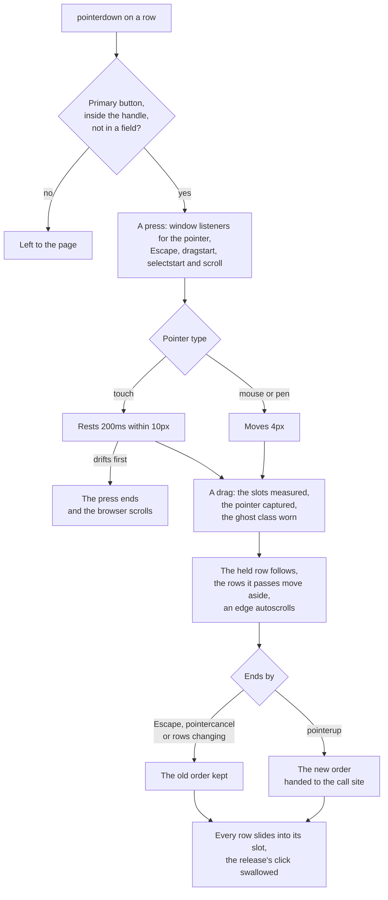

# Drag reorder

`useDragReorder` moves a row by pointer: a row is pressed and dragged to a new place in its list, table or sidebar, and the call site is handed the new order. The keyboard half — Alt+Up and Alt+Down, read out through a live region — is `useReorder`'s, and both make their move through `getMovedItems`. The drag used to be [vue-draggable-plus](https://github.com/Alfred-Skyblue/vue-draggable-plus), a Vue wrapper bundling [SortableJS](https://github.com/SortableJS/Sortable) 1.15.2. It is now a composable in the [UI library](../ui-library/design.md), written on Pointer Events. How it works, what it leaves out, and every upstream issue with its verdict are below, as [dependency admission](../dependency-admission/design.md) requires of an absorbed package.

## Why it is ours

The register kept vue-draggable-plus as an engine, on the stop list's accessibility item. Neither reason holds:

- **The accessible half was already ours.** `UiList` and `UiDataTable` move a row by Alt and an arrow and read the move out, and the room categories move by the same keys. SortableJS did only the pointer drag, which has no focus, role or announcement of its own.
- **The algorithm is small.** The call sites use one vertical container, an optional handle, a touch delay, rows moving aside and autoscroll. SortableJS's other surfaces — groups, cloning, multi-drag, swap, grids — were never called.
- **It joined nothing.** It is no adapter between two engines we keep: it bundled an engine the catalog never named.

Vuetify 0's [`useDragDrop`](https://0.vuetifyjs.com/composables/system/use-drag-drop) was weighed first, as the platform the library already stands on, and not taken. It has no touch delay, no `touch-action` handling and no pointer capture. Its drop zones are measured once and go stale on a scroll. It moves nothing on screen. Its keyboard adapter would compete with the rows' own keys.

Only the web app drags rows, so, like [SQL highlighting](../sql-highlight/design.md), the drag is no package: it is a composable beside the components that call it, with this page.

## How it works

`useDragReorder()` returns a builder. A call site hands it three things:

- the values, in their rendered order;
- the callback that takes a new order;
- optionally, a handle selector.

The call site spreads the result on the container, whose element children are the rows, one for each value. `UiList` spreads it on each group, `UiDataTable` on its one body with the handle column's class, and the room sidebar on its categories with their headers' handles.

- **Starting.** Only a primary press counts: the main button, or the first finger. With a handle, the press must land inside it. A press in a field, a select or an editable region keeps its own meaning: its caret, selection, slider or menu. Mouse and pen start a drag once the press moves `DRAG_START_DISTANCE`, so a press released short of it is a plain click. A finger must rest `TOUCH_DRAG_DELAY_MS` within `LONG_PRESS_MOVE_TOLERANCE`. A swipe before that ends the press and the browser scrolls, and a longer rest still reaches the context menu. In nested containers the innermost claims the press.
- **While a press is down.** The browser's own drag and a text selection are both cancelled, since either would take the pointer. Each listener sits on the window and goes with the press.
- **Following.** The held row moves by the CSS `translate` property, which composes with any `transform` the row carries. It is clamped between the first and last slot, and divided by the container's scale on screen, so a zoomed or transformed ancestor keeps it under the pointer. It captures the pointer, so nothing it passes over takes a hover. It wears `REORDER_GHOST_CLASS`, drawn as a lifted row over the rest.
- **Choosing a slot.** The slot is the one whose offset is nearest where the row is held, from the rows' places when the drag began. So rows of unequal height change places once, midway. The rows between the old slot and the new move aside by the held row's height and the gap after it, over `REORDER_SLIDE_TRANSITION`, the short motion that reduced motion zeroes.
- **Scrolling.** The innermost scroller that can still scroll toward the pointer scrolls: the container and its overflow ancestors, then the page. It starts within `DRAG_AUTOSCROLL_EDGE` of the scroller's top or bottom, or past it, and runs at up to `DRAG_AUTOSCROLL_SPEED`, faster nearer the edge. Each step is instant, so a smooth `scroll-behavior` cannot ease it away. Any scroll, the wheel's included, re-reads where the held row is, so its slot stays right.
- **Holding the page.** Once a touch drag has started, the container cancels its own `touchmove`, so the page stays still under the finger. The listener is on the container before the touch begins, because a browser decides as a touch starts whether it may scroll.
- **Ending.** A release hands the call site the new order through `getMovedItems`, and nothing when the order did not change. No row is ever moved in the DOM: Vue renders the new order. The rows keep where they were let go until the next frame, which is painted only after the call site's render has landed, even one an optimistic store makes a few microtasks on. Each then slides from there to where it lands — its first and last place read, an inverse translate written, then the transition let go. The click a release raises is swallowed, and only that one: the next press or key disarms it, since a touch drag raises none.
- **Giving way.** Escape cancels and goes no further, so a dialog the list sits in stays open. A `pointercancel` cancels. So does a row added or removed under the drag, whose slots are then stale. Unmounting ends the press with every listener and timer.

## What it leaves out

The surface is what the three call sites use. None of these are offered:

- moving a row to another list or group, cloning, multi-drag and swap mode;
- filters, per-row disabling, and callbacks other than the new order;
- horizontal, grid, wrapped and right-to-left layouts, and virtual scrolling;
- custom drag images, a directive and a component API.

An issue asking for one of them is out of scope on that ground. A reorder is never pointer-only: the keyboard path stays `useReorder`'s.

## Upstream

Two trackers were read.

- **vue-draggable-plus**: all 265 items, 200 issues and 65 pull requests, open and closed.
- **SortableJS**: 810 of its 2,351 items, 682 issues and 128 pull requests. These are the items whose titles touch the behaviour rebuilt: handles, touch and delay, order and position, scrolling, animation, nesting, clicks and fields inside a row, tables, and the pointer and ghost. Titles about a surface not offered here (multi-drag, swap, clone, group pull and put) or about another framework's wrapper were left out.

Each item was read with every comment and given one verdict from the [dependency admission triage](../dependency-admission/design.md). A pull request takes the verdict of the issue it fixes or the change it makes.

Verdicts by count:

| Verdict                               | vue-draggable-plus | SortableJS |
| :------------------------------------ | -----------------: | ---------: |
| In scope: fixed                       |                 22 |        263 |
| In scope: implemented                 |                  6 |         44 |
| Out of scope: surface we do not offer |                142 |        286 |
| Out of scope: owned by a neighbour    |                 18 |         34 |
| False positive                        |                 45 |        178 |
| Noise                                 |                 32 |          5 |
| Total                                 |                265 |        810 |

Every in-scope item is proven by one of 20 regression tests in `useDragReorder.test.ts`, each titled with the item leading its class. Every item of the class cites that test in the Proof column, by the item its title starts with.

The suite was run once against vue-draggable-plus 0.6.1, through a throwaway copy that mounted the wrapper's component with the call sites' old props. 20 tests fail there. The 10 that pass are recorded as pins:

- the short press and the drift before the delay;
- a secondary button and a second finger;
- a field inside a row;
- an unchanged drop and the click after a drop that raised none;
- `pointercancel` and an unmount;
- a row added under the drag.

Most of the failures come from SortableJS doing nothing on a mouse in the harness. It hands a mouse drag to the browser's native drag and drop, which happy-dom does not run, and that native drag is itself the class of defect this replacement removes (vue-draggable-plus#35).

### vue-draggable-plus

| Upstream item                                                           | Verdict                               | Evidence                                                                                                                                                                                                           | Proof                                           |
| :---------------------------------------------------------------------- | :------------------------------------ | :----------------------------------------------------------------------------------------------------------------------------------------------------------------------------------------------------------------- | :---------------------------------------------- |
| [#1](https://github.com/Alfred-Skyblue/vue-draggable-plus/issues/1)     | Out of scope: surface we do not offer | Grouped columns built by v-for could not get useDraggable through dynamic refs; maintainer added an immediate option and showed the v-draggable directive, which worked. Multi-list groups and the function API.   |                                                 |
| [#2](https://github.com/Alfred-Skyblue/vue-draggable-plus/issues/2)     | False positive                        | Autoscroll felt too slow when dragging past the screen edge; the reporter answered it himself: 'I can use the scroll-speed attribute the same as sortablejs'. A usage question.                                    |                                                 |
| [#3](https://github.com/Alfred-Skyblue/vue-draggable-plus/issues/3)     | Out of scope: surface we do not offer | A custom clone function added a key, but repeated clones of one item shared the same key; maintainer asked for a reproduction since the custom-clone demo works. Cloning between lists.                            |                                                 |
| [#4](https://github.com/Alfred-Skyblue/vue-draggable-plus/issues/4)     | False positive                        | Request for a nested draggable example; maintainer added one to the docs and a commenter linked its source file. A documentation gap.                                                                              |                                                 |
| [#5](https://github.com/Alfred-Skyblue/vue-draggable-plus/issues/5)     | Out of scope: surface we do not offer | Returning false from onMove did not cancel the drag; maintainer fixed it in 0.1.3 and the reporter confirmed. The onMove callback.                                                                                 |                                                 |
| [#6](https://github.com/Alfred-Skyblue/vue-draggable-plus/issues/6)     | Out of scope: surface we do not offer | Asked to work with vue-virtual-scroller; a commenter says the library does not support virtual lists and items jump back with RecycleScroller, while VueUse useVirtualList works. Virtual scrolling.               |                                                 |
| [#7](https://github.com/Alfred-Skyblue/vue-draggable-plus/issues/7)     | False positive                        | A ul wrapped inside the component would not drag and a list reassigned from a server response would not sort; maintainer pointed to the ul/li demo and asked for a repro. The reassignment part duplicates #12.    |                                                 |
| [#8](https://github.com/Alfred-Skyblue/vue-draggable-plus/issues/8)     | False positive                        | Asked where the props and events API is documented, and how to widen the autoscroll zone and hide the ghost; maintainer added an API page to the docs. A documentation gap.                                        |                                                 |
| [#9](https://github.com/Alfred-Skyblue/vue-draggable-plus/issues/9)     | In scope: fixed                       | After dragging the last item upward, a newly added item renders second to last though it is last in the array (scrollSensitivity also ignored); reporter gave a stackblitz and a video, no fix.                    | the vue-draggable-plus#173 test, fails upstream |
| [#10](https://github.com/Alfred-Skyblue/vue-draggable-plus/issues/10)   | Out of scope: surface we do not offer | Request for SortableJS MultiDrag and Swap plugin support, with a +1 for swap. Multi-drag and swap mode.                                                                                                            |                                                 |
| [#11](https://github.com/Alfred-Skyblue/vue-draggable-plus/issues/11)   | False positive                        | An item dragged the opposite way landed first or last; maintainer: 'pass the onMove function to return false to prevent this sorting', and the reporter accepted. Answered in the thread.                          |                                                 |
| [#12](https://github.com/Alfred-Skyblue/vue-draggable-plus/issues/12)   | In scope: fixed                       | A list assigned after mount (async fetch) snaps back to its old order on release; maintainer: the directive unwraps the ref so the reassignment 'cannot be monitored', no fix.                                     | the vue-draggable-plus#12 test, fails upstream  |
| [#13](https://github.com/Alfred-Skyblue/vue-draggable-plus/issues/13)   | False positive                        | Props passed to the VueDraggable component could not change after mount; maintainer fixed it in 0.1.5.                                                                                                             |                                                 |
| [#14](https://github.com/Alfred-Skyblue/vue-draggable-plus/issues/14)   | Out of scope: surface we do not offer | Asks whether the SortableJS MultiDrag plugin works; a contributor offered to implement it (PR #26) and others want multi-select. Multi-drag.                                                                       |                                                 |
| [#15](https://github.com/Alfred-Skyblue/vue-draggable-plus/issues/15)   | False positive                        | The v-model list was updated only after the @update event fired, forcing a nextTick; maintainer fixed the ordering in 0.1.6.                                                                                       |                                                 |
| [#16](https://github.com/Alfred-Skyblue/vue-draggable-plus/issues/16)   | False positive                        | v-model cannot bind a prop; maintainer explained passing :modelValue works because the wrapper reorders the array in place, and the reporter accepted it. A usage question.                                        |                                                 |
| [#17](https://github.com/Alfred-Skyblue/vue-draggable-plus/issues/17)   | Out of scope: surface we do not offer | The README's stackblitz example had an unclosed div, a stale file and an old toolchain; maintainer forked the reporter's fixed version. The upstream docs site and examples.                                       |                                                 |
| [#18](https://github.com/Alfred-Skyblue/vue-draggable-plus/issues/18)   | Out of scope: surface we do not offer | Two grouped lists with a target container inside Element Plus el-row left the last dragged element behind; fixed in 0.2.0-beta.1. Moving between lists with a target container.                                    |                                                 |
| [#19](https://github.com/Alfred-Skyblue/vue-draggable-plus/issues/19)   | Out of scope: surface we do not offer | Asked how to prevent a drop onto an element matched by filter; the reporter solved it through a SortableJS issue. The filter option.                                                                               |                                                 |
| [#20](https://github.com/Alfred-Skyblue/vue-draggable-plus/issues/20)   | Out of scope: surface we do not offer | In TSX the component's types rejected v-model and handle; maintainer: 'a problem with ts checking, please try using useDraggable'. The published package's types.                                                  |                                                 |
| [#21](https://github.com/Alfred-Skyblue/vue-draggable-plus/issues/21)   | Out of scope: surface we do not offer | Items cloned from one list into nested dynamic components vanished after a drag though the data was right; another user hit the same, no answer. Cloning and moving between nested lists.                          |                                                 |
| [#22](https://github.com/Alfred-Skyblue/vue-draggable-plus/issues/22)   | Out of scope: owned by a neighbour    | In Edge, holding a drag and moving for seconds made the animation lag; maintainer could not reproduce and a commenter found turning off Edge's efficiency mode fixes it. Owner: Microsoft Edge.                    |                                                 |
| [#23](https://github.com/Alfred-Skyblue/vue-draggable-plus/issues/23)   | In scope: fixed                       | onUpdate removes and reinserts the dragged DOM node, and insertNodeAt used firstChild, catching Vue text or comment nodes and breaking Vue's diff; maintainer fixed it and says the DOM moves serve the animation. | the vue-draggable-plus#173 test, fails upstream |
| [#24](https://github.com/Alfred-Skyblue/vue-draggable-plus/issues/24)   | Out of scope: owned by a neighbour    | Async components blinked when moved between lists; a commenter traced it to defineAsyncComponent itself and found the fix in a Vue core issue. Owner: Vue.                                                         |                                                 |
| [#25](https://github.com/Alfred-Skyblue/vue-draggable-plus/issues/25)   | False positive                        | Reported the change event firing without a position change; the reporter then wrote 'sorry, it was my misunderstanding'.                                                                                           |                                                 |
| [#26](https://github.com/Alfred-Skyblue/vue-draggable-plus/issues/26)   | Out of scope: surface we do not offer | PR adding the MultiDrag plugin; maintainer noted it only moved DOM nodes and the array order came out wrong, and it was never merged. Multi-drag.                                                                  |                                                 |
| [#27](https://github.com/Alfred-Skyblue/vue-draggable-plus/issues/27)   | False positive                        | A Vue warning about an invalid watch source appeared in the console; maintainer replied 'Fixed' in a later release.                                                                                                |                                                 |
| [#28](https://github.com/Alfred-Skyblue/vue-draggable-plus/issues/28)   | Out of scope: surface we do not offer | PR fixing the package.json types field so TypeScript moduleResolution Bundler resolves the typings; merged. The published package's types and builds.                                                              |                                                 |
| [#29](https://github.com/Alfred-Skyblue/vue-draggable-plus/issues/29)   | Noise                                 | PR removing a duplicated prop declaration and unifying style in the component's props; no behaviour change.                                                                                                        |                                                 |
| [#30](https://github.com/Alfred-Skyblue/vue-draggable-plus/issues/30)   | Out of scope: surface we do not offer | The generated component.d.ts imported vue-demi from devDependencies, so VueDraggable typed as any; maintainer replaced vue-demi with vue in 0.2.3. The published package's types.                                  |                                                 |
| [#31](https://github.com/Alfred-Skyblue/vue-draggable-plus/issues/31)   | Out of scope: surface we do not offer | Dragging an item out of the container sends it to the list end, and with removeOnSpill a removed item seems to come back; stackblitz given, no reply. removeOnSpill and spill handling.                            |                                                 |
| [#32](https://github.com/Alfred-Skyblue/vue-draggable-plus/issues/32)   | Out of scope: surface we do not offer | Asked how to forbid some items from entering another list; maintainer pointed to onMove returning false, reporter says a move between lists still cannot be cancelled. onMove and cross-list moves.                |                                                 |
| [#33](https://github.com/Alfred-Skyblue/vue-draggable-plus/issues/33)   | Out of scope: surface we do not offer | Importing the package failed TypeScript checking; maintainer said to upgrade to 0.2.4. The published package's types.                                                                                              |                                                 |
| [#34](https://github.com/Alfred-Skyblue/vue-draggable-plus/issues/34)   | False positive                        | Could not pass a class to the element rendered by tag; maintainer: the component wraps a layer of div, so pass the class to the component or use useDraggable. A usage question.                                   |                                                 |
| [#35](https://github.com/Alfred-Skyblue/vue-draggable-plus/issues/35)   | In scope: fixed                       | In Firefox a finished drag opens a search page (not in Chrome or Edge); maintainer's workaround is preventDefault on the body's drop event, which the reporter confirmed works.                                    | the vue-draggable-plus#35 test, fails upstream  |
| [#36](https://github.com/Alfred-Skyblue/vue-draggable-plus/issues/36)   | False positive                        | Maintainer's note restating the Firefox new-tab-on-drop workaround credited to the reporter of #35. A duplicate of #35.                                                                                            |                                                 |
| [#37](https://github.com/Alfred-Skyblue/vue-draggable-plus/issues/37)   | Out of scope: surface we do not offer | Wants only the inner item shown while dragging it from one container to another, not the whole child with its decoration; no answer. Moving between containers and a custom drag image.                            |                                                 |
| [#38](https://github.com/Alfred-Skyblue/vue-draggable-plus/issues/38)   | Out of scope: surface we do not offer | Asked how to move rows between several Vuetify v-data-tables in one group; maintainer pointed to the target selector. Moving items between lists.                                                                  |                                                 |
| [#39](https://github.com/Alfred-Skyblue/vue-draggable-plus/issues/39)   | Out of scope: owned by a neighbour    | Dragging in an ant-design-vue 3 table with a checkbox column misaligns; maintainer offered customUpdate in 0.2.5 to move the array by hand. Owner: Ant Design Vue's table.                                         |                                                 |
| [#40](https://github.com/Alfred-Skyblue/vue-draggable-plus/issues/40)   | Out of scope: owned by a neighbour    | 'Nt_mounted is not defined' appears only in a webpack production build and seems tied to the Terser minimizer; zip repro, no reply. Owner: the bundler (webpack with Terser).                                      |                                                 |
| [#41](https://github.com/Alfred-Skyblue/vue-draggable-plus/issues/41)   | Out of scope: surface we do not offer | One line: after a page refresh the move, end and start events no longer fire; no reproduction and no reply. The onMove, onStart and onEnd callbacks.                                                               |                                                 |
| [#42](https://github.com/Alfred-Skyblue/vue-draggable-plus/issues/42)   | In scope: fixed                       | After dragging the bottom item up, a newly created item renders in the wrong place while the array is right; a commenter fixed it by not keying by index, as the FAQ advises.                                      | the vue-draggable-plus#173 test, fails upstream |
| [#43](https://github.com/Alfred-Skyblue/vue-draggable-plus/issues/43)   | Out of scope: surface we do not offer | An item dragged quickly into an empty grouped list flies back; maintainer could not reproduce and a commenter suggested a min-height on empty lists. Moving items between lists.                                   |                                                 |
| [#44](https://github.com/Alfred-Skyblue/vue-draggable-plus/issues/44)   | Out of scope: surface we do not offer | PR using oldDraggableIndex and newDraggableIndex so the model reorders correctly when the draggable option excludes nodes; merged. The draggable selector option.                                                  |                                                 |
| [#45](https://github.com/Alfred-Skyblue/vue-draggable-plus/issues/45)   | Out of scope: surface we do not offer | Moving entries between two grouped lists without an id makes some disappear; the template keys by item.no-id, which evaluates to NaN. Moving items between lists.                                                  |                                                 |
| [#46](https://github.com/Alfred-Skyblue/vue-draggable-plus/issues/46)   | False positive                        | An inner VueDraggable nested in group cards never fired its handler while the outer one did; the code block is empty and it was closed with no reply. No reproduction.                                             |                                                 |
| [#47](https://github.com/Alfred-Skyblue/vue-draggable-plus/issues/47)   | False positive                        | After updating, data reorders but the view does not; maintainer asked for a minimal reproduction since the demo works, the reporter could not share one and pinned 0.2.1. No reproduction.                         |                                                 |
| [#48](https://github.com/Alfred-Skyblue/vue-draggable-plus/issues/48)   | Out of scope: surface we do not offer | A production build threw 'Converting circular structure to JSON' because the default clone copies through JSON; maintainer: pass a custom clone such as cloneDeep. Cloning.                                        |                                                 |
| [#49](https://github.com/Alfred-Skyblue/vue-draggable-plus/issues/49)   | Out of scope: surface we do not offer | Asked how to disable dragging per item by its data inside a Swiper; maintainer answered with filter and an ignore class. Per-item disabling and filter.                                                            |                                                 |
| [#50](https://github.com/Alfred-Skyblue/vue-draggable-plus/issues/50)   | Out of scope: surface we do not offer | The English docs page did not load because of an outdated Vitepress; maintainer pointed to #59, where the docs were fixed. The upstream docs site.                                                                 |                                                 |
| [#51](https://github.com/Alfred-Skyblue/vue-draggable-plus/issues/51)   | Out of scope: surface we do not offer | Needs the dragged item with its source and target list to patch an order's status across lists; maintainer pointed to the onEnd event object. Event payloads and cross-list moves.                                 |                                                 |
| [#52](https://github.com/Alfred-Skyblue/vue-draggable-plus/issues/52)   | Out of scope: owned by a neighbour    | With Element Plus el-upload the hook only sorted the whole list, not its file items; the reporter later wrote 'solved'. Owner: Element Plus el-upload.                                                             |                                                 |
| [#53](https://github.com/Alfred-Skyblue/vue-draggable-plus/issues/53)   | Out of scope: surface we do not offer | Dragging from a draggable-plus list into a plain SortableJS list was refused; maintainer explained the private Symbol key, and draggable-plus on both sides fixed it. Moving between lists.                        |                                                 |
| [#54](https://github.com/Alfred-Skyblue/vue-draggable-plus/issues/54)   | Out of scope: surface we do not offer | Wants to process a custom-cloned item before it is added to the target list; maintainer pointed to the custom-clone demo. Cloning.                                                                                 |                                                 |
| [#55](https://github.com/Alfred-Skyblue/vue-draggable-plus/issues/55)   | Out of scope: owned by a neighbour    | Asked for a demo of freely dragging one element rather than reordering; maintainer pointed to VueUse useDraggable. Owner: VueUse, not a sorter.                                                                    |                                                 |
| [#56](https://github.com/Alfred-Skyblue/vue-draggable-plus/issues/56)   | Out of scope: owned by a neighbour    | The list rendered but would not drag; the reporter found an enclosing Swiper and fixed it by setting simulate-touch to false. Owner: Swiper.                                                                       |                                                 |
| [#57](https://github.com/Alfred-Skyblue/vue-draggable-plus/issues/57)   | Out of scope: surface we do not offer | Asks for an option to remove the dragged element from its source only when the drag ends, not as soon as it starts; maintainer will not support extreme features. Moving between lists.                            |                                                 |
| [#58](https://github.com/Alfred-Skyblue/vue-draggable-plus/issues/58)   | Out of scope: owned by a neighbour    | useDraggable.d.ts failed with TS1005 on its inline type imports; the reporter found their TypeScript 4.4.4 does not support that syntax. Owner: the consumer's TypeScript version.                                 |                                                 |
| [#59](https://github.com/Alfred-Skyblue/vue-draggable-plus/issues/59)   | Out of scope: surface we do not offer | English docs on GitHub Pages loaded CSS and JS from wrong paths; maintainer blamed Vitepress and fixed the docs. The upstream docs site.                                                                           |                                                 |
| [#61](https://github.com/Alfred-Skyblue/vue-draggable-plus/issues/61)   | Out of scope: surface we do not offer | Asked for an event reporting the elements passed over during a drag, even in other groups; maintainer: use the native events, or onAdd for the same group. Callbacks and event payloads.                           |                                                 |
| [#62](https://github.com/Alfred-Skyblue/vue-draggable-plus/issues/62)   | In scope: fixed                       | Dragging goes wrong when the root node has CSS zoom; maintainer linked a known SortableJS issue and a commenter asks why there is still no fix, noting browser page zoom works.                                    | the vue-draggable-plus#62 test, fails upstream  |
| [#63](https://github.com/Alfred-Skyblue/vue-draggable-plus/issues/63)   | Out of scope: owned by a neighbour    | A TDesign t-table with target set would not drag; maintainer found TDesign's lazy-load kept the rows out of the DOM at mount, and turning it off worked. Owner: TDesign.                                           |                                                 |
| [#64](https://github.com/Alfred-Skyblue/vue-draggable-plus/issues/64)   | False positive                        | Asked how to let items inside collapsible groups sort while the groups stay fixed; maintainer said to wrap each group's list root in VueDraggable. A usage question.                                               |                                                 |
| [#65](https://github.com/Alfred-Skyblue/vue-draggable-plus/issues/65)   | Out of scope: surface we do not offer | Wants a list to accept an item from another list only when empty; maintainer pointed to group and pause, a commenter used onMove plus pause. Groups and cross-list puts.                                           |                                                 |
| [#66](https://github.com/Alfred-Skyblue/vue-draggable-plus/issues/66)   | Out of scope: surface we do not offer | Asked how to customise the drag preview; maintainer said SortableJS clones the item and suggested styling it through chosenClass and dragClass. Custom drag images.                                                |                                                 |
| [#67](https://github.com/Alfred-Skyblue/vue-draggable-plus/issues/67)   | False positive                        | Nested lists did not render with the reporter's nested-component; maintainer pointed out the component must call itself recursively and the reporter confirmed. A misunderstanding.                                |                                                 |
| [#68](https://github.com/Alfred-Skyblue/vue-draggable-plus/issues/68)   | In scope: implemented                 | Wants dragging to start only from a grip icon, since otherwise clicks are swallowed and text in inputs cannot be selected; maintainer pointed to the handle option, reporter: 'perfect'.                           | the vue-draggable-plus#68 test, fails upstream  |
| [#69](https://github.com/Alfred-Skyblue/vue-draggable-plus/issues/69)   | Noise                                 | PR correcting the default type of direction in the Chinese docs.                                                                                                                                                   |                                                 |
| [#70](https://github.com/Alfred-Skyblue/vue-draggable-plus/issues/70)   | Noise                                 | PR fixing a type error in the docs' hooks usage example.                                                                                                                                                           |                                                 |
| [#71](https://github.com/Alfred-Skyblue/vue-draggable-plus/issues/71)   | False positive                        | Proposed rewriting moveArrayElement as a swap; maintainer showed that moving and swapping give different arrays. A misunderstanding answered in the thread.                                                        |                                                 |
| [#73](https://github.com/Alfred-Skyblue/vue-draggable-plus/issues/73)   | Out of scope: surface we do not offer | Cloning an item from list A into list B made the item vanish from A; maintainer asked for a minimal reproduction. Cloning.                                                                                         |                                                 |
| [#74](https://github.com/Alfred-Skyblue/vue-draggable-plus/issues/74)   | Out of scope: surface we do not offer | Dynamic components cloned into a second list did not render; maintainer: cloning deep-copies through JSON, so pass a clone function or map component names. Cloning.                                               |                                                 |
| [#75](https://github.com/Alfred-Skyblue/vue-draggable-plus/issues/75)   | Out of scope: owned by a neighbour    | With scroll set, an ant-design-vue table's tbody holds a hidden measure row, so dragging up writes undefined into the data; a draggable selector worked until 0.5.6. Owner: Ant Design Vue's table.                |                                                 |
| [#76](https://github.com/Alfred-Skyblue/vue-draggable-plus/issues/76)   | Out of scope: surface we do not offer | Asks for an insertion line instead of live reordering while dragging, and how to style the mirror; a commenter shared a demo. A custom drop indicator or drag image.                                               |                                                 |
| [#77](https://github.com/Alfred-Skyblue/vue-draggable-plus/issues/77)   | Out of scope: surface we do not offer | With computed getters and setters, moving items across two lists never calls the setters because onAdd and onRemove mutate the array in place. Moving items between lists.                                         |                                                 |
| [#78](https://github.com/Alfred-Skyblue/vue-draggable-plus/issues/78)   | Out of scope: surface we do not offer | PR for #77 setting the list in onAdd and onRemove and dropping DOM moves; maintainer said the DOM moves are needed for animation and it was closed. Moving items between lists.                                    |                                                 |
| [#79](https://github.com/Alfred-Skyblue/vue-draggable-plus/issues/79)   | Out of scope: surface we do not offer | Asked how to stop the first element from being dragged; a commenter answered with a class and the filter option. Per-item disabling and filter.                                                                    |                                                 |
| [#80](https://github.com/Alfred-Skyblue/vue-draggable-plus/issues/80)   | Out of scope: surface we do not offer | In the dual-list docs, the component and function usage examples showed identical code; fixed by PR #83. The upstream docs site.                                                                                   |                                                 |
| [#81](https://github.com/Alfred-Skyblue/vue-draggable-plus/issues/81)   | Noise                                 | PR with small English corrections in the docs.                                                                                                                                                                     |                                                 |
| [#82](https://github.com/Alfred-Skyblue/vue-draggable-plus/issues/82)   | Out of scope: surface we do not offer | Asks for a fix for horizontal lists in RTL; no answer. Horizontal and RTL layouts.                                                                                                                                 |                                                 |
| [#83](https://github.com/Alfred-Skyblue/vue-draggable-plus/issues/83)   | Noise                                 | PR fixing the dual-list function usage example in the docs, for #80.                                                                                                                                               |                                                 |
| [#84](https://github.com/Alfred-Skyblue/vue-draggable-plus/issues/84)   | Out of scope: surface we do not offer | Cloning two identical items into list2 then moving the first into list3 made the other vanish; maintainer: the keys were duplicated, give clones a unique key. Cloning and moving between lists.                   |                                                 |
| [#85](https://github.com/Alfred-Skyblue/vue-draggable-plus/issues/85)   | Out of scope: surface we do not offer | Dropping just past list B's bounds puts the item in B but the animation flies back to A; the reporter linked a SortableJS fix. Moving items between lists.                                                         |                                                 |
| [#86](https://github.com/Alfred-Skyblue/vue-draggable-plus/issues/86)   | Out of scope: surface we do not offer | Setting sort to false still let the list reorder; maintainer could not reproduce. The sort: false option.                                                                                                          |                                                 |
| [#87](https://github.com/Alfred-Skyblue/vue-draggable-plus/issues/87)   | False positive                        | With direction horizontal, a child's dragend seemed not to fire after dragging out; the reporter found the bug in their own logic, unrelated to vue-draggable-plus.                                                |                                                 |
| [#88](https://github.com/Alfred-Skyblue/vue-draggable-plus/issues/88)   | Out of scope: surface we do not offer | Wants to detect a task dropped on a div outside the lists; maintainer said to listen for dragenter on that div. Target containers outside the list.                                                                |                                                 |
| [#89](https://github.com/Alfred-Skyblue/vue-draggable-plus/issues/89)   | Out of scope: owned by a neighbour    | Could not make it work with PrimeVue DataTable and TreeTable; maintainer said useDraggable cannot be called in onMounted and needs an initial value. Owner: PrimeVue's tables.                                     |                                                 |
| [#90](https://github.com/Alfred-Skyblue/vue-draggable-plus/issues/90)   | Out of scope: surface we do not offer | PR fixing the data position when the draggable attribute excludes some nodes; merged. The draggable selector option.                                                                                               |                                                 |
| [#91](https://github.com/Alfred-Skyblue/vue-draggable-plus/issues/91)   | Out of scope: surface we do not offer | Dynamic components moved between lists without cloning fail to render; repro given, no answer. Moving items between lists.                                                                                         |                                                 |
| [#93](https://github.com/Alfred-Skyblue/vue-draggable-plus/issues/93)   | Out of scope: surface we do not offer | A custom-cloned item dropped below another landed above it; mixing ul and div children made newDraggableIndex differ from newIndex, fixed by using divs. Cloning between lists.                                    |                                                 |
| [#94](https://github.com/Alfred-Skyblue/vue-draggable-plus/issues/94)   | Noise                                 | PR tidying a config file, with no description; closed.                                                                                                                                                             |                                                 |
| [#95](https://github.com/Alfred-Skyblue/vue-draggable-plus/issues/95)   | Out of scope: surface we do not offer | Wants required items to sort within their column but never move to another; onMove returning false failed and a commenter used pause(). Moving between lists and onMove.                                           |                                                 |
| [#96](https://github.com/Alfred-Skyblue/vue-draggable-plus/issues/96)   | Out of scope: surface we do not offer | Asks whether dragging several selected items is planned, pointing at a fork with multidrag. Multi-drag.                                                                                                            |                                                 |
| [#97](https://github.com/Alfred-Skyblue/vue-draggable-plus/issues/97)   | Out of scope: surface we do not offer | Wants the first item of each list never replaced when cloning between lists; a commenter suggested the filter option. Cloning and filter.                                                                          |                                                 |
| [#98](https://github.com/Alfred-Skyblue/vue-draggable-plus/issues/98)   | Out of scope: surface we do not offer | With ul and li across two lists, an item dropped at the end of the second list lands first; maintainer: use li under ul and div under div, see PR #44. Moving items between lists.                                 |                                                 |
| [#99](https://github.com/Alfred-Skyblue/vue-draggable-plus/issues/99)   | False positive                        | Firefox opens a new tab when dragging; maintainer referred to #36. A duplicate of #35.                                                                                                                             |                                                 |
| [#100](https://github.com/Alfred-Skyblue/vue-draggable-plus/issues/100) | Out of scope: surface we do not offer | Wants the group put function to see the dragged item's data so only even ids enter a list; maintainer suggested filter or onMove. Group pull and put.                                                              |                                                 |
| [#101](https://github.com/Alfred-Skyblue/vue-draggable-plus/issues/101) | Out of scope: surface we do not offer | Asks for oldIndex and newIndex in onMove to veto sorting across nesting levels; no maintainer answer. The onMove callback and its payload.                                                                         |                                                 |
| [#102](https://github.com/Alfred-Skyblue/vue-draggable-plus/issues/102) | Out of scope: surface we do not offer | The package did not export the Options and SortableEvent types; fixed by PR #103. The published package's types.                                                                                                   |                                                 |
| [#103](https://github.com/Alfred-Skyblue/vue-draggable-plus/issues/103) | Out of scope: surface we do not offer | PR exporting the Options and SortableEvent types for #102; merged. The published package's types.                                                                                                                  |                                                 |
| [#104](https://github.com/Alfred-Skyblue/vue-draggable-plus/issues/104) | False positive                        | The UI reordered but the data did not; a commenter saw it only with the directive and switching to the component fixed it. A duplicate of #12.                                                                     |                                                 |
| [#105](https://github.com/Alfred-Skyblue/vue-draggable-plus/issues/105) | In scope: implemented                 | Asks how to cancel a drag by pressing Escape; another user wants the same, and a commenter links a SortableJS workaround. No built-in support.                                                                     | the vue-draggable-plus#105 test, fails upstream |
| [#106](https://github.com/Alfred-Skyblue/vue-draggable-plus/issues/106) | False positive                        | Grouped lists in a v-for did not animate or move between lists; a commenter answered 'v-model binding is required', as the reporter passed :items. A usage question.                                               |                                                 |
| [#107](https://github.com/Alfred-Skyblue/vue-draggable-plus/issues/107) | Out of scope: surface we do not offer | Importing the browser build in an options API page failed on a bare 'vue' specifier; a commenter pointed to the global VueDraggablePlus. The published package's builds.                                           |                                                 |
| [#108](https://github.com/Alfred-Skyblue/vue-draggable-plus/issues/108) | Noise                                 | PR removing redundant comments from component.ts and useDraggable.ts.                                                                                                                                              |                                                 |
| [#109](https://github.com/Alfred-Skyblue/vue-draggable-plus/issues/109) | Noise                                 | PR changing the format of DOM in the README and guide docs.                                                                                                                                                        |                                                 |
| [#110](https://github.com/Alfred-Skyblue/vue-draggable-plus/issues/110) | Noise                                 | PR adding a new WeChat group image; closed.                                                                                                                                                                        |                                                 |
| [#111](https://github.com/Alfred-Skyblue/vue-draggable-plus/issues/111) | Noise                                 | PR updating the WeChat group QR code.                                                                                                                                                                              |                                                 |
| [#112](https://github.com/Alfred-Skyblue/vue-draggable-plus/issues/112) | Noise                                 | PR deleting redundant title text in README.md.                                                                                                                                                                     |                                                 |
| [#113](https://github.com/Alfred-Skyblue/vue-draggable-plus/issues/113) | In scope: fixed                       | ghostClass and dragClass are not applied when v-model is not used; a second user confirms it 'does not seem to apply correctly with the function'. No maintainer reply.                                            | the vue-draggable-plus#113 test, fails upstream |
| [#114](https://github.com/Alfred-Skyblue/vue-draggable-plus/issues/114) | False positive                        | Thought items with a handle should not default to draggable true; the reporter retracted it: 'my bad about this draggable=true'. The clone part became PR #115.                                                    |                                                 |
| [#115](https://github.com/Alfred-Skyblue/vue-draggable-plus/issues/115) | Out of scope: surface we do not offer | PR adding clone to the component props; merged. Cloning.                                                                                                                                                           |                                                 |
| [#116](https://github.com/Alfred-Skyblue/vue-draggable-plus/issues/116) | Noise                                 | PR updating the WeChat group QR code; closed.                                                                                                                                                                      |                                                 |
| [#117](https://github.com/Alfred-Skyblue/vue-draggable-plus/issues/117) | Noise                                 | PR updating the WeChat group QR code.                                                                                                                                                                              |                                                 |
| [#118](https://github.com/Alfred-Skyblue/vue-draggable-plus/issues/118) | Out of scope: surface we do not offer | Wants draggable items never dropped onto fixed items; maintainer: onMove returning false, and later users report that stopped working after 0.5.0. onMove and per-item disabling.                                  |                                                 |
| [#119](https://github.com/Alfred-Skyblue/vue-draggable-plus/issues/119) | Out of scope: surface we do not offer | Moving an element from the Vue list into a vanilla SortableJS list is refused; stackblitz given. Moving items between lists.                                                                                       |                                                 |
| [#120](https://github.com/Alfred-Skyblue/vue-draggable-plus/issues/120) | In scope: fixed                       | cursor: grabbing does not apply while dragging in Chrome (fine in Firefox), also seen in Safari; maintainer: 'looks like a browser issue'. The native drag ignores the cursor.                                     | the vue-draggable-plus#35 test, fails upstream  |
| [#121](https://github.com/Alfred-Skyblue/vue-draggable-plus/issues/121) | Out of scope: surface we do not offer | Wants the physical left or right direction of a single swiped card in onEnd, without binding an array; maintainer: record positions in onStart and onEnd. Event payloads.                                          |                                                 |
| [#122](https://github.com/Alfred-Skyblue/vue-draggable-plus/issues/122) | Out of scope: surface we do not offer | The v-draggable directive does not work inside an options API component; repro given. The directive.                                                                                                               |                                                 |
| [#123](https://github.com/Alfred-Skyblue/vue-draggable-plus/issues/123) | Out of scope: surface we do not offer | Asked how to use the CDN build; maintainer gave an IIFE example and the reporter confirmed it works. The CDN build.                                                                                                |                                                 |
| [#124](https://github.com/Alfred-Skyblue/vue-draggable-plus/issues/124) | Noise                                 | PR updating the WeChat group QR code.                                                                                                                                                                              |                                                 |
| [#125](https://github.com/Alfred-Skyblue/vue-draggable-plus/issues/125) | Noise                                 | PR changing the group chat QR code; maintainer closed it as a duplicate of #124.                                                                                                                                   |                                                 |
| [#126](https://github.com/Alfred-Skyblue/vue-draggable-plus/issues/126) | Noise                                 | PR updating the WeChat group QR code; closed.                                                                                                                                                                      |                                                 |
| [#127](https://github.com/Alfred-Skyblue/vue-draggable-plus/issues/127) | Noise                                 | PR updating the WeChat group QR code.                                                                                                                                                                              |                                                 |
| [#128](https://github.com/Alfred-Skyblue/vue-draggable-plus/issues/128) | Out of scope: owned by a neighbour    | Sorting Element Plus tabs with target .el-tabs__nav failed; maintainer: Element Plus adds its own elements there, so the count does not match the list. Owner: Element Plus el-tabs.                               |                                                 |
| [#129](https://github.com/Alfred-Skyblue/vue-draggable-plus/issues/129) | Out of scope: surface we do not offer | Wants to lock specific elements in place; a commenter used onMove returning false when the related element has a non-draggable class. onMove and per-item disabling.                                               |                                                 |
| [#130](https://github.com/Alfred-Skyblue/vue-draggable-plus/issues/130) | Noise                                 | PR updating the WeChat group QR code.                                                                                                                                                                              |                                                 |
| [#131](https://github.com/Alfred-Skyblue/vue-draggable-plus/issues/131) | Out of scope: surface we do not offer | Wants a class that stops buttons and images inside a card from starting a drag; a commenter showed the filter option. The filter option.                                                                           |                                                 |
| [#132](https://github.com/Alfred-Skyblue/vue-draggable-plus/issues/132) | Noise                                 | PR fixing a broken link to the target container demo in the README.                                                                                                                                                |                                                 |
| [#133](https://github.com/Alfred-Skyblue/vue-draggable-plus/issues/133) | Out of scope: surface we do not offer | PR adding a class that disables dragging an individual element; maintainer preferred the filter option and it was closed. Per-item disabling.                                                                      |                                                 |
| [#134](https://github.com/Alfred-Skyblue/vue-draggable-plus/issues/134) | Out of scope: surface we do not offer | Wants the moved item or index in onUpdate and onAdd for a dual list, with some columns never draggable; no answer. Event payloads, moving between lists and per-item disabling.                                    |                                                 |
| [#135](https://github.com/Alfred-Skyblue/vue-draggable-plus/issues/135) | False positive                        | Reporter could not get dragging to work with defineComponent and TSX and asked what identifies each dragged item; a usage question and documentation gap with no maintainer reply.                                 |                                                 |
| [#136](https://github.com/Alfred-Skyblue/vue-draggable-plus/issues/136) | Out of scope: owned by a neighbour    | TinyMCE editors inside dragged divs stop working after a drop. Owner: TinyMCE, whose iframe editor reloads whenever its node is moved, which Vue's keyed re-render also does. No reply.                            |                                                 |
| [#138](https://github.com/Alfred-Skyblue/vue-draggable-plus/issues/138) | Out of scope: surface we do not offer | Merged PR making onAdd and onRemove emit update:model-value when an item moves between lists, closing #77. Not offered: moving items between lists.                                                                |                                                 |
| [#139](https://github.com/Alfred-Skyblue/vue-draggable-plus/issues/139) | Out of scope: surface we do not offer | Open PR attaching the dragged item's data to every SortableJS event; the maintainer proposed getCurrentData (#153) instead. Not offered: callbacks and event payloads.                                             |                                                 |
| [#140](https://github.com/Alfred-Skyblue/vue-draggable-plus/issues/140) | False positive                        | Inner nested list never fired update; the maintainer explained onUpdate fires only for a reorder within one list, while a cross-list move fires onAdd and onRemove. Reporter closed it.                            |                                                 |
| [#142](https://github.com/Alfred-Skyblue/vue-draggable-plus/issues/142) | Out of scope: surface we do not offer | Closed PR fixing useDraggable(el, undefined, options) dropping its options. Not offered: the useDraggable function API and its argument overloads.                                                                 |                                                 |
| [#143](https://github.com/Alfred-Skyblue/vue-draggable-plus/issues/143) | Out of scope: surface we do not offer | Kanban user wants to restrict which nested list a task may be dropped into; unanswered. Not offered: moving items between lists or groups (put rules).                                                             |                                                 |
| [#144](https://github.com/Alfred-Skyblue/vue-draggable-plus/issues/144) | Out of scope: surface we do not offer | Dragging the last row from one Arco table into another rendered wrongly though the data was right; the reporter forced a re-render. Not offered: moving items between lists.                                       |                                                 |
| [#145](https://github.com/Alfred-Skyblue/vue-draggable-plus/issues/145) | Noise                                 | Docs PR removing a duplicated CSS class from a demo; merged with thanks.                                                                                                                                           |                                                 |
| [#146](https://github.com/Alfred-Skyblue/vue-draggable-plus/issues/146) | Out of scope: surface we do not offer | Wanted fixed first and last columns in a draggable header row; answered with the target option plus display: contents. Not offered: horizontal layouts and static, non-draggable items.                            |                                                 |
| [#147](https://github.com/Alfred-Skyblue/vue-draggable-plus/issues/147) | Out of scope: owned by a neighbour    | Request for free positioning like VueUse useDraggable instead of sorting; no reply. Owner: a free-drag utility such as VueUse useDraggable, not a sorter.                                                          |                                                 |
| [#148](https://github.com/Alfred-Skyblue/vue-draggable-plus/issues/148) | False positive                        | Asked how to revert a position after a drop; the maintainer answered to swap the data back using newIndex and oldIndex from the event.                                                                             |                                                 |
| [#149](https://github.com/Alfred-Skyblue/vue-draggable-plus/issues/149) | False positive                        | Nested lists' inner events and an array watcher reportedly never fired; only screenshots, no reproduction or follow-up. Same symptom as #140, answered there.                                                      |                                                 |
| [#150](https://github.com/Alfred-Skyblue/vue-draggable-plus/issues/150) | Out of scope: surface we do not offer | Closed PR keeping an item in its source when it already exists in the target group; the maintainer declined it as uncommon. Not offered: moving items between groups.                                              |                                                 |
| [#151](https://github.com/Alfred-Skyblue/vue-draggable-plus/issues/151) | In scope: fixed                       | scrollSensitivity did nothing until forceFallback: true was set, per SortableJS issue 1443; a commenter also passed the scroll container in by hand. Autoscroll failed in native drag mode.                        | the vue-draggable-plus#151 test, fails upstream |
| [#153](https://github.com/Alfred-Skyblue/vue-draggable-plus/issues/153) | Out of scope: surface we do not offer | Maintainer's design note for a getCurrentData function exposing the dragged and cloned data inside callbacks. Not offered: callbacks, event payloads and cloning.                                                  |                                                 |
| [#154](https://github.com/Alfred-Skyblue/vue-draggable-plus/issues/154) | Out of scope: surface we do not offer | Closed docs PR adding an FAQ example for disabling drag. Not offered: the published package's docs site.                                                                                                           |                                                 |
| [#155](https://github.com/Alfred-Skyblue/vue-draggable-plus/issues/155) | Noise                                 | Closed docs PR normalising the spacing before paths in Markdown files.                                                                                                                                             |                                                 |
| [#156](https://github.com/Alfred-Skyblue/vue-draggable-plus/issues/156) | Out of scope: surface we do not offer | The :move handler was never called, and @move returning false did not block a move in a grouped nested list; only a docs pointer was given. Not offered: onMove callbacks and groups.                              |                                                 |
| [#157](https://github.com/Alfred-Skyblue/vue-draggable-plus/issues/157) | Out of scope: surface we do not offer | Asked to delay sorting until an item rests 200 to 300 ms over a new spot so rows in between stop shuffling; no reply. Not offered: sort-timing tuning in the vein of swapThreshold.                                |                                                 |
| [#159](https://github.com/Alfred-Skyblue/vue-draggable-plus/issues/159) | Out of scope: surface we do not offer | Function properties were lost when a cloned item was dragged on to a third list; a commenter said the default clone is JSON round-tripping and to pass :clone. Not offered: cloning.                               |                                                 |
| [#160](https://github.com/Alfred-Skyblue/vue-draggable-plus/issues/160) | Out of scope: surface we do not offer | Merged PR adding the vue keyword to package.json for npm search visibility. Not offered: a published npm package.                                                                                                  |                                                 |
| [#161](https://github.com/Alfred-Skyblue/vue-draggable-plus/issues/161) | Out of scope: surface we do not offer | Asked to cancel a drag from onStart or onMove on a flag; @move returning false left the item displaced until the mouse left. No reply. Not offered: onStart and onMove callbacks.                                  |                                                 |
| [#162](https://github.com/Alfred-Skyblue/vue-draggable-plus/issues/162) | Out of scope: surface we do not offer | Wanted a table row and its accordion row to move together in one drag with nothing dropped between them; unanswered. Not offered: multi-drag.                                                                      |                                                 |
| [#163](https://github.com/Alfred-Skyblue/vue-draggable-plus/issues/163) | In scope: implemented                 | Asked whether items in nested lists can be limited to reordering within their own level; no reply.                                                                                                                 | the sortablejs#328 test, fails upstream         |
| [#164](https://github.com/Alfred-Skyblue/vue-draggable-plus/issues/164) | Noise                                 | PR updating the community group QR code.                                                                                                                                                                           |                                                 |
| [#165](https://github.com/Alfred-Skyblue/vue-draggable-plus/issues/165) | Out of scope: surface we do not offer | Wanted to forbid dropping some nodes in some places; returning false from onMove did not work for them. Not offered: onMove callbacks and per-target drop rules.                                                   |                                                 |
| [#166](https://github.com/Alfred-Skyblue/vue-draggable-plus/issues/166) | Out of scope: surface we do not offer | Handlers are typed SortableEvent instead of the documented DraggableEvent because option merging uses SortableJS types. Not offered: event payloads and published types.                                           |                                                 |
| [#167](https://github.com/Alfred-Skyblue/vue-draggable-plus/issues/167) | In scope: implemented                 | Reported no transition while dragging, the two divs just swap; a commenter suggested ghostClass and a hand-made demo. Upstream animation is an opt-in option.                                                      | the vue-draggable-plus#167 test, fails upstream |
| [#168](https://github.com/Alfred-Skyblue/vue-draggable-plus/issues/168) | Out of scope: surface we do not offer | Title only, onMove returns false but the item still swaps; no body and no replies. Not offered: onMove callbacks.                                                                                                  |                                                 |
| [#169](https://github.com/Alfred-Skyblue/vue-draggable-plus/issues/169) | Noise                                 | PR updating the community group QR code.                                                                                                                                                                           |                                                 |
| [#171](https://github.com/Alfred-Skyblue/vue-draggable-plus/issues/171) | Out of scope: surface we do not offer | Merged PR making the wrapper honour onMove's return value so returning false blocks the move. Not offered: onMove callbacks.                                                                                       |                                                 |
| [#172](https://github.com/Alfred-Skyblue/vue-draggable-plus/issues/172) | Out of scope: surface we do not offer | Asked how to save the new order and detect a cross-group move when using the group option; unanswered. Not offered: group and moving items between lists.                                                          |                                                 |
| [#173](https://github.com/Alfred-Skyblue/vue-draggable-plus/issues/173) | In scope: fixed                       | Moving the last item above the others, then pushing a new item, rendered the new item out of place; the maintainer only linked the FAQ. The rendered order diverged from the data.                                 | the vue-draggable-plus#173 test, fails upstream |
| [#174](https://github.com/Alfred-Skyblue/vue-draggable-plus/issues/174) | False positive                        | Tree table rows jumped to the end after expanding and inserted wrongly; the reporter confirmed it worked once they removed the target option and the template wrapper.                                             |                                                 |
| [#175](https://github.com/Alfred-Skyblue/vue-draggable-plus/issues/175) | Out of scope: surface we do not offer | Closed PR fixing a v-draggable type error, split into #176 and #177. Not offered: the directive and published types.                                                                                               |                                                 |
| [#176](https://github.com/Alfred-Skyblue/vue-draggable-plus/issues/176) | Out of scope: surface we do not offer | Merged PR fixing the v-draggable directive's type error. Not offered: the directive and published types.                                                                                                           |                                                 |
| [#177](https://github.com/Alfred-Skyblue/vue-draggable-plus/issues/177) | Out of scope: surface we do not offer | Merged PR fixing type errors in the docs demos, such as a string animation attribute bound as :animation, and adding a recursive component tip. Not offered: the docs site.                                        |                                                 |
| [#178](https://github.com/Alfred-Skyblue/vue-draggable-plus/issues/178) | False positive                        | After sorting, an item added by a per-row button lands at the end of the array; no reproduction and no reply. The ordering symptom is the one in #173.                                                             |                                                 |
| [#179](https://github.com/Alfred-Skyblue/vue-draggable-plus/issues/179) | False positive                        | v-model did not update through defineModel; a commenter traced it to a reactive copy and the maintainer said to bind a ref, since a reactive object cannot be replaced.                                            |                                                 |
| [#180](https://github.com/Alfred-Skyblue/vue-draggable-plus/issues/180) | Out of scope: surface we do not offer | Generated v-draggable lines sharing a group refused drops and errored on reorder; the maintainer advised the component or composable. Not offered: the directive and moving between lists.                         |                                                 |
| [#181](https://github.com/Alfred-Skyblue/vue-draggable-plus/issues/181) | False positive                        | The update event never fired under Inertia though it worked standalone; closed with no reply. The snippet declares the handler in a plain script block rather than script setup.                                   |                                                 |
| [#182](https://github.com/Alfred-Skyblue/vue-draggable-plus/issues/182) | Out of scope: surface we do not offer | Open PR letting clone be async or return false to cancel a drop; the maintainer objected that async would block updates. Not offered: cloning and callbacks.                                                       |                                                 |
| [#183](https://github.com/Alfred-Skyblue/vue-draggable-plus/issues/183) | Out of scope: surface we do not offer | Asked for click-to-move between two lists; the reporter solved it with click handlers moving items between the arrays. Not offered: moving items between lists.                                                    |                                                 |
| [#184](https://github.com/Alfred-Skyblue/vue-draggable-plus/issues/184) | Noise                                 | Merged docs PR clearing the default li styles in a demo.                                                                                                                                                           |                                                 |
| [#186](https://github.com/Alfred-Skyblue/vue-draggable-plus/issues/186) | Noise                                 | Merged docs PR fixing a style glitch and stray Chinese text in the English docs.                                                                                                                                   |                                                 |
| [#187](https://github.com/Alfred-Skyblue/vue-draggable-plus/issues/187) | Out of scope: owned by a neighbour    | Asked whether items can be freely arranged on a canvas; the maintainer said no, it only sorts. Owner: a free-drag utility such as VueUse useDraggable.                                                             |                                                 |
| [#188](https://github.com/Alfred-Skyblue/vue-draggable-plus/issues/188) | Out of scope: surface we do not offer | Dragging a node into a nested list mixed with plain nodes broke; the maintainer said to use a single-root element instead of a template v-for. Not offered: moving items between lists.                            |                                                 |
| [#189](https://github.com/Alfred-Skyblue/vue-draggable-plus/issues/189) | Out of scope: surface we do not offer | A Vue 2.7 laravel-mix production build failed with Xt_mounted is not defined; a commenter traced it to Terser reduce_vars. Not offered: Vue 2 and the published package build.                                     |                                                 |
| [#190](https://github.com/Alfred-Skyblue/vue-draggable-plus/issues/190) | False positive                        | Asked for an element's CSS rotation to be kept while dragging; the maintainer asked for detail or a reproduction and the reporter never replied.                                                                   |                                                 |
| [#191](https://github.com/Alfred-Skyblue/vue-draggable-plus/issues/191) | Out of scope: surface we do not offer | Kanban columns sharing a group returned another card's data after the first cross-column move; unanswered. Not offered: moving items between lists or groups.                                                      |                                                 |
| [#194](https://github.com/Alfred-Skyblue/vue-draggable-plus/issues/194) | Out of scope: surface we do not offer | Two Element Plus el-row lists in one group: after moving every item out, one still showed and stayed draggable; plain divs worked. Not offered: moving items between lists.                                        |                                                 |
| [#195](https://github.com/Alfred-Skyblue/vue-draggable-plus/issues/195) | Out of scope: surface we do not offer | With sort false on both lists, dragging into the target list still animated a sort; wanted the container highlighted instead. Unanswered. Not offered: sort false and moving between lists.                        |                                                 |
| [#196](https://github.com/Alfred-Skyblue/vue-draggable-plus/issues/196) | Out of scope: surface we do not offer | The @update:modelValue listener reports a type error while v-model works. Not offered: the published component's types.                                                                                            |                                                 |
| [#197](https://github.com/Alfred-Skyblue/vue-draggable-plus/issues/197) | Out of scope: surface we do not offer | In the clone demo, onClone could not read clonedData or data; a commenter noted onClone fires before onStart. Not offered: cloning and callbacks.                                                                  |                                                 |
| [#198](https://github.com/Alfred-Skyblue/vue-draggable-plus/issues/198) | False positive                        | Text in an input inside a draggable row could not be mouse-selected; the maintainer said to add a dedicated handle, since a draggable element cannot also be text-selectable.                                      |                                                 |
| [#199](https://github.com/Alfred-Skyblue/vue-draggable-plus/issues/199) | In scope: fixed                       | After a drop the element's styles did not follow it; two reporters confirmed force-fallback, the non-native drag mode, fixed it.                                                                                   | the vue-draggable-plus#35 test, fails upstream  |
| [#200](https://github.com/Alfred-Skyblue/vue-draggable-plus/issues/200) | Out of scope: surface we do not offer | Grid or flex layouts with direction rtl misbehave when dragging; the only follow-up was a commenter fixing an unrelated data mistake. Not offered: grid, wrapped and RTL layouts.                                  |                                                 |
| [#201](https://github.com/Alfred-Skyblue/vue-draggable-plus/issues/201) | Out of scope: surface we do not offer | Asked for a way to mount SortableJS plugins such as Swap, since the swap option is accepted but the plugin is never mounted. Not offered: swap mode and multi-drag.                                                |                                                 |
| [#202](https://github.com/Alfred-Skyblue/vue-draggable-plus/issues/202) | In scope: fixed                       | Dragging without changing the order, then appending, put the new item out of place even in the official demo; the maintainer fixed it in #205 for text anchors in childNodes.                                      | the vue-draggable-plus#173 test, fails upstream |
| [#203](https://github.com/Alfred-Skyblue/vue-draggable-plus/issues/203) | Out of scope: surface we do not offer | Open PR enabling swap and multiDrag; the maintainer held multiDrag back over unresolved multi-clone side effects. Not offered: swap mode and multi-drag.                                                           |                                                 |
| [#204](https://github.com/Alfred-Skyblue/vue-draggable-plus/issues/204) | Out of scope: surface we do not offer | VueDraggable declares its props as an array, so Vue's boolean casting is lost when options merge (vuejs core issue 12224). Not offered: the published component and its props.                                     |                                                 |
| [#205](https://github.com/Alfred-Skyblue/vue-draggable-plus/issues/205) | In scope: fixed                       | Merged fix for #202: text anchors in childNodes misplaced the restored node when the order was unchanged, so Vue inserted the DOM in the wrong order.                                                              | the vue-draggable-plus#173 test, fails upstream |
| [#206](https://github.com/Alfred-Skyblue/vue-draggable-plus/issues/206) | False positive                        | Moving the last element then adding one rendered out of order; the reporter closed it saying the FAQ covered it (the list was keyed by index). Duplicate of #173.                                                  |                                                 |
| [#207](https://github.com/Alfred-Skyblue/vue-draggable-plus/issues/207) | Out of scope: owned by a neighbour    | Wanted nested dragging in an Ant Design Vue tree table, which renders child rows flat beside their parents; a commenter said it cannot work and wrote their own table. Owner: Ant Design Vue.                      |                                                 |
| [#208](https://github.com/Alfred-Skyblue/vue-draggable-plus/issues/208) | Out of scope: surface we do not offer | Merged PR letting useDraggable's el accept a plain element when no list is passed. Not offered: the useDraggable function API and its types.                                                                       |                                                 |
| [#209](https://github.com/Alfred-Skyblue/vue-draggable-plus/issues/209) | In scope: fixed                       | Merged PR: in pointer fallback mode a leftover node broke the length check, so dropping on the same position swapped the first two elements in the DOM.                                                            | the vue-draggable-plus#173 test, fails upstream |
| [#210](https://github.com/Alfred-Skyblue/vue-draggable-plus/issues/210) | Out of scope: owned by a neighbour    | Dragging worked in the HBuilderX preview but not in the packaged app on a phone; the maintainer said it depends on the platform's capabilities. Owner: the uni-app runtime.                                        |                                                 |
| [#211](https://github.com/Alfred-Skyblue/vue-draggable-plus/issues/211) | Noise                                 | Open PR adding Vitest browser-mode tests to the upstream repository; the maintainer welcomed it.                                                                                                                   |                                                 |
| [#212](https://github.com/Alfred-Skyblue/vue-draggable-plus/issues/212) | False positive                        | Asked whether the docs folder tow-list should be two-list; a documentation typo, taken up by PRs #219 and #220.                                                                                                    |                                                 |
| [#213](https://github.com/Alfred-Skyblue/vue-draggable-plus/issues/213) | Out of scope: owned by a neighbour    | Asked how to animate a programmatic reorder of the list; another user has the same need, unanswered. Owner: Vue's TransitionGroup, not the drag.                                                                   |                                                 |
| [#214](https://github.com/Alfred-Skyblue/vue-draggable-plus/issues/214) | Out of scope: surface we do not offer | vue-tsc reports TS2305, no exported member VueDraggable, in 0.5.4 and 0.6.0. Not offered: the published package's types.                                                                                           |                                                 |
| [#215](https://github.com/Alfred-Skyblue/vue-draggable-plus/issues/215) | Out of scope: surface we do not offer | An item twitched when dragged into an empty container overlapping another; emptyInsertThreshold 0 fixed it. Not offered: moving items between lists.                                                               |                                                 |
| [#216](https://github.com/Alfred-Skyblue/vue-draggable-plus/issues/216) | False positive                        | Adding or removing items reportedly broke sorting; no reproduction, no reply, and the issue was closed.                                                                                                            |                                                 |
| [#217](https://github.com/Alfred-Skyblue/vue-draggable-plus/issues/217) | Out of scope: surface we do not offer | Closed PR setting emptyInsertThreshold to 0 for overlapping empty containers, for #215. Not offered: moving items between lists.                                                                                   |                                                 |
| [#218](https://github.com/Alfred-Skyblue/vue-draggable-plus/issues/218) | Out of scope: surface we do not offer | Closed resubmission of #217 setting emptyInsertThreshold to 0 for overlapping empty containers. Not offered: moving items between lists.                                                                           |                                                 |
| [#219](https://github.com/Alfred-Skyblue/vue-draggable-plus/issues/219) | Noise                                 | Closed PR renaming the tow-list docs folder to two-list.                                                                                                                                                           |                                                 |
| [#220](https://github.com/Alfred-Skyblue/vue-draggable-plus/issues/220) | Noise                                 | Closed resubmission of #219 renaming the tow-list docs folder to two-list.                                                                                                                                         |                                                 |
| [#221](https://github.com/Alfred-Skyblue/vue-draggable-plus/issues/221) | Noise                                 | Merged docs PR correcting the documented type and default of delayOnTouchOnly.                                                                                                                                     |                                                 |
| [#222](https://github.com/Alfred-Skyblue/vue-draggable-plus/issues/222) | False positive                        | Copied demos would not drag though start and end fired; the same reporter then said the Tauri setting in #223 solved it. Duplicate of #223.                                                                        |                                                 |
| [#223](https://github.com/Alfred-Skyblue/vue-draggable-plus/issues/223) | In scope: fixed                       | Dragging worked in a browser but not in Tauri; two users fixed it with dragDropEnabled: false, which hands HTML5 drag events back to the page.                                                                     | the vue-draggable-plus#35 test, fails upstream  |
| [#224](https://github.com/Alfred-Skyblue/vue-draggable-plus/issues/224) | Out of scope: surface we do not offer | TS4082 private name IProps from the package's declarations; a commenter found vue-tsc 2.1.10 works and 2.2.0 fails. Not offered: the published package's types.                                                    |                                                 |
| [#225](https://github.com/Alfred-Skyblue/vue-draggable-plus/issues/225) | Out of scope: surface we do not offer | Default cloning turned class instances into plain objects; the maintainer said to pass a clone returning the element itself. Not offered: cloning.                                                                 |                                                 |
| [#226](https://github.com/Alfred-Skyblue/vue-draggable-plus/issues/226) | Out of scope: surface we do not offer | Cloning from one column into a recursive nested list threw Maximum call stack size exceeded, with templates keyed by Date.now(); no reply. Not offered: cloning and moving between lists.                          |                                                 |
| [#227](https://github.com/Alfred-Skyblue/vue-draggable-plus/issues/227) | Out of scope: surface we do not offer | A registered component passed as the tag prop rendered as a raw tag; the reporter switched to the directive on a dynamic component. Not offered: a wrapper component and its tag prop.                             |                                                 |
| [#228](https://github.com/Alfred-Skyblue/vue-draggable-plus/issues/228) | Out of scope: surface we do not offer | Since 0.6.0 a static first th moved because updates use draggable indexes; the maintainer declined an option and pointed to customUpdate. Not offered: horizontal layouts and static items.                        |                                                 |
| [#229](https://github.com/Alfred-Skyblue/vue-draggable-plus/issues/229) | Noise                                 | Merged README PR adding a list item.                                                                                                                                                                               |                                                 |
| [#230](https://github.com/Alfred-Skyblue/vue-draggable-plus/issues/230) | Out of scope: surface we do not offer | Moving an item into a nested list left its node in the source too, since onRemove re-inserts it; others tied it to template v-for. Not offered: moving items between lists.                                        |                                                 |
| [#231](https://github.com/Alfred-Skyblue/vue-draggable-plus/issues/231) | Out of scope: surface we do not offer | The Chinese docs site was often unreachable, with or without a proxy. Not offered: the docs site.                                                                                                                  |                                                 |
| [#232](https://github.com/Alfred-Skyblue/vue-draggable-plus/issues/232) | False positive                        | Asked how this package differs from VueUse useSortable; a commenter quoted VueUse's note that useSortable only sorts a single list.                                                                                |                                                 |
| [#233](https://github.com/Alfred-Skyblue/vue-draggable-plus/issues/233) | Out of scope: surface we do not offer | A draggable selector excluding static columns dragged the wrong item; the reporter conceded the misunderstanding and asked for per-index disabling. Not offered: per-item disabled and draggable selectors.        |                                                 |
| [#234](https://github.com/Alfred-Skyblue/vue-draggable-plus/issues/234) | Out of scope: surface we do not offer | SortableEvent lacks the clonedData field the wrapper adds, so onRemove needs a cast; a commenter said DraggableEvent should be used. Not offered: event payloads and cloning.                                      |                                                 |
| [#235](https://github.com/Alfred-Skyblue/vue-draggable-plus/issues/235) | Out of scope: surface we do not offer | Element Plus tab headers sorted through the target option: after moving the first tab to the end, a new tab was not appended last. Unanswered. Not offered: horizontal layouts.                                    |                                                 |
| [#236](https://github.com/Alfred-Skyblue/vue-draggable-plus/issues/236) | Out of scope: surface we do not offer | Asked for the SortableJS instance behind useDraggable; the maintainer said it returns some methods but not the instance. Not offered: the useDraggable function API.                                               |                                                 |
| [#237](https://github.com/Alfred-Skyblue/vue-draggable-plus/issues/237) | False positive                        | Root element not found and el must be an HTMLElement appeared at random; the reporter resolved it with the advice given in issue #1.                                                                               |                                                 |
| [#238](https://github.com/Alfred-Skyblue/vue-draggable-plus/issues/238) | Out of scope: surface we do not offer | useDraggable typed its list as a Ref, so a Pinia store array errored; the maintainer said it needs a Ref, not reactive. Not offered: the useDraggable function API.                                                |                                                 |
| [#239](https://github.com/Alfred-Skyblue/vue-draggable-plus/issues/239) | In scope: implemented                 | Requested lockAxis so a drag moves on one axis only, as smooth-dnd offers; no reply.                                                                                                                               | the vue-draggable-plus#252 test, fails upstream |
| [#240](https://github.com/Alfred-Skyblue/vue-draggable-plus/issues/240) | False positive                        | A beginner asked how to drag Element Plus table rows; a commenter pointed to the target container demo.                                                                                                            |                                                 |
| [#241](https://github.com/Alfred-Skyblue/vue-draggable-plus/issues/241) | False positive                        | Dragging the third row of an el-row table threw a missing id error; the container also holds the header row, so DOM positions run one ahead of the data. No maintainer reply.                                      |                                                 |
| [#242](https://github.com/Alfred-Skyblue/vue-draggable-plus/issues/242) | Out of scope: surface we do not offer | Asked how to remove an item by dropping it outside any list; unanswered. Not offered: removeOnSpill.                                                                                                               |                                                 |
| [#243](https://github.com/Alfred-Skyblue/vue-draggable-plus/issues/243) | Out of scope: surface we do not offer | Closed docs PR adding an FAQ for UI frameworks; a reviewer said the target container page already covers it. Not offered: the docs site.                                                                           |                                                 |
| [#244](https://github.com/Alfred-Skyblue/vue-draggable-plus/issues/244) | In scope: fixed                       | Dragging a column whose inner table was scrolled showed unrelated content in the drag representation; the browser's drag image captured overflow beyond the column.                                                | the vue-draggable-plus#252 test, fails upstream |
| [#245](https://github.com/Alfred-Skyblue/vue-draggable-plus/issues/245) | False positive                        | A computed v-model without a setter snapped back on drop; the maintainer said the computed needs both get and set.                                                                                                 |                                                 |
| [#246](https://github.com/Alfred-Skyblue/vue-draggable-plus/issues/246) | False positive                        | The computed v-model still snapped back, but its setter wrote a different field than the getter reads; the maintainer could not reproduce it and asked for a reproduction.                                         |                                                 |
| [#247](https://github.com/Alfred-Skyblue/vue-draggable-plus/issues/247) | Out of scope: surface we do not offer | Asked to expose dragenter, dragover and dragleave to react while dragging over items; another user agreed. Not offered: callbacks and native drag events.                                                          |                                                 |
| [#248](https://github.com/Alfred-Skyblue/vue-draggable-plus/issues/248) | Out of scope: surface we do not offer | Merged PR typing the component's emitted events as DraggableEvent instead of SortableEvent. Not offered: event payloads and published types.                                                                       |                                                 |
| [#249](https://github.com/Alfred-Skyblue/vue-draggable-plus/issues/249) | Out of scope: surface we do not offer | Locking some items with the draggable or filter options scrambled the order of the rest; others confirmed it since 0.2.0-beta.1. Not offered: filter and draggable selectors.                                      |                                                 |
| [#250](https://github.com/Alfred-Skyblue/vue-draggable-plus/issues/250) | Out of scope: surface we do not offer | v-draggable on an initially empty array snapped back on drop; the maintainer said the directive cannot see data updates. Not offered: the directive.                                                               |                                                 |
| [#251](https://github.com/Alfred-Skyblue/vue-draggable-plus/issues/251) | In scope: fixed                       | The mouse wheel could not scroll the page while dragging; a commenter said forceFallback true, the non-native mode, fixes it. The reporter moved to Svelte.                                                        | the vue-draggable-plus#251 test, fails upstream |
| [#252](https://github.com/Alfred-Skyblue/vue-draggable-plus/issues/252) | In scope: fixed                       | Wanted to drop the translucent drag preview, or show it opaque and hide the original; a commenter hid .sortable-drag with CSS.                                                                                     | the vue-draggable-plus#252 test, fails upstream |
| [#253](https://github.com/Alfred-Skyblue/vue-draggable-plus/issues/253) | Out of scope: surface we do not offer | Two-column clone with sort false: dragging into the right list and back plays a reset animation; another user hit it too. Not offered: cloning, sort false and moving between lists.                               |                                                 |
| [#254](https://github.com/Alfred-Skyblue/vue-draggable-plus/issues/254) | Out of scope: surface we do not offer | Merged docs PR adding FAQs for the v-draggable directive. Not offered: the docs site and the directive.                                                                                                            |                                                 |
| [#255](https://github.com/Alfred-Skyblue/vue-draggable-plus/issues/255) | Out of scope: surface we do not offer | Merged docs PR adding FAQs for the v-draggable directive, a resubmission of #254. Not offered: the docs site and the directive.                                                                                    |                                                 |
| [#256](https://github.com/Alfred-Skyblue/vue-draggable-plus/issues/256) | Out of scope: surface we do not offer | Asked to treat sortablejs as an external dependency loaded from a CDN; unanswered. Not offered: the published package's builds and CDN.                                                                            |                                                 |
| [#257](https://github.com/Alfred-Skyblue/vue-draggable-plus/issues/257) | False positive                        | v-model on a nested reactive array reportedly did not update and start and end never fired; closed with no reply and no defect confirmed.                                                                          |                                                 |
| [#258](https://github.com/Alfred-Skyblue/vue-draggable-plus/issues/258) | Out of scope: surface we do not offer | Events are typed SortableEvent instead of the documented DraggableEvent, missing clone and clonedData; the same report as #166. Not offered: event payloads and published types.                                   |                                                 |
| [#259](https://github.com/Alfred-Skyblue/vue-draggable-plus/issues/259) | In scope: fixed                       | Items pushed after load jump to the container's top while dragged though sorting works; items present at load behave. No reply.                                                                                    | the vue-draggable-plus#12 test, fails upstream  |
| [#260](https://github.com/Alfred-Skyblue/vue-draggable-plus/issues/260) | In scope: implemented                 | Asked for the parent to autoscroll while dragging near its bottom edge; it only triggered occasionally and was not sensitive. No reply.                                                                            | the vue-draggable-plus#151 test, fails upstream |
| [#261](https://github.com/Alfred-Skyblue/vue-draggable-plus/issues/261) | Out of scope: surface we do not offer | Merged PR re-exporting SortableJS's MoveEvent type for onMove listeners. Not offered: onMove callbacks and published types.                                                                                        |                                                 |
| [#262](https://github.com/Alfred-Skyblue/vue-draggable-plus/issues/262) | Noise                                 | Merged docs PR fixing a one-character Chinese typo.                                                                                                                                                                |                                                 |
| [#263](https://github.com/Alfred-Skyblue/vue-draggable-plus/issues/263) | Out of scope: surface we do not offer | Asked how to read the target list's model in onMove when moving between two lists; unanswered. Not offered: onMove callbacks and moving between lists.                                                             |                                                 |
| [#264](https://github.com/Alfred-Skyblue/vue-draggable-plus/issues/264) | In scope: fixed                       | Screenshot only: the cursor flickers when the pointer reaches the edge of the dragged element; no reply.                                                                                                           | the vue-draggable-plus#35 test, fails upstream  |
| [#265](https://github.com/Alfred-Skyblue/vue-draggable-plus/issues/265) | In scope: fixed                       | Destroying the dragged item's container before the drop threw while removing event listeners; a video shows it and another user hit the same.                                                                      | the vue-draggable-plus#265 test, a pin          |
| [#266](https://github.com/Alfred-Skyblue/vue-draggable-plus/issues/266) | Out of scope: surface we do not offer | Merged PR removing a deprecated RefOrValue type definition. Not offered: the published package's types.                                                                                                            |                                                 |
| [#267](https://github.com/Alfred-Skyblue/vue-draggable-plus/issues/267) | False positive                        | TS4082 private name IProps during a build; duplicate of #224.                                                                                                                                                      |                                                 |
| [#268](https://github.com/Alfred-Skyblue/vue-draggable-plus/issues/268) | Out of scope: surface we do not offer | Asked for a git tag for the 0.6.1 release; the maintainer published it. Not offered: a published npm package.                                                                                                      |                                                 |
| [#269](https://github.com/Alfred-Skyblue/vue-draggable-plus/issues/269) | Out of scope: surface we do not offer | Asked what invertSwap, invertedSwapThreshold and swapThreshold do; the reporter found it in the SortableJS docs. Not offered: swapThreshold and invertSwap.                                                        |                                                 |
| [#270](https://github.com/Alfred-Skyblue/vue-draggable-plus/issues/270) | False positive                        | Asked why one docs demo animates on drop while another animates continuously; a question about the docs demos with no reply.                                                                                       |                                                 |
| [#271](https://github.com/Alfred-Skyblue/vue-draggable-plus/issues/271) | Out of scope: surface we do not offer | scrollSensitivity worked as props but was ignored inside an options object on Android, both with forceFallback. Not offered: forceFallback and scroll tuning options.                                              |                                                 |
| [#272](https://github.com/Alfred-Skyblue/vue-draggable-plus/issues/272) | Noise                                 | Closed docs PR switching demo text to English.                                                                                                                                                                     |                                                 |
| [#273](https://github.com/Alfred-Skyblue/vue-draggable-plus/issues/273) | Out of scope: surface we do not offer | Asked for revertOnSpill support; the reporter found it already passes through to SortableJS, only undocumented. Not offered: revertOnSpill.                                                                        |                                                 |
| [#274](https://github.com/Alfred-Skyblue/vue-draggable-plus/issues/274) | Out of scope: surface we do not offer | Open PR adding a renderGhost option to customise the drag ghost content. Not offered: custom drag images.                                                                                                          |                                                 |
| [#275](https://github.com/Alfred-Skyblue/vue-draggable-plus/issues/275) | In scope: fixed                       | On mobile with TransitionGroup, dragging an item and releasing it back at its origin swapped the first two elements but not the data, even in the official demo.                                                   | the vue-draggable-plus#173 test, fails upstream |
| [#276](https://github.com/Alfred-Skyblue/vue-draggable-plus/issues/276) | Out of scope: surface we do not offer | Open PR warning when the initial list is null or undefined, which the overloaded arguments mistook for options. Not offered: the useDraggable function API and the directive.                                      |                                                 |

### SortableJS

| Upstream item                                               | Verdict                               | Evidence                                                                                                                                                                                                               | Proof                                                                     |
| :---------------------------------------------------------- | :------------------------------------ | :--------------------------------------------------------------------------------------------------------------------------------------------------------------------------------------------------------------------- | :------------------------------------------------------------------------ |
| [#19](https://github.com/SortableJS/Sortable/issues/19)     | False positive                        | Reporter was calling jQuery UI's sortable, not this library; maintainer pointed it out and the reporter apologised and closed it.                                                                                      |                                                                           |
| [#23](https://github.com/SortableJS/Sortable/issues/23)     | In scope: fixed                       | An input inside a draggable item cannot be focused on mobile Chrome; a commenter notes native DnD lets text inputs work in Firefox but not Chrome. No fix in the thread.                                               | the sortablejs#972 test, a pin                                            |
| [#25](https://github.com/SortableJS/Sortable/issues/25)     | In scope: implemented                 | Request for autoscroll when a drag nears the viewport border on long lists; a commenter calls the browser's native drag autoscroll strange.                                                                            | the vue-draggable-plus#151 test, fails upstream                           |
| [#26](https://github.com/SortableJS/Sortable/issues/26)     | False positive                        | Starting a sort threw 'has no method dragDrop' from IE9 support code; maintainer said update the code and the reporter confirmed 'That fixed it'. Fixed by a later upstream commit.                                    |                                                                           |
| [#27](https://github.com/SortableJS/Sortable/issues/27)     | In scope: implemented                 | Asks for a delay between touch and sorting because a full-width list blocks page scrolling on mobile; maintainer tried, failed and asked for a PR.                                                                     | the sortablejs#56 test, fails upstream; the sortablejs#27 test, a pin     |
| [#28](https://github.com/SortableJS/Sortable/issues/28)     | False positive                        | Dragging to the top of the screen on iOS 6 threw 'null is not an object' in the parent walk; maintainer answered 'done'. Fixed by a later upstream commit.                                                             |                                                                           |
| [#33](https://github.com/SortableJS/Sortable/issues/33)     | In scope: fixed                       | On mobile an ordered list shows the number 6 while an item moves, because the touch fallback appends a clone to the list; maintainer only said mobile has no native dnd.                                               | the vue-draggable-plus#252 test, fails upstream                           |
| [#35](https://github.com/SortableJS/Sortable/issues/35)     | False positive                        | Asks for nested list support; maintainer said not planned, and a commenter notes it is tracked in #152. Duplicate of #152.                                                                                             |                                                                           |
| [#36](https://github.com/SortableJS/Sortable/issues/36)     | In scope: fixed                       | On touch the position fixed ghost lands in the wrong place when a parent has a CSS transform, a Chromium quirk; the fix PR #37 was not merged.                                                                         | the vue-draggable-plus#62 test, fails upstream                            |
| [#37](https://github.com/SortableJS/Sortable/issues/37)     | In scope: fixed                       | Fix PR for #36, the touch ghost mispositioned under a transformed parent; maintainer disliked relying on a positioned parent and it closed unmerged.                                                                   | the vue-draggable-plus#62 test, fails upstream                            |
| [#39](https://github.com/SortableJS/Sortable/issues/39)     | False positive                        | Asks how to read the list order as an array to save it; maintainer answered with a data-id map and the reporter said it works.                                                                                         |                                                                           |
| [#41](https://github.com/SortableJS/Sortable/issues/41)     | In scope: fixed                       | After a first drag with a handle the item keeps draggable=true and can then be dragged from outside the handle; maintainer acknowledged with 'thx' and fixed it.                                                       | the vue-draggable-plus#68 test, fails upstream                            |
| [#47](https://github.com/SortableJS/Sortable/issues/47)     | In scope: implemented                 | Merged PR making the hardcoded ignore list for a and img configurable, so drags can start on links and images whose native drag Sortable had disabled.                                                                 | the vue-draggable-plus#35 test, fails upstream                            |
| [#49](https://github.com/SortableJS/Sortable/issues/49)     | In scope: implemented                 | Merged PR adding IE10+ touch support and handling touchcancel, raised when a phone call or the home button interrupts a touch.                                                                                         | the sortablejs#49 test, a pin                                             |
| [#54](https://github.com/SortableJS/Sortable/issues/54)     | False positive                        | Asks how to persist the sorted order across reloads; maintainer pointed to the store option and the follow-ups are usage questions with no defect.                                                                     |                                                                           |
| [#56](https://github.com/SortableJS/Sortable/issues/56)     | In scope: implemented                 | PR adding a touch delay for #27; maintainer closed it because the delay must be configurable and cover both mouse and touch.                                                                                           | the sortablejs#56 test, fails upstream; the sortablejs#27 test, a pin     |
| [#58](https://github.com/SortableJS/Sortable/issues/58)     | In scope: fixed                       | Links inside a sortable item cannot be tapped on iPhone or iPad; maintainer called it 'a feature' and gave a filter workaround, and a later comment notes the click fires onEnd.                                       | the sortablejs#1184 test, fails upstream; the sortablejs#2365 test, a pin |
| [#59](https://github.com/SortableJS/Sortable/issues/59)     | False positive                        | Reported the indexes never change after dragging; the reporter then found 'a fault in my own code' and said the directive works.                                                                                       |                                                                           |
| [#66](https://github.com/SortableJS/Sortable/issues/66)     | In scope: fixed                       | Merely clicking the handle made the rest of the item draggable so its text could no longer be selected; fixed on the dev branch and confirmed by the reporter.                                                         | the vue-draggable-plus#68 test, fails upstream                            |
| [#67](https://github.com/SortableJS/Sortable/issues/67)     | False positive                        | An internal refactoring note to move the listeners to handleEvent, with no reported behaviour or defect.                                                                                                               |                                                                           |
| [#69](https://github.com/SortableJS/Sortable/issues/69)     | Out of scope: surface we do not offer | onUpdate does not fire when an item moves to another list in the same group; maintainer said update only covers changes inside one list. Moving between lists and callbacks are not offered.                           |                                                                           |
| [#70](https://github.com/SortableJS/Sortable/issues/70)     | Out of scope: surface we do not offer | PR firing onUpdate on add and remove between lists for #69 via mutation events; maintainer called it a hack. Moving between lists and callbacks are not offered.                                                       |                                                                           |
| [#71](https://github.com/SortableJS/Sortable/issues/71)     | False positive                        | Empty report about an accordion with ng-repeat; maintainer asked for an example and a description and none came.                                                                                                       |                                                                           |
| [#77](https://github.com/SortableJS/Sortable/issues/77)     | False positive                        | A question about supported browsers; maintainer quoted the README list of touch devices and browser versions.                                                                                                          |                                                                           |
| [#83](https://github.com/SortableJS/Sortable/issues/83)     | Out of scope: surface we do not offer | Wants a list whose items drag into another list but cannot be reordered; maintainer said no such option. sort false and moving between lists are not offered.                                                          |                                                                           |
| [#86](https://github.com/SortableJS/Sortable/issues/86)     | Out of scope: surface we do not offer | Asks for callbacks to run with the Sortable instance as this, to tell cross-list moves apart; fixed on dev. onEnd and other callbacks are not offered.                                                                 |                                                                           |
| [#88](https://github.com/SortableJS/Sortable/issues/88)     | In scope: fixed                       | On iPad a click handler on the drag handle never fires and inputs get no keyboard once Sortable is attached; maintainer suggested touchstart, then the filter option.                                                  | the sortablejs#1184 test, fails upstream; the sortablejs#2365 test, a pin |
| [#93](https://github.com/SortableJS/Sortable/issues/93)     | In scope: fixed                       | A right click on an item runs the tap-start handler; the reporter proposed ignoring non-primary buttons and confirmed the dev-branch fix.                                                                              | the sortablejs#93 test, a pin                                             |
| [#96](https://github.com/SortableJS/Sortable/issues/96)     | In scope: fixed                       | Animation branch bugs: no animation when items carry their own CSS transition, and fast drags to the first or last slot sometimes do not sort; maintainer fixed both.                                                  | the vue-draggable-plus#167 test, fails upstream                           |
| [#102](https://github.com/SortableJS/Sortable/issues/102)   | Out of scope: surface we do not offer | Non-draggable spacer children between items scramble the stored order; maintainer said the list should be uniform. The draggable selector and store are not offered.                                                   |                                                                           |
| [#104](https://github.com/SortableJS/Sortable/issues/104)   | In scope: fixed                       | On mobile a swipe over the list drags an item instead of scrolling the page; maintainer said sorting starts on touchstart and to scroll outside the list.                                                              | the sortablejs#56 test, fails upstream; the sortablejs#27 test, a pin     |
| [#107](https://github.com/SortableJS/Sortable/issues/107)   | False positive                        | Animations missing in v0.5.2; the reporter realised animation lived on a separate branch and closed it as their own mistake.                                                                                           |                                                                           |
| [#114](https://github.com/SortableJS/Sortable/issues/114)   | False positive                        | A beginner asked how to sort; maintainer said select an item, hold the left mouse button and drag.                                                                                                                     |                                                                           |
| [#123](https://github.com/SortableJS/Sortable/issues/123)   | False positive                        | Animation worked with the demo's script but not the repository's; maintainer said use the dev branch, where animation had landed ahead of release.                                                                     |                                                                           |
| [#124](https://github.com/SortableJS/Sortable/issues/124)   | In scope: implemented                 | PR scrolling the window when the pointer leaves the viewport; maintainer called it partial because a list may sit in its own overflow container.                                                                       | the vue-draggable-plus#151 test, fails upstream                           |
| [#125](https://github.com/SortableJS/Sortable/issues/125)   | False positive                        | Reported Sortable failing in Firefox, then the reporter said 'nevermind'; a second user gave no details or example.                                                                                                    |                                                                           |
| [#126](https://github.com/SortableJS/Sortable/issues/126)   | In scope: implemented                 | Autoscroll PR for scroll containers; maintainer specified finding the nearest scrollable parent or the window and built it on the scroll branch (#134).                                                                | the vue-draggable-plus#151 test, fails upstream                           |
| [#129](https://github.com/SortableJS/Sortable/issues/129)   | False positive                        | Request to add a drag handle example to the upstream demo site; a documentation gap, answered with the README handle section.                                                                                          |                                                                           |
| [#132](https://github.com/SortableJS/Sortable/issues/132)   | Out of scope: surface we do not offer | sort false still allowed reordering in a clone source list; maintainer pointed at a fix commit. sort false and cloning are not offered.                                                                                |                                                                           |
| [#134](https://github.com/SortableJS/Sortable/issues/134)   | In scope: implemented                 | Spec for autoscroll that finds the scrollable parent or the window; testers found it stopping once the pointer passed the viewport and when children overflowed, both fixed.                                           | the sortablejs#1240 test, fails upstream                                  |
| [#135](https://github.com/SortableJS/Sortable/issues/135)   | False positive                        | Merged PR adding a grab handle example to the upstream demo page; documentation, as asked in #129.                                                                                                                     |                                                                           |
| [#136](https://github.com/SortableJS/Sortable/issues/136)   | Out of scope: surface we do not offer | sort false did not work for a standalone list; maintainer fixed it on dev. sort false is not offered.                                                                                                                  |                                                                           |
| [#144](https://github.com/SortableJS/Sortable/issues/144)   | In scope: implemented                 | Asks for a jQuery UI style drop placeholder; maintainer pointed to ghostClass as the similar option.                                                                                                                   | the vue-draggable-plus#167 test, fails upstream                           |
| [#145](https://github.com/SortableJS/Sortable/issues/145)   | In scope: fixed                       | With a long animation an item jumps from slot 3 to 1 at the very end of the move; maintainer had 'no idea how to fix it' and capped animation at 150 to 200 ms.                                                        | the sortablejs#1804 test, fails upstream                                  |
| [#148](https://github.com/SortableJS/Sortable/issues/148)   | Out of scope: surface we do not offer | Asks for the drop position in callback arguments; resolved as evt.oldIndex and evt.newIndex in #154. Callbacks and event payloads are not offered.                                                                     |                                                                           |
| [#149](https://github.com/SortableJS/Sortable/issues/149)   | Out of scope: surface we do not offer | Wants to restrict which items another list accepts; added months later through put. Moving between lists and group put are not offered.                                                                                |                                                                           |
| [#152](https://github.com/SortableJS/Sortable/issues/152)   | Out of scope: surface we do not offer | Nested lists with group put rules accept items they should refuse; maintainer said nested lists were unsupported, later shipped in v1.2.0. Moving items between lists and groups is not offered.                       |                                                                           |
| [#153](https://github.com/SortableJS/Sortable/issues/153)   | Out of scope: surface we do not offer | Moving an item between two lists fires two sort events with mismatched from and item; fixed on dev. Moving between lists and events are not offered.                                                                   |                                                                           |
| [#154](https://github.com/SortableJS/Sortable/issues/154)   | Out of scope: surface we do not offer | Merged PR exposing oldIndex and newIndex on drag events, for #148. Event payloads are not offered.                                                                                                                     |                                                                           |
| [#156](https://github.com/SortableJS/Sortable/issues/156)   | Out of scope: surface we do not offer | onFilter receives the handle instead of the item; maintainer changed the filter dispatch. filter and its callbacks are not offered.                                                                                    |                                                                           |
| [#160](https://github.com/SortableJS/Sortable/issues/160)   | Out of scope: surface we do not offer | Animation looks wrong when an item moves between two connected lists; maintainer called it a feature. Moving between lists is not offered.                                                                             |                                                                           |
| [#162](https://github.com/SortableJS/Sortable/issues/162)   | In scope: fixed                       | With handles, items added to a list that started empty could not be dragged; maintainer reproduced it and fixed it on dev, confirmed by the reporter.                                                                  | the vue-draggable-plus#12 test, fails upstream                            |
| [#166](https://github.com/SortableJS/Sortable/issues/166)   | In scope: fixed                       | Sortable's native drags reach a page's file-upload drop handler and bubble to outer containers; maintainer added stopPropagation in dragover on dev.                                                                   | the vue-draggable-plus#35 test, fails upstream                            |
| [#167](https://github.com/SortableJS/Sortable/issues/167)   | In scope: implemented                 | A long list does not autoscroll when the drag leaves the visible area; maintainer pointed to the new scroll option on dev.                                                                                             | the vue-draggable-plus#151 test, fails upstream                           |
| [#168](https://github.com/SortableJS/Sortable/issues/168)   | Out of scope: owned by a neighbour    | Merged PR skipping template elements in index counts, because Polymer leaves its template tag among the list items. Owned by Polymer; Vue renders no template element.                                                 |                                                                           |
| [#169](https://github.com/SortableJS/Sortable/issues/169)   | False positive                        | evt.oldIndex returned the inner subitem's index on master; maintainer said the fix was only on the dev branch, shipped in the next release.                                                                            |                                                                           |
| [#181](https://github.com/SortableJS/Sortable/issues/181)   | Out of scope: surface we do not offer | Asks for a not-allowed cursor while dragging over lists of another group. Groups and moving between lists are not offered.                                                                                             |                                                                           |
| [#182](https://github.com/SortableJS/Sortable/issues/182)   | Out of scope: surface we do not offer | Merged PR fixing the sort event not firing on a receiving nested list after a cross-list drop. Moving between lists and events are not offered.                                                                        |                                                                           |
| [#185](https://github.com/SortableJS/Sortable/issues/185)   | In scope: fixed                       | On touch, items stop moving when the drop targets have an overlay, since the element under the finger is not an item; maintainer fixed it on dev and the reporter confirmed.                                           | the sortablejs#1686 test, fails upstream                                  |
| [#200](https://github.com/SortableJS/Sortable/issues/200)   | In scope: fixed                       | Firefox stops dragging when setData is disabled, and a drag over a text field appends the item's HTML into it; both are native DataTransfer behaviour.                                                                 | the vue-draggable-plus#35 test, fails upstream                            |
| [#207](https://github.com/SortableJS/Sortable/issues/207)   | Out of scope: surface we do not offer | newIndex is one too high when dragging forward, only with pull set to clone; maintainer called the fix incorrect. Cloning and event payloads are not offered.                                                          |                                                                           |
| [#208](https://github.com/SortableJS/Sortable/issues/208)   | In scope: fixed                       | Sorting tr rows in a tbody works on desktop but not on touch devices, while a ul works; maintainer had 'No ideas'.                                                                                                     | the sortablejs#1686 test, fails upstream                                  |
| [#209](https://github.com/SortableJS/Sortable/issues/209)   | False positive                        | Handles on the demo failed only in a Chrome 41 dev build; the reporter confirmed Chrome 39 works and asked to close it.                                                                                                |                                                                           |
| [#211](https://github.com/SortableJS/Sortable/issues/211)   | In scope: fixed                       | On iOS after a pinch zoom, the drag indicator drifts further from the finger the more the page is zoomed; no reply.                                                                                                    | the vue-draggable-plus#251 test, fails upstream                           |
| [#214](https://github.com/SortableJS/Sortable/issues/214)   | Out of scope: surface we do not offer | PR fixing ng-sortable so a nested sub item reorders its own Angular array; maintainer pointed to dev. The Angular binding is not offered.                                                                              |                                                                           |
| [#222](https://github.com/SortableJS/Sortable/issues/222)   | In scope: fixed                       | The dragged element shows as a translucent native drag image in Firefox and Chrome on Windows; maintainer answered 'Yes and no', see #146.                                                                             | the vue-draggable-plus#252 test, fails upstream                           |
| [#229](https://github.com/SortableJS/Sortable/issues/229)   | False positive                        | The README's ghostClass JS Bin did not use ghostClass; maintainer fixed the example, a documentation gap.                                                                                                              |                                                                           |
| [#231](https://github.com/SortableJS/Sortable/issues/231)   | Out of scope: surface we do not offer | Cloning from a list reorders it despite sort false; fixed on dev. Cloning and sort false are not offered.                                                                                                              |                                                                           |
| [#235](https://github.com/SortableJS/Sortable/issues/235)   | Out of scope: surface we do not offer | Request for dragging several selected items at once; shipped later as multidrag in 1.10.0. Multi-drag is not offered.                                                                                                  |                                                                           |
| [#242](https://github.com/SortableJS/Sortable/issues/242)   | Out of scope: owned by a neighbour    | PR making index counts skip template elements instead of stopping at them, resubmitted against dev as #243. Owned by template-driven frameworks such as Polymer; Vue renders no template element.                      |                                                                           |
| [#243](https://github.com/SortableJS/Sortable/issues/243)   | Out of scope: owned by a neighbour    | Merged dev version of #242, skipping template elements left by template-driven frameworks such as Polymer in index counts. Vue renders no template element.                                                            |                                                                           |
| [#246](https://github.com/SortableJS/Sortable/issues/246)   | In scope: fixed                       | During a drag the grabbing cursor reverts to default in Chrome and Safari; commenters trace it to native DnD and note Dragula and forceFallback, which avoid it, keep the cursor.                                      | the vue-draggable-plus#35 test, fails upstream                            |
| [#250](https://github.com/SortableJS/Sortable/issues/250)   | In scope: fixed                       | Items that should drag or open a link on tap only ever drag on touch devices, and a ghost shows on touchstart; fixed later by #441.                                                                                    | the sortablejs#1184 test, fails upstream; the sortablejs#2365 test, a pin |
| [#252](https://github.com/SortableJS/Sortable/issues/252)   | Out of scope: surface we do not offer | Asked how to let list A drop into list B without reordering A; the reporter answered it with sort false. Groups and sort false are not offered.                                                                        |                                                                           |
| [#254](https://github.com/SortableJS/Sortable/issues/254)   | In scope: fixed                       | Sortable's dragover preventDefault blocks dropping text from another window into inputs inside the list; fixed on a drop-text branch, then regressed in 1.1.1.                                                         | the vue-draggable-plus#35 test, fails upstream                            |
| [#256](https://github.com/SortableJS/Sortable/issues/256)   | In scope: fixed                       | The page never autoscrolled in Firefox, the scroll demo included, and scrolling down was unreliable; fixed on the scroll branch. The cross-list part is not offered.                                                   | the vue-draggable-plus#151 test, fails upstream                           |
| [#258](https://github.com/SortableJS/Sortable/issues/258)   | Out of scope: surface we do not offer | A two-level tree from nested lists with group pull and put; the reporter fixed their put settings and maintainer said tree view is unsupported. Moving between lists is not offered.                                   |                                                                           |
| [#261](https://github.com/SortableJS/Sortable/issues/261)   | In scope: fixed                       | On Android a translate3d left on a sortable element after sorting disables scrolling of its overflow wrapper; the reporter's workaround removes the transform on end.                                                  | the sortablejs#1804 test, fails upstream                                  |
| [#270](https://github.com/SortableJS/Sortable/issues/270)   | In scope: implemented                 | Asks to make sub-lists sortable while keeping their items from leaving their container; maintainer showed nested sorting on dev.                                                                                       | the sortablejs#328 test, fails upstream                                   |
| [#271](https://github.com/SortableJS/Sortable/issues/271)   | In scope: fixed                       | On touch a height 100% scroll container never autoscrolled because the window was scrolled instead; fixed on the scroll branch and confirmed by the reporter.                                                          | the vue-draggable-plus#151 test, fails upstream                           |
| [#277](https://github.com/SortableJS/Sortable/issues/277)   | Out of scope: surface we do not offer | A remove button set as filter on items with a handle removed only the icon; maintainer called the handle selector wrong, then gave a dev-branch example. filter is not offered.                                        |                                                                           |
| [#278](https://github.com/SortableJS/Sortable/issues/278)   | False positive                        | Scrolling down stopped after 1.1.0; the demo was a stale cache, and the reporter then found an error in their own HTML and CSS.                                                                                        |                                                                           |
| [#282](https://github.com/SortableJS/Sortable/issues/282)   | False positive                        | Asks whether autoscroll should key off the dragged element's edge; maintainer answered the calculation uses the cursor by design.                                                                                      |                                                                           |
| [#283](https://github.com/SortableJS/Sortable/issues/283)   | Out of scope: owned by a neighbour    | The demo's handles were invisible on Chrome for Android; maintainer found Android's fonts lack the menu glyph used. Owned by the platform's fonts.                                                                     |                                                                           |
| [#285](https://github.com/SortableJS/Sortable/issues/285)   | In scope: fixed                       | Sorting failed in Safari 8 because ng-repeat comment nodes sat among the items and the nextSibling check hit them; fixed on dev and confirmed by the reporter.                                                         | the vue-draggable-plus#173 test, fails upstream                           |
| [#286](https://github.com/SortableJS/Sortable/issues/286)   | In scope: fixed                       | Dragging a small item over a tall one makes the tall one bounce back and forth; maintainer later said it was solved in 1.8.0.                                                                                          | the sortablejs#1686 test, fails upstream                                  |
| [#289](https://github.com/SortableJS/Sortable/issues/289)   | In scope: fixed                       | Items would not move in Safari 8 because dataTransfer.effectAllowed was never move in dragover unless command was held; fixed in release 1.1.1.                                                                        | the vue-draggable-plus#35 test, fails upstream                            |
| [#291](https://github.com/SortableJS/Sortable/issues/291)   | In scope: fixed                       | In Safari the drag image includes text from sibling elements, tied to children with max-height and overflow hidden or a ripple; native drag snapshot behaviour.                                                        | the vue-draggable-plus#252 test, fails upstream                           |
| [#294](https://github.com/SortableJS/Sortable/issues/294)   | In scope: implemented                 | Asks to start a drag only after a long press; maintainer said no such option at the time.                                                                                                                              | the sortablejs#56 test, fails upstream; the sortablejs#27 test, a pin     |
| [#299](https://github.com/SortableJS/Sortable/issues/299)   | In scope: fixed                       | On mobile the fallback ghost is appended to the end of the list, so the item shows at the bottom while dragging; maintainer did not understand the problem.                                                            | the vue-draggable-plus#252 test, fails upstream                           |
| [#302](https://github.com/SortableJS/Sortable/issues/302)   | Out of scope: owned by a neighbour    | Autoscroll failed in IE11 because window.scrollY is undefined there; fixed by #303. Owned by IE11, a platform Vue 3 does not run on.                                                                                   |                                                                           |
| [#303](https://github.com/SortableJS/Sortable/issues/303)   | Out of scope: owned by a neighbour    | Merged PR switching to pageYOffset for IE11, which lacks window.scrollY (#302). Owned by IE11, a platform Vue 3 does not run on.                                                                                       |                                                                           |
| [#304](https://github.com/SortableJS/Sortable/issues/304)   | In scope: fixed                       | With Bootstrap fixed top and bottom navbars the page never autoscrolls on Firefox and tablets, and only in bursts on IE11; the reporter's workaround is an inner scroll box.                                           | the sortablejs#1240 test, fails upstream                                  |
| [#306](https://github.com/SortableJS/Sortable/issues/306)   | In scope: fixed                       | The table case was a missing tbody, but a commenter's fiddle shows a dragged table row's content does not follow the pointer as a list item does.                                                                      | the vue-draggable-plus#252 test, fails upstream                           |
| [#308](https://github.com/SortableJS/Sortable/issues/308)   | False positive                        | A re-report of #254, dropping outside text into sortable inputs, after it regressed in 1.1.1; maintainer fixed it again. Duplicate of #254.                                                                            |                                                                           |
| [#311](https://github.com/SortableJS/Sortable/issues/311)   | In scope: implemented                 | Empty PR adding a delay between touchstart and the drag, superseded by #312 and #325.                                                                                                                                  | the sortablejs#56 test, fails upstream; the sortablejs#27 test, a pin     |
| [#312](https://github.com/SortableJS/Sortable/issues/312)   | In scope: implemented                 | PR adding a configurable delay before a drag starts; review found it broke native drag on desktop and fired onStart twice, so it was reopened against dev as #325.                                                     | the sortablejs#56 test, fails upstream; the sortablejs#27 test, a pin     |
| [#313](https://github.com/SortableJS/Sortable/issues/313)   | False positive                        | onEnd seemed not to fire in Firefox 36 with two lists; maintainer showed it working in 35, 36 and 37 and the reporter found it fine in 37.                                                                             |                                                                           |
| [#314](https://github.com/SortableJS/Sortable/issues/314)   | In scope: fixed                       | Tapping a text input inside a sortable never opens the keyboard on Android or iOS; the workaround was the handle option.                                                                                               | the sortablejs#972 test, a pin                                            |
| [#317](https://github.com/SortableJS/Sortable/issues/317)   | Out of scope: surface we do not offer | newIndex in onAdd for an empty target list is 0 on desktop and 1 on iPad with ng-sortable; no example followed. Moving between lists and event payloads are not offered.                                               |                                                                           |
| [#318](https://github.com/SortableJS/Sortable/issues/318)   | In scope: fixed                       | Sorting items inside a nested section also runs the outer sections list's onUpdate; maintainer said try dev.                                                                                                           | the sortablejs#328 test, fails upstream                                   |
| [#323](https://github.com/SortableJS/Sortable/issues/323)   | False positive                        | PR adding ghostClass to the fallback ghost; maintainer explained ghostClass belongs on the item in the list and the author admitted a wrong test.                                                                      |                                                                           |
| [#324](https://github.com/SortableJS/Sortable/issues/324)   | In scope: implemented                 | PR adding the touchstart delay against dev, following #312; replaced by #325.                                                                                                                                          | the sortablejs#56 test, fails upstream; the sortablejs#27 test, a pin     |
| [#325](https://github.com/SortableJS/Sortable/issues/325)   | In scope: implemented                 | Merged PR adding the delay before a drag starts; a later comment reports 'Cannot set property draggable of null' when clicking items with a delay set.                                                                 | the sortablejs#56 test, fails upstream; the sortablejs#27 test, a pin     |
| [#326](https://github.com/SortableJS/Sortable/issues/326)   | In scope: fixed                       | During a drag on the scroll demo neither the mouse wheel nor the arrow keys scroll the page, a limit of native drag and drop; no reply.                                                                                | the vue-draggable-plus#251 test, fails upstream                           |
| [#328](https://github.com/SortableJS/Sortable/issues/328)   | In scope: fixed                       | PR stopping tap-start propagation so a drag in a nested sortable does not take the outer list's index; maintainer rejected the approach.                                                                               | the sortablejs#328 test, fails upstream                                   |
| [#329](https://github.com/SortableJS/Sortable/issues/329)   | In scope: fixed                       | A range input inside a sortable item stops moving its thumb, even with the input set as a filter; no reply.                                                                                                            | the sortablejs#972 test, a pin                                            |
| [#333](https://github.com/SortableJS/Sortable/issues/333)   | Out of scope: owned by a neighbour    | onEnd did not fire in Firefox; maintainer traced it to Firefox bug 1153603 and asked people to vote for it. Owned by Firefox.                                                                                          |                                                                           |
| [#336](https://github.com/SortableJS/Sortable/issues/336)   | Out of scope: owned by a neighbour    | In Chrome DevTools device mode with fit scaling, items do not sort and newIndex is undefined; the reporter suspects Chrome. Owned by Chrome DevTools emulation.                                                        |                                                                           |
| [#343](https://github.com/SortableJS/Sortable/issues/343)   | Out of scope: surface we do not offer | Confusion over what sort false does; maintainer explained it blocks reordering within a list but not inserts from others. sort false is not offered.                                                                   |                                                                           |
| [#346](https://github.com/SortableJS/Sortable/issues/346)   | Out of scope: surface we do not offer | PR fixing nested ng-sortable; maintainer said it was already fixed on dev. The Angular binding is not offered.                                                                                                         |                                                                           |
| [#347](https://github.com/SortableJS/Sortable/issues/347)   | Out of scope: surface we do not offer | Wants filtered items pinned in place and not acting as drop targets; maintainer showed an onMove workaround. filter, onMove and draggable selectors are not offered.                                                   |                                                                           |
| [#348](https://github.com/SortableJS/Sortable/issues/348)   | In scope: fixed                       | Setting the delay option breaks all sorting in Firefox, later IE11 too, while Chrome and Safari work; two users still saw it after it closed.                                                                          | the sortablejs#1482 test, a pin                                           |
| [#349](https://github.com/SortableJS/Sortable/issues/349)   | Out of scope: owned by a neighbour    | ng-sortable onEnd did not fire on Firefox; maintainer pointed to Firefox bug 1153603, as in #333. Owned by Firefox.                                                                                                    |                                                                           |
| [#357](https://github.com/SortableJS/Sortable/issues/357)   | Out of scope: surface we do not offer | Asks how to move an item to another list on a button click; maintainer suggested insertBefore. Moving between lists is not offered.                                                                                    |                                                                           |
| [#362](https://github.com/SortableJS/Sortable/issues/362)   | False positive                        | Asks how to read the order when no drag happened; the reporter found the save method and another user showed calling it from onSort.                                                                                   |                                                                           |
| [#363](https://github.com/SortableJS/Sortable/issues/363)   | In scope: fixed                       | In nested sortables the tap-start handler runs twice, so the outer list overwrites the inner item's oldIndex; maintainer fixed it on dev.                                                                              | the sortablejs#328 test, fails upstream                                   |
| [#367](https://github.com/SortableJS/Sortable/issues/367)   | Out of scope: surface we do not offer | Meteor binding PR setting order 0 when dropping into an empty target list; maintainer moved Meteor to a separate repository. Meteor and cross-list drops are not offered.                                              |                                                                           |
| [#368](https://github.com/SortableJS/Sortable/issues/368)   | In scope: fixed                       | A button hidden in onStart still shows in the drag image because the native snapshot is taken first; PR #389 proposed hiding it through ghostClass.                                                                    | the vue-draggable-plus#252 test, fails upstream                           |
| [#370](https://github.com/SortableJS/Sortable/issues/370)   | In scope: fixed                       | A button used as a handle cannot start a drag in Firefox or Edge; maintainer cited Firefox bugs on native drag inside buttons, and forceFallback, which skips native DnD, works.                                       | the vue-draggable-plus#68 test, fails upstream                            |
| [#371](https://github.com/SortableJS/Sortable/issues/371)   | In scope: fixed                       | On iOS Safari the ghost disappears when some list items are hidden by CSS; open with no reply.                                                                                                                         | the vue-draggable-plus#252 test, fails upstream                           |
| [#372](https://github.com/SortableJS/Sortable/issues/372)   | Out of scope: surface we do not offer | The draggable option rejects attribute selectors; maintainer said only simple selectors work. draggable selectors are not offered.                                                                                     |                                                                           |
| [#379](https://github.com/SortableJS/Sortable/issues/379)   | In scope: implemented                 | Asks for a long press to start sorting; the delay option worked on mobile but not desktop, and repeated taps within the delay triggered a drag.                                                                        | the sortablejs#56 test, fails upstream; the sortablejs#27 test, a pin     |
| [#380](https://github.com/SortableJS/Sortable/issues/380)   | False positive                        | Wants a long press to drag on mobile with the React mixin; a commenter marked it a copy of #379. Duplicate of #379.                                                                                                    |                                                                           |
| [#382](https://github.com/SortableJS/Sortable/issues/382)   | False positive                        | Could not select text or use inputs with filter set; the reporter then said 'i was not using the drag handle correctly'.                                                                                               |                                                                           |
| [#389](https://github.com/SortableJS/Sortable/issues/389)   | In scope: fixed                       | PR for #368 letting ghostClass hide the ghost or its children, since a hidden child still showed in the drag image; asked to resubmit against dev.                                                                     | the vue-draggable-plus#252 test, fails upstream                           |
| [#390](https://github.com/SortableJS/Sortable/issues/390)   | False positive                        | On Android with Ionic the item only follows once the finger reaches the parent's edge; the reporter sees Codepen demos follow at once and suspects their own setup. No example.                                        |                                                                           |
| [#393](https://github.com/SortableJS/Sortable/issues/393)   | In scope: fixed                       | Asks how to remove the translucent copy shown while sorting on iOS; pointed to #146 on the browser's drag image.                                                                                                       | the vue-draggable-plus#252 test, fails upstream                           |
| [#395](https://github.com/SortableJS/Sortable/issues/395)   | False positive                        | Unsortable items get pushed to the back of the list; maintainers asked for an example and a description and none came.                                                                                                 |                                                                           |
| [#396](https://github.com/SortableJS/Sortable/issues/396)   | False positive                        | Translated from Russian: cannot get nested list sorting working in plain HTML though it works in AngularJS; the reporter then wrote 'question solved'.                                                                 |                                                                           |
| [#400](https://github.com/SortableJS/Sortable/issues/400)   | In scope: fixed                       | With a fixed navbar, autoscroll up fails in Firefox, IE11 and on mobile while down works; maintainer blamed Firefox, others reproduced it for years.                                                                   | the sortablejs#1240 test, fails upstream                                  |
| [#409](https://github.com/SortableJS/Sortable/issues/409)   | In scope: fixed                       | The delay timer was cleared only on touchmove, so another touchstart within the delay counted toward it; fixed on dev.                                                                                                 | the sortablejs#56 test, fails upstream; the sortablejs#27 test, a pin     |
| [#410](https://github.com/SortableJS/Sortable/issues/410)   | In scope: fixed                       | Moving an item out and back to its own slot reports oldIndex 1 and newIndex 0 after a few rounds; maintainer fixed it on dev.                                                                                          | the sortablejs#410 test, a pin                                            |
| [#411](https://github.com/SortableJS/Sortable/issues/411)   | In scope: fixed                       | Merged PR for #250 so taps on touch devices still click, calling preventDefault only after a real drag; a commenter found it broke iPhone and pointed to #441.                                                         | the sortablejs#1184 test, fails upstream; the sortablejs#2365 test, a pin |
| [#422](https://github.com/SortableJS/Sortable/issues/422)   | In scope: fixed                       | In fallback mode the ghost clone appended to the container makes the last-item check fail when moving within the own list; fixed by #458.                                                                              | the sortablejs#1686 test, fails upstream                                  |
| [#427](https://github.com/SortableJS/Sortable/issues/427)   | Out of scope: surface we do not offer | Asks for ctrl-click multi selection dragged between groups; maintainer said no. Multi-drag and groups are not offered.                                                                                                 |                                                                           |
| [#432](https://github.com/SortableJS/Sortable/issues/432)   | In scope: fixed                       | On a touch-screen Windows laptop drags never start in IE, and in Firefox a vertical drag scrolls the page; open, and hybrid touch-and-mouse devices still fail.                                                        | the sortablejs#973 test, fails upstream                                   |
| [#434](https://github.com/SortableJS/Sortable/issues/434)   | Out of scope: surface we do not offer | Nested ng-sortable updates the view but not the Angular scope; maintainer said nested lists are unsupported. The Angular binding is not offered.                                                                       |                                                                           |
| [#436](https://github.com/SortableJS/Sortable/issues/436)   | In scope: fixed                       | Anchors, buttons and labels inside sortable items fire no click on touch, blocking React onClick; traced to preventDefault in drop and fixed by #411.                                                                  | the sortablejs#1184 test, fails upstream; the sortablejs#2365 test, a pin |
| [#437](https://github.com/SortableJS/Sortable/issues/437)   | Out of scope: surface we do not offer | Asks to move items between nested lists. Moving between lists is not offered.                                                                                                                                          |                                                                           |
| [#440](https://github.com/SortableJS/Sortable/issues/440)   | In scope: fixed                       | Inside a scaled element in Firefox the dragged element is not aligned with the mouse; maintainer blamed the browser.                                                                                                   | the vue-draggable-plus#62 test, fails upstream                            |
| [#441](https://github.com/SortableJS/Sortable/issues/441)   | In scope: fixed                       | Merged PR fixing clicks on touch devices and old browsers (#250, #411, #436) with a polyfilled drag; a user confirmed Android and iPhone now work.                                                                     | the sortablejs#1184 test, fails upstream; the sortablejs#2365 test, a pin |
| [#446](https://github.com/SortableJS/Sortable/issues/446)   | False positive                        | Asks how to mirror one list's order onto another; a commenter suggested ordinal data attributes and the reporter did that.                                                                                             |                                                                           |
| [#447](https://github.com/SortableJS/Sortable/issues/447)   | In scope: fixed                       | newIndex goes wrong when an item is picked up and dropped back in its old slot after several drags; maintainer fixed it on dev and the reporter confirmed.                                                             | the sortablejs#410 test, a pin                                            |
| [#454](https://github.com/SortableJS/Sortable/issues/454)   | Out of scope: surface we do not offer | No way to move an item from a nested sortable out to the outer one; maintainer had no ideas. Moving between lists is not offered.                                                                                      |                                                                           |
| [#455](https://github.com/SortableJS/Sortable/issues/455)   | In scope: fixed                       | Dropping an item outside its container in Firefox Developer Edition loads the item's text as a URL; maintainer called it a Firefox bug.                                                                                | the vue-draggable-plus#35 test, fails upstream                            |
| [#457](https://github.com/SortableJS/Sortable/issues/457)   | In scope: fixed                       | Merged PR removing native drag and drop handlers in forceFallback mode to stop native drags running alongside the emulated one; maintainer agreed.                                                                     | the vue-draggable-plus#35 test, fails upstream                            |
| [#458](https://github.com/SortableJS/Sortable/issues/458)   | In scope: fixed                       | Merged fix for #422, where the fallback clone appended to the container broke moves to the bottom of the own list.                                                                                                     | the sortablejs#1686 test, fails upstream                                  |
| [#459](https://github.com/SortableJS/Sortable/issues/459)   | In scope: implemented                 | Merged PR tightening the fallback drag-over loop so the emulated drag feels as fluid as native drag and drop.                                                                                                          | the sortablejs#1686 test, fails upstream                                  |
| [#461](https://github.com/SortableJS/Sortable/issues/461)   | Out of scope: surface we do not offer | PR adding cursorAt to offset the dragged helper from the cursor, mainly for fallback mode; never finished. Custom drag image placement and fallback options are not offered.                                           |                                                                           |
| [#462](https://github.com/SortableJS/Sortable/issues/462)   | In scope: fixed                       | Clicks in an input inside an item cannot move the caret or select text in Firefox and Edge, even with a handle set; preventOnFilter false was the workaround.                                                          | the sortablejs#972 test, a pin                                            |
| [#463](https://github.com/SortableJS/Sortable/issues/463)   | False positive                        | A usage question about when the dragged item's index updates; the body only says the reporter uses AngularJS, with no defect described and no reply.                                                                   |                                                                           |
| [#467](https://github.com/SortableJS/Sortable/issues/467)   | In scope: fixed                       | On IE11 and Edge Mobile touch, dragging 'freezes after dragging past another LI' and handle drags scroll the page; a reporter fixed it with touch-action none on the container.                                        | the sortablejs#973 test, fails upstream                                   |
| [#469](https://github.com/SortableJS/Sortable/issues/469)   | Out of scope: surface we do not offer | Asks to swap two items instead of inserting the dragged one; the maintainer links an older thread. Swap mode is not offered.                                                                                           |                                                                           |
| [#470](https://github.com/SortableJS/Sortable/issues/470)   | In scope: fixed                       | Firefox shows 'The address isn't valid' after a drop inside an iframe because the native drag sets the item's text as drag data; still reported later.                                                                 | the vue-draggable-plus#35 test, fails upstream                            |
| [#480](https://github.com/SortableJS/Sortable/issues/480)   | In scope: fixed                       | In 1.2.0 a plain click without any drag fired the store set (save), shown in a jsbin; the maintainer fixed it in 1.2.1.                                                                                                | the sortablejs#1482 test, a pin                                           |
| [#484](https://github.com/SortableJS/Sortable/issues/484)   | In scope: fixed                       | Dragging an img inside a nested tile list runs the press handler twice, once for the img list and once for the parent .tile list, so oldIndex is wrong; the maintainer said try dev.                                   | the sortablejs#328 test, fails upstream                                   |
| [#485](https://github.com/SortableJS/Sortable/issues/485)   | False positive                        | Vague report that some demo lists fail in Firefox for Android, with no detail and no follow-up; the concrete Firefox for Android touch-scroll defect is tracked in #710.                                               |                                                                           |
| [#486](https://github.com/SortableJS/Sortable/issues/486)   | Out of scope: surface we do not offer | Merged PR makes sorting work in flex-direction row and row-reverse containers; horizontal layouts are not offered.                                                                                                     |                                                                           |
| [#488](https://github.com/SortableJS/Sortable/issues/488)   | Out of scope: surface we do not offer | newIndex keeps a stale value when an item from list A is dropped outside list B; moving items between lists is not offered.                                                                                            |                                                                           |
| [#490](https://github.com/SortableJS/Sortable/issues/490)   | In scope: implemented                 | Asks how to animate sorting when the items have different sizes; the maintainer answered 'Alas, no way'.                                                                                                               | the vue-draggable-plus#167 test, fails upstream                           |
| [#492](https://github.com/SortableJS/Sortable/issues/492)   | In scope: fixed                       | In Firefox, dropping a dragged image opens it in the window, and with delay set a row containing a link never drags; both come from native drag and drop.                                                              | the vue-draggable-plus#35 test, fails upstream                            |
| [#504](https://github.com/SortableJS/Sortable/issues/504)   | In scope: implemented                 | PR adds a class when the hold delay elapses so the user sees exactly when the row becomes draggable; the maintainer asked for a demo and docs.                                                                         | the vue-draggable-plus#113 test, fails upstream                           |
| [#506](https://github.com/SortableJS/Sortable/issues/506)   | Out of scope: surface we do not offer | PR makes the index count only children matching the draggable selector; draggable selectors are not offered.                                                                                                           |                                                                           |
| [#507](https://github.com/SortableJS/Sortable/issues/507)   | Out of scope: surface we do not offer | Same PR as #506, counting only children matching the draggable selector in the index; draggable selectors are not offered.                                                                                             |                                                                           |
| [#510](https://github.com/SortableJS/Sortable/issues/510)   | Out of scope: surface we do not offer | Asks that only the dragged item move while the others stay put until the drop; the maintainer said it is not possible. A no-slide-aside mode is not offered.                                                           |                                                                           |
| [#511](https://github.com/SortableJS/Sortable/issues/511)   | False positive                        | A touch drag-down glitch with a lost ng-src in an AngularJS app; the maintainer asked to try dev and post a jsbin, and the reporter never replied.                                                                     |                                                                           |
| [#516](https://github.com/SortableJS/Sortable/issues/516)   | In scope: implemented                 | Wants a long press to start the drag on touch without lifting the finger; the maintainer pointed to delay plus chosenClass, and a commenter said the delay did not work.                                               | the sortablejs#56 test, fails upstream; the sortablejs#27 test, a pin     |
| [#520](https://github.com/SortableJS/Sortable/issues/520)   | In scope: fixed                       | PR aims to fix nested child-sort bugs (#331, #363) by cancelling the event in the inner list; the maintainer rejected it as 'a crutch', not a fix.                                                                     | the sortablejs#328 test, fails upstream                                   |
| [#523](https://github.com/SortableJS/Sortable/issues/523)   | In scope: fixed                       | Since iOS 8.4.1, items can be picked up in Safari but no drop position is recognised on any demo; fixed on the dev branch and confirmed by the reporter.                                                               | the sortablejs#1686 test, fails upstream                                  |
| [#525](https://github.com/SortableJS/Sortable/issues/525)   | False positive                        | Asks why evt.models is not updated in onEnd and how to get the new order; no reproduction, answered only with the issue checklist.                                                                                     |                                                                           |
| [#526](https://github.com/SortableJS/Sortable/issues/526)   | In scope: fixed                       | Merged PR stops a HierarchyRequestError raised when nested lists try to append a parent into its own child during a drag.                                                                                              | the sortablejs#328 test, fails upstream                                   |
| [#532](https://github.com/SortableJS/Sortable/issues/532)   | In scope: fixed                       | On iOS 8.4.1 any touched element is thrown to the bottom of the list; Safari rejects setting draggable to true under strict mode. Fixed by #537.                                                                       | the sortablejs#1686 test, fails upstream                                  |
| [#537](https://github.com/SortableJS/Sortable/issues/537)   | In scope: fixed                       | Merged PR fixing #532 on iOS 8.4.1 and IE9/10 by taking the dragged element out of hit testing with pointer-events.                                                                                                    | the sortablejs#1686 test, fails upstream                                  |
| [#538](https://github.com/SortableJS/Sortable/issues/538)   | In scope: fixed                       | A plain click on an item disabled hover events in an iframe in Chrome and Safari because mouseup was prevented; the dev branch prevents it only while dragging, confirmed.                                             | the sortablejs#1482 test, a pin                                           |
| [#541](https://github.com/SortableJS/Sortable/issues/541)   | In scope: fixed                       | In IE11 an input inside a draggable li shows no caret on a single click; the maintainer traced it to the IE bug with draggable=true on the li.                                                                         | the sortablejs#972 test, a pin                                            |
| [#551](https://github.com/SortableJS/Sortable/issues/551)   | False positive                        | Demos failed on iPhone; the reporter confirmed 'Dev branch works', the iOS 8.4.1 defect of #523. A later animate.css follow-up had no reproduction.                                                                    |                                                                           |
| [#554](https://github.com/SortableJS/Sortable/issues/554)   | In scope: fixed                       | The ghost class sets a cursor but the default cursor shows while dragging; a commenter confirmed it with forceFallback.                                                                                                | the vue-draggable-plus#35 test, fails upstream                            |
| [#555](https://github.com/SortableJS/Sortable/issues/555)   | False positive                        | Dragging to the top failed on touch in the reporter's app; they said 'it's my fault' and blamed the mui.js framework's CSS.                                                                                            |                                                                           |
| [#567](https://github.com/SortableJS/Sortable/issues/567)   | In scope: fixed                       | Asks to scroll the page with the middle mouse button while sorting; the maintainer said 'there is no such possibility' under native drag and drop.                                                                     | the vue-draggable-plus#251 test, fails upstream                           |
| [#569](https://github.com/SortableJS/Sortable/issues/569)   | Out of scope: surface we do not offer | Wants the forceFallback ghost clone inside onStart to change its props; onStart callbacks, cloning and fallback options are not offered.                                                                               |                                                                           |
| [#570](https://github.com/SortableJS/Sortable/issues/570)   | Out of scope: surface we do not offer | PR for #569 exposing the fallback ghost element in onStart; onStart callbacks and fallback options are not offered.                                                                                                    |                                                                           |
| [#576](https://github.com/SortableJS/Sortable/issues/576)   | False positive                        | Asks how to derive the new array from oldIndex and newIndex; the reporter solved it themselves with a gist. A usage question.                                                                                          |                                                                           |
| [#582](https://github.com/SortableJS/Sortable/issues/582)   | Out of scope: surface we do not offer | Asks to select and drag table columns, with no body; horizontal layouts such as table columns are not offered.                                                                                                         |                                                                           |
| [#584](https://github.com/SortableJS/Sortable/issues/584)   | Out of scope: surface we do not offer | Nested lists could not exchange items; answered that pull and put belong inside the group option. Moving items between lists or groups is not offered.                                                                 |                                                                           |
| [#591](https://github.com/SortableJS/Sortable/issues/591)   | Out of scope: surface we do not offer | An emptied tbody group stops accepting items moved back from another group; moving items between lists or groups is not offered.                                                                                       |                                                                           |
| [#592](https://github.com/SortableJS/Sortable/issues/592)   | Out of scope: surface we do not offer | On a Trello-style board an item dropped at the top of another column flips to second then first place; moving between lists, solved in 1.8.0-rc1.                                                                      |                                                                           |
| [#595](https://github.com/SortableJS/Sortable/issues/595)   | Out of scope: surface we do not offer | Merged PR lets the React mixin take a custom setState handler; React is not offered.                                                                                                                                   |                                                                           |
| [#598](https://github.com/SortableJS/Sortable/issues/598)   | Out of scope: surface we do not offer | An AngularJS directive using transclusion does not update its model after sorting; ng-sortable was moved out. Angular is not offered.                                                                                  |                                                                           |
| [#599](https://github.com/SortableJS/Sortable/issues/599)   | False positive                        | Stored order comes back out of order on refresh in the reporter's Bootstrap collapse setup; no reproduction followed the checklist reply.                                                                              |                                                                           |
| [#607](https://github.com/SortableJS/Sortable/issues/607)   | Out of scope: surface we do not offer | Merged PR makes the index skip thead and tfoot when sorting tbody groups in a table; counting only matching children is the draggable selector, not offered.                                                           |                                                                           |
| [#608](https://github.com/SortableJS/Sortable/issues/608)   | Out of scope: owned by a neighbour    | An ol renumbers its items after a sort and the user wants the numbers kept; the maintainer said 'Nope'. Ordered-list numbering is the platform's.                                                                      |                                                                           |
| [#616](https://github.com/SortableJS/Sortable/issues/616)   | False positive                        | Asks how to build a sortable list with an add-row feature and serialize it; the maintainer sent a jsbin. A usage question.                                                                                             |                                                                           |
| [#618](https://github.com/SortableJS/Sortable/issues/618)   | In scope: fixed                       | With nested sortables, onEnd gives the outer group's index as oldIndex for any inner item; fixed by PR #624 on dev and confirmed by a commenter.                                                                       | the sortablejs#328 test, fails upstream                                   |
| [#619](https://github.com/SortableJS/Sortable/issues/619)   | In scope: fixed                       | PR for #618 stopping the parent container's drag handler from overwriting the inner item's oldIndex; reopened against dev as #624.                                                                                     | the sortablejs#328 test, fails upstream                                   |
| [#621](https://github.com/SortableJS/Sortable/issues/621)   | In scope: fixed                       | Wants the dragged item not translucent; the maintainer said the browser controls the native drag image, and the workarounds swap in a setDragImage clone.                                                              | the vue-draggable-plus#252 test, fails upstream                           |
| [#624](https://github.com/SortableJS/Sortable/issues/624)   | In scope: fixed                       | Merged PR for #618 and #597: the parent container's drag event no longer changes the dragged inner item's oldIndex.                                                                                                    | the sortablejs#328 test, fails upstream                                   |
| [#628](https://github.com/SortableJS/Sortable/issues/628)   | In scope: fixed                       | With forceFallback in Safari the clone drags and the real item only moves after release, because draggable=true still starts a native drag; dev fixed it.                                                              | the vue-draggable-plus#35 test, fails upstream                            |
| [#629](https://github.com/SortableJS/Sortable/issues/629)   | Out of scope: surface we do not offer | Inputs inside an element matched by filter cannot be clicked because filter calls preventDefault; filter is not offered.                                                                                               |                                                                           |
| [#639](https://github.com/SortableJS/Sortable/issues/639)   | False positive                        | Asks whether tables work; answered that the tbody, not the table, must be made sortable. A usage question.                                                                                                             |                                                                           |
| [#641](https://github.com/SortableJS/Sortable/issues/641)   | Out of scope: surface we do not offer | PR for oldIndex being wrong when an item moves to a second list with group set; moving items between lists is not offered.                                                                                             |                                                                           |
| [#648](https://github.com/SortableJS/Sortable/issues/648)   | Out of scope: surface we do not offer | On a Trello-like board, dragging between columns gets stuck and stops horizontal scrolling; moving between lists and horizontal layouts are not offered.                                                               |                                                                           |
| [#659](https://github.com/SortableJS/Sortable/issues/659)   | In scope: fixed                       | With delay set, the drag never starts in Firefox, IE and iPad because native dragstart does not fire; only forceFallback worked until a fix landed on master.                                                          | the sortablejs#56 test, fails upstream; the sortablejs#27 test, a pin     |
| [#662](https://github.com/SortableJS/Sortable/issues/662)   | Out of scope: surface we do not offer | Merged PR fixing flicker of wrapped float and flex items; wrapped layouts are not offered.                                                                                                                             |                                                                           |
| [#663](https://github.com/SortableJS/Sortable/issues/663)   | False positive                        | Asks how to hide only the dragged copy; answered with CSS such as opacity 0 on the ghost class, and a commenter said it belongs in the docs.                                                                           |                                                                           |
| [#674](https://github.com/SortableJS/Sortable/issues/674)   | In scope: fixed                       | The native drag image grows or sits far off in Chrome on Ubuntu with high-DPI screens; traced to a Chromium bug, fixed in Chrome 53.                                                                                   | the vue-draggable-plus#252 test, fails upstream                           |
| [#680](https://github.com/SortableJS/Sortable/issues/680)   | In scope: fixed                       | With forceFallback, dragging an item holding radio buttons clears their checked state because the clone shares their name; fixed in a commit.                                                                          | the vue-draggable-plus#252 test, fails upstream                           |
| [#689](https://github.com/SortableJS/Sortable/issues/689)   | Out of scope: surface we do not offer | Merged PR (replacing #641) for oldIndex being wrong with group set when an item moves to another list; moving between lists is not offered.                                                                            |                                                                           |
| [#690](https://github.com/SortableJS/Sortable/issues/690)   | False positive                        | Order saved through store get and set is lost on refresh in a Meteor image grid; no reproduction followed the checklist reply.                                                                                         |                                                                           |
| [#691](https://github.com/SortableJS/Sortable/issues/691)   | In scope: fixed                       | On mobile, dragging on the demo scrolls the page, always when zoomed; the maintainer pointed to scroll false, a workaround the reporter noted also disables scrolling.                                                 | the vue-draggable-plus#151 test, fails upstream                           |
| [#694](https://github.com/SortableJS/Sortable/issues/694)   | Out of scope: surface we do not offer | Asks for a custom small ghost element during the drag; a workaround was shared. Custom drag images are not offered.                                                                                                    |                                                                           |
| [#700](https://github.com/SortableJS/Sortable/issues/700)   | Out of scope: surface we do not offer | Asks to select several items and move them together; the maintainer said 'Nope'. Multi-drag is not offered.                                                                                                            |                                                                           |
| [#701](https://github.com/SortableJS/Sortable/issues/701)   | False positive                        | Duplicate of #618: a nested list's oldIndex shows the parent's index; fixed on the dev branch and confirmed by the reporter.                                                                                           |                                                                           |
| [#702](https://github.com/SortableJS/Sortable/issues/702)   | In scope: fixed                       | On touch, the position fixed clone lands far off inside a translate3d container; the maintainer advised dropping translate3d and the reporter used fallbackOnBody.                                                     | the vue-draggable-plus#62 test, fails upstream                            |
| [#703](https://github.com/SortableJS/Sortable/issues/703)   | False positive                        | In IE9 document mode every dragged item jumps to the end; the maintainer could not reproduce it and the thread ends there.                                                                                             |                                                                           |
| [#707](https://github.com/SortableJS/Sortable/issues/707)   | Out of scope: surface we do not offer | Dropping into the space after the last item of another group does nothing; it is moving between groups of wrapped blocks, later answered with the direction option.                                                    |                                                                           |
| [#710](https://github.com/SortableJS/Sortable/issues/710)   | In scope: fixed                       | On Firefox for Android a touch drag scrolls the page and the item gets stuck; a commenter traced it to the long-press selection beating preventDefault on touchmove. Still open.                                       | the sortablejs#973 test, fails upstream                                   |
| [#718](https://github.com/SortableJS/Sortable/issues/718)   | Out of scope: surface we do not offer | this is null inside onAdd; onAdd and the other callbacks are not offered.                                                                                                                                              |                                                                           |
| [#721](https://github.com/SortableJS/Sortable/issues/721)   | Out of scope: surface we do not offer | this is the window object in onAdd and onSort; callbacks are not offered.                                                                                                                                              |                                                                           |
| [#728](https://github.com/SortableJS/Sortable/issues/728)   | Out of scope: surface we do not offer | Asks for newIndex and oldIndex in onMove and an event per intermediate position; onMove and event payloads are not offered.                                                                                            |                                                                           |
| [#733](https://github.com/SortableJS/Sortable/issues/733)   | False positive                        | Wants a different stored order per user; a commenter said it 'has nothing to do with Sortable' and the reporter solved it in their own data model.                                                                     |                                                                           |
| [#740](https://github.com/SortableJS/Sortable/issues/740)   | False positive                        | Duplicate of #628: with forceFallback in Safari the item only moves after mouse up; the maintainer linked #628.                                                                                                        |                                                                           |
| [#747](https://github.com/SortableJS/Sortable/issues/747)   | Out of scope: surface we do not offer | Asks for nested lists whose items can move between levels, a tree; moving items between lists is not offered.                                                                                                          |                                                                           |
| [#753](https://github.com/SortableJS/Sortable/issues/753)   | Out of scope: surface we do not offer | In a three-column wrapped grid the dragged item jumps back and forth; later answered with swapThreshold. Grid layouts and swapThreshold are not offered.                                                               |                                                                           |
| [#755](https://github.com/SortableJS/Sortable/issues/755)   | Out of scope: surface we do not offer | Dragging into a sortable inside an iframe fails with forceFallback; moving between lists and fallback options are not offered.                                                                                         |                                                                           |
| [#756](https://github.com/SortableJS/Sortable/issues/756)   | False positive                        | A getBoundingClientRect TypeError came from non-item content inside the sortable; the reporter agreed there is 'no technical problem here'.                                                                            |                                                                           |
| [#761](https://github.com/SortableJS/Sortable/issues/761)   | In scope: fixed                       | Under iScroll the touch-dragged clone appears about 150px below the finger because getBoundingClientRect is off; the reporter fixed it by positioning with offsets.                                                    | the vue-draggable-plus#62 test, fails upstream                            |
| [#767](https://github.com/SortableJS/Sortable/issues/767)   | Out of scope: surface we do not offer | Asks to move a whole table column by dragging its header; horizontal layouts and table columns are not offered.                                                                                                        |                                                                           |
| [#772](https://github.com/SortableJS/Sortable/issues/772)   | Out of scope: surface we do not offer | onEnd reports newIndex undefined the first time an item is dropped in place; onEnd event payloads are not offered, and the replacement emits nothing then.                                                             |                                                                           |
| [#776](https://github.com/SortableJS/Sortable/issues/776)   | In scope: fixed                       | In Firefox the caret in an input inside a sortable item cannot be placed where clicked; the reporter worked around it with a handle because the item blocks selection.                                                 | the sortablejs#972 test, a pin                                            |
| [#783](https://github.com/SortableJS/Sortable/issues/783)   | Out of scope: surface we do not offer | Merged PR passes the missing draggable selector to Sortable.utils.index; draggable selectors are not offered.                                                                                                          |                                                                           |
| [#792](https://github.com/SortableJS/Sortable/issues/792)   | False positive                        | Order stored for ng-repeat table cells is not restored on reload; asked for a fiddle and the issue template, and the reporter went quiet.                                                                              |                                                                           |
| [#794](https://github.com/SortableJS/Sortable/issues/794)   | Out of scope: surface we do not offer | A how-to for customizing or hiding the dragged ghost with setDragImage and CSS; custom drag images are not offered.                                                                                                    |                                                                           |
| [#799](https://github.com/SortableJS/Sortable/issues/799)   | Out of scope: surface we do not offer | Asks how to keep some items from being sorted; answered with the filter option. filter is not offered.                                                                                                                 |                                                                           |
| [#805](https://github.com/SortableJS/Sortable/issues/805)   | False positive                        | Asks where a cursorAt option is; the maintainer did not know what it is. A misunderstanding with no defect.                                                                                                            |                                                                           |
| [#806](https://github.com/SortableJS/Sortable/issues/806)   | Out of scope: surface we do not offer | PR adds an option to skip the ghost-is-last check that misbehaves with float, text-align or flex alignment; rejected as a hack. Horizontal and wrapped layouts are not offered.                                        |                                                                           |
| [#807](https://github.com/SortableJS/Sortable/issues/807)   | Out of scope: surface we do not offer | Asks for the old and new parent list when an item moves between lists; moving between lists is not offered.                                                                                                            |                                                                           |
| [#808](https://github.com/SortableJS/Sortable/issues/808)   | False positive                        | Asks how to get every item's index after a drag; answered with toArray and evt.models. A usage question.                                                                                                               |                                                                           |
| [#814](https://github.com/SortableJS/Sortable/issues/814)   | False positive                        | Every list's stored order uses the first list's key because store reads options.group; answered with the issue template. A usage question.                                                                             |                                                                           |
| [#815](https://github.com/SortableJS/Sortable/issues/815)   | False positive                        | In IE the scroll position is wrong after dragging a horizontal scrollbar; no reproduction or detail, and the maintainer only invited a PR.                                                                             |                                                                           |
| [#816](https://github.com/SortableJS/Sortable/issues/816)   | False positive                        | Asks how to make dragging smooth in a scrollable view, with no detail; the maintainer had 'No ideas'.                                                                                                                  |                                                                           |
| [#820](https://github.com/SortableJS/Sortable/issues/820)   | In scope: implemented                 | Asks to keep the dragged item within the container's bounds; the maintainer said native drag and drop cannot do it.                                                                                                    | the vue-draggable-plus#252 test, fails upstream                           |
| [#826](https://github.com/SortableJS/Sortable/issues/826)   | In scope: fixed                       | In Firefox, inline-block children can be dragged from their text but not from their empty area; the maintainer called it a Firefox bug.                                                                                | the vue-draggable-plus#35 test, fails upstream                            |
| [#828](https://github.com/SortableJS/Sortable/issues/828)   | False positive                        | The page did not autoscroll toward a category out of view; raising scrollSensitivity from 30 to 100 fixed it, and the reporter confirmed.                                                                              |                                                                           |
| [#832](https://github.com/SortableJS/Sortable/issues/832)   | Out of scope: owned by a neighbour    | PR adding a custom autoscroll function for third-party scrollers, recreated as #884; the custom scrollbar library owns its own scrolling.                                                                              |                                                                           |
| [#833](https://github.com/SortableJS/Sortable/issues/833)   | Out of scope: owned by a neighbour    | Autoscroll assigns scrollTop, which breaks a third-party custom scrollbar library; answered with a scrollFn option. The custom scroller owns its scrolling.                                                            |                                                                           |
| [#835](https://github.com/SortableJS/Sortable/issues/835)   | False positive                        | Asks whether tables work; answered that the tbody, not the table, must be sortable so rows never move over the header. A usage question.                                                                               |                                                                           |
| [#837](https://github.com/SortableJS/Sortable/issues/837)   | In scope: fixed                       | Aurelia, Vue and lit users want drops to leave the DOM alone and let the framework re-render; one says both editing the DOM caused 'unwanted behaviors and duplication'.                                               | the vue-draggable-plus#173 test, fails upstream                           |
| [#842](https://github.com/SortableJS/Sortable/issues/842)   | Out of scope: surface we do not offer | Asks for a placeholder so items can be dropped into an empty list; dropping into another list is moving between lists, not offered.                                                                                    |                                                                           |
| [#845](https://github.com/SortableJS/Sortable/issues/845)   | False positive                        | The title says the sort animation is hidden when items already have CSS3 animations, but the body is only the checklist; no reproduction, answered with the template.                                                  |                                                                           |
| [#846](https://github.com/SortableJS/Sortable/issues/846)   | In scope: fixed                       | When the container is taller than the screen, an item that started off-screen sits offset from the pointer while dragged; a commenter patched the delta with scrollTop.                                                | the vue-draggable-plus#251 test, fails upstream                           |
| [#849](https://github.com/SortableJS/Sortable/issues/849)   | Out of scope: owned by a neighbour    | Asks to use a ::before or ::after pseudo-element as the handle; the maintainer said no way. The platform gives pseudo-elements no events of their own.                                                                 |                                                                           |
| [#850](https://github.com/SortableJS/Sortable/issues/850)   | False positive                        | newIndex and oldIndex were 0 in a table because the reporter's options said adraggable instead of draggable; the reporter agreed.                                                                                      |                                                                           |
| [#854](https://github.com/SortableJS/Sortable/issues/854)   | Noise                                 | Merged PR adds a missing comma in the README options example.                                                                                                                                                          |                                                                           |
| [#870](https://github.com/SortableJS/Sortable/issues/870)   | Out of scope: owned by a neighbour    | Autoscroll does nothing inside mCustomScrollbar; the maintainer pointed to scrollFn. The custom scrollbar library owns its scrolling.                                                                                  |                                                                           |
| [#874](https://github.com/SortableJS/Sortable/issues/874)   | Out of scope: surface we do not offer | sort false is not respected when dragging between lists; sort false and moving between lists are not offered.                                                                                                          |                                                                           |
| [#878](https://github.com/SortableJS/Sortable/issues/878)   | Out of scope: surface we do not offer | PR adds xOffset and yOffset to reposition the dragged element, later merged as fallbackOffset; fallback options are not offered.                                                                                       |                                                                           |
| [#881](https://github.com/SortableJS/Sortable/issues/881)   | Out of scope: surface we do not offer | Merged PR adds a flag so Polymer users update the list themselves instead of through Polymer's mutators; Polymer is another framework, not offered.                                                                    |                                                                           |
| [#884](https://github.com/SortableJS/Sortable/issues/884)   | Out of scope: owned by a neighbour    | Merged PR adding the scrollFn option for #833 so third-party custom scrollers scroll themselves; the scrollbar library owns its scrolling.                                                                             |                                                                           |
| [#888](https://github.com/SortableJS/Sortable/issues/888)   | False positive                        | Asks to autoscroll the page instead of the parent; answered with the scroll option. A follow-up about several lists had no reproduction.                                                                               |                                                                           |
| [#893](https://github.com/SortableJS/Sortable/issues/893)   | Out of scope: surface we do not offer | Merged PR renames xOffset and yOffset to fallbackOffset; fallback options are not offered.                                                                                                                             |                                                                           |
| [#895](https://github.com/SortableJS/Sortable/issues/895)   | False positive                        | Drag stops working after editing an inline input in a table row; the maintainer replied tables are not supported, nobody confirmed the plunker, and the reporter went quiet.                                           |                                                                           |
| [#899](https://github.com/SortableJS/Sortable/issues/899)   | In scope: implemented                 | Asks for a revert or drop animation besides the sort animation; the maintainer said 'Nohow'.                                                                                                                           | the sortablejs#1804 test, fails upstream                                  |
| [#901](https://github.com/SortableJS/Sortable/issues/901)   | Out of scope: surface we do not offer | Items cloned into another list break it after a double click; fixed on dev. Cloning and moving between lists are not offered.                                                                                          |                                                                           |
| [#907](https://github.com/SortableJS/Sortable/issues/907)   | Out of scope: surface we do not offer | The animation flips items between rows in a flex-wrap grid, later not reproduced; wrapped grid layouts are not offered.                                                                                                |                                                                           |
| [#909](https://github.com/SortableJS/Sortable/issues/909)   | Out of scope: surface we do not offer | this in onSort is the window when an item moves to another list; callbacks and moving between lists are not offered.                                                                                                   |                                                                           |
| [#913](https://github.com/SortableJS/Sortable/issues/913)   | In scope: fixed                       | Merged PR adds Pointer Events so touch works on IE and Windows touch devices, with touch-action none; a tester noted a button click inside a tile stopped firing.                                                      | the sortablejs#973 test, fails upstream                                   |
| [#914](https://github.com/SortableJS/Sortable/issues/914)   | In scope: fixed                       | With a fixed header and footer, page autoscroll only works at the top edge; reproduced in a jsbin, answered only with a CSS workaround, still open.                                                                    | the sortablejs#1240 test, fails upstream                                  |
| [#917](https://github.com/SortableJS/Sortable/issues/917)   | In scope: fixed                       | Just clicking the handle leaves stale drag state because Sortable.active is null in _nulling, so sorting stops working; many confirmed the one-line patch.                                                             | the sortablejs#1482 test, a pin                                           |
| [#920](https://github.com/SortableJS/Sortable/issues/920)   | In scope: fixed                       | In IE11 elementFromPoint returns the dragged item when it has pseudo-elements, so it is dropped at the end of the list; fixed by #923.                                                                                 | the sortablejs#1686 test, fails upstream                                  |
| [#921](https://github.com/SortableJS/Sortable/issues/921)   | In scope: fixed                       | PR for #920 adding a disabledPointerEvents option so IE11 hides the dragged item from hit testing; superseded by #923.                                                                                                 | the sortablejs#1686 test, fails upstream                                  |
| [#922](https://github.com/SortableJS/Sortable/issues/922)   | In scope: fixed                       | Duplicate PR of #921 for #920, hiding the dragged item from IE11 hit testing; superseded by #923.                                                                                                                      | the sortablejs#1686 test, fails upstream                                  |
| [#923](https://github.com/SortableJS/Sortable/issues/923)   | In scope: fixed                       | Merged PR for #920 treating IE11 as lacking pointer-events support, so the dragged item no longer wins hit testing and lands at the end.                                                                               | the sortablejs#1686 test, fails upstream                                  |
| [#929](https://github.com/SortableJS/Sortable/issues/929)   | Out of scope: surface we do not offer | Wants stopPropagation on onUpdate and onSort so an AngularJS formatter stops resetting the order; event objects and Angular are not offered.                                                                           |                                                                           |
| [#930](https://github.com/SortableJS/Sortable/issues/930)   | In scope: fixed                       | PR so nested lists with their own handles work: without it the press handler runs for the inner list and then the parent, giving a wrong oldIndex.                                                                     | the sortablejs#328 test, fails upstream                                   |
| [#934](https://github.com/SortableJS/Sortable/issues/934)   | False positive                        | Autoscroll fails when Sortable is created inside an iframe from the parent window; only a link was posted, with no reply or confirmation.                                                                              |                                                                           |
| [#935](https://github.com/SortableJS/Sortable/issues/935)   | In scope: fixed                       | The mouse wheel does not scroll the page during a drag because native drag and drop blocks it; forceFallback restores it, and the demo still fails in current browsers.                                                | the vue-draggable-plus#251 test, fails upstream                           |
| [#936](https://github.com/SortableJS/Sortable/issues/936)   | Out of scope: surface we do not offer | onEnd and onUpdate gave 0 for both indexes in a tbody, fixed on dev; onEnd and onUpdate event payloads are not offered.                                                                                                |                                                                           |
| [#947](https://github.com/SortableJS/Sortable/issues/947)   | Out of scope: surface we do not offer | Wants a table row to carry its following child-class rows with it; the maintainer said children must be inside the parent. Moving several rows as one is multi-drag.                                                   |                                                                           |
| [#952](https://github.com/SortableJS/Sortable/issues/952)   | Out of scope: surface we do not offer | A range slider inside an item drags the item instead of its thumb; the reporter later solved it in their setup. Excluding inner controls is filter, not offered.                                                       |                                                                           |
| [#955](https://github.com/SortableJS/Sortable/issues/955)   | Out of scope: surface we do not offer | Asks for Sortable.destroy by element without an instance; the maintainer rejected it. An imperative instance or function API is not offered.                                                                           |                                                                           |
| [#956](https://github.com/SortableJS/Sortable/issues/956)   | Out of scope: surface we do not offer | PR fixes the last-item offset in a wrapped layout where moving to the last slot pushes it to a new row; wrapped layouts are not offered.                                                                               |                                                                           |
| [#957](https://github.com/SortableJS/Sortable/issues/957)   | In scope: fixed                       | In Firefox and Edge a drag from a button handle never starts under native drag and drop though draggable=true is set; only forceFallback works. A Firefox bug.                                                         | the vue-draggable-plus#68 test, fails upstream                            |
| [#958](https://github.com/SortableJS/Sortable/issues/958)   | False positive                        | Reporter said a click on the handle without dragging breaks every later drag; no reproduction was given and the maintainer closed it pointing to the issue template and the handle option docs.                        |                                                                           |
| [#964](https://github.com/SortableJS/Sortable/issues/964)   | In scope: fixed                       | Native drag and drop will not start on text in Chrome and Safari when Shift is held before the press; the maintainer's answer was forceFallback, i.e. not using native DnD.                                            | the sortablejs#1482 test, a pin                                           |
| [#966](https://github.com/SortableJS/Sortable/issues/966)   | False positive                        | Usage question on how to save a card's new position; answered with onEnd and the toArray and sort methods.                                                                                                             |                                                                           |
| [#968](https://github.com/SortableJS/Sortable/issues/968)   | In scope: fixed                       | In Firefox the press handler's preventDefault freezes or hides the caret in a contenteditable inside a sortable item (jsbin); the maintainer suggested a handle as the way round it.                                   | the sortablejs#972 test, a pin                                            |
| [#969](https://github.com/SortableJS/Sortable/issues/969)   | False positive                        | Asked for a destroy method to clean up handlers; the maintainer linked the documented destroy().                                                                                                                       |                                                                           |
| [#972](https://github.com/SortableJS/Sortable/issues/972)   | In scope: fixed                       | In Firefox a click in a text input inside a sortable item does not place the caret because the press is prevented (fiddle); the fix offered was filter: 'input' with preventOnFilter: false.                           | the sortablejs#972 test, a pin                                            |
| [#973](https://github.com/SortableJS/Sortable/issues/973)   | In scope: fixed                       | On iOS 10 and later the page scrolls while sorting by touch, even on the demo; commenters add that the global non-passive document touchmove listener makes scrolling janky app-wide.                                  | the sortablejs#973 test, fails upstream                                   |
| [#981](https://github.com/SortableJS/Sortable/issues/981)   | In scope: fixed                       | With delay set, Chrome Android fires mousemove under a still finger, which cancels the delay, so 'Dragging never starts on Chrome Android if the delay property is set'.                                               | the sortablejs#56 test, fails upstream; the sortablejs#27 test, a pin     |
| [#983](https://github.com/SortableJS/Sortable/issues/983)   | Out of scope: surface we do not offer | evt.to in onEnd does not name the new list after a move between shared lists; this is moving items between lists and an event payload.                                                                                 |                                                                           |
| [#984](https://github.com/SortableJS/Sortable/issues/984)   | Out of scope: surface we do not offer | Pull request for #983 (evt.to in onEnd after a move between lists); the maintainer said it does not solve it and creates a new problem. Moving between lists and event payloads.                                       |                                                                           |
| [#985](https://github.com/SortableJS/Sortable/issues/985)   | In scope: fixed                       | Firefox opens a new tab when a native drag is dropped, on the demo too; workarounds were preventing drop on body or writing custom DataTransfer data through setData.                                                  | the vue-draggable-plus#35 test, fails upstream                            |
| [#988](https://github.com/SortableJS/Sortable/issues/988)   | In scope: fixed                       | On iOS an object element showing an image disappears once its sortable item is moved (jsbin); the maintainer answered 'Here such feature iOS, alas'.                                                                   | the vue-draggable-plus#173 test, fails upstream                           |
| [#997](https://github.com/SortableJS/Sortable/issues/997)   | In scope: fixed                       | With forceFallback, dragging selects page text in Safari, later confirmed in Firefox and Chromium; a fix commit was reverted and users fall back to user-select: none on the list.                                     | the sortablejs#997 test, fails upstream                                   |
| [#998](https://github.com/SortableJS/Sortable/issues/998)   | In scope: fixed                       | Pull request fixing #997, content selected while dragging in Safari; the maintainer landed his own commit instead.                                                                                                     | the sortablejs#997 test, fails upstream                                   |
| [#1000](https://github.com/SortableJS/Sortable/issues/1000) | Out of scope: surface we do not offer | Asked to select text in an input by a horizontal drag and reorder by a vertical one; resolved with filter: 'input' plus preventOnFilter: false, i.e. the filter option.                                                |                                                                           |
| [#1002](https://github.com/SortableJS/Sortable/issues/1002) | Out of scope: surface we do not offer | Asked for a drag handle placed outside the list; the maintainer said it is impossible with native DnD. A handle outside its child is not offered: the selector matches inside each child.                              |                                                                           |
| [#1008](https://github.com/SortableJS/Sortable/issues/1008) | False positive                        | Usage question whether nesting is supported; answered with a nested demo and the reporter replied 'Yes! thank you'.                                                                                                    |                                                                           |
| [#1011](https://github.com/SortableJS/Sortable/issues/1011) | False positive                        | One-line report that the order is not saved when items include inputs and textareas; no reproduction and the reporter never followed up.                                                                               |                                                                           |
| [#1012](https://github.com/SortableJS/Sortable/issues/1012) | False positive                        | Duplicate of #985: Firefox opens a new tab when an item is dropped; the maintainer said try master.                                                                                                                    |                                                                           |
| [#1013](https://github.com/SortableJS/Sortable/issues/1013) | Out of scope: surface we do not offer | Merged fix for an error when the scrollFn option is used, a custom scroll callback we do not offer; the pull request has no body.                                                                                      |                                                                           |
| [#1017](https://github.com/SortableJS/Sortable/issues/1017) | Out of scope: surface we do not offer | Cloning an item into another group also reordered the source list; resolved by the revertClone option. Cloning and groups.                                                                                             |                                                                           |
| [#1019](https://github.com/SortableJS/Sortable/issues/1019) | Out of scope: surface we do not offer | Asked to forbid drops below a fixed item; answered with filter, onMove and draggable selectors (disabled-per-item).                                                                                                    |                                                                           |
| [#1021](https://github.com/SortableJS/Sortable/issues/1021) | Out of scope: surface we do not offer | Asked to stop one li being dragged or sorted; answered with filter plus onMove returning false (disabled-per-item, filter, onMove).                                                                                    |                                                                           |
| [#1022](https://github.com/SortableJS/Sortable/issues/1022) | In scope: fixed                       | Chrome 56 made touch listeners passive, so preventDefault failed with an error and the page scrolled while dragging; non-passive listeners fixed it, touch-action none was rejected as it blocks scrolling.            | the sortablejs#973 test, fails upstream                                   |
| [#1027](https://github.com/SortableJS/Sortable/issues/1027) | Out of scope: surface we do not offer | newIndex ignores the receiving list's items when dragging from one list to another; moving items between lists. Maintainer: working in latest.                                                                         |                                                                           |
| [#1035](https://github.com/SortableJS/Sortable/issues/1035) | False positive                        | Body did not autoscroll in the reporter's setup; the maintainer showed his example scrolling and another user confirmed 'It does work'.                                                                                |                                                                           |
| [#1036](https://github.com/SortableJS/Sortable/issues/1036) | Out of scope: surface we do not offer | Text in a filtered element stops being clickable once a handle is set; maintainer: the filter missed the handle and preventOnFilter: false is needed. The filter option.                                               |                                                                           |
| [#1042](https://github.com/SortableJS/Sortable/issues/1042) | In scope: fixed                       | Pull request for #1022 making touch listeners non-passive so a touch drag no longer also scrolls the page in Chrome 56; superseded by #1043.                                                                           | the sortablejs#973 test, fails upstream                                   |
| [#1043](https://github.com/SortableJS/Sortable/issues/1043) | In scope: fixed                       | Merged pull request for #1022: non-passive touch listeners so dragging on touch no longer scrolls the page in Chrome 56, tested on Android Chrome.                                                                     | the sortablejs#973 test, fails upstream                                   |
| [#1049](https://github.com/SortableJS/Sortable/issues/1049) | Out of scope: surface we do not offer | Request to select several elements and drag them together into another group; multidrag landed in 1.10.0-rc1. Multi-drag.                                                                                              |                                                                           |
| [#1051](https://github.com/SortableJS/Sortable/issues/1051) | Out of scope: surface we do not offer | Pull request adding evt.to to the onAdd, onSort, onUpdate and onEnd payloads; callbacks and event payloads.                                                                                                            |                                                                           |
| [#1052](https://github.com/SortableJS/Sortable/issues/1052) | In scope: fixed                       | With a handle, a drop re-checks checkboxes the user had unchecked because Sortable saved and restored checked inputs; reproduced in jsbins by many, a regression from 1.4.2.                                           | the vue-draggable-plus#173 test, fails upstream                           |
| [#1058](https://github.com/SortableJS/Sortable/issues/1058) | Out of scope: surface we do not offer | Asked for sorting several nodes at once; multidrag arrived in 1.10.0-rc1. Multi-drag.                                                                                                                                  |                                                                           |
| [#1059](https://github.com/SortableJS/Sortable/issues/1059) | In scope: fixed                       | A click on the handle without dragging adds dragClass and never removes it; several users applied the patch, maintainer: 'Try the latest, I think this is fixed'.                                                      | the vue-draggable-plus#113 test, fails upstream                           |
| [#1062](https://github.com/SortableJS/Sortable/issues/1062) | In scope: fixed                       | Rows sort once Sortable sits on tbody (answered); then in Safari the native drag image of a row loses its inputs, images and background, confirmed by two more users.                                                  | the vue-draggable-plus#252 test, fails upstream                           |
| [#1070](https://github.com/SortableJS/Sortable/issues/1070) | False positive                        | Questioned the _ghostIsLast maths after failing to drop at the end of a list; no reproduction, and the maintainer said '_ghostIsLast works in latest release'.                                                         |                                                                           |
| [#1071](https://github.com/SortableJS/Sortable/issues/1071) | In scope: fixed                       | In 1.5.1 the pointercancel listener is never removed and is not handled during the delay like the mouse and touch ones; a second user confirmed.                                                                       | the sortablejs#49 test, a pin                                             |
| [#1072](https://github.com/SortableJS/Sortable/issues/1072) | Out of scope: surface we do not offer | Wanted live sorting off and the dragged item swapped with the one under it, with indexes from onEnd; swap mode, sort: false and event payloads.                                                                        |                                                                           |
| [#1079](https://github.com/SortableJS/Sortable/issues/1079) | Out of scope: surface we do not offer | Wanted the ghost class chosen by the target group when dragging between groups of different styles; added in 1.8.0. Moving between groups.                                                                             |                                                                           |
| [#1081](https://github.com/SortableJS/Sortable/issues/1081) | Out of scope: surface we do not offer | Filtered elements inside the handle lose text selection; answered with preventOnFilter: false. The filter option.                                                                                                      |                                                                           |
| [#1086](https://github.com/SortableJS/Sortable/issues/1086) | Out of scope: surface we do not offer | Wanted grid cards to sort on the outside edge of a neighbour; answered with invertSwap and invertSwapThreshold. Grid layouts and invertSwap.                                                                           |                                                                           |
| [#1087](https://github.com/SortableJS/Sortable/issues/1087) | Out of scope: surface we do not offer | Asked for an event each time the tentative order changes mid-drag; answered with onChange in 1.8.0. Callbacks.                                                                                                         |                                                                           |
| [#1092](https://github.com/SortableJS/Sortable/issues/1092) | In scope: fixed                       | On mouse down Sortable sets will-change: transform, creating a stacking context, so a z-indexed box inside the item drops behind the container (jsbin); a second user confirmed.                                       | the vue-draggable-plus#113 test, fails upstream                           |
| [#1095](https://github.com/SortableJS/Sortable/issues/1095) | Out of scope: surface we do not offer | onMove lacks the dragged item's current index; answered with onChange and evt.newIndex in 1.8.0. Callbacks and event payloads.                                                                                         |                                                                           |
| [#1096](https://github.com/SortableJS/Sortable/issues/1096) | Out of scope: surface we do not offer | filter with an id selector did not exclude an item; the maintainer said it works on master. The filter option.                                                                                                         |                                                                           |
| [#1098](https://github.com/SortableJS/Sortable/issues/1098) | False positive                        | Saved order in localStorage skipped five items; maintainer: duplicate ids from the built-in _generateId, predefine data-id on the elements.                                                                            |                                                                           |
| [#1099](https://github.com/SortableJS/Sortable/issues/1099) | In scope: fixed                       | Native drag in Chrome freezes or crashes the tab when the item holds a rich editor such as Quill (jsbin); fallback mode was fine, 'The only issue is with Native sorting in Chrome'.                                   | the vue-draggable-plus#35 test, fails upstream                            |
| [#1103](https://github.com/SortableJS/Sortable/issues/1103) | In scope: fixed                       | On touch devices dragging a card to the edge of a scrollable column or the window does not autoscroll, though it does on desktop (videos); a second user confirmed.                                                    | the vue-draggable-plus#151 test, fails upstream                           |
| [#1104](https://github.com/SortableJS/Sortable/issues/1104) | False positive                        | Reporter's own mistake: 'I was applying sortable to each individual list member. Works now.'                                                                                                                           |                                                                           |
| [#1105](https://github.com/SortableJS/Sortable/issues/1105) | False positive                        | Usage question about saving the order to a database; pointed to onEnd and the store option.                                                                                                                            |                                                                           |
| [#1107](https://github.com/SortableJS/Sortable/issues/1107) | In scope: fixed                       | A handle selector matching an SVG element by class never starts a drag (jsbin); worked round by wrapping the SVG in a div, later reported resolved.                                                                    | the vue-draggable-plus#68 test, fails upstream                            |
| [#1109](https://github.com/SortableJS/Sortable/issues/1109) | False positive                        | Asked for an event while the ghost enters an area; reporter: 'It was my mistake... The move event is fired when dragging between elements.'                                                                            |                                                                           |
| [#1112](https://github.com/SortableJS/Sortable/issues/1112) | In scope: fixed                       | In Firefox a handle drawn by an icon font's ::before, beside an absolutely positioned element, never starts a drag (fiddle); others confirmed, one traced it to an add-on.                                             | the vue-draggable-plus#68 test, fails upstream                            |
| [#1113](https://github.com/SortableJS/Sortable/issues/1113) | Out of scope: surface we do not offer | Treeview built with group: items cannot move between nested containers and dragoverBubble causes endless sorting. Moving items between lists.                                                                          |                                                                           |
| [#1114](https://github.com/SortableJS/Sortable/issues/1114) | Out of scope: surface we do not offer | With draggable: '.draggable' and a fixed first header cell the drop lands one place off, in a horizontal th row. Draggable selectors and horizontal layouts.                                                           |                                                                           |
| [#1115](https://github.com/SortableJS/Sortable/issues/1115) | False positive                        | Duplicate of #972: in Firefox the text of an input inside a sortable item cannot be selected; answered with a handle.                                                                                                  |                                                                           |
| [#1118](https://github.com/SortableJS/Sortable/issues/1118) | Out of scope: surface we do not offer | onEnd evt.to points at the source list after a move between lists. Moving between lists and event payloads.                                                                                                            |                                                                           |
| [#1121](https://github.com/SortableJS/Sortable/issues/1121) | In scope: fixed                       | Merged: the left-button check ran only for mousedown, so a pointerdown with another button could start a drag.                                                                                                         | the sortablejs#93 test, a pin                                             |
| [#1123](https://github.com/SortableJS/Sortable/issues/1123) | In scope: fixed                       | In Firefox the dragged element appears far from the pointer when body has a translate (jsbin), also seen on iPad; maintainer: solved in 1.8.0.                                                                         | the vue-draggable-plus#62 test, fails upstream                            |
| [#1126](https://github.com/SortableJS/Sortable/issues/1126) | Out of scope: surface we do not offer | Asked how to know when store.get has finished; the store option's callbacks. Callbacks.                                                                                                                                |                                                                           |
| [#1130](https://github.com/SortableJS/Sortable/issues/1130) | False positive                        | Duplicate of #981 and #659: delay stops touch dragging on mobile; answered with a link to #659.                                                                                                                        |                                                                           |
| [#1132](https://github.com/SortableJS/Sortable/issues/1132) | False positive                        | Fast touch drags starting on an SVG icon pause; maintainer: 'Seems like a mobile browser issue', closed for want of a jsbin, none came.                                                                                |                                                                           |
| [#1136](https://github.com/SortableJS/Sortable/issues/1136) | False positive                        | Duplicate of #1130, #981 and #659 as the thread says: delay makes touch dragging impossible on some Chrome Android devices.                                                                                            |                                                                           |
| [#1139](https://github.com/SortableJS/Sortable/issues/1139) | Out of scope: surface we do not offer | Programmatic sortable.sort() does not fire onUpdate. Callbacks.                                                                                                                                                        |                                                                           |
| [#1144](https://github.com/SortableJS/Sortable/issues/1144) | Out of scope: owned by a neighbour    | IE 11 and older lack CSS pointer-events, so the item drops last instead of dragging; the owner is the IE platform, which Vue 3 does not support.                                                                       |                                                                           |
| [#1145](https://github.com/SortableJS/Sortable/issues/1145) | Out of scope: owned by a neighbour    | Pull request for #1144 working around missing CSS pointer-events in IE 11 and older; the IE platform, which Vue 3 does not support.                                                                                    |                                                                           |
| [#1146](https://github.com/SortableJS/Sortable/issues/1146) | False positive                        | Duplicate of #1052, as a commenter noted: a checkbox toggled off reverts to checked after a drag; maintainer: solved in the latest.                                                                                    |                                                                           |
| [#1153](https://github.com/SortableJS/Sortable/issues/1153) | In scope: fixed                       | In nested ul/li lists an inner item dragged upward is inserted into the parent list despite incompatible groups (jsbin); fixed by #1154 and in 1.8.0-rc1.                                                              | the sortablejs#328 test, fails upstream                                   |
| [#1154](https://github.com/SortableJS/Sortable/issues/1154) | In scope: fixed                       | Pull request fixing #1153: nested items drop into a parent list they should never enter, a regression bisected to #1106; solved in 1.8.0-rc1.                                                                          | the sortablejs#328 test, fails upstream                                   |
| [#1159](https://github.com/SortableJS/Sortable/issues/1159) | In scope: fixed                       | Merged fix for #1158: the press handling read the non-standard event.path, which Firefox and IE lack.                                                                                                                  | the sortablejs#1482 test, a pin                                           |
| [#1160](https://github.com/SortableJS/Sortable/issues/1160) | False positive                        | Clicking the handle re-checks options unselected in a checkbox multiselect inside the row, the checked-input restore bug of #1052 (duplicate); maintainer: try master.                                                 |                                                                           |
| [#1161](https://github.com/SortableJS/Sortable/issues/1161) | False positive                        | Duplicate of #1022: Chrome warns it cannot preventDefault inside a passive touch listener while sorting; solved in 1.8.0-rc1.                                                                                          |                                                                           |
| [#1164](https://github.com/SortableJS/Sortable/issues/1164) | In scope: fixed                       | Autoscroll's zone sits inside the scroller's border and fires only while the pointer is over a sortable, so dragging to the page edge does not scroll; no maintainer reply.                                            | the sortablejs#1240 test, fails upstream                                  |
| [#1165](https://github.com/SortableJS/Sortable/issues/1165) | In scope: fixed                       | In Firefox a click on the scrollbar arrows of a scrollable sortable item starts a drag instead of scrolling (jsbin); later seen working in Firefox 69.                                                                 | the sortablejs#972 test, a pin                                            |
| [#1169](https://github.com/SortableJS/Sortable/issues/1169) | False positive                        | Usage question on saving positions to a WordPress database; answered with data attributes and onSort, the reporter got it working.                                                                                     |                                                                           |
| [#1170](https://github.com/SortableJS/Sortable/issues/1170) | False positive                        | UI breaks while sorting in a scrolled container of two lists; the maintainer asked for a JSBin and none came.                                                                                                          |                                                                           |
| [#1173](https://github.com/SortableJS/Sortable/issues/1173) | In scope: implemented                 | Asked how to stop an inner list's item breaking out into the sortable parent list; maintainer: 'Sortable doesn't support nesting'.                                                                                     | the sortablejs#328 test, fails upstream                                   |
| [#1174](https://github.com/SortableJS/Sortable/issues/1174) | Out of scope: surface we do not offer | Horizontal autoscroll blocks vertical scrolling in a corner, reproducible only with the custom scroll function; maintainer: working on master. Horizontal autoscroll and scroll callbacks.                             |                                                                           |
| [#1175](https://github.com/SortableJS/Sortable/issues/1175) | Out of scope: surface we do not offer | Asked to select several items and sort them together; commenters say Sortable cannot. Multi-drag.                                                                                                                      |                                                                           |
| [#1177](https://github.com/SortableJS/Sortable/issues/1177) | In scope: fixed                       | Pull request: Android WebView reports subpixel touch movement that cancels a delayed drag; the author moved to a configurable threshold (#1181, #1205).                                                                | the sortablejs#56 test, fails upstream; the sortablejs#27 test, a pin     |
| [#1180](https://github.com/SortableJS/Sortable/issues/1180) | Out of scope: surface we do not offer | Asked how to reorder table columns; answered that tables group cells by row, so columns cannot easily be sorted. Horizontal layouts.                                                                                   |                                                                           |
| [#1181](https://github.com/SortableJS/Sortable/issues/1181) | In scope: fixed                       | Pull request adding a movement threshold because Android WebView subpixel touch movement cancelled delayed drags; the maintainer asked for docs and it was not merged.                                                 | the sortablejs#56 test, fails upstream; the sortablejs#27 test, a pin     |
| [#1184](https://github.com/SortableJS/Sortable/issues/1184) | In scope: fixed                       | A drag dropped back in place lets the click fire on links inside the item; after the 1.8.0 fix it is still reported in Firefox, firing vue-router navigation.                                                          | the sortablejs#1184 test, fails upstream; the sortablejs#2365 test, a pin |
| [#1185](https://github.com/SortableJS/Sortable/issues/1185) | False positive                        | Usage question on resetting the order; answered: sortableInstance.sort(order).                                                                                                                                         |                                                                           |
| [#1187](https://github.com/SortableJS/Sortable/issues/1187) | Out of scope: surface we do not offer | draggable: '.item' across nested Bootstrap rows of a picture grid, with store; draggable selectors and grid layouts.                                                                                                   |                                                                           |
| [#1196](https://github.com/SortableJS/Sortable/issues/1196) | Out of scope: surface we do not offer | dataTransfer never reaches onEnd and the other callbacks; maintainer: setData only prepares native DnD. Callbacks and event payloads.                                                                                  |                                                                           |
| [#1199](https://github.com/SortableJS/Sortable/issues/1199) | In scope: fixed                       | From Chrome 62 the browser raises pointercancel when the native drag takes the pointer, which ended Sortable's drag at once; fixed by later releases and pointercancel was dropped.                                    | the vue-draggable-plus#35 test, fails upstream                            |
| [#1200](https://github.com/SortableJS/Sortable/issues/1200) | In scope: fixed                       | Merged: touch dragging failed because elementFromPoint does not report the element inside a Shadow DOM (jsbin).                                                                                                        | the sortablejs#1686 test, fails upstream                                  |
| [#1201](https://github.com/SortableJS/Sortable/issues/1201) | Out of scope: surface we do not offer | Wanted both td cells within a row and the rows sortable; maintainer: impossible right now, use handles for the rows. Horizontal layouts.                                                                               |                                                                           |
| [#1205](https://github.com/SortableJS/Sortable/issues/1205) | In scope: fixed                       | Merged touchMoveSensitivity: sensitive screens such as the Galaxy S8 fire touchmove under a still finger, cancelling the delayed drag.                                                                                 | the sortablejs#56 test, fails upstream; the sortablejs#27 test, a pin     |
| [#1208](https://github.com/SortableJS/Sortable/issues/1208) | Out of scope: surface we do not offer | Asked to keep the card in place until the drop and animate only then; unanswered. A drop-only reorder with no live slide-aside is not offered.                                                                         |                                                                           |
| [#1209](https://github.com/SortableJS/Sortable/issues/1209) | In scope: fixed                       | In Safari the native drag image of the item never shows (between lists for another user), while forceFallback shows it.                                                                                                | the vue-draggable-plus#252 test, fails upstream                           |
| [#1210](https://github.com/SortableJS/Sortable/issues/1210) | In scope: fixed                       | Dragging the last item upward makes the scrollbar blink at high frequency (jsbin and video); unanswered, a second user asked for a workaround.                                                                         | the vue-draggable-plus#252 test, fails upstream                           |
| [#1217](https://github.com/SortableJS/Sortable/issues/1217) | False positive                        | Duplicate of #1153 (nested groups let an item drop into the wrong list), as a commenter said; solved in 1.8.0-rc1.                                                                                                     |                                                                           |
| [#1218](https://github.com/SortableJS/Sortable/issues/1218) | In scope: fixed                       | Inside an iframe in Safari the dragged image sits far from the cursor; a commenter showed plain draggable=true does the same, a Safari bug later fixed.                                                                | the vue-draggable-plus#252 test, fails upstream                           |
| [#1219](https://github.com/SortableJS/Sortable/issues/1219) | Out of scope: surface we do not offer | The draggable option accepted only class names, so '.selected:not(.disabled)' and 'tbody:not(.head)' failed. Draggable selectors.                                                                                      |                                                                           |
| [#1222](https://github.com/SortableJS/Sortable/issues/1222) | Out of scope: surface we do not offer | Placing items between and into nested groups; answered with an outer non-sortable container and invertSwap. Moving between groups.                                                                                     |                                                                           |
| [#1235](https://github.com/SortableJS/Sortable/issues/1235) | Out of scope: surface we do not offer | Nested Bootstrap grid rows sharing one group drop into the first row; maintainer: same group name, so expected. Groups and grid layouts.                                                                               |                                                                           |
| [#1239](https://github.com/SortableJS/Sortable/issues/1239) | In scope: fixed                       | With fallback, autoscroll never runs while dragging a parent over a nested list, so Parent B cannot reach above Parent A (jsbin, gif); solved in a later version.                                                      | the sortablejs#1240 test, fails upstream                                  |
| [#1240](https://github.com/SortableJS/Sortable/issues/1240) | In scope: fixed                       | Window autoscroll fails at the top under a fixed nav bar and at the bottom over a sticky footer (jsbin); still in 1.7.0, worked round with pointer-events: none.                                                       | the sortablejs#1240 test, fails upstream                                  |
| [#1243](https://github.com/SortableJS/Sortable/issues/1243) | False positive                        | Items undraggable only in the distributed iOS Cordova app; the reporter found a protocol-relative script src left Sortable undefined.                                                                                  |                                                                           |
| [#1244](https://github.com/SortableJS/Sortable/issues/1244) | Out of scope: surface we do not offer | Wanted the move on drop only, to stop flicker between horizontal columns of different widths; maintainer: the flicker is solved in latest. Horizontal layouts.                                                         |                                                                           |
| [#1251](https://github.com/SortableJS/Sortable/issues/1251) | Out of scope: surface we do not offer | Merged: Element.matches for richer filter and draggable selectors such as '.a:not(.b)', fixing #1219. Filter and draggable selectors.                                                                                  |                                                                           |
| [#1254](https://github.com/SortableJS/Sortable/issues/1254) | False positive                        | Double click cannot select text inside items in Firefox; maintainer: 'You should use handle in this scenerio'.                                                                                                         |                                                                           |
| [#1256](https://github.com/SortableJS/Sortable/issues/1256) | Out of scope: surface we do not offer | evt.to.id in onEnd gives the old list's id; an event payload after a move between lists.                                                                                                                               |                                                                           |
| [#1260](https://github.com/SortableJS/Sortable/issues/1260) | In scope: fixed                       | In Chrome 63 the native drag image becomes a file icon when the page is scrolled down, on the demo too; fixed in Chrome 64.                                                                                            | the vue-draggable-plus#252 test, fails upstream                           |
| [#1264](https://github.com/SortableJS/Sortable/issues/1264) | Out of scope: surface we do not offer | Asked for touchEvt and the element in scrollCustomFn to build sideways autoscroll; a custom scroll callback and horizontal scrolling.                                                                                  |                                                                           |
| [#1266](https://github.com/SortableJS/Sortable/issues/1266) | Out of scope: surface we do not offer | Merged #1264: extra scrollCustomFn parameters and keepOriginalScroll; a custom scroll callback and horizontal scrolling.                                                                                               |                                                                           |
| [#1267](https://github.com/SortableJS/Sortable/issues/1267) | In scope: fixed                       | In Firefox native dragging stops working intermittently across reloads, on the demo too; workarounds were forceFallback, setData, or pointer-events none on an icon handle; still seen in Firefox 135.                 | the vue-draggable-plus#35 test, fails upstream                            |
| [#1273](https://github.com/SortableJS/Sortable/issues/1273) | False positive                        | Duplicate of #1260: Chrome 63 drops the native drag image once the page is scrolled; the reporter confirmed it fixed in Chrome 64.                                                                                     |                                                                           |
| [#1276](https://github.com/SortableJS/Sortable/issues/1276) | In scope: fixed                       | The native drag image grabs pixels of elements above the item in Chrome 64 and Safari, from overflowing or absolute content; solved in 1.8.0-rc1 with translateZ(0).                                                   | the vue-draggable-plus#252 test, fails upstream                           |
| [#1277](https://github.com/SortableJS/Sortable/issues/1277) | Out of scope: surface we do not offer | onMove returning false misbehaved when keeping nested items out of the root list; the reporter fixed it with a draggable selector. onMove and cross-list nesting are not offered.                                      |                                                                           |
| [#1278](https://github.com/SortableJS/Sortable/issues/1278) | Out of scope: surface we do not offer | Asks for nested tree sorting; the answer is nested lists joined by a shared group, and the maintainer closed it as 'supported out of the box'. Moving items between lists or groups is not offered.                    |                                                                           |
| [#1279](https://github.com/SortableJS/Sortable/issues/1279) | In scope: fixed                       | On a zoomed Android or iOS page the dragged ghost is placed wrong, jumps around or drops at once; others confirm it with touch, one sees it trail far behind the finger.                                               | the vue-draggable-plus#251 test, fails upstream                           |
| [#1282](https://github.com/SortableJS/Sortable/issues/1282) | False positive                        | PR made fallback drag work through several nested ShadowRoots; the maintainer had already fixed it in commit 847cc6b and the author agreed the PR could be closed.                                                     |                                                                           |
| [#1286](https://github.com/SortableJS/Sortable/issues/1286) | In scope: fixed                       | Sortable called preventDefault on selectstart, so a contenteditable inside an item could not be edited in Chrome; the maintainer and reporter later confirmed master works.                                            | the sortablejs#972 test, a pin                                            |
| [#1287](https://github.com/SortableJS/Sortable/issues/1287) | False positive                        | Reporter's jQuery click handler on items led to the list being emptied after a move; no maintainer reply, no confirmation and the reporter never followed up.                                                          |                                                                           |
| [#1289](https://github.com/SortableJS/Sortable/issues/1289) | Out of scope: surface we do not offer | Filtered items could not be clicked because the filter path calls preventDefault; a duplicate of #972 answered with preventOnFilter false. The filter option is not offered.                                           |                                                                           |
| [#1291](https://github.com/SortableJS/Sortable/issues/1291) | False positive                        | Angular user says items sometimes snap back to their old position; the maintainer asked for a JSBin and the reporter never supplied a reproduction.                                                                    |                                                                           |
| [#1292](https://github.com/SortableJS/Sortable/issues/1292) | Out of scope: surface we do not offer | Asks how to read the dragged element's position while dragging; answers use onStart, onMove and onEnd callbacks. Callbacks and event payloads are not offered.                                                         |                                                                           |
| [#1294](https://github.com/SortableJS/Sortable/issues/1294) | In scope: fixed                       | On mobile with a long list, dragging a bottom item scrolls the page up so it cannot be dropped at the bottom; the reporter worked around it by scrolling an inner box instead of the page.                             | the vue-draggable-plus#151 test, fails upstream                           |
| [#1301](https://github.com/SortableJS/Sortable/issues/1301) | In scope: fixed                       | Fallback mode ignored a transform scale on the list, so after scrolling the dragged item used the wrong position; the maintainer said 'Solved in 1.8.0'.                                                               | the vue-draggable-plus#62 test, fails upstream                            |
| [#1304](https://github.com/SortableJS/Sortable/issues/1304) | False positive                        | A vague 'sort bug' about uids with only a screenshot; the maintainer asked for a JSBin and none was given.                                                                                                             |                                                                           |
| [#1309](https://github.com/SortableJS/Sortable/issues/1309) | False positive                        | Drag handle did not work in Firefox; the maintainer pointed out the reporter's markup had no closing tag for the span used as the handle.                                                                              |                                                                           |
| [#1311](https://github.com/SortableJS/Sortable/issues/1311) | Out of scope: surface we do not offer | PR fixes insertion before or after a nonadjacent sibling in a floating, wrapped container. Horizontal and wrapped layouts are not offered.                                                                             |                                                                           |
| [#1317](https://github.com/SortableJS/Sortable/issues/1317) | Out of scope: surface we do not offer | Wants to drag table cells laid out in one row from one table into another; the target table has no room to drop. Moving between lists and horizontal rows are not offered.                                             |                                                                           |
| [#1319](https://github.com/SortableJS/Sortable/issues/1319) | In scope: fixed                       | On iPhone and iPad the whole page scrolls along with the dragged item and the item floats away from the finger; several confirm on iOS 11.3, worked around by preventing touchstart default.                           | the sortablejs#973 test, fails upstream                                   |
| [#1322](https://github.com/SortableJS/Sortable/issues/1322) | In scope: fixed                       | Merged PR: the delay timer called dragStartFn without its context, so the delay option broke dragging, notably on mobile (#659, #981, #989); one user said 'this commit saves my life'.                                | the sortablejs#56 test, fails upstream; the sortablejs#27 test, a pin     |
| [#1323](https://github.com/SortableJS/Sortable/issues/1323) | Out of scope: surface we do not offer | Asks for the live index during onMove; the maintainer added an onChange event in 1.8.0. Callbacks and event payloads are not offered.                                                                                  |                                                                           |
| [#1326](https://github.com/SortableJS/Sortable/issues/1326) | False positive                        | Reporter wanted to start a drag by pressing a select element; the maintainer said a drag handle 'is currently the only way to make this work'.                                                                         |                                                                           |
| [#1331](https://github.com/SortableJS/Sortable/issues/1331) | Out of scope: surface we do not offer | Wants words dragged from a pool into blank gaps, overriding or returning words; the maintainer said 'that is not the purpose of this library'. Moving between lists and swapping are not offered.                      |                                                                           |
| [#1333](https://github.com/SortableJS/Sortable/issues/1333) | In scope: fixed                       | Merged PR titled 'Fix Android start dragging doesn't work', linked to #1365 where drag did not start in the Android WeChat browser whose engine lacks native drag and drop.                                            | the sortablejs#973 test, fails upstream                                   |
| [#1337](https://github.com/SortableJS/Sortable/issues/1337) | False positive                        | Any delay stopped dragging in Firefox and sometimes Chrome; the maintainer said it 'works on master', the same timer-context bug fixed by #1322.                                                                       |                                                                           |
| [#1341](https://github.com/SortableJS/Sortable/issues/1341) | In scope: fixed                       | With a handle set, dragging an item whose inner checkbox was unchecked left it checked after the drop; the maintainer said it was solved in commit d9ae21c.                                                            | the vue-draggable-plus#173 test, fails upstream                           |
| [#1344](https://github.com/SortableJS/Sortable/issues/1344) | In scope: fixed                       | With delay set, iOS still starts sorting as soon as the finger touches and moves (Chinese thread: handle suggested, reporter needs long press); another user wants a long touch so a swipe scrolls.                    | the sortablejs#56 test, fails upstream; the sortablejs#27 test, a pin     |
| [#1345](https://github.com/SortableJS/Sortable/issues/1345) | Out of scope: surface we do not offer | Asks to leave the item in place and show a drop line, like a bookmarks bar; answers clone the item and style the ghost as a line. A custom placeholder or drop line is not offered.                                    |                                                                           |
| [#1347](https://github.com/SortableJS/Sortable/issues/1347) | False positive                        | A selector using an attribute failed where a class worked; the maintainer replied 'Works in latest version'.                                                                                                           |                                                                           |
| [#1348](https://github.com/SortableJS/Sortable/issues/1348) | In scope: fixed                       | On mobile, holding an item to start a drag and lifting without moving left the chosen class on and the item never dropped; the maintainer said 'Solved in latest'.                                                     | the vue-draggable-plus#113 test, fails upstream                           |
| [#1349](https://github.com/SortableJS/Sortable/issues/1349) | False positive                        | A usage question asking whether nested lists are possible, answered with a link to another issue.                                                                                                                      |                                                                           |
| [#1353](https://github.com/SortableJS/Sortable/issues/1353) | Out of scope: surface we do not offer | PR guards against an undefined order when the store get function returns nothing; the maintainer said it was solved in 1.8.0-rc1. The store save and restore callbacks are not offered.                                |                                                                           |
| [#1355](https://github.com/SortableJS/Sortable/issues/1355) | Out of scope: surface we do not offer | Items in unlimited nested lists sharing a group loop between levels while dragged; the maintainer said the fiddle 'works as expected in the latest release'. Moving between nested lists is not offered.               |                                                                           |
| [#1356](https://github.com/SortableJS/Sortable/issues/1356) | Out of scope: surface we do not offer | Automated test needs 50 ms before mouseup; the maintainer explained the interval emulates dragover because the reporter uses forceFallback, across stage lists. forceFallback is not offered.                          |                                                                           |
| [#1358](https://github.com/SortableJS/Sortable/issues/1358) | In scope: fixed                       | Dropping in the gap between two items moved the dragged item to the end of the list instead of leaving it near its target; the maintainer said 'Solved in 1.8.0-rc1'.                                                  | the sortablejs#1686 test, fails upstream                                  |
| [#1359](https://github.com/SortableJS/Sortable/issues/1359) | False positive                        | An invalid selector error when dragging; the reporter said 'My fault' after finding they used a div instead of a ul.                                                                                                   |                                                                           |
| [#1360](https://github.com/SortableJS/Sortable/issues/1360) | In scope: fixed                       | A Vuetify table sorted by a button handle worked in Chrome but not Firefox or Edge under native drag; the reporter's fix was forceFallback for Firefox and IE11.                                                       | the vue-draggable-plus#68 test, fails upstream                            |
| [#1365](https://github.com/SortableJS/Sortable/issues/1365) | In scope: fixed                       | Drag fails in the Android WeChat browser, whose X5 engine lacks native drag and drop (Chinese replies: disable X5); master fixed it, but a tester then saw the page scroll on iOS while dragging.                      | the sortablejs#973 test, fails upstream                                   |
| [#1369](https://github.com/SortableJS/Sortable/issues/1369) | In scope: fixed                       | With animation on, dropping into a fixed-height scrollable list shows a horizontal glitch; the maintainer said Sortable cannot solve it and suggested overflow-x hidden.                                               | the sortablejs#1804 test, fails upstream                                  |
| [#1371](https://github.com/SortableJS/Sortable/issues/1371) | False positive                        | PR to find the inner web component when emulating dragover through nested shadow roots; never merged, and the linked case was fixed on master and released in 1.9.0.                                                   |                                                                           |
| [#1373](https://github.com/SortableJS/Sortable/issues/1373) | Out of scope: surface we do not offer | In a Trello-like board the outer list should scroll sideways while a card is over an inner list; the reporter built manual scrolling. Moving between lists and horizontal layouts are not offered.                     |                                                                           |
| [#1374](https://github.com/SortableJS/Sortable/issues/1374) | Out of scope: surface we do not offer | Asks to swap only the dragged item and its target instead of shifting all items; the maintainer said it was not implemented. Swap mode is not offered.                                                                 |                                                                           |
| [#1382](https://github.com/SortableJS/Sortable/issues/1382) | In scope: fixed                       | Merged PR for #1158: the press target was read from evt.path, which is non-standard and missing in Firefox, so it now falls back to evt.composedPath.                                                                  | the vue-draggable-plus#68 test, fails upstream                            |
| [#1384](https://github.com/SortableJS/Sortable/issues/1384) | Out of scope: surface we do not offer | Merged PR fires onChoose before the chosen class is added so a handler can read the item's height. onChoose and other callbacks are not offered.                                                                       |                                                                           |
| [#1385](https://github.com/SortableJS/Sortable/issues/1385) | False positive                        | Asks how to stop sorting 'during the update' with only the issue template; the maintainer asked which update and got no reply.                                                                                         |                                                                           |
| [#1386](https://github.com/SortableJS/Sortable/issues/1386) | Out of scope: surface we do not offer | Merged PR lets every scrollable parent of the hovered element autoscroll, written for #1373's board where cards cross lists and scroll sideways. Moving between lists is not offered.                                  |                                                                           |
| [#1389](https://github.com/SortableJS/Sortable/issues/1389) | In scope: fixed                       | Merged PR: delayed dragging failed on iOS because clientX was read from the TouchEvent rather than touches[0], and on Android a mousemove arrived instead of touchmove.                                                | the sortablejs#56 test, fails upstream; the sortablejs#27 test, a pin     |
| [#1390](https://github.com/SortableJS/Sortable/issues/1390) | False positive                        | A table that sorted in 1.1.1 did not in 1.7.0; the reporter said 'my fault' and the maintainer noted the missing tbody.                                                                                                |                                                                           |
| [#1392](https://github.com/SortableJS/Sortable/issues/1392) | Out of scope: surface we do not offer | Cards cannot be dropped into an empty stage of a stage and card board; fixed by the dragover revamp. Moving items between lists is not offered.                                                                        |                                                                           |
| [#1393](https://github.com/SortableJS/Sortable/issues/1393) | Out of scope: surface we do not offer | Every div of a dynamic tree is its own Sortable in one group; the maintainer said Sortable cannot know which one to insert into. Groups and moving between lists are not offered.                                      |                                                                           |
| [#1394](https://github.com/SortableJS/Sortable/issues/1394) | In scope: fixed                       | With delay set, dragging failed on a Huawei phone; the reporter found the mousemove listener cancelled the delayed drag, and confirmed master fixed it.                                                                | the sortablejs#56 test, fails upstream; the sortablejs#27 test, a pin     |
| [#1403](https://github.com/SortableJS/Sortable/issues/1403) | In scope: fixed                       | Merged PR: autoscroll picked an overflowing parent even when its overflow was hidden; the maintainer also added a check that the parent has a scrollbar on that axis.                                                  | the vue-draggable-plus#151 test, fails upstream                           |
| [#1406](https://github.com/SortableJS/Sortable/issues/1406) | False positive                        | Asks for a select box per item to set its position instead of dragging a long list; the maintainer said it is out of the project's scope and easy to build on top.                                                     |                                                                           |
| [#1407](https://github.com/SortableJS/Sortable/issues/1407) | In scope: fixed                       | Native drag puts text on the DataTransfer, so a Firefox gesture extension opens a new tab searching that text; the maintainer suggested setData null.                                                                  | the vue-draggable-plus#35 test, fails upstream                            |
| [#1409](https://github.com/SortableJS/Sortable/issues/1409) | Out of scope: surface we do not offer | Asks for a callback after two items exchange places to update ranks; the maintainer added onChange in 1.8.0. Callbacks and event payloads are not offered.                                                             |                                                                           |
| [#1411](https://github.com/SortableJS/Sortable/issues/1411) | Out of scope: owned by a neighbour    | Merged PR uses webkitMatchesSelector because the Android 4.4 WebView lacks Element.matches. Owner: the legacy Android WebView platform, which also lacks Pointer Events.                                               |                                                                           |
| [#1412](https://github.com/SortableJS/Sortable/issues/1412) | False positive                        | Usage question on ordering by an order property for Mongo; the maintainer explained keeping a sort index and sorting the array, and the reporter said it 'works beautifully'.                                          |                                                                           |
| [#1414](https://github.com/SortableJS/Sortable/issues/1414) | Out of scope: surface we do not offer | Wants to drop a folder inside another folder in a nested tree; answers use a shared group, invertSwap and swapThreshold. Groups, invertSwap and swapThreshold are not offered.                                         |                                                                           |
| [#1417](https://github.com/SortableJS/Sortable/issues/1417) | False positive                        | Moving a picture slightly made the rest flicker on a laptop; the reporter was on 1.4.0 and confirmed 1.8.0-rc1 'works well'.                                                                                           |                                                                           |
| [#1419](https://github.com/SortableJS/Sortable/issues/1419) | False positive                        | Asks for a store example to restore order from an array; the maintainer explained get returns the id array, and the reporter got it working.                                                                           |                                                                           |
| [#1421](https://github.com/SortableJS/Sortable/issues/1421) | Out of scope: surface we do not offer | Asks how to read the target list's items in onEnd across several lists; answered with evt.to.children. onEnd payloads and multiple lists are not offered.                                                              |                                                                           |
| [#1423](https://github.com/SortableJS/Sortable/issues/1423) | In scope: fixed                       | A translate3d on the drag element is ignored in Firefox; the maintainer said under native drag 'the sortable-drag element is being created and positioned by the browser', fixed by forceFallback.                     | the vue-draggable-plus#252 test, fails upstream                           |
| [#1435](https://github.com/SortableJS/Sortable/issues/1435) | In scope: implemented                 | Dragging item 0 to item 5 animated only the two swapped items while the rest jumped; the maintainer built animating every moved item and merged it.                                                                    | the vue-draggable-plus#167 test, fails upstream                           |
| [#1436](https://github.com/SortableJS/Sortable/issues/1436) | In scope: fixed                       | In Safari, which then lacked PointerEvent, the move handler returned early on a non-cancelable mouse event so dragging broke; the maintainer shipped the fix in 1.8.2.                                                 | the sortablejs#1482 test, a pin                                           |
| [#1437](https://github.com/SortableJS/Sortable/issues/1437) | In scope: fixed                       | In nested sortable lists Edge 15 dragged the whole outer group instead of the pressed sub-item; the reporter confirmed it on EdgeHTML 15, while Edge 42 works.                                                         | the sortablejs#328 test, fails upstream                                   |
| [#1440](https://github.com/SortableJS/Sortable/issues/1440) | In scope: implemented                 | Asks for the dragged item to be the real HTML element rather than the browser's drag image; the maintainer said it is possible with forceFallback.                                                                     | the vue-draggable-plus#252 test, fails upstream                           |
| [#1441](https://github.com/SortableJS/Sortable/issues/1441) | Out of scope: surface we do not offer | On next-version, newIndex equalled oldIndex when dragging several items at once; solved in commit 82e2686. Multi-drag is not offered.                                                                                  |                                                                           |
| [#1443](https://github.com/SortableJS/Sortable/issues/1443) | In scope: fixed                       | scrollSensitivity was ignored under native drag, and on iPhone and iPad the list did not autoscroll at the top; the reporter confirmed master fixed it on iOS.                                                         | the vue-draggable-plus#151 test, fails upstream                           |
| [#1444](https://github.com/SortableJS/Sortable/issues/1444) | False positive                        | Asks whether the order can survive a reboot and whether images or audio work; the maintainer pointed to the store option.                                                                                              |                                                                           |
| [#1448](https://github.com/SortableJS/Sortable/issues/1448) | In scope: fixed                       | On iOS 12 with the page zoomed in and scrolled, the ghost sat far from the finger, even offscreen; the maintainer emulated fixed positioning and the reporter confirmed it 'Working great now'.                        | the vue-draggable-plus#251 test, fails upstream                           |
| [#1449](https://github.com/SortableJS/Sortable/issues/1449) | In scope: fixed                       | Each move re-inserts the dragged node, so iframes and widgets inside reload and refire API calls; the reporter switched to a library that moves items by CSS transforms alone.                                         | the vue-draggable-plus#173 test, fails upstream                           |
| [#1450](https://github.com/SortableJS/Sortable/issues/1450) | False positive                        | Grid cells swapped the wrong way on one machine; the reporter found it worked on a second computer and said the problem was local.                                                                                     |                                                                           |
| [#1451](https://github.com/SortableJS/Sortable/issues/1451) | Out of scope: surface we do not offer | In a wrapping display grid with auto-fill, dragging past the last item of the short row sends the item to the end; fixed on master. Grid and wrapped layouts are not offered.                                          |                                                                           |
| [#1453](https://github.com/SortableJS/Sortable/issues/1453) | Out of scope: surface we do not offer | Requests sorting table columns, or syncing several lists at once, and asks about onChange's oldIndex. Horizontal layouts, multiple lists and event payloads are not offered.                                           |                                                                           |
| [#1454](https://github.com/SortableJS/Sortable/issues/1454) | False positive                        | Vue usage question: a stale page variable inside onEnd because Sortable was re-created on every fetch; the maintainer's advice to create it once in mounted worked.                                                    |                                                                           |
| [#1455](https://github.com/SortableJS/Sortable/issues/1455) | False positive                        | Said clicks were cancelled even when the delay was not reached; the reporter closed it saying 'It was my fault'.                                                                                                       |                                                                           |
| [#1458](https://github.com/SortableJS/Sortable/issues/1458) | In scope: fixed                       | On macOS Safari dragging no longer scrolled the page, and the top-edge sensitivity was ignored under a fixed navbar; master fixed both and 1.8.4 shipped it.                                                           | the vue-draggable-plus#151 test, fails upstream                           |
| [#1461](https://github.com/SortableJS/Sortable/issues/1461) | Out of scope: surface we do not offer | Asks to select several rows and drag them to another list; the maintainer pointed to multi-drag on next-version. Multi-drag and moving between lists are not offered.                                                  |                                                                           |
| [#1462](https://github.com/SortableJS/Sortable/issues/1462) | In scope: fixed                       | Dragging an outer item over a nested sortable applied the inner list's ghost class to it; the maintainer called it 'Very good find' and fixed it in commit 452436a.                                                    | the vue-draggable-plus#113 test, fails upstream                           |
| [#1466](https://github.com/SortableJS/Sortable/issues/1466) | In scope: fixed                       | Merged PR with no description titled 'IOS Ghost fix', the fix for #1448 where the ghost sat far from the finger on a zoomed and scrolled iOS page.                                                                     | the vue-draggable-plus#251 test, fails upstream                           |
| [#1469](https://github.com/SortableJS/Sortable/issues/1469) | In scope: fixed                       | On Android with delay set, a touch nearly always failed to start a drag, and after scrolls the drag took twice the delay; others confirmed, and master fixed it.                                                       | the sortablejs#56 test, fails upstream; the sortablejs#27 test, a pin     |
| [#1472](https://github.com/SortableJS/Sortable/issues/1472) | Out of scope: surface we do not offer | 1.8 changed onEnd oldIndex and newIndex to count all children, not only those matching draggable; the maintainer added draggable indexes. Event payloads and draggable selectors are not offered.                      |                                                                           |
| [#1478](https://github.com/SortableJS/Sortable/issues/1478) | Out of scope: owned by a neighbour    | Clicking an SVG in IE11 threw in _isTrueParentSortable; fixed in 75a4882, with pointer-events none advised for xlink use elements. Owner: IE11, which Vue 3 does not support.                                          |                                                                           |
| [#1479](https://github.com/SortableJS/Sortable/issues/1479) | False positive                        | In Chrome's mobile emulator, scrolling first stops dragging with delay set (Chinese and English text); the maintainer closed it as a duplicate of #1469.                                                               |                                                                           |
| [#1480](https://github.com/SortableJS/Sortable/issues/1480) | Out of scope: owned by a neighbour    | Autoscroll and scrollFn never ran inside perfect-scrollbar; a user found the plugin sets overflow hidden, so the container is not seen as scrollable. Owner: the perfect-scrollbar library.                            |                                                                           |
| [#1482](https://github.com/SortableJS/Sortable/issues/1482) | In scope: implemented                 | Merged PR adds delayOnTouchOnly so a Kanban without handles delays only touch presses; a user reports touch laptops need the touch-action CSS property.                                                                | the sortablejs#1482 test, a pin                                           |
| [#1485](https://github.com/SortableJS/Sortable/issues/1485) | Out of scope: surface we do not offer | Merged PR restoring indexes counted only among draggable items, for #1472. Event payloads and draggable selectors are not offered.                                                                                     |                                                                           |
| [#1486](https://github.com/SortableJS/Sortable/issues/1486) | In scope: fixed                       | A button handle never drags in Edge under native drag; the maintainer called it an Edge issue fixed only by forceFallback, and Firefox will not drag from a button's empty area.                                       | the vue-draggable-plus#68 test, fails upstream                            |
| [#1491](https://github.com/SortableJS/Sortable/issues/1491) | False positive                        | Usage question on storing and recursively creating a nested folder tree; the reporter wrote a recursive serialiser and the maintainer pointed to events or Vue.Draggable.                                              |                                                                           |
| [#1492](https://github.com/SortableJS/Sortable/issues/1492) | Out of scope: owned by a neighbour    | Closure Compiler removed the unused offsetWidth read that forces a reflow, so items stopped animating; the maintainer said it 'Seems like an issue with Closure'. Owner: Closure Compiler.                             |                                                                           |
| [#1493](https://github.com/SortableJS/Sortable/issues/1493) | In scope: fixed                       | Since 1.8.0 a tap on a photo started a drag so its click never fired; the reporter traced it to drag start becoming too sensitive compared with 1.5.1.                                                                 | the sortablejs#1184 test, fails upstream; the sortablejs#2365 test, a pin |
| [#1494](https://github.com/SortableJS/Sortable/issues/1494) | Out of scope: surface we do not offer | Asks how to select an element as it moves to another list on next-version; the maintainer pointed to Sortable.utils.select. Multi-drag and moving between lists are not offered.                                       |                                                                           |
| [#1495](https://github.com/SortableJS/Sortable/issues/1495) | False positive                        | An unclear follow-up asking how an element can be dragged when the mouse style changes; the maintainer did not understand and moved it to #1494.                                                                       |                                                                           |
| [#1499](https://github.com/SortableJS/Sortable/issues/1499) | Out of scope: surface we do not offer | Asks how to select elements without a mouse click to get the selected effect, which belongs to multi-drag selection. Multi-drag is not offered.                                                                        |                                                                           |
| [#1502](https://github.com/SortableJS/Sortable/issues/1502) | Out of scope: surface we do not offer | Asks for fallbackOnBody to append the fallback clone to another element; the maintainer said not currently. Fallback options are not offered.                                                                          |                                                                           |
| [#1511](https://github.com/SortableJS/Sortable/issues/1511) | In scope: fixed                       | PR says delayOnTouchOnly did not detect touches and fixes it by reading pointerType; closed only because of unrelated styling changes.                                                                                 | the sortablejs#56 test, fails upstream; the sortablejs#27 test, a pin     |
| [#1516](https://github.com/SortableJS/Sortable/issues/1516) | False positive                        | Asks for built-in sorting of dropped items by a data attribute or text and for hiding the ghost; the maintainer said 'you will have to use events'.                                                                    |                                                                           |
| [#1517](https://github.com/SortableJS/Sortable/issues/1517) | In scope: fixed                       | On Android the delay never started a drag because early pointermove events cancelled it; the maintainer traced it to Chrome's native drag changing the touch threshold, and the reporter confirmed the fix.            | the sortablejs#56 test, fails upstream; the sortablejs#27 test, a pin     |
| [#1518](https://github.com/SortableJS/Sortable/issues/1518) | In scope: fixed                       | In Chrome a native drag of a grid or Bootstrap row item flickers to another position as it starts; forceFallback removes it, and a Chromium bug was filed.                                                             | the vue-draggable-plus#252 test, fails upstream                           |
| [#1520](https://github.com/SortableJS/Sortable/issues/1520) | Out of scope: surface we do not offer | Huge nested lists turn slow and the reporter proposes virtualization; the maintainer found the lag in the browser and declined bundling virtualization. Virtual scrolling is not offered.                              |                                                                           |
| [#1521](https://github.com/SortableJS/Sortable/issues/1521) | In scope: fixed                       | With fallbackTolerance set, the start check took the minimum of the x and y moves, so a purely vertical drag never started; the maintainer fixed it on next-version.                                                   | the sortablejs#1482 test, a pin                                           |
| [#1529](https://github.com/SortableJS/Sortable/issues/1529) | Out of scope: surface we do not offer | Wants to stop groups from nesting inside other groups while items move between them; answered with group pull and put and the filter option. Groups and filter are not offered.                                        |                                                                           |
| [#1537](https://github.com/SortableJS/Sortable/issues/1537) | Out of scope: surface we do not offer | With the filter option, selects inside an item could not open; the maintainer said to set preventOnFilter false, which fixed it. The filter option is not offered.                                                     |                                                                           |
| [#1538](https://github.com/SortableJS/Sortable/issues/1538) | False positive                        | Usage question on reading a nested list's hierarchy for saving; the maintainer answered with a StackOverflow serialiser.                                                                                               |                                                                           |
| [#1549](https://github.com/SortableJS/Sortable/issues/1549) | False positive                        | Asks for an example of storing the order on a server; the maintainer posted a store get and set using fetch.                                                                                                           |                                                                           |
| [#1551](https://github.com/SortableJS/Sortable/issues/1551) | False positive                        | Title says the browser scrollbar cannot scroll while dragging a table, but the body is the empty template; the maintainer asked 'Why no JSBin?' and got nothing.                                                       |                                                                           |
| [#1556](https://github.com/SortableJS/Sortable/issues/1556) | In scope: fixed                       | On Android, delay with delayOnTouchOnly was ignored so dragging began at once and blocked scrolling, while iOS worked; the press was not detected as touch, fixed in commit a09bddb.                                   | the sortablejs#56 test, fails upstream; the sortablejs#27 test, a pin     |
| [#1558](https://github.com/SortableJS/Sortable/issues/1558) | In scope: implemented                 | Requests the new order as an array of the original values after a move; the maintainer pointed to a framework binding or toArray with data-id attributes.                                                              | the vue-draggable-plus#173 test, fails upstream                           |
| [#1561](https://github.com/SortableJS/Sortable/issues/1561) | Out of scope: surface we do not offer | In the nested demo an item cannot become a child of an empty item; the fix adds a nested Sortable to each item and tunes swapThreshold. Groups and swapThreshold are not offered.                                      |                                                                           |
| [#1563](https://github.com/SortableJS/Sortable/issues/1563) | False positive                        | Usage question on posting a nested order to PHP; the maintainer's serialiser plus JSON.stringify solved it, and the reporter called him 'a lifesaver'.                                                                 |                                                                           |
| [#1564](https://github.com/SortableJS/Sortable/issues/1564) | Out of scope: surface we do not offer | Filtered items were counted in oldIndex and newIndex; the maintainer said to exclude them with the draggable selector, which worked. Filter, draggable selectors and event payloads are not offered.                   |                                                                           |
| [#1566](https://github.com/SortableJS/Sortable/issues/1566) | Out of scope: surface we do not offer | Wants a grid limited to three items per row that reflows on reorder; answers use group put, the Swap plugin or CSS grid. Grid layouts are not offered.                                                                 |                                                                           |
| [#1567](https://github.com/SortableJS/Sortable/issues/1567) | Out of scope: surface we do not offer | With two linked groups and sort false, items still sort in the receiving list; the maintainer suggested an onMove workaround. Groups, sort false and onMove are not offered.                                           |                                                                           |
| [#1570](https://github.com/SortableJS/Sortable/issues/1570) | Noise                                 | Merged PR titled 'Fixed missing forEach index' with no description and no discussion of any user-facing behaviour.                                                                                                     |                                                                           |
| [#1571](https://github.com/SortableJS/Sortable/issues/1571) | In scope: fixed                       | In Safari 13 after one native drag and drop the next pointerdown never fires, so the next drag selects text instead; a WebKit bug, worked around by forceFallback and later fixed.                                     | the vue-draggable-plus#35 test, fails upstream                            |
| [#1574](https://github.com/SortableJS/Sortable/issues/1574) | False positive                        | A button handle does not drag in Edge and IE11 while a span does; the maintainer closed it as a duplicate of #1486.                                                                                                    |                                                                           |
| [#1576](https://github.com/SortableJS/Sortable/issues/1576) | In scope: fixed                       | With Windows display scaling above 100 percent, Chrome's native drag ghosts and misplaces the item; forceFallback avoids it, and the cause was traced to a Chromium bug.                                               | the vue-draggable-plus#252 test, fails upstream                           |
| [#1580](https://github.com/SortableJS/Sortable/issues/1580) | Out of scope: surface we do not offer | AutoScroll ignored the configured scrollSensitivity; fixed in a8836d5, and later users found the options only apply with forceAutoScrollFallback. Autoscroll options (scrollSensitivity, scrollSpeed) are not offered. |                                                                           |
| [#1582](https://github.com/SortableJS/Sortable/issues/1582) | In scope: fixed                       | With a fixed header, dragging up never scrolled the page; owner: native browser autoscroll was in use, and the fallback scrollSensitivity was broken in the 1.10.0 rc builds until a later release.                    | the sortablejs#1240 test, fails upstream                                  |
| [#1583](https://github.com/SortableJS/Sortable/issues/1583) | False positive                        | Firefox logged a mozPressure deprecation warning; owner: Sortable never uses mozPressure and asked for a JSBin, which never came. A second report came from vuedraggable with no reproduction.                         |                                                                           |
| [#1584](https://github.com/SortableJS/Sortable/issues/1584) | In scope: fixed                       | In Firefox a native drop on a tbody sortable intermittently navigated the tab to about:blank; the reporter saw it only with table rows and closed after moving to divs.                                                | the vue-draggable-plus#35 test, fails upstream                            |
| [#1585](https://github.com/SortableJS/Sortable/issues/1585) | False positive                        | Usage question translated from Chinese: dragging reorders the HTML but not the bound array. Owner answered that keeping data in sync is a framework job and pointed to Vue.Draggable.                                  |                                                                           |
| [#1588](https://github.com/SortableJS/Sortable/issues/1588) | Out of scope: surface we do not offer | onSort did not fire for a same-index swap between two lists in swap mode; owner fixed it in 1fed4ee. Swap mode and moving between lists are not offered.                                                               |                                                                           |
| [#1593](https://github.com/SortableJS/Sortable/issues/1593) | False positive                        | Items that collapse on drag at the bottom of a scrolled page left a gap between the pointer and the dragged item; the owner could not open either JSBin in Chrome and the thread stalled.                              |                                                                           |
| [#1594](https://github.com/SortableJS/Sortable/issues/1594) | Out of scope: surface we do not offer | scrollFn was not called; fixed in 1.10.0, then the reporter asked for scrollFn to fire with no scrollbar to switch screens on mobile, which the owner called out of scope. Scroll callbacks are not offered.           |                                                                           |
| [#1596](https://github.com/SortableJS/Sortable/issues/1596) | False positive                        | A functional component with its own draggable attribute and dragstart listener did not drag in Firefox; the owner asked for a JSBin and the reporter never supplied one.                                               |                                                                           |
| [#1599](https://github.com/SortableJS/Sortable/issues/1599) | In scope: implemented                 | Sortable positioned the hovering item by transform translate, so a rotation added to tilt it on pickup was discarded; owner added support in 1c7847b.                                                                  | the vue-draggable-plus#252 test, fails upstream                           |
| [#1601](https://github.com/SortableJS/Sortable/issues/1601) | In scope: fixed                       | In Firefox the dragged item appeared shrunk; owner: that is how Firefox styles the native Drag and Drop image, and forceFallback avoids it.                                                                            | the vue-draggable-plus#252 test, fails upstream                           |
| [#1603](https://github.com/SortableJS/Sortable/issues/1603) | False positive                        | Reporter thought the delay option made items undraggable; owner explained the pointer must rest during the delay, and the reporter replied it was a misunderstanding.                                                  |                                                                           |
| [#1604](https://github.com/SortableJS/Sortable/issues/1604) | Out of scope: surface we do not offer | Clicking the page scrollbar deselected MultiDrag selections; the owner moved the discussion to #1612. Multi-drag is not offered.                                                                                       |                                                                           |
| [#1608](https://github.com/SortableJS/Sortable/issues/1608) | Out of scope: surface we do not offer | Asked how to change the ghost element's innerHTML; owner: edit Sortable.ghost with forceFallback on, and supplied a working JSBin. Custom drag images are not offered.                                                 |                                                                           |
| [#1610](https://github.com/SortableJS/Sortable/issues/1610) | In scope: implemented                 | Asked to hide the browser's drag copy and show only the ghost plus cursor; the reporter settled it via forceFallback after another script made the copy jump and flicker.                                              | the vue-draggable-plus#252 test, fails upstream                           |
| [#1612](https://github.com/SortableJS/Sortable/issues/1612) | Out of scope: surface we do not offer | Wish for a MultiDrag option that stops deselection on outside clicks; owner proposed a deselectZone option and users shared workarounds. Multi-drag is not offered.                                                    |                                                                           |
| [#1613](https://github.com/SortableJS/Sortable/issues/1613) | Out of scope: surface we do not offer | Asked how to deselect MultiDrag items after a drop; owner showed Sortable.utils.deselect inside onEnd, which worked. Multi-drag and onEnd callbacks are not offered.                                                   |                                                                           |
| [#1615](https://github.com/SortableJS/Sortable/issues/1615) | Out of scope: surface we do not offer | Wanted a delay before items move aside so a file can be dropped into a folder in a grid; owner solved it with a timeout in onMove and invertSwap. onMove and invertSwap are not offered.                               |                                                                           |
| [#1617](https://github.com/SortableJS/Sortable/issues/1617) | In scope: fixed                       | On Android, click handlers on sortable items never fired because Sortable claimed the touch at once; touchStartThreshold did not help a second user, who fell back to a filter selector.                               | the sortablejs#1184 test, fails upstream; the sortablejs#2365 test, a pin |
| [#1621](https://github.com/SortableJS/Sortable/issues/1621) | False positive                        | Asked for a handle on only some items; owner wrote an optionalHandle plugin, but the reporter got it by setting the handle selector where needed and the owner agreed either works.                                    |                                                                           |
| [#1622](https://github.com/SortableJS/Sortable/issues/1622) | In scope: fixed                       | Unchecking an input during a drag event was undone by Sortable's _nulling, which restores saved checked states; JSBin given and a second user saw checkbox values roll back after a move.                              | the vue-draggable-plus#173 test, fails upstream                           |
| [#1623](https://github.com/SortableJS/Sortable/issues/1623) | Out of scope: surface we do not offer | evt.to.id in onEnd reported the old list after a move between lists; owner asked for a JSBin. onEnd payloads and moving between lists are not offered.                                                                 |                                                                           |
| [#1625](https://github.com/SortableJS/Sortable/issues/1625) | In scope: fixed                       | Autoscroll never ran when dragging to the edge on an iPhone, even on the demo; the reporter made it work by reading pageX and pageY instead of clientX and clientY in the autoscroll code.                             | the vue-draggable-plus#151 test, fails upstream                           |
| [#1626](https://github.com/SortableJS/Sortable/issues/1626) | Out of scope: surface we do not offer | Asked to cancel a sort from the onEnd handler and undo it like the OnSpill plugin; no answer beyond a clarifying question. onEnd callbacks and revertOnSpill are not offered.                                          |                                                                           |
| [#1627](https://github.com/SortableJS/Sortable/issues/1627) | Out of scope: surface we do not offer | Wanted list A to drop into list B only at the top with sorting disabled; owner answered with onMove and evt.related. sort false, groups and onMove are not offered.                                                    |                                                                           |
| [#1630](https://github.com/SortableJS/Sortable/issues/1630) | Out of scope: surface we do not offer | Merged typo fix: _showClone called a nonexistent this._animate instead of this.animate. The clone shown for pull clone is cloning, which is not offered.                                                               |                                                                           |
| [#1635](https://github.com/SortableJS/Sortable/issues/1635) | False positive                        | Asked whether Sortable can drop items at free positions, like pins on an image; the reporter answered it himself with layerX and layerY in onEnd and closed it.                                                        |                                                                           |
| [#1636](https://github.com/SortableJS/Sortable/issues/1636) | False positive                        | Title says newDraggableIndex is wrong when part of a TR is hidden, but the issue has no body, no reproduction and no comments.                                                                                         |                                                                           |
| [#1639](https://github.com/SortableJS/Sortable/issues/1639) | In scope: fixed                       | Merged PR: destroying a Sortable before its delayed drag-start timer fired left the listeners on ownerDocument bound; a JSBin showed it.                                                                               | the vue-draggable-plus#265 test, a pin                                    |
| [#1642](https://github.com/SortableJS/Sortable/issues/1642) | Out of scope: surface we do not offer | A React grid with multiDrag took over 2 s from onStart to onEnd with 300 items; animation 0 did not help and the owner suggested lazy loading. Multi-drag on a grid is not offered.                                    |                                                                           |
| [#1643](https://github.com/SortableJS/Sortable/issues/1643) | Out of scope: surface we do not offer | Wanted a drop outside the list to cancel the sort; owner pointed to the RevertOnSpill plugin, which the next commenter confirmed did it. revertOnSpill is not offered.                                                 |                                                                           |
| [#1644](https://github.com/SortableJS/Sortable/issues/1644) | In scope: fixed                       | transform translateZ(0) set on drag was never removed on drop, so a tooltip overflowing the item was covered by the next item; jsfiddle given, fixed in e979370.                                                       | the sortablejs#1804 test, fails upstream                                  |
| [#1645](https://github.com/SortableJS/Sortable/issues/1645) | Out of scope: surface we do not offer | Unmerged PR adding a deselecting zone around MultiDrag selections; owner objected to it pulling in jQuery. Multi-drag is not offered.                                                                                  |                                                                           |
| [#1647](https://github.com/SortableJS/Sortable/issues/1647) | Out of scope: owned by a neighbour    | Merged fix for TypeErrors in Chrome below 44 and Firefox below 47, which lack document.scrollingElement. Owner is the platform: those browsers also predate the Pointer Events the replacement needs.                  |                                                                           |
| [#1650](https://github.com/SortableJS/Sortable/issues/1650) | False positive                        | Usage question on reading the new order to save it; owner explained toArray with data-id attributes and gave an example.                                                                                               |                                                                           |
| [#1653](https://github.com/SortableJS/Sortable/issues/1653) | Out of scope: surface we do not offer | An item could not be nested under a parent with no children; owner: balance swapThreshold and emptyInsertThreshold. Moving into another list and threshold options are not offered.                                    |                                                                           |
| [#1654](https://github.com/SortableJS/Sortable/issues/1654) | In scope: fixed                       | Merged PR for #1644: the transform translateZ(0) added at drag start is removed on drop so overflowing children are no longer covered by the next item.                                                                | the sortablejs#1804 test, fails upstream                                  |
| [#1659](https://github.com/SortableJS/Sortable/issues/1659) | In scope: fixed                       | On an iPhone, dragging to the screen edge left the item stuck away from its place until the user tapped elsewhere; a screenshot, no replies.                                                                           | the sortablejs#49 test, a pin                                             |
| [#1664](https://github.com/SortableJS/Sortable/issues/1664) | In scope: fixed                       | At 150 percent Windows display scaling, fast repeated drags flickered and left the data out of order; at 100 percent it was fine. Screenshots, no replies.                                                             | the vue-draggable-plus#173 test, fails upstream                           |
| [#1665](https://github.com/SortableJS/Sortable/issues/1665) | Out of scope: surface we do not offer | Chinese question asking how to drag tr rows between two tables; no answer. Moving items between lists is not offered.                                                                                                  |                                                                           |
| [#1667](https://github.com/SortableJS/Sortable/issues/1667) | Out of scope: owned by a neighbour    | Sorting option elements inside a select's optgroups works in Firefox but not Chrome; others confirmed. The owner is the browser's native select control, whose options a page cannot drag or transform.                |                                                                           |
| [#1670](https://github.com/SortableJS/Sortable/issues/1670) | False positive                        | Images flickered after reordering; owner asked for a JSBin and suspected the app reloads its HTML so images are fetched again. No reproduction followed.                                                               |                                                                           |
| [#1671](https://github.com/SortableJS/Sortable/issues/1671) | Out of scope: surface we do not offer | On iOS the fallback ghost dragged between containers was trapped in an overflow auto source container; owner suggested fallbackOnBody, which fixed it. Fallback options and cross-list moves are not offered.          |                                                                           |
| [#1672](https://github.com/SortableJS/Sortable/issues/1672) | False positive                        | AutoScroll and OnSpill could not be imported from sortablejs; owner: those plugins are already mounted by default, which is what the docs mean by included.                                                            |                                                                           |
| [#1673](https://github.com/SortableJS/Sortable/issues/1673) | Out of scope: surface we do not offer | With -webkit-overflow-scrolling touch the iOS fallback ghost stayed inside its container; fallbackOnBody avoided it. Fallback ghost options are not offered.                                                           |                                                                           |
| [#1676](https://github.com/SortableJS/Sortable/issues/1676) | Out of scope: surface we do not offer | Asked Sortable to treat overflow hidden containers as scrollable so a custom scrollbar plugin gets scroll calls; no reply. Custom scroll callbacks (scrollFn) are not offered.                                         |                                                                           |
| [#1677](https://github.com/SortableJS/Sortable/issues/1677) | False positive                        | A handle selector built with extra double quotes did not match; a commenter said to drop the quotes and the reporter confirmed it worked.                                                                              |                                                                           |
| [#1678](https://github.com/SortableJS/Sortable/issues/1678) | In scope: fixed                       | In Safari the native drag preview did not show while dragging (video given); owner suggested forceFallback, which another user confirmed fixes it.                                                                     | the vue-draggable-plus#252 test, fails upstream                           |
| [#1680](https://github.com/SortableJS/Sortable/issues/1680) | In scope: fixed                       | Safari with forceFallback: clicking a select in an item, then clicking outside to close it, started dragging the item; JSBin given, fixed by #1681.                                                                    | the sortablejs#972 test, a pin                                            |
| [#1681](https://github.com/SortableJS/Sortable/issues/1681) | In scope: fixed                       | Merged PR fixing #1680, where closing a select's popup in Safari with forceFallback left the item dragging.                                                                                                            | the sortablejs#972 test, a pin                                            |
| [#1682](https://github.com/SortableJS/Sortable/issues/1682) | Out of scope: surface we do not offer | Clicking items did not add to a MultiDrag selection, only Shift plus click did; the reporter traced it to _deselectMultiDrag firing on mouseup and touchend. Multi-drag is not offered.                                |                                                                           |
| [#1685](https://github.com/SortableJS/Sortable/issues/1685) | In scope: fixed                       | List flickered at drag start in Chrome; owner tied it to Chrome on Windows (#1576) and said Chrome's native drag API forces the low opacity of the dragged image.                                                      | the vue-draggable-plus#252 test, fails upstream                           |
| [#1686](https://github.com/SortableJS/Sortable/issues/1686) | In scope: fixed                       | Items flickered between positions when sizes differed, first shown in a grid, then reported for items of different heights; overlapping swap zones blamed, fixed in 1.15.1.                                            | the sortablejs#1686 test, fails upstream                                  |
| [#1687](https://github.com/SortableJS/Sortable/issues/1687) | In scope: fixed                       | A drag that left the order unchanged kept transform translateZ(0px) on the item, breaking z-index in table rows and a nested modal; owner fixed it in e979370.                                                         | the sortablejs#1804 test, fails upstream                                  |
| [#1690](https://github.com/SortableJS/Sortable/issues/1690) | Out of scope: surface we do not offer | sort() misorders when the container holds children that do not match the draggable selector, such as a header; several users confirmed. The draggable selector and the sort API are not offered.                       |                                                                           |
| [#1691](https://github.com/SortableJS/Sortable/issues/1691) | Out of scope: surface we do not offer | Open PR for #1690 making sort() query by the draggable selector; its author said middle or trailing non-draggables still break. The draggable selector and sort API are not offered.                                   |                                                                           |
| [#1695](https://github.com/SortableJS/Sortable/issues/1695) | False positive                        | Duplicate of #1696: the same el-table column drag report, filed again by the same reporter.                                                                                                                            |                                                                           |
| [#1696](https://github.com/SortableJS/Sortable/issues/1696) | Out of scope: owned by a neighbour    | Dragging an Element UI el-table column did not carry its sortable attribute; owner: please open this issue on element-ui. Owner is Element UI.                                                                         |                                                                           |
| [#1697](https://github.com/SortableJS/Sortable/issues/1697) | Out of scope: surface we do not offer | Wanted the ghost removed from list 2 when the dragged item leaves it before dropping, also with pull clone; owner said to do it in custom dragover code. Cross-list moves and cloning are not offered.                 |                                                                           |
| [#1698](https://github.com/SortableJS/Sortable/issues/1698) | Out of scope: surface we do not offer | With CSS scroll snap, dragging to the right edge of a horizontal row stopped autoscrolling; the reporter gave flat jsfiddles and had no reply. Horizontal layouts are not offered.                                     |                                                                           |
| [#1699](https://github.com/SortableJS/Sortable/issues/1699) | In scope: fixed                       | Inside a CSS-scaled container with forceFallback, the dragged item rescaled on every move, shrinking away or filling the screen; jsfiddle given, fixed in aae2c97.                                                     | the vue-draggable-plus#62 test, fails upstream                            |
| [#1707](https://github.com/SortableJS/Sortable/issues/1707) | Out of scope: surface we do not offer | With forceFallback and animation, the ghost jumped only when dragged from a nested list to its parent; others confirmed. Moving between nested lists and fallback options are not offered.                             |                                                                           |
| [#1708](https://github.com/SortableJS/Sortable/issues/1708) | Out of scope: surface we do not offer | Asked to hire someone to integrate SortableJS into the Ghost blog admin; owner knew of none. Integrations with other platforms or frameworks are not offered.                                                          |                                                                           |
| [#1709](https://github.com/SortableJS/Sortable/issues/1709) | Out of scope: surface we do not offer | Wanted to nest a tree node by dragging it right under another node; maintainer: not implemented in Sortable. Moving into another list and horizontal tracking are not offered.                                         |                                                                           |
| [#1715](https://github.com/SortableJS/Sortable/issues/1715) | In scope: fixed                       | AutoScroll skipped the element itself when looking for a scroller; owner: deliberate because Chrome's native drag autoscroll covers it, then added forceAutoScrollFallback.                                            | the vue-draggable-plus#151 test, fails upstream                           |
| [#1722](https://github.com/SortableJS/Sortable/issues/1722) | In scope: implemented                 | Asked how to keep each item of a nested tree moving only within its current node; maintainer explained it depends on where Sortable instances and groups are created.                                                  | the sortablejs#328 test, fails upstream                                   |
| [#1723](https://github.com/SortableJS/Sortable/issues/1723) | In scope: fixed                       | Since 1.10.0, dragging a row in a table of about 500 rows paused heavily (JSBins for before and after); others confirmed, and animation 0 removed the lag.                                                             | the vue-draggable-plus#252 test, fails upstream                           |
| [#1729](https://github.com/SortableJS/Sortable/issues/1729) | In scope: fixed                       | Items holding select2 widgets dragged only after a first click in Chrome native mode; forceFallback worked. A later user reproduced it on 1.15.2, where Chrome raised a click instead of the drag.                     | the vue-draggable-plus#35 test, fails upstream                            |
| [#1731](https://github.com/SortableJS/Sortable/issues/1731) | Out of scope: surface we do not offer | The controls of the thresholds demo on the SortableJS site fail in IE, which lacks a working input event and padEnd. A docs or demo site is not offered.                                                               |                                                                           |
| [#1732](https://github.com/SortableJS/Sortable/issues/1732) | Out of scope: surface we do not offer | Merged PR for #1731 fixing IE compatibility in the thresholds demo's st/app.js. A docs or demo site is not offered.                                                                                                    |                                                                           |
| [#1734](https://github.com/SortableJS/Sortable/issues/1734) | In scope: fixed                       | The AutoScroll demo list does not scroll during a drag; maintainer: looks like a bug, it fails even without overflow hidden. Bisected to PR #1386 in 1.8.0.                                                            | the vue-draggable-plus#151 test, fails upstream                           |
| [#1737](https://github.com/SortableJS/Sortable/issues/1737) | Out of scope: owned by a neighbour    | On touch, items did not drop until the user tapped elsewhere; commenters found the Vuetify v-tab-item touch directive caused it, fixed by the touchless attribute. Owner is Vuetify.                                   |                                                                           |
| [#1739](https://github.com/SortableJS/Sortable/issues/1739) | Out of scope: surface we do not offer | Sought ideas for nesting by class depth and changing an item's level by dragging sideways; the reporter built his own. Moving between nested lists and horizontal tracking are not offered.                            |                                                                           |
| [#1744](https://github.com/SortableJS/Sortable/issues/1744) | In scope: implemented                 | Sorting showed three copies of the item: the source, the hovering drag image and the placed one. Owner: that is how the animation works, set animation 0.                                                              | the vue-draggable-plus#252 test, fails upstream                           |
| [#1745](https://github.com/SortableJS/Sortable/issues/1745) | False positive                        | Duplicate of #1622: a checkbox stops working after pressing the handle, traced to Sortable's saved checked state restore. No reproduction was given.                                                                   |                                                                           |
| [#1751](https://github.com/SortableJS/Sortable/issues/1751) | In scope: fixed                       | A transition-duration set in CSS on items killed the sort animation; owner: Sortable animates by transitions and a user transition negates it. A Tailwind user hit the same.                                           | the vue-draggable-plus#167 test, fails upstream                           |
| [#1753](https://github.com/SortableJS/Sortable/issues/1753) | Out of scope: surface we do not offer | Dragging an unselected item to another list cleared a preselected MultiDrag item; owner: deselecting is intended. Multi-drag and cross-list moves are not offered.                                                     |                                                                           |
| [#1765](https://github.com/SortableJS/Sortable/issues/1765) | False positive                        | Usage question on restoring an earlier order; owner: call sortable.sort with an array saved from toArray. The reporter rebuilt the HTML for nested cross-parent moves instead.                                         |                                                                           |
| [#1779](https://github.com/SortableJS/Sortable/issues/1779) | False positive                        | store.set and onEnd were not called; owner suspected alert calls interrupting events and asked for a JSBin, then the reporter said I solved the problem.                                                               |                                                                           |
| [#1781](https://github.com/SortableJS/Sortable/issues/1781) | In scope: fixed                       | With forceFallback, autoscroll stopped working once the parent had scroll-behavior smooth; owner: adding to scrollTop on an interval only applies once and called it a Chrome issue.                                   | the vue-draggable-plus#151 test, fails upstream                           |
| [#1783](https://github.com/SortableJS/Sortable/issues/1783) | Out of scope: surface we do not offer | Asked how to cap nesting depth; users answered with a pull function and onMove checks. Moving items between nested lists, group pull and onMove are not offered.                                                       |                                                                           |
| [#1784](https://github.com/SortableJS/Sortable/issues/1784) | Out of scope: surface we do not offer | Merged PR fixing an insertBefore error when dragging from a pull clone parent list into a nested list. Cloning and moving between lists are not offered.                                                               |                                                                           |
| [#1785](https://github.com/SortableJS/Sortable/issues/1785) | Out of scope: surface we do not offer | Moving an item from a nested list to its parent fired onSort twice; no reply. onSort callbacks and moving between lists are not offered.                                                                               |                                                                           |
| [#1788](https://github.com/SortableJS/Sortable/issues/1788) | In scope: fixed                       | The handle demo on the SortableJS site does not drag in Firefox on a Samsung Android tablet, nor on an iPad Air; no replies.                                                                                           | the sortablejs#973 test, fails upstream                                   |
| [#1791](https://github.com/SortableJS/Sortable/issues/1791) | False positive                        | Request for a complete example of storing and loading the order; owner pointed to the store example in the README.                                                                                                     |                                                                           |
| [#1792](https://github.com/SortableJS/Sortable/issues/1792) | False positive                        | Usage question: evt.newIndex was off in a Django formset tbody holding hidden inputs; the reporter solved it with toArray captured in onStart.                                                                         |                                                                           |
| [#1795](https://github.com/SortableJS/Sortable/issues/1795) | False positive                        | ghostClass seemed not to apply while chosenClass did; maintainer said CSS order matters, and a user confirmed placing the ghost rule after the chosen rule fixes it.                                                   |                                                                           |
| [#1796](https://github.com/SortableJS/Sortable/issues/1796) | Out of scope: surface we do not offer | In a grid with direction rtl the last, partly filled row does not sort; maintainer: the short row confuses Sortable. RTL and grid layouts are not offered.                                                             |                                                                           |
| [#1797](https://github.com/SortableJS/Sortable/issues/1797) | Out of scope: owned by a neighbour    | Asked for collapse and expand on nested lists; maintainer: out of scope of this library, use CSS accordions. Owner is an accordion component.                                                                          |                                                                           |
| [#1798](https://github.com/SortableJS/Sortable/issues/1798) | False positive                        | On mobile, a swipe to scroll first stopped later drags until tapping off the list; the reporter found it was fixed by loading the latest sortablejs from the CDN.                                                      |                                                                           |
| [#1801](https://github.com/SortableJS/Sortable/issues/1801) | False positive                        | Duplicate of #1722: asks to let children reorder only within their own parent in the nested example; a commenter pointed to a JSBin that does it.                                                                      |                                                                           |
| [#1804](https://github.com/SortableJS/Sortable/issues/1804) | In scope: implemented                 | Request: on drop, animate the dragged element into its final slot instead of having it teleport there; the reporter noted it is impossible with native DnD but doable in fallback mode.                                | the sortablejs#1804 test, fails upstream                                  |
| [#1805](https://github.com/SortableJS/Sortable/issues/1805) | Out of scope: surface we do not offer | Asked how to swap the MultiDrag selected class for another class after a drop into another list via onAdd; closed pending a codesandbox. Multi-drag, cross-list moves and callbacks are not offered.                   |                                                                           |
| [#1807](https://github.com/SortableJS/Sortable/issues/1807) | False positive                        | Duplicate of #1805, refiled; a commenter answered that evt.item is a DOM element, so the jQuery calls need $(evt.item).                                                                                                |                                                                           |
| [#1810](https://github.com/SortableJS/Sortable/issues/1810) | In scope: fixed                       | With forceFallback the dragged item stuttered in place instead of following the pointer; several confirmed, and one traced it to transition all 0.15s on the item.                                                     | the vue-draggable-plus#252 test, fails upstream                           |
| [#1812](https://github.com/SortableJS/Sortable/issues/1812) | In scope: fixed                       | Inside a sortable item, a second click in an input could not move the caret or select text in Firefox and Edge, only drag; likely duplicate of #972, still failing in Firefox later.                                   | the sortablejs#972 test, a pin                                            |
| [#1814](https://github.com/SortableJS/Sortable/issues/1814) | In scope: fixed                       | AutoScroll options and scroll false were ignored because native drag autoscroll of the window ran instead of the container; owner added forceAutoScrollFallback.                                                       | the vue-draggable-plus#151 test, fails upstream                           |
| [#1816](https://github.com/SortableJS/Sortable/issues/1816) | In scope: fixed                       | Releasing a drag outside the container played a revert animation on macOS but not on Windows; the reporter found it is native HTML5 drag behaviour, avoided by preventing dragover.                                    | the vue-draggable-plus#35 test, fails upstream                            |
| [#1817](https://github.com/SortableJS/Sortable/issues/1817) | In scope: fixed                       | Unmerged PR for #1814 and #1715 so AutoScroll finds the scrollable parent instead of always the window; owner shipped forceAutoScrollFallback instead.                                                                 | the vue-draggable-plus#151 test, fails upstream                           |
| [#1818](https://github.com/SortableJS/Sortable/issues/1818) | In scope: fixed                       | In an iOS PWA a vertical list scrolled the page sideways when the ghost reached the right edge, and cards could be dragged far past the workspace; many confirmed, overflow-x hidden did not fully help.               | the vue-draggable-plus#151 test, fails upstream                           |
| [#1819](https://github.com/SortableJS/Sortable/issues/1819) | False positive                        | Nested sortables ignored their items because the instance was not created on the items' direct parent; a commenter's workaround creates it on the exact parent node.                                                   |                                                                           |
| [#1821](https://github.com/SortableJS/Sortable/issues/1821) | Out of scope: surface we do not offer | Asks to keep sort: false when an item is dragged from one list into another and force it to the top; a commenter suggests toggling sort in dragover. Moving between lists and sort: false are not offered.             |                                                                           |
| [#1825](https://github.com/SortableJS/Sortable/issues/1825) | False positive                        | Safari alternates between dragging and selecting text on every other drag; the reporter closed it as already reported, a duplicate of #1571 (a Safari bug).                                                            |                                                                           |
| [#1826](https://github.com/SortableJS/Sortable/issues/1826) | In scope: fixed                       | In a Chrome installed app window (open as window) the demo still reorders but all drag feedback is gone; reproducible from the demo page, no maintainer reply.                                                         | the vue-draggable-plus#35 test, fails upstream                            |
| [#1829](https://github.com/SortableJS/Sortable/issues/1829) | In scope: implemented                 | With forceFallback the dragged clone is removed the instant the drag ends; the reporter asks that it move smoothly to its slot when an animation duration is set. No reply.                                            | the sortablejs#1804 test, fails upstream                                  |
| [#1830](https://github.com/SortableJS/Sortable/issues/1830) | Out of scope: surface we do not offer | PR adds a per-direction scrollSensitivity (top, bottom, left, right) for a fixed header; closed unmerged after the TypeScript switch. A per-edge autoscroll tuning option is not offered.                              |                                                                           |
| [#1832](https://github.com/SortableJS/Sortable/issues/1832) | In scope: fixed                       | An item with an inline transform: scale(1.5) loses it at drag start and at drop because Sortable writes its own transform; open with a codepen, a commenter only suggests forceFallback.                               | the vue-draggable-plus#252 test, fails upstream                           |
| [#1837](https://github.com/SortableJS/Sortable/issues/1837) | Out of scope: surface we do not offer | The MultiDrag folding animation sends the other selected items flying upward when the container is scrolled. Multi-drag is not offered.                                                                                |                                                                           |
| [#1840](https://github.com/SortableJS/Sortable/issues/1840) | Out of scope: surface we do not offer | Clicking a toggle arrow inside an item still selects the item under the MultiDrag plugin despite stopPropagation. Multi-drag selection is not offered.                                                                 |                                                                           |
| [#1841](https://github.com/SortableJS/Sortable/issues/1841) | In scope: fixed                       | Dragging bootstrap-vue table rows in Safari shows a broken drag ghost while the reorder works; still reproduced in Safari 17.4.1, and forceFallback (no native drag) avoids it.                                        | the vue-draggable-plus#252 test, fails upstream                           |
| [#1847](https://github.com/SortableJS/Sortable/issues/1847) | Out of scope: surface we do not offer | Asks how to select MultiDrag items from code; answered with shift-click. Multi-drag is not offered.                                                                                                                    |                                                                           |
| [#1848](https://github.com/SortableJS/Sortable/issues/1848) | Out of scope: surface we do not offer | Dragging an item into a nested container is jerky; asks for a per-container sorting delay. Moving items into another (nested) container is not offered.                                                                |                                                                           |
| [#1851](https://github.com/SortableJS/Sortable/issues/1851) | False positive                        | Documentation gap: the README calls delay the time before sorting starts, while it is the wait before the drag starts; a wording change only.                                                                          |                                                                           |
| [#1858](https://github.com/SortableJS/Sortable/issues/1858) | Out of scope: surface we do not offer | Elements matching filter that are added during a drag are counted in oldIndex and newIndex; maintainer points to oldDraggableIndex. filter and event payloads are not offered.                                         |                                                                           |
| [#1859](https://github.com/SortableJS/Sortable/issues/1859) | False positive                        | Usage question on ordering two shared tables by a date column after an add; maintainer answered with sort() over data-id and date pairs.                                                                               |                                                                           |
| [#1860](https://github.com/SortableJS/Sortable/issues/1860) | Out of scope: surface we do not offer | Copying an item from list 1 to list 2 with a custom setData drag image, the image drifts from the pointer in Chrome; no repo given. Cloning between lists and custom drag images are not offered.                      |                                                                           |
| [#1863](https://github.com/SortableJS/Sortable/issues/1863) | False positive                        | The reporter deleted the question and called it a silly question.                                                                                                                                                      |                                                                           |
| [#1864](https://github.com/SortableJS/Sortable/issues/1864) | In scope: fixed                       | Since 1.10.0, dragging an item to the screen edge on iPhone or iPad Safari does not autoscroll, unlike desktop; reproduced on the demo page and confirmed by another user.                                             | the vue-draggable-plus#151 test, fails upstream                           |
| [#1867](https://github.com/SortableJS/Sortable/issues/1867) | Out of scope: surface we do not offer | Asks how to cap nesting depth; answers use onMove and group pull checks across nested lists. Moving items between nested lists and onMove are not offered.                                                             |                                                                           |
| [#1870](https://github.com/SortableJS/Sortable/issues/1870) | Out of scope: surface we do not offer | Asks to drag a folder into another folder, then whether MultiDrag works nested; a commenter shows nested multiDrag failing. Nesting across lists and multi-drag are not offered.                                       |                                                                           |
| [#1888](https://github.com/SortableJS/Sortable/issues/1888) | In scope: fixed                       | Pinch-zoom on Android Chrome often fails on any page loading SortableJS, inside and outside lists; traced to its document touchmove listener, and removing Sortable restores zoom.                                     | the vue-draggable-plus#265 test, a pin                                    |
| [#1889](https://github.com/SortableJS/Sortable/issues/1889) | In scope: implemented                 | Asks for a 50 ms delay on desktop and 200 ms on touch, since delayOnTouchOnly drops the desktop delay; maintainer says pick the delay by environment.                                                                  | the sortablejs#1482 test, a pin                                           |
| [#1890](https://github.com/SortableJS/Sortable/issues/1890) | Out of scope: owned by a neighbour    | Translated: an Element UI table with tree data throws Cannot read property hasChildren of undefined in its normalizedData watcher; maintainer: a state issue, not Sortable. Owner: Element UI table.                   |                                                                           |
| [#1895](https://github.com/SortableJS/Sortable/issues/1895) | Out of scope: surface we do not offer | Asks to move an item from list A into list B by a displacement threshold rather than by reaching B's edge. Moving between lists is not offered.                                                                        |                                                                           |
| [#1905](https://github.com/SortableJS/Sortable/issues/1905) | False positive                        | Safari 13.1 selects text instead of dragging on every second move; the maintainer closed it as a duplicate of #1571.                                                                                                   |                                                                           |
| [#1907](https://github.com/SortableJS/Sortable/issues/1907) | In scope: implemented                 | Asks that autoscroll speed grow as the pointer nears the edge instead of a fixed scrollSpeed; a commenter shares a scrollFn workaround.                                                                                | the vue-draggable-plus#151 test, fails upstream                           |
| [#1911](https://github.com/SortableJS/Sortable/issues/1911) | Out of scope: surface we do not offer | Maintainer proposal to replace oldIndex and newIndex with index arrays in event payloads. Event payloads and callbacks are not offered.                                                                                |                                                                           |
| [#1912](https://github.com/SortableJS/Sortable/issues/1912) | Out of scope: surface we do not offer | Moving items between two large shared lists with animation on freezes the page. Moving between lists is not offered.                                                                                                   |                                                                           |
| [#1917](https://github.com/SortableJS/Sortable/issues/1917) | False positive                        | One grid card's order was not saved after reload; the reporter found the cause in their own href attribute.                                                                                                            |                                                                           |
| [#1923](https://github.com/SortableJS/Sortable/issues/1923) | In scope: fixed                       | On touch, an item's own transform: translate(50%,50%) is replaced by Sortable's matrix() while dragging, misplacing it; the reporter suggests composing both transforms.                                               | the vue-draggable-plus#252 test, fails upstream                           |
| [#1935](https://github.com/SortableJS/Sortable/issues/1935) | In scope: fixed                       | Dragging an item in Safari leaves text highlighted as if the press were a text selection; a second user confirms.                                                                                                      | the sortablejs#997 test, fails upstream                                   |
| [#1936](https://github.com/SortableJS/Sortable/issues/1936) | Out of scope: owned by a neighbour    | Asks how to animate the remaining items when one is deleted from a flexbox. A deletion animation belongs to Vue TransitionGroup, not the drag sorter.                                                                  |                                                                           |
| [#1937](https://github.com/SortableJS/Sortable/issues/1937) | In scope: fixed                       | With forceFallback, a quick drag out of the list leaves the ignore-next-click listener on document so the next unrelated click is eaten; it also survives destroy().                                                   | the sortablejs#1184 test, fails upstream; the sortablejs#2365 test, a pin |
| [#1941](https://github.com/SortableJS/Sortable/issues/1941) | In scope: fixed                       | Since 1.12.0 a touch drag with animation snaps the dragged item to a wrong touch offset after it changes position; many confirm, and downgrading to 1.10.1 avoids it.                                                  | the vue-draggable-plus#252 test, fails upstream                           |
| [#1948](https://github.com/SortableJS/Sortable/issues/1948) | In scope: fixed                       | Opened on the AutoScroll export, the thread finds autoscroll fails under native drag (no scroll, or a tiny slow edge zone), while forceFallback scrolls but will not drop.                                             | the vue-draggable-plus#151 test, fails upstream                           |
| [#1952](https://github.com/SortableJS/Sortable/issues/1952) | In scope: fixed                       | PR: the dragged fallback element is misplaced when an ancestor has a perspective or filter, not only a transform; a codepen reproduces it.                                                                             | the vue-draggable-plus#62 test, fails upstream                            |
| [#1953](https://github.com/SortableJS/Sortable/issues/1953) | In scope: fixed                       | With forceFallback the dragged element drifts from the cursor, more the further the page is scrolled or when it is scaled; regressed after 1.10.0 and still reported in 1.15.3.                                        | the vue-draggable-plus#251 test, fails upstream                           |
| [#1954](https://github.com/SortableJS/Sortable/issues/1954) | Out of scope: owned by a neighbour    | Asks for an animated programmatic move; upstream added sort(order, true). In our app a reorder made in code is a data change animated by Vue TransitionGroup, and the keyboard path is untouched.                      |                                                                           |
| [#1963](https://github.com/SortableJS/Sortable/issues/1963) | In scope: fixed                       | Dragging item 1 to the bottom and releasing outside the list animates it back to its old top slot; caused by the native drag image return, and forceFallback avoids it.                                                | the vue-draggable-plus#35 test, fails upstream                            |
| [#1968](https://github.com/SortableJS/Sortable/issues/1968) | False positive                        | Usage question on keeping some items inside one of two shared lists; the reporter answered it themselves after reading the docs.                                                                                       |                                                                           |
| [#1969](https://github.com/SortableJS/Sortable/issues/1969) | In scope: fixed                       | A handle absolutely positioned outside the container's box cannot start a sort, and passing over such handles mis-sorts; several users confirm with demos.                                                             | the vue-draggable-plus#68 test, fails upstream                            |
| [#1970](https://github.com/SortableJS/Sortable/issues/1970) | In scope: implemented                 | Wants nested children sortable only within their parent while the parent moves as a whole; maintainer: use separate groups. A one-container-at-a-time drag gives exactly this.                                         | the sortablejs#328 test, fails upstream                                   |
| [#1974](https://github.com/SortableJS/Sortable/issues/1974) | False positive                        | In an Element UI table, row text could not be selected for copy because pressing starts the drag; maintainer: this is normal, use the handle option.                                                                   |                                                                           |
| [#1980](https://github.com/SortableJS/Sortable/issues/1980) | Out of scope: surface we do not offer | Asks to swap items between two columns with swap: true and a shared group. Swap mode and moving between lists are not offered.                                                                                         |                                                                           |
| [#1981](https://github.com/SortableJS/Sortable/issues/1981) | In scope: fixed                       | A transform on .sortable-drag is ignored in Chrome because the native drag image drops it; maintainer: use forceFallback without !important, and a commenter says styles still fail.                                   | the vue-draggable-plus#252 test, fails upstream                           |
| [#1987](https://github.com/SortableJS/Sortable/issues/1987) | In scope: fixed                       | With a right-aligned handle the native drag image drifts from the pointer; caused by Windows 125 percent scaling, which the maintainer says native drag cannot fix; forceFallback avoids it.                           | the vue-draggable-plus#252 test, fails upstream                           |
| [#1993](https://github.com/SortableJS/Sortable/issues/1993) | False positive                        | A close button inside a sortable item would not click; maintainer: the drag starts right away, use the delay or handle option. No reproduction given.                                                                  |                                                                           |
| [#1994](https://github.com/SortableJS/Sortable/issues/1994) | False positive                        | Usage question on passing a class-selected element as the container; answered with getElementsByClassName.                                                                                                             |                                                                           |
| [#1996](https://github.com/SortableJS/Sortable/issues/1996) | Out of scope: surface we do not offer | Wants a placeholder when a file from the OS is dragged over the list, to position the new entry. Dropping outside items into the list (target containers, native DataTransfer) is not offered.                         |                                                                           |
| [#2006](https://github.com/SortableJS/Sortable/issues/2006) | False positive                        | Reporter said nothing dragged in Firefox 85 though responsive mode worked, then closed it with no comment, cause or confirmation from anyone else.                                                                     |                                                                           |
| [#2008](https://github.com/SortableJS/Sortable/issues/2008) | False positive                        | Translated: toggling the disabled option in an Element UI table had no effect; answers: the Sortable was created twice so destroy the old one, or set options.disabled directly.                                       |                                                                           |
| [#2009](https://github.com/SortableJS/Sortable/issues/2009) | Out of scope: surface we do not offer | PR on the check for the last horizontal ghost when three items sit side by side; maintainer asked for a demo. Horizontal layouts are not offered.                                                                      |                                                                           |
| [#2011](https://github.com/SortableJS/Sortable/issues/2011) | Out of scope: surface we do not offer | In a two-column grid with a short last row, onUpdate newIndex exceeds the item count. Grid layouts and event payloads are not offered.                                                                                 |                                                                           |
| [#2013](https://github.com/SortableJS/Sortable/issues/2013) | False positive                        | A beginner asks how the stored order picks up a newly appended li; the reporter solved it by re-running store get and toArray.                                                                                         |                                                                           |
| [#2016](https://github.com/SortableJS/Sortable/issues/2016) | In scope: implemented                 | Asks that siblings reorder when the dragged item's center crosses them rather than the cursor, so a drag feels responsive; a hack is posted.                                                                           | the sortablejs#1686 test, fails upstream                                  |
| [#2017](https://github.com/SortableJS/Sortable/issues/2017) | False positive                        | PR to stop items being chosen while scrolling on touch by destroying sortables on scroll; the author says it was opened by mistake.                                                                                    |                                                                           |
| [#2018](https://github.com/SortableJS/Sortable/issues/2018) | Out of scope: surface we do not offer | In React, store.get does not restore the order when data-id values are strings; maintainer suggests react-sortablejs. The store option and React are not offered.                                                      |                                                                           |
| [#2025](https://github.com/SortableJS/Sortable/issues/2025) | Out of scope: surface we do not offer | Nested lists with sort: false cannot drag an item back to the parent before dropping; fixed in commit 0a1bab7. sort: false and moving between lists are not offered.                                                   |                                                                           |
| [#2029](https://github.com/SortableJS/Sortable/issues/2029) | In scope: fixed                       | Loading SortableJS adds click and non-passive touchmove listeners to document for the page's life; the reporter asks they be added per instance and removed on destroy.                                                | the vue-draggable-plus#265 test, a pin                                    |
| [#2034](https://github.com/SortableJS/Sortable/issues/2034) | Out of scope: surface we do not offer | Merged docs PR showing a CSS stand-in for emptyInsertThreshold, which governs dropping into an empty list from another one. Moving between lists is not offered.                                                       |                                                                           |
| [#2035](https://github.com/SortableJS/Sortable/issues/2035) | In scope: fixed                       | On Firefox mobile with a delay, a long press then drag moves the item while the page scrolls along, so it barely moves relative to the list; a jsbin reproduces it.                                                    | the sortablejs#973 test, fails upstream                                   |
| [#2038](https://github.com/SortableJS/Sortable/issues/2038) | Out of scope: surface we do not offer | Asks ghostClass to take several space-separated classes; the replacement takes no ghost class option, the dragged child wears its one fixed ghost class, and the maintainer declined the feature.                      |                                                                           |
| [#2039](https://github.com/SortableJS/Sortable/issues/2039) | False positive                        | With a handle and forceFallback the ghost appears offset to the container's left; the maintainer asked for a JSBin and the reporter never gave one.                                                                    |                                                                           |
| [#2048](https://github.com/SortableJS/Sortable/issues/2048) | In scope: fixed                       | PR: the sort animation resets the transform of absolute or fixed children to 0 and breaks the page; the maintainer suggests skipping elements that already have a transform.                                           | the vue-draggable-plus#167 test, fails upstream                           |
| [#2049](https://github.com/SortableJS/Sortable/issues/2049) | Out of scope: owned by a neighbour    | Element UI table column resizing leaves page text unselectable; the maintainer found it happens without calling Sortable, an Element UI problem. Owner: Element UI table.                                              |                                                                           |
| [#2055](https://github.com/SortableJS/Sortable/issues/2055) | In scope: fixed                       | Dragging sections holding CKEditor fields drops the dragged text into the editor passed over, as native drag carries text; forceFallback fixed it per the reporter.                                                    | the vue-draggable-plus#35 test, fails upstream                            |
| [#2063](https://github.com/SortableJS/Sortable/issues/2063) | False positive                        | onEnd and other callbacks did not run; the reporter solved it themselves, their code having created two Sortable instances on the same list.                                                                           |                                                                           |
| [#2068](https://github.com/SortableJS/Sortable/issues/2068) | Out of scope: surface we do not offer | vxe-table with virtual scrolling reports oldIndex and newIndex relative to the rendered rows; solved by looking up ids. Virtual scrolling is not offered.                                                              |                                                                           |
| [#2069](https://github.com/SortableJS/Sortable/issues/2069) | In scope: fixed                       | With forceFallback the pointer still reaches content under the dragged item: tooltips, hover styles, mouse events; reproduced in Chrome, Firefox and Safari.                                                           | the sortablejs#2069 test, fails upstream                                  |
| [#2071](https://github.com/SortableJS/Sortable/issues/2071) | Out of scope: surface we do not offer | Asks how to stop list B rendering an item dropped from list A so the app can render it itself. Moving between lists is not offered.                                                                                    |                                                                           |
| [#2072](https://github.com/SortableJS/Sortable/issues/2072) | Out of scope: surface we do not offer | Merged PR: a drag to the end inserts after the last draggable item when non-draggable elements trail the list. The draggable selector (non-draggable children) is not offered.                                         |                                                                           |
| [#2079](https://github.com/SortableJS/Sortable/issues/2079) | In scope: fixed                       | On a Raspberry Pi touchscreen under Electron, autoscroll never fires during a touch drag though it works with a mouse; tuning the options did not help.                                                                | the vue-draggable-plus#151 test, fails upstream                           |
| [#2083](https://github.com/SortableJS/Sortable/issues/2083) | In scope: fixed                       | PR: text inputs inside sortable items cannot have their text selected, and adding them to filter makes them uneditable; a jsbin demo shows it.                                                                         | the sortablejs#972 test, a pin                                            |
| [#2084](https://github.com/SortableJS/Sortable/issues/2084) | Out of scope: surface we do not offer | Merged PR adding avoidImplicitDeselect to MultiDrag, released in 1.15.0. Multi-drag is not offered.                                                                                                                    |                                                                           |
| [#2087](https://github.com/SortableJS/Sortable/issues/2087) | Out of scope: surface we do not offer | Cmd-clicking items across lists deselects earlier ones in MultiDrag; the maintainer suggests removing the deselect listener. Multi-drag across lists is not offered.                                                   |                                                                           |
| [#2090](https://github.com/SortableJS/Sortable/issues/2090) | Out of scope: surface we do not offer | Sorting table columns under a virtual DOM with sort: false also disables onMove and onChange. sort: false, callbacks and horizontal layouts are not offered.                                                           |                                                                           |
| [#2091](https://github.com/SortableJS/Sortable/issues/2091) | Out of scope: surface we do not offer | Releasing outside the list after moving keeps the new position; the reporter wants it to return to its origin. revertOnSpill is not offered.                                                                           |                                                                           |
| [#2095](https://github.com/SortableJS/Sortable/issues/2095) | In scope: fixed                       | Merged PR: Android Chrome raises no click after a drag, so the ignore-next-click guard ate the user's next unrelated click; it is no longer armed there.                                                               | the sortablejs#1184 test, fails upstream; the sortablejs#2365 test, a pin |
| [#2097](https://github.com/SortableJS/Sortable/issues/2097) | False positive                        | Claims dragover is bound to this, the Sortable instance, as an invalid handler; that registers its handleEvent, a valid listener object, and no reproduction was given.                                                |                                                                           |
| [#2101](https://github.com/SortableJS/Sortable/issues/2101) | In scope: fixed                       | With forceFallback, a transform on an ancestor makes the dragged preview drift from the pointer while the list autoscrolls or is wheel-scrolled; a second user reproduced it.                                          | the vue-draggable-plus#251 test, fails upstream                           |
| [#2107](https://github.com/SortableJS/Sortable/issues/2107) | False positive                        | Usage question on updating hidden position fields after a move; the reporter solved it in onEnd.                                                                                                                       |                                                                           |
| [#2108](https://github.com/SortableJS/Sortable/issues/2108) | Out of scope: surface we do not offer | Kanban: wants the not-allowed cursor over lists whose group refuses the item; a pointer-events workaround is given. Groups and target containers are not offered.                                                      |                                                                           |
| [#2112](https://github.com/SortableJS/Sortable/issues/2112) | In scope: fixed                       | In Chrome, after dragging an item holding a password input with saved-password autofill, the chosen and ghost classes stay and dragging stops until reload.                                                            | the vue-draggable-plus#113 test, fails upstream                           |
| [#2113](https://github.com/SortableJS/Sortable/issues/2113) | Noise                                 | Empty PR fixing the grid example's code display on the upstream demo page; no library change.                                                                                                                          |                                                                           |
| [#2115](https://github.com/SortableJS/Sortable/issues/2115) | Out of scope: surface we do not offer | Using draggable with handle or filter then calling sort() leaves the items disorderly; codesandbox only. The draggable selector, filter and a programmatic sort API are not offered.                                   |                                                                           |
| [#2136](https://github.com/SortableJS/Sortable/issues/2136) | In scope: fixed                       | On Android Chrome, buttons inside sortable items ignore taps while iOS works; the maintainer expects PR 2095 to fix it, a later user says it still fails.                                                              | the sortablejs#1184 test, fails upstream; the sortablejs#2365 test, a pin |
| [#2140](https://github.com/SortableJS/Sortable/issues/2140) | Out of scope: surface we do not offer | Asks for a callback when the sort() animation ends; the maintainer suggests setTimeout. A programmatic sort and callbacks are not offered.                                                                             |                                                                           |
| [#2143](https://github.com/SortableJS/Sortable/issues/2143) | Out of scope: surface we do not offer | PR for touch drags inside shadow DOM, where walking parentNode ends at the shadow root. Web component hosts, another framework surface, are not offered.                                                               |                                                                           |
| [#2147](https://github.com/SortableJS/Sortable/issues/2147) | Out of scope: surface we do not offer | Rows using display: contents inside a CSS grid cannot be dragged since they have no box; a workaround moves draggable to the cells. Grid layouts are not offered.                                                      |                                                                           |
| [#2152](https://github.com/SortableJS/Sortable/issues/2152) | In scope: fixed                       | PR: Sortable sets will-change: all on animated items, which is not a valid value; it should be will-change: transform.                                                                                                 | the vue-draggable-plus#167 test, fails upstream                           |
| [#2156](https://github.com/SortableJS/Sortable/issues/2156) | In scope: fixed                       | During a native drag the cursor cannot be made the move cursor even with dropEffect move; others confirm, and a body class workaround is shared.                                                                       | the vue-draggable-plus#35 test, fails upstream                            |
| [#2158](https://github.com/SortableJS/Sortable/issues/2158) | Out of scope: surface we do not offer | With the store option, items missing from the saved order go to the top instead of the bottom. The store persistence option is not offered; the call site owns the order.                                              |                                                                           |
| [#2160](https://github.com/SortableJS/Sortable/issues/2160) | Out of scope: surface we do not offer | Asks for a move button and double-click to move items between two shared lists; the maintainer says to move the DOM directly. Moving between lists is not offered.                                                     |                                                                           |
| [#2165](https://github.com/SortableJS/Sortable/issues/2165) | In scope: fixed                       | In Chrome on Linux the native drag image shifts left and up the further right and lower the item is grabbed; forceFallback fixes it.                                                                                   | the vue-draggable-plus#252 test, fails upstream                           |
| [#2177](https://github.com/SortableJS/Sortable/issues/2177) | Out of scope: surface we do not offer | revertOnSpill breaks moving items up to a parent list when sort: false. revertOnSpill, sort: false and moving between lists are not offered.                                                                           |                                                                           |
| [#2189](https://github.com/SortableJS/Sortable/issues/2189) | Out of scope: surface we do not offer | Sortable.utils.select and deselect skip implicit deselection and override hand-made selections. Multi-drag selection is not offered.                                                                                   |                                                                           |
| [#2200](https://github.com/SortableJS/Sortable/issues/2200) | In scope: fixed                       | In Firefox, autoscrolling upward jerks back down each time the moved placeholder enters a row, by its height; a scroll-lock workaround is shared.                                                                      | the vue-draggable-plus#151 test, fails upstream                           |
| [#2210](https://github.com/SortableJS/Sortable/issues/2210) | False positive                        | Releasing outside the list animates the item back to its old position; a commenter says it is macOS-specific and a duplicate of #1816.                                                                                 |                                                                           |
| [#2212](https://github.com/SortableJS/Sortable/issues/2212) | Out of scope: surface we do not offer | Wants a larger drop capture area that drops into a nested list. Target containers and drop zones are not offered.                                                                                                      |                                                                           |
| [#2213](https://github.com/SortableJS/Sortable/issues/2213) | Out of scope: surface we do not offer | Translated title: with el-table, dragging across tables and splicing data in onAdd animates duplicate rows though the data is right; no body. Moving between lists is not offered.                                     |                                                                           |
| [#2215](https://github.com/SortableJS/Sortable/issues/2215) | False positive                        | An Angular 4 user asks how to save reordered pictures that reset on save; a usage question with no answer.                                                                                                             |                                                                           |
| [#2216](https://github.com/SortableJS/Sortable/issues/2216) | Out of scope: surface we do not offer | Dragging from a list into an empty shared list inside an iframe makes the ghost flicker. Moving between lists is not offered.                                                                                          |                                                                           |
| [#2219](https://github.com/SortableJS/Sortable/issues/2219) | Out of scope: surface we do not offer | In React, onMove's evt.to and evt.related point at the outer container inside nested containers. onMove and event payloads are not offered.                                                                            |                                                                           |
| [#2222](https://github.com/SortableJS/Sortable/issues/2222) | In scope: fixed                       | With many items the dragged element's animation starts from stale positions so it flickers and jumps; a commenter fixed it by never animating the dragged element, which tracks the cursor.                            | the vue-draggable-plus#252 test, fails upstream                           |
| [#2229](https://github.com/SortableJS/Sortable/issues/2229) | In scope: implemented                 | The handle option is matched by a split string and regex, not a real CSS selector, so [data-movable] or :not() fail; asks for a proper selector.                                                                       | the vue-draggable-plus#68 test, fails upstream                            |
| [#2231](https://github.com/SortableJS/Sortable/issues/2231) | In scope: implemented                 | With forceFallback and swap, a drop with no reorder snaps the item back at once, which feels like a glitch; asks for a smooth return animation.                                                                        | the sortablejs#1804 test, fails upstream                                  |
| [#2234](https://github.com/SortableJS/Sortable/issues/2234) | Out of scope: surface we do not offer | Asks how to create nested items by dropping into another item, as angular-ui-tree did. Moving items into other lists and cloning are not offered.                                                                      |                                                                           |
| [#2235](https://github.com/SortableJS/Sortable/issues/2235) | Out of scope: surface we do not offer | Inline-block wrapped items cannot be dragged into the first row's empty space; maintainer: Sortable treats it as a list, use another library. Wrapped layouts are not offered.                                         |                                                                           |
| [#2238](https://github.com/SortableJS/Sortable/issues/2238) | Out of scope: surface we do not offer | When exchanging table columns the moved column takes the target column's width until done. Horizontal column reordering is not offered.                                                                                |                                                                           |
| [#2244](https://github.com/SortableJS/Sortable/issues/2244) | Out of scope: surface we do not offer | On iOS a MultiDrag tap selects then deselects as mousedown and touchstart both fire; fixed in 1.15.6 with supportPointer on iOS. Multi-drag selection is not offered.                                                  |                                                                           |
| [#2245](https://github.com/SortableJS/Sortable/issues/2245) | Out of scope: surface we do not offer | PR adding a fallbackParent option to choose where the fallback ghost is appended. Fallback options are not offered.                                                                                                    |                                                                           |
| [#2247](https://github.com/SortableJS/Sortable/issues/2247) | False positive                        | One line: during Zoom screen sharing the chosen event conflicts with click; no reproduction or follow-up.                                                                                                              |                                                                           |
| [#2253](https://github.com/SortableJS/Sortable/issues/2253) | False positive                        | Only a screenshot saying a mobile drag always gets stuck; no reproduction or follow-up.                                                                                                                                |                                                                           |
| [#2254](https://github.com/SortableJS/Sortable/issues/2254) | Out of scope: surface we do not offer | On iOS, buttons listed in filter need four or five taps to fire. The filter option is not offered.                                                                                                                     |                                                                           |
| [#2257](https://github.com/SortableJS/Sortable/issues/2257) | False positive                        | Nothing dragged in Firefox 110 on macOS; the reporter found a browser restart fixed it.                                                                                                                                |                                                                           |
| [#2262](https://github.com/SortableJS/Sortable/issues/2262) | Out of scope: surface we do not offer | Programmatic Sortable.sort() misorders a list holding non-draggable items once some are removed; one commenter hit it in Svelte. Not offered: a programmatic sort API and draggable selectors.                         |                                                                           |
| [#2266](https://github.com/SortableJS/Sortable/issues/2266) | Out of scope: surface we do not offer | A request for docs on nested lists; the maintainer points to the nested demo and commenters still ask how to read the order across nested instances. Not offered: moving items between nested groups.                  |                                                                           |
| [#2267](https://github.com/SortableJS/Sortable/issues/2267) | Out of scope: surface we do not offer | Asks how to capture parent and child order of nested lists through store; maintainer: 'It's not supported in Sortable'. Not offered: nested lists moving items between groups.                                         |                                                                           |
| [#2272](https://github.com/SortableJS/Sortable/issues/2272) | In scope: fixed                       | Dragging an item past the list toward the right or bottom edge scrolls the page indefinitely into blank space, reproduced in the official AutoScroll example; a commenter hides it with overflow-x hidden.             | the vue-draggable-plus#252 test, fails upstream                           |
| [#2274](https://github.com/SortableJS/Sortable/issues/2274) | Out of scope: surface we do not offer | With sort disabled on two tables, dropping an item from one table into the other still sorts it; others confirm. Not offered: sort false and moving items between lists.                                               |                                                                           |
| [#2276](https://github.com/SortableJS/Sortable/issues/2276) | In scope: fixed                       | A grabbing cursor set in CSS reverts to the browser's drag cursor as soon as the item moves; the only fix found is forceFallback, which still loses the cursor over other elements.                                    | the vue-draggable-plus#35 test, fails upstream                            |
| [#2277](https://github.com/SortableJS/Sortable/issues/2277) | Out of scope: surface we do not offer | Asks how to redirect the dragged item to another index from inside onChange while dragging; no answer. Not offered: onChange and other callbacks.                                                                      |                                                                           |
| [#2279](https://github.com/SortableJS/Sortable/issues/2279) | Out of scope: surface we do not offer | Requests an onDragMove callback for lists with sort false; the reporter built it as a plugin and closed it. Not offered: sort false and callbacks.                                                                     |                                                                           |
| [#2280](https://github.com/SortableJS/Sortable/issues/2280) | Out of scope: surface we do not offer | Wants some items locked in place inside shared groups; filter was suggested and the reporter moved the button out of the list. Not offered: filter, disabled-per-item and groups.                                      |                                                                           |
| [#2281](https://github.com/SortableJS/Sortable/issues/2281) | Out of scope: surface we do not offer | Asks for horizontal autoscroll while moving kanban cards between columns. Not offered: horizontal layouts and moving items between lists.                                                                              |                                                                           |
| [#2282](https://github.com/SortableJS/Sortable/issues/2282) | Out of scope: surface we do not offer | Inline-block items in an RTL container sort wrongly and jump to the end; another user confirms with videos. Not offered: horizontal and RTL layouts.                                                                   |                                                                           |
| [#2285](https://github.com/SortableJS/Sortable/issues/2285) | In scope: implemented                 | Asks how to let Redux or Vuex own the order and let the framework render the DOM; a commenter suggests ignoring Sortable's store and re-rendering from state on onEnd.                                                 | the vue-draggable-plus#173 test, fails upstream                           |
| [#2293](https://github.com/SortableJS/Sortable/issues/2293) | Out of scope: owned by a neighbour    | With Element UI el-table, after resizing a header column, page text cannot be copied and other headers cannot be dragged; no repro or answer. Owner: Element UI el-table column resizing.                              |                                                                           |
| [#2294](https://github.com/SortableJS/Sortable/issues/2294) | False positive                        | Autoscroll glitches and the page scrolls beyond its width while dragging with forceFallback; a commenter suggests an overflow hidden wrapper. Duplicate of #2272.                                                      |                                                                           |
| [#2297](https://github.com/SortableJS/Sortable/issues/2297) | False positive                        | A range slider in a row started drags because the reporter put draggable=true on the row; they closed it: 'solved by not including draggable=true at all'.                                                             |                                                                           |
| [#2300](https://github.com/SortableJS/Sortable/issues/2300) | In scope: fixed                       | Dragging by the handle does not work on mobile, reproduced on the official Handle demo; four users confirm and one moved to dnd-kit.                                                                                   | the sortablejs#973 test, fails upstream                                   |
| [#2301](https://github.com/SortableJS/Sortable/issues/2301) | In scope: fixed                       | In Vue 3 both Sortable and Vue reactivity update the DOM, so a table row appears twice though the data holds it once; users work around it by removing the moved node or re-keying the table.                          | the vue-draggable-plus#173 test, fails upstream                           |
| [#2303](https://github.com/SortableJS/Sortable/issues/2303) | False positive                        | Animation does nothing on span items; answered: 'because the span is an inline element. Change it to block and the animation will work.'                                                                               |                                                                           |
| [#2305](https://github.com/SortableJS/Sortable/issues/2305) | Out of scope: surface we do not offer | Dragging an element into a same-origin iframe document works on desktop but not on touch devices; no reply. Not offered: moving items to target containers outside the list.                                           |                                                                           |
| [#2306](https://github.com/SortableJS/Sortable/issues/2306) | False positive                        | The AutoScroll example does not scroll; answered that the list had overflow hidden: 'If the list isn't scrollable, then no auto scrolling will be done.'                                                               |                                                                           |
| [#2309](https://github.com/SortableJS/Sortable/issues/2309) | Noise                                 | Docs-only PR capitalizing forceAutoScrollFallback in the README.                                                                                                                                                       |                                                                           |
| [#2311](https://github.com/SortableJS/Sortable/issues/2311) | Out of scope: surface we do not offer | Translated: in ESM mode OnSpill and AutoScroll cannot be imported from sortablejs; the report has only screenshots and was closed. Not offered: a published npm package and its builds.                                |                                                                           |
| [#2312](https://github.com/SortableJS/Sortable/issues/2312) | In scope: fixed                       | On Samsung and Pixel Chrome, tapping an x button inside a sortable item starts a drag and the click never fires; commenters work around it with filter or a 100 ms touch-only delay.                                   | the sortablejs#1184 test, fails upstream; the sortablejs#2365 test, a pin |
| [#2322](https://github.com/SortableJS/Sortable/issues/2322) | In scope: fixed                       | Firefox logs 'Error in parsing value for will-change' on every drag; the missing animation cleared in Firefox 119 but the warning stays, and replacing the value with transform removes it.                            | the vue-draggable-plus#167 test, fails upstream                           |
| [#2329](https://github.com/SortableJS/Sortable/issues/2329) | Out of scope: surface we do not offer | Wants to select a parent group by key, then drag the whole group by pressing a child inside it. Not offered: multi-drag of a selected group.                                                                           |                                                                           |
| [#2331](https://github.com/SortableJS/Sortable/issues/2331) | Out of scope: surface we do not offer | With forceFallback, native dragover and dragenter never fire and evt.related is lost by onEnd; maintainer: 'it's not native drag and drop'. Not offered: forceFallback and event payloads.                             |                                                                           |
| [#2332](https://github.com/SortableJS/Sortable/issues/2332) | In scope: fixed                       | The dragged element drifts away from the cursor and the gap grows as the page scrolls; a commenter traced it to a transform on the scrollable modal ancestor.                                                          | the vue-draggable-plus#62 test, fails upstream                            |
| [#2334](https://github.com/SortableJS/Sortable/issues/2334) | Out of scope: surface we do not offer | Dropping into another container could not append at its end because _ghostIsLast used the content rect; the maintainer fixed it in 1.15.2. Not offered: moving items between lists.                                    |                                                                           |
| [#2335](https://github.com/SortableJS/Sortable/issues/2335) | Out of scope: surface we do not offer | CSS grid items of different heights swap back and forth endlessly; maintainer: 'grid elements with dynamic size is not fully supported yet'. Not offered: grid layouts.                                                |                                                                           |
| [#2341](https://github.com/SortableJS/Sortable/issues/2341) | Out of scope: surface we do not offer | A nested group with forceFallback and drop zones toggled in onMove flickers and miscalculates offsets; the workaround is a timeout. Not offered: nested groups, onMove and forceFallback.                              |                                                                           |
| [#2344](https://github.com/SortableJS/Sortable/issues/2344) | Out of scope: surface we do not offer | Asks how to sort a tree-structured table; the maintainer says to nest a sortable container in each item sharing one group. Not offered: moving items between nested groups.                                            |                                                                           |
| [#2346](https://github.com/SortableJS/Sortable/issues/2346) | False positive                        | With forceFallback, a handle or content that is a shadow-root custom element could not swap items; the fix PR #2347 was merged and released in 1.15.3.                                                                 |                                                                           |
| [#2348](https://github.com/SortableJS/Sortable/issues/2348) | Out of scope: surface we do not offer | Asks how to show every selected item while dragging with the MultiDrag plugin. Not offered: multi-drag.                                                                                                                |                                                                           |
| [#2352](https://github.com/SortableJS/Sortable/issues/2352) | In scope: fixed                       | On iOS, after pressing a list item without dragging, the first tap on a button does nothing; a video and sample are attached, and PRs #2364 and #2365 trace it to ignoreNextClick staying set.                         | the sortablejs#1184 test, fails upstream; the sortablejs#2365 test, a pin |
| [#2353](https://github.com/SortableJS/Sortable/issues/2353) | In scope: fixed                       | Mobile Chrome scrolling lags because Sortable's touchmove listeners are never passive; maintainer: 'Currently no events are set as passive' and asked for a repro. PR #2375 targets the same listener.                 | the vue-draggable-plus#265 test, a pin                                    |
| [#2360](https://github.com/SortableJS/Sortable/issues/2360) | Out of scope: surface we do not offer | Asks how to save the order of four shared todo lists to localStorage through store; unanswered. Not offered: moving items between lists.                                                                               |                                                                           |
| [#2361](https://github.com/SortableJS/Sortable/issues/2361) | Out of scope: surface we do not offer | Wants a dropTarget selector so an empty second table accepts rows from the first. Not offered: moving items between lists and target containers.                                                                       |                                                                           |
| [#2362](https://github.com/SortableJS/Sortable/issues/2362) | Out of scope: surface we do not offer | MultiDrag with sort false on the first list reorders it after dragging out and back; others could not reproduce and the reporter closed it. Not offered: multi-drag and sort false.                                    |                                                                           |
| [#2364](https://github.com/SortableJS/Sortable/issues/2364) | In scope: fixed                       | Closed PR adding an option to stop ignoring the next click after a fallback drag, citing #2352 where a later tap is swallowed after a drag.                                                                            | the sortablejs#1184 test, fails upstream; the sortablejs#2365 test, a pin |
| [#2365](https://github.com/SortableJS/Sortable/issues/2365) | In scope: fixed                       | Open PR: after a touch drop no click event follows, so ignoreNextClick stays set and the next button press is lost; it clears the flag on touchmove, with a demo and video.                                            | the sortablejs#1184 test, fails upstream; the sortablejs#2365 test, a pin |
| [#2366](https://github.com/SortableJS/Sortable/issues/2366) | Out of scope: owned by a neighbour    | TinyMCE editors stop being clickable after a drag; only the editor's iframe dies, a plain input is fine. Owner: the platform reloads an iframe moved in the DOM, so TinyMCE must re-initialise.                        |                                                                           |
| [#2369](https://github.com/SortableJS/Sortable/issues/2369) | False positive                        | Merged PR scoping savedInputChecked per instance, since rebinding one list rechecked checkboxes in another; the maintainer released it in 1.15.7.                                                                      |                                                                           |
| [#2371](https://github.com/SortableJS/Sortable/issues/2371) | Out of scope: surface we do not offer | With handle set, items lacking a handle cannot be dragged and the reporter wanted both kinds mixed; they moved to another library. Not offered: per-item handles or draggable selectors.                               |                                                                           |
| [#2374](https://github.com/SortableJS/Sortable/issues/2374) | Out of scope: surface we do not offer | onFilter stopped working on iOS 17.4 with forceFallback and a filter selector; no reply. Not offered: filter and onFilter.                                                                                             |                                                                           |
| [#2375](https://github.com/SortableJS/Sortable/issues/2375) | In scope: fixed                       | Open PR attaching the document touchmove listener only during a drag instead of always, per #973; the author notes it fails on Firefox and keeps the old path there.                                                   | the vue-draggable-plus#265 test, a pin                                    |
| [#2379](https://github.com/SortableJS/Sortable/issues/2379) | Out of scope: surface we do not offer | onEnd newIndex counts a thead that is not draggable; answered to use newDraggableIndex instead. Not offered: event payloads and draggable selectors.                                                                   |                                                                           |
| [#2382](https://github.com/SortableJS/Sortable/issues/2382) | In scope: fixed                       | On touch, dragging an item slightly and releasing without a swap makes the next tap on any link on the page do nothing until a second tap; video attached.                                                             | the sortablejs#1184 test, fails upstream; the sortablejs#2365 test, a pin |
| [#2385](https://github.com/SortableJS/Sortable/issues/2385) | False positive                        | Safari 17.4.1 froze while sorting, even on the demo page; the reporter later wrote 'I now can't reproduce it using the same setting and versions'.                                                                     |                                                                           |
| [#2386](https://github.com/SortableJS/Sortable/issues/2386) | Out of scope: surface we do not offer | Asks to set swapThreshold per element instead of per list; the body is the empty template. Not offered: swapThreshold.                                                                                                 |                                                                           |
| [#2390](https://github.com/SortableJS/Sortable/issues/2390) | False positive                        | A selected class is removed after a slight drag back to the same place; the template is left blank, with no reproduction and no reply.                                                                                 |                                                                           |
| [#2391](https://github.com/SortableJS/Sortable/issues/2391) | Out of scope: owned by a neighbour    | Asks for keyboard reordering with arrow keys; that is the app's existing Alt+Up and Alt+Down keyboard path, which the pointer drag composable leaves untouched.                                                        |                                                                           |
| [#2393](https://github.com/SortableJS/Sortable/issues/2393) | Out of scope: surface we do not offer | Asks for _appendGhost to insert the dragged ghost into a custom node. Not offered: fallback options and custom drag images.                                                                                            |                                                                           |
| [#2394](https://github.com/SortableJS/Sortable/issues/2394) | Out of scope: surface we do not offer | Wants items to stay put during the drag and move only on drop behind a line indicator like Notion; answered as possible with onStart and a clone. Not offered: a drop-line mode built on callbacks.                    |                                                                           |
| [#2398](https://github.com/SortableJS/Sortable/issues/2398) | False positive                        | Asks how to apply a server-provided order with fixed first and last items; the reporter solved it with dataIdAttr and store.                                                                                           |                                                                           |
| [#2399](https://github.com/SortableJS/Sortable/issues/2399) | Out of scope: owned by a neighbour    | Selected-row colors did not show in a Bootstrap table; maintainer reproduced it: 'It's bootstrap adding a bg color to the td elements'. Owner: Bootstrap table styles.                                                 |                                                                           |
| [#2403](https://github.com/SortableJS/Sortable/issues/2403) | In scope: implemented                 | Wants to drag the real item rather than a ghost copy, with others moving aside and the item settling on release; the ghost turned out to be the browser's native drag image.                                           | the vue-draggable-plus#252 test, fails upstream                           |
| [#2404](https://github.com/SortableJS/Sortable/issues/2404) | In scope: fixed                       | Autoscroll pauses noticeably when dragging an item to the bottom of a long list, shown on video with scrollSensitivity 150 and scrollSpeed 100; no reply.                                                              | the vue-draggable-plus#151 test, fails upstream                           |
| [#2406](https://github.com/SortableJS/Sortable/issues/2406) | Out of scope: surface we do not offer | Wants th cells in one row grouped by data-date so each drags only among its own date. Not offered: groups and horizontal layouts.                                                                                      |                                                                           |
| [#2410](https://github.com/SortableJS/Sortable/issues/2410) | False positive                        | In 1.15.4 clicking a text input inside a sortable item lost focus, a by-product of the text-selection fix; the maintainer changed it and asked to try 1.15.5.                                                          |                                                                           |
| [#2411](https://github.com/SortableJS/Sortable/issues/2411) | Out of scope: surface we do not offer | Nested sortables in group nested flicker and lose items while previews rewrite each li's innerHTML after Sortable was created; no reply. Not offered: moving items between nested groups.                              |                                                                           |
| [#2413](https://github.com/SortableJS/Sortable/issues/2413) | Out of scope: surface we do not offer | Animation does not run when using sortablejs directly in a React custom hook; closed without an answer. Not offered: React.                                                                                            |                                                                           |
| [#2415](https://github.com/SortableJS/Sortable/issues/2415) | Out of scope: surface we do not offer | Nested tree sortables cannot place a node between two siblings; maintainer: 'sorting is only triggered if you drag over an actual item'. Not offered: moving items between nested groups.                              |                                                                           |
| [#2423](https://github.com/SortableJS/Sortable/issues/2423) | In scope: fixed                       | An authored transform such as rotate(5deg) is wiped from the dragged element and, with animation on, from every element it displaces; jsfiddle repro.                                                                  | the vue-draggable-plus#252 test, fails upstream                           |
| [#2424](https://github.com/SortableJS/Sortable/issues/2424) | Out of scope: surface we do not offer | Closed PR titled Handle RTL mode with an empty body. Not offered: RTL layouts.                                                                                                                                         |                                                                           |
| [#2425](https://github.com/SortableJS/Sortable/issues/2425) | In scope: fixed                       | In Firefox, after a tap that scrolls and releases, a tap-and-hold on an item no longer starts a drag despite delay; codesandbox repro.                                                                                 | the sortablejs#56 test, fails upstream; the sortablejs#27 test, a pin     |
| [#2426](https://github.com/SortableJS/Sortable/issues/2426) | False positive                        | Laggy mobile scrolling and drags failing on first try in a React grid that recreates Sortable on every state change; no repro, and a commenter's fixes were in their own CSS and markup.                               |                                                                           |
| [#2428](https://github.com/SortableJS/Sortable/issues/2428) | In scope: fixed                       | Native dragend fired only after the drag image's return animation, so the drop did not run on release; the reporter fixed it by calling preventDefault.                                                                | the vue-draggable-plus#35 test, fails upstream                            |
| [#2429](https://github.com/SortableJS/Sortable/issues/2429) | In scope: implemented                 | PR filling newIndex in onDrop so the author can tell an actual move from a pick-up-and-put-down; onDrop always passed null.                                                                                            | the sortablejs#410 test, a pin                                            |
| [#2432](https://github.com/SortableJS/Sortable/issues/2432) | In scope: fixed                       | In Chrome, dragging above or below the scrolling list does not autoscroll while Firefox does; jsbin repro, and commenters point to bubbleScroll and a hand-written workaround.                                         | the sortablejs#1240 test, fails upstream                                  |
| [#2433](https://github.com/SortableJS/Sortable/issues/2433) | Out of scope: surface we do not offer | Wants draggable to accept a descendant selector so table cells, not rows, are the drag targets. Not offered: draggable selectors.                                                                                      |                                                                           |
| [#2434](https://github.com/SortableJS/Sortable/issues/2434) | Out of scope: surface we do not offer | Requests a programmatic from-index to-index move, mainly to keep locked rows in place. Not offered: a programmatic sort API and disabled-per-item.                                                                     |                                                                           |
| [#2435](https://github.com/SortableJS/Sortable/issues/2435) | Out of scope: surface we do not offer | Requests evt.related in onEnd and onChange as onMove has. Not offered: callbacks and event payloads.                                                                                                                   |                                                                           |
| [#2437](https://github.com/SortableJS/Sortable/issues/2437) | False positive                        | Native drag would not start in Firefox 137 when the chosen class had overflow hidden; filed as a Firefox bug and 'fixed in Firefox 139'.                                                                               |                                                                           |
| [#2439](https://github.com/SortableJS/Sortable/issues/2439) | Out of scope: surface we do not offer | In the official grid demo, dragging a row's first item to the row's end makes items swap back and forth; fixed locally with a debounce plugin. Not offered: grid layouts.                                              |                                                                           |
| [#2440](https://github.com/SortableJS/Sortable/issues/2440) | Out of scope: surface we do not offer | On iOS the fallback ghost is positioned absolutely and gets clipped by an overflow hidden container; asks for an option to use fixed. Not offered: fallback options.                                                   |                                                                           |
| [#2441](https://github.com/SortableJS/Sortable/issues/2441) | In scope: fixed                       | After dragging an item to the last position, the framework's container comment node is left before the moved item, so later drops land above it; the reporter re-appends it in onEnd.                                  | the vue-draggable-plus#173 test, fails upstream                           |
| [#2442](https://github.com/SortableJS/Sortable/issues/2442) | False positive                        | Sorting in a Bootstrap 5 scrollable modal fails at phone width on 1.14.0; a commenter asks for a stripped-down reproduction and the reporter went quiet.                                                               |                                                                           |
| [#2450](https://github.com/SortableJS/Sortable/issues/2450) | In scope: implemented                 | Requests sorting that changes only the items' order and never the DOM structure, since moving nodes disturbs fixed elements and comment nodes; a commenter links sortablejs-pinned.                                    | the vue-draggable-plus#173 test, fails upstream                           |
| [#2451](https://github.com/SortableJS/Sortable/issues/2451) | In scope: fixed                       | Dragging while holding Command or Option makes the dragged element animate back to its original position after release; video attached, closed without a reply.                                                        | the vue-draggable-plus#35 test, fails upstream                            |
| [#2457](https://github.com/SortableJS/Sortable/issues/2457) | Out of scope: surface we do not offer | Nested folder groups with a locked demos group at the bottom; dropped files vanish below it and the reporter asks how to block that. Not offered: groups and locked items.                                             |                                                                           |
| [#2460](https://github.com/SortableJS/Sortable/issues/2460) | Out of scope: surface we do not offer | With MultiDrag in React, deleted items came back when others were dragged; maintainer: use the deselect util on deleted elements. Not offered: multi-drag.                                                             |                                                                           |
| [#2464](https://github.com/SortableJS/Sortable/issues/2464) | In scope: fixed                       | On iOS inside a shadow root, the dragged fallback element does not follow the touch because the scroll-offset walk reaches the shadow root and returns NaN; codesandbox and a one-line fix given.                      | the vue-draggable-plus#252 test, fails upstream                           |
| [#2467](https://github.com/SortableJS/Sortable/issues/2467) | False positive                        | Titled zoom problems in Safari, but the body is the empty template with 'aaaaa'; closed. The filled-in report is #2468.                                                                                                |                                                                           |
| [#2468](https://github.com/SortableJS/Sortable/issues/2468) | False positive                        | One-line report: in Safari, inside a div with zoom 0.8, items can only be dragged upward; no reproduction and no reply.                                                                                                |                                                                           |
| [#2473](https://github.com/SortableJS/Sortable/issues/2473) | Out of scope: surface we do not offer | Open PR replacing fallbackOnBody with a fallbackOnto element option for where the ghost is appended. Not offered: fallback options.                                                                                    |                                                                           |
| [#2474](https://github.com/SortableJS/Sortable/issues/2474) | Noise                                 | Docs-only PR rewording the delay option in the README to say it waits before the drag starts.                                                                                                                          |                                                                           |
| [#2478](https://github.com/SortableJS/Sortable/issues/2478) | In scope: fixed                       | Open PR fixing #2423: preserves authored transforms during the drag and the animation, with regression tests that fail on the unchanged build.                                                                         | the vue-draggable-plus#252 test, fails upstream                           |

## Key files

| Path                                                    | Role                                                                                                           |
| :------------------------------------------------------ | :------------------------------------------------------------------------------------------------------------- |
| `apps/web/app/composables/ui/useDragReorder.ts`         | The drag: the press, the follow, autoscroll and the settle                                                     |
| `apps/web/app/composables/ui/useDragReorder.test.ts`    | The suite, with a regression test for each class named by its lead item                                        |
| `apps/web/app/composables/ui/useReorder.ts`             | The keyboard half: Alt and an arrow, and the live region                                                       |
| `apps/web/app/services/shared/getMovedItems.ts`         | One item moved to another place, the one move the drag and the keys make                                       |
| `apps/web/app/services/ui/constants.ts`                 | The start distance, the touch delay, the autoscroll edge and speed, the handle and ghost classes and the slide |
| `apps/web/app/assets/css/globals.css`                   | The held row's lifted look, `.reorder-ghost`                                                                   |
| `apps/web/app/components/Ui/List/Index.vue`             | A list's rows, dragged within their group                                                                      |
| `apps/web/app/components/Ui/DataTable.vue`              | A table's rows, dragged by their handle                                                                        |
| `apps/web/app/components/Message/LeftSideBar/Rooms.vue` | The room categories, dragged by their headers' handles                                                         |

## Sources

- The upstream repositories and their trackers: [vue-draggable-plus](https://github.com/Alfred-Skyblue/vue-draggable-plus), read at 0.6.1, and [SortableJS](https://github.com/SortableJS/Sortable), read at 1.15.2, the version it bundled.
- [Pointer Events](https://www.w3.org/TR/pointerevents3/), W3C: the primary pointer, the button, pointer capture and `pointercancel`.
- [`touch-action`](https://developer.mozilla.org/en-US/docs/Web/CSS/touch-action) and [passive event listeners](https://developer.mozilla.org/en-US/docs/Web/API/EventTarget/addEventListener#using_passive_listeners), MDN: why a touch drag cancels its own `touchmove` from a listener already in place.
- [`translate`](https://developer.mozilla.org/en-US/docs/Web/CSS/translate), MDN: the individual transform property that composes with a row's own `transform`.
- [FLIP your animations](https://aerotwist.com/blog/flip-your-animations/), Paul Lewis: the first, last, invert and play the settle follows.
- [`useDragDrop`](https://0.vuetifyjs.com/composables/system/use-drag-drop), Vuetify 0: the primitive weighed and not taken.
