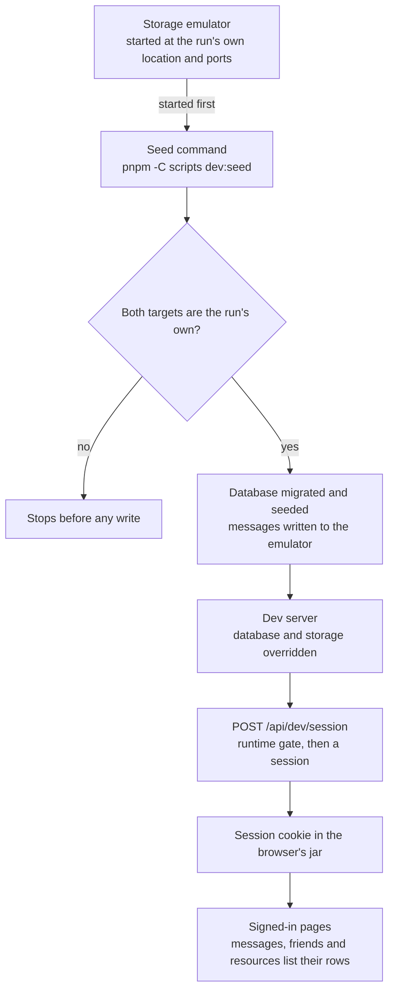

# Driven session

A development server answers one session route that signs a seeded person in, so a driven browser reaches the pages that need an account against a local database of its own, while the app's session check itself stays as it is.

## How it works

The route is `POST /api/dev/session`. A Nuxt module in the app's modules folder registers its handler at that path only under `nuxt dev`, so a production build bundles no handler and holds no route. Under `nuxt dev` the handler still judges every request itself, reading the environment flag and the database address when the request arrives.

A request is accepted only when `APP_ENV` is not the production member of `Environment` and `BASE_URL` names a server on this machine. That second test is `checkIsLocalUrl`: a loopback hostname, no fragment, and neither a "host" nor a "hostaddr" query parameter. A refused request answers not found, which is the answer a server without the route gives, and it writes nothing. No environment variable turns the route on.

An accepted request takes the driven user by the fixed id `DRIVEN_USER_ID`, and refuses if the seed has not written that user. It then asks better-auth's internal adapter for a new session for that user, and signs the session token with the auth context's secret in the form better-auth gives its own session cookies: the token, a dot, then an HMAC of the token under the secret, computed by the signing helper better-auth exports as "makeSignature". The cookie's name and attributes come from better-auth's session cookie definition, and the response is a 204 that carries the cookie. The next request from that browser is an ordinary signed-in request. `readSession` verifies the signature with the same secret, and the authed middleware passes the request, neither changed for this route.

The run has stores of its own, so the owner's dev data is never read or written. The seed, `pnpm -C scripts dev:seed`, takes the database address and the storage connection string from the environment and checks both targets before it writes anything. The database address must be local and must name the database `SEED_DATABASE_NAME` gives, which is `driven_session`; a local database under any other name is taken to be the owner's dev database and refused. The storage connection string must not contain the development flag `"UseDevelopmentStorage=true"` in any letter case, must name a table endpoint, must not use the default emulator's table port whatever host it names, and must name a local endpoint. A refusal stops the run before the seed creates anything, and it names the target that tripped it.

When both targets pass, the seed creates `driven_session` on the local Postgres server if it is absent, migrates it with the app's own migrations, and writes the smallest dataset that opens each signed-in page. That is the driven user and one friend, one friendship between them, one room the driven user owns and is the only member of, the room's everyone role, one note the driven user owns, and one message from the driven user in that room. The message goes into the run's emulator under a fixed row key, with the index row written first, as the app writes a message. The seed writes no drafts and no achievements, so those pages open signed in and list nothing.

Every row has a fixed id, and inserts ignore a row the database already holds. A rerun therefore converges on the same rows, and the message is replaced in place rather than copied.

The driver starts the run's emulator at its own location and ports, aims the database address and the storage connection string at the run's stores through the environment, seeds, and starts the dev server. The overrides reach the server and the seed because the configuration loader does not overwrite a key the process environment already holds. The driver then posts to the route once through its browser context's own request client, so the cookie lands in the jar that every later navigation reads. The commands are owned by the driven-browser reference, `.agents/skills/run-app/references/driven-browser.md`.

## Key files

| File                                                           | Role                                                                                             |
| :------------------------------------------------------------- | :----------------------------------------------------------------------------------------------- |
| `apps/web/modules/devSession.ts`                               | Registers the handler at the route under the dev command only.                                   |
| `apps/web/modules/devSession.test.ts`                          | The module's gate test, beside the module.                                                       |
| `apps/web/modules/startAzuriteEmulator.ts`                     | The owner's emulator module, which starts only for the default development flag.                 |
| `apps/web/server/services/devSession/postDevSession.ts`        | The route handler: a refusal answers not found, an accepted request sets the cookie.             |
| `apps/web/server/services/devSession/checkIsDevSessionOpen.ts` | The runtime gate on the environment flag and the local database address.                         |
| `apps/web/server/services/devSession/openDevSession.ts`        | The seeded-user check and the session created through the auth context.                          |
| `apps/web/server/services/devSession/signSessionToken.ts`      | The signed cookie value the session reader verifies.                                             |
| `apps/web/server/services/devSession/constants.ts`             | The route's path.                                                                                |
| `apps/web/server/auth.ts`                                      | The better-auth instance whose context the handler takes.                                        |
| `apps/web/server/services/auth/readSession.ts`                 | The session reader that accepts the minted cookie unchanged.                                     |
| `apps/web/server/trpc/middleware/getAuthedMiddleware.ts`       | The authed check a minted session passes unchanged.                                              |
| `apps/web/server/db/index.ts`                                  | Reads the database address at start, so the run's override reaches the app.                      |
| `apps/web/shared/models/environment/Environment.ts`            | Declares the production member the runtime gate compares against.                                |
| `packages/shared/src/services/devSeed/constants.ts`            | The driven user's id, read by the route and by the seed.                                         |
| `packages/shared/src/services/devSeed/checkIsLocalUrl.ts`      | The local-address test both the route and the seed's gates use.                                  |
| `packages/db/src/services/azure/table/getTableClient.ts`       | Allows an unencrypted connection only for a loopback http table endpoint.                        |
| `scripts/src/devSeed/index.ts`                                 | The seed's entry, which runs through the timing wrapper.                                         |
| `scripts/src/services/devSeed/runDevSeed.ts`                   | The run: the gates, the database, its migrations and the seed.                                   |
| `scripts/src/services/devSeed/seedDevDataset.ts`               | The write order, behind a gate that runs again before the first write.                           |
| `scripts/src/services/devSeed/getSeedDatabaseRefusal.ts`       | The database target's gate.                                                                      |
| `scripts/src/services/devSeed/getSeedStorageRefusal.ts`        | The storage target's gate.                                                                       |
| `scripts/src/services/devSeed/writeSeedMessages.ts`            | The message's rows in the emulator, under a fixed row key.                                       |
| `scripts/src/services/devSeed/constants.ts`                    | The seed database's name, the friend's id, the fixed row time and the emulator's gate constants. |
| `scripts/src/models/devSeed/SeedRefusal.ts`                    | The refusals a gate can return, each naming its target.                                          |
| `scripts/package.json`                                         | Declares the `dev:seed` script.                                                                  |
| `.agents/skills/run-app/references/driven-browser.md`          | The driver's steps, which post to the route once per run.                                        |

## Notes

- **Trade:** any development run on the owner's machine can sign the driven user in. The gates confine the route to that machine's own database, and a production build holds no route to reach.
- **Trade:** a flow that publishes during a signed-in run reaches the dev Azure services the app's environment names. The run records every request host, and the hosts it expects are the loopback address, the blob read host and the Nuxt devtools icon's host, so the record shows where any other request went.
- **Constraint:** the driven user's id is shaped as a version-4 UUID and is not `ZERO_UUID`, which `AUTOMOD_USER_ID` holds. With the zero UUID the audit log would label the driven user's own actions as automod. The id lives in the shared package because the route and the seed both need it and that package is the lowest one both depend on, which leaves one development-only string in a client-safe package.
- **Constraint:** the table client allows an unencrypted connection only for a loopback http table endpoint, which is the form the run's emulator takes. A plaintext endpoint on any other host keeps the library's refusal, so the exception never reaches a production table.
- **Placement:** the seed is a scripts command outside the catalogue of scripts an agent runs, since the owner runs it as well as the driver.
- **Rejected, a request header the authed middleware honours:** it would impersonate at the one check every authed procedure passes, in every build.
- **Rejected, an API key as the session:** the key plugin is configured never to open a session, which keeps a key to the procedures that opt in. A key used as a session would open every procedure to its holder.
- **Rejected, a hand-written cookie with a fixed name and a copied signature:** it breaks the day better-auth changes the cookie's name or encoding, where the context's own cookie definition follows the change.
- **Rejected, a route that takes a user as input:** it would sign in any user of a local database, the owner's development accounts included.
- **Rejected, a route under the app's server routes behind a runtime check:** every build would carry the handler, and one configuration change could expose it. The module gate keeps it out of the production bundle.
- **Rejected, an environment variable that enables the route:** a deployed environment can set any variable, so the gate reads the environment flag the app already declares.
- **Rejected, the owner's database with a marker column:** it changes the owner's data, and a marker missed by one write leaves seed rows in that data.
- **Rejected, the owner's storage emulator:** its data is kept beside the app, and a table-name prefix would not separate the rows, since the driven server reads the same table names.
- **Rejected, an Azure development database for the run:** the owner's dev data is kept out of every run, and a seed written there would sit beside it.

## Sources

- [better-auth](https://better-auth.com): the internal adapter creates the session, the session cookie definition names the cookie and its attributes, and the exported signing helper computes the signature the reader verifies. The handler reuses all three rather than rebuilding them.
- [c12](https://github.com/unjs/c12): its dotenv handling, which Nuxt's configuration loading uses. A `.env` file fills a key only when the process environment does not already hold it.
- [postgres](https://github.com/porsager/postgres): the driver the app and the seed both use. It reads the database from the address's path and takes a `host` parameter ahead of the address's own host.
- [Azurite](https://github.com/Azure/Azurite): the emulator the run starts at its own location and ports, and the published development account the run's connection string names.
- [@azure/data-tables](https://github.com/Azure/azure-sdk-for-js/tree/main/sdk/tables/data-tables): its rule that an unencrypted connection is allowed only for the development flag, which the table client extends to a loopback http endpoint.
