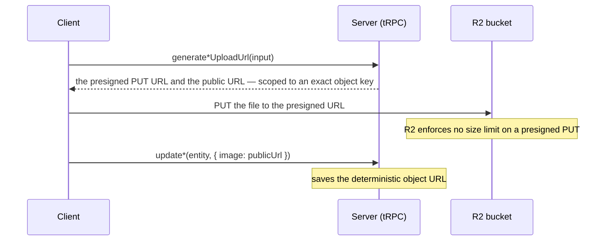

# File Uploads

All binary uploads use a two-step presigned flow: the server issues a short-lived presigned PUT URL scoped to one exact object key, and the client uploads directly to R2. tRPC never carries binary bodies — `octetInputParser` (tRPC's raw-body mode) cannot pass any input alongside the binary stream (no `roomId` or other context) and its size limit falls through to the general tRPC body limit (`MAX_REQUEST_SIZE`) rather than a dedicated file limit. A URL scoped to one key is strictly better than either.

## Pattern

The client sends the file as one `PUT` to the presigned URL, with the `Content-Type` the URL was signed with, and reports its progress. The request is checked for an error status: R2 refuses an expired or mis-signed URL with a status rather than a failed request, and unread, the upload would report itself landed.

**The signed type is the stored type.** A presigned PUT signed with a `Content-Type` requires the upload to send that type, and R2 stores it as the object's type. A URL signed without one leaves the type open, for a caller that learns the file's type from the upload itself; an empty type counts as no type, since a browser reports `""` for a file it cannot name.

**The content type is the uploader's claim, not a check on the bytes.** The URL fixes which type the upload sends, not what the bytes are, so the mime check on the procedures that mint a write target bounds an honest client only, exactly like the size check below, and the stored type stays the client's own claim. Read paths that need to be sure what they are serving override it at read time from something trustworthy: the persisted `FileEntity.mimetype` for attachments, a fixed type for thumbnails. A resource asset's read keeps the uploader's type and asks for `Content-Disposition: attachment`, so a navigation downloads it instead of rendering it on the storage origin.

## Upload procedures

| Procedure                                                   | Router                                                               | Blob path                            | Size limit                                       | Auth         |
| ----------------------------------------------------------- | -------------------------------------------------------------------- | ------------------------------------ | ------------------------------------------------ | ------------ |
| `generateUploadFilePresignedUrlEntities({ files, roomId })` | `message`                                                            | `{roomId}/{fileId}\|{filename}`      | `MAX_FILE_REQUEST_SIZE`, narrowed per room       | member       |
| `generateUploadFilePresignedUrlEntities({ files, id })`     | any [FileAssets](../../resource/resource-file-assets/design.md) type | `{id}/files/{hash}`                  | `MAX_FILE_REQUEST_SIZE` + personal storage quota | owner        |
| `generateUploadContentPresignedUrl({ id, size })`           | every resource type                                                  | `{id}/stagedContent.json.gz`         | `MAX_RESOURCE_CONTENT_SIZE` + personal quota     | owner        |
| `generateProfileImageUploadUrl()`                           | `user`                                                               | `{userId}/ProfileImage`              | client-side only (`validateFileWithAlert`)       | authed       |
| `generateProfileImageUploadUrl({ roomId })`                 | `room`                                                               | `rooms/{roomId}/ProfileImage/{uuid}` | client-side only (`validateFileWithAlert`)       | `ManageRoom` |

A message attachment's blob name is the upload's id joined to the client's filename by `ID_SEPARATOR` (`getBlobName`), which is what lets a download restore the original name from the path alone. A resource asset's is its content hash under the resource's `files` folder (`getResourceFileBlobName`). The room profile image appends a fresh uuid per upload instead, so a re-upload never lands on a prior name.

The two file-batch procedures check more than size. The message one refuses a file whose mime category is not in the room's `allowedMimeCategories` as well as one over the room's `maxFileSizeBytes` (itself capped by `MAX_FILE_REQUEST_SIZE`), and its batch is bounded by `MAX_READ_LIMIT`. The resource one mints every write target through `generateReservedResourceAssetPresignedUrlEntities`, which takes the hold on the owner's personal quota in the same call, and bounds its batch by `MAX_UNRECONCILED_STORAGE_LEDGER_ENTRIES` — the in-flight hold cap, not the generic read limit, because a batch above it could never pass the reserve however long the client waited ([storage quotas](../../resource/storage-quotas/design.md)). A message attachment is reserved against its uploader's quota in the same call that mints it, so the bytes count against whoever sent them ([storage quotas](../../resource/storage-quotas/design.md)).

An image attachment also gets a **sibling thumbnail write target**. `generateUploadFilePresignedUrlEntities(…, { withThumbnail: true })` returns a second presigned PUT for `{prefix}/{id}.thumb` so the client uploads a downscaled preview alongside the original, and `message.generateDownloadThumbnailPresignedUrls` is the matching read. Only images are minted one, but every delete path names the thumbnail unconditionally — a no-op for other types, and no object left behind.

Message attachments land in `StorageBucket.MessageAssets`; resource asset files in `StorageBucket.ResourceAssets`; profile images (user + room) in `StorageBucket.PublicUserAssets`. The separate attachments bucket lets its R2 lifecycle rule move old attachments to Infrequent Access without touching the small profile images ([Cloudflare services](../cloudflare-services/design.md)).

Reads differ per domain: message attachments fetch download URLs per batch of attachments (`message.generateDownloadFilePresignedUrls`) and cache them per room in the download store until `READ_PRESIGNED_URL_DURATION_MS` runs out. **A page read is not enough to keep that cache alive** — it only mints urls for files it does not already hold, so a room left open longer than the URL's lifetime would render every attachment broken and fail every download until reload. The download store therefore sweeps its own cache every `READ_PRESIGNED_URL_REFRESH_INTERVAL_MS` and re-mints whatever is inside that margin of expiry; the same margin is what a page read counts as already expired, so no url is ever handed to the renderer that could die while on screen. A tick that finds nothing aging out issues no query, which is what makes the sweep affordable. Two properties keep it from becoming the failure it exists to prevent: it re-mints in batches of `MAX_READ_LIMIT` because the room that scrolled past that many attachments is exactly the long-open room being swept, and the whole tick swallows its own rejection — nothing retries a background timer, so an unhandled one would take the page down with it while the user has lost nothing yet. **Swallowing is not enough on its own**, which is why the sweep's reads are marked `isBackground`. The sweep runs for whatever room is open, which may be one the user has just been banned or removed from, and an unmarked read's `FORBIDDEN` reaches `errorLink` inside the link chain — before the rejection can reach the handler that would have swallowed it — where it would redirect to the login page. `errorLink` never redirects a read carrying that mark, and alerts no `FORBIDDEN` at all, so the swept room neither alerts nor navigates: anything the user did not trigger must not be able to move them. Resource assets instead embed a stable app url built client-side after the upload and served through `/api/resource-assets` ([resource file assets](../../resource/resource-file-assets/design.md)) — resource types have no download procedure, and nothing about them expires.

## Resource content

A resource's content takes the inline mutation or the presigned upload, by its size. The transport choice, the staged save and the reads that go with them are [large documents](../large-documents/design.md)'s.

## Sweeping orphans: never delete a blob younger than its presigned write URL

A blob whose owning row is updated to a new upload leaves the old one behind, so the update sweeps the entity's blob prefix and publishes everything that is not the url it was just handed ([persist then notify](../persist-then-notify/design.md)). "Not the current url" is not on its own a safe test for staleness: upload names are per-upload unique, so a blob a second editor uploaded seconds ago — and has not saved yet — also fails it, and sweeping it points that editor's save at a blob that no longer exists.

**Every orphan sweep therefore filters on age, keeping only blobs created before `now - WRITE_PRESIGNED_URL_DURATION_MS`** (`listBlobNames(bucket, prefix, { createdBefore })`). The presigned write URL that authorized an upload expires after `WRITE_PRESIGNED_URL_DURATION_MS`, so no upload can still be in flight past that age, while a blob older than it is either the previous version or an abandoned upload — an orphan either way. This applies to any sweep that infers staleness from the current row rather than from a name it stored, and it is why the sweep is a filtered listing rather than a plain "delete everything else". **Nothing a sweep lists is exempt from the filter** — least of all the version the row itself just stopped pointing at, since a save carries whatever url its form loaded with ([blob lifecycle ownership](../blob-lifecycle/design.md)). A teardown is not a sweep: deleting a room removes its whole attachment prefix with no age cutoff (`publishBlobPrefixDeletion`, called from `apps/web/server/services/room/deleteRoom.ts`), because the room row is gone and nothing can re-own the prefix, so a cutoff would strand an attachment a member's presigned write URL still reaches.

The composer's own revert — an upload the user threw away before sending — is the one delete no entity backs, and it is authorized by the grant token minted with the presigned write URL rather than by membership ([blob lifecycle ownership](../blob-lifecycle/design.md)).

## Batch input is validated all-or-nothing

Client-side validation of a multi-item input (a multi-file drop, a bulk paste, a multi-select action) **rejects the whole batch on the first invalid item, and the alert names that item**. Never filter the batch down to its valid members: the user would be left holding a set they never chose, with the dropped item easy to miss before they commit. `validateFileWithAlert(file, maxSize)` takes the whole `File` for exactly this reason — it needs the name for the message.

## Size constants

The limits are declared in `apps/web/shared/services/app/constants.ts` (`MAX_REQUEST_SIZE`, `MAX_FILE_REQUEST_SIZE`) and `apps/web/shared/services/resource/constants.ts` (`MAX_RESOURCE_CONTENT_SIZE`).

`MAX_REQUEST_SIZE` applies to all tRPC requests, whatever `Content-Type` they claim: the security module's request size limiter is wired to it alone, and it reads a request's limit from the route the request matches, since the client writes that header. No route takes a larger body, and a body that can outgrow `MAX_REQUEST_SIZE` is committed by reference rather than carried under a raised limit ([raised request body limit](../../../rejected/resource/raised-request-body-limit/design.md)). `MAX_RESOURCE_CONTENT_SIZE` is how large a document a resource may be, and also the cap every content schema's free-form strings and lists take — no string or list can outgrow the document holding it. At that ceiling a staged commit holds the gzip, the inflated text, the parsed document and its re-serialization at once, and its synchronous parse and validation run for seconds. `MAX_FILE_REQUEST_SIZE` is **not** enforced by R2: a presigned PUT carries its signed headers, its method and an expiry, but no length constraint. It is checked against the size the client declares when it asks for the write target, and the composer checks the real file before uploading — so it bounds an honest client and nothing else. That check only exists on the two procedures that take a file input at all: the profile-image procedures take none and simply mint a presigned PUT, so their only bound is `validateFileWithAlert`'s default on the client. A client that declares a small size and then writes a large object succeeds until the URL expires, and the persisted `FileEntity.size` is the declared number rather than the object's. Nothing downstream may assume an attachment is within `MAX_FILE_REQUEST_SIZE` or a room's `maxFileSizeBytes`. The gap is owned by [storage quotas](../../resource/storage-quotas/design.md).

## Notes

- **Naming**: both the user and room upload procedures are named `generateProfileImageUploadUrl`; the router context (`user.` vs `room.`) disambiguates.

## Sources

- [Request Size Limiter](../../../../packages/nuxt-security-module/README.md) (nuxt-security-module) — the module's 2,000,000-byte default for a request body, which is `MAX_REQUEST_SIZE`, and the limiter a staged save never trips.
- [R2 presigned URLs](https://developers.cloudflare.com/r2/api/s3/presigned-urls/) (Cloudflare) — a URL signed for one object key, one method and one expiry, the scope the upload flow relies on.
- [Size limits in Google Drive](https://support.google.com/drive/answer/37603) (Google) — a spreadsheet up to 100 MB, the reference product's ceiling `MAX_RESOURCE_CONTENT_SIZE` takes.
- [Valet Key pattern](https://learn.microsoft.com/en-us/azure/architecture/patterns/valet-key) (Microsoft Azure Architecture Center) — the key cannot bound the size written, so the application checks the size once the upload completes, which is what the staged commit's checks do.
- [Claim-Check pattern](https://learn.microsoft.com/en-us/azure/architecture/patterns/claim-check) (Microsoft Azure Architecture Center) — a content hash on the reference, a named owner of payload deletion (the commit), and the per-message choice between inline and external.
