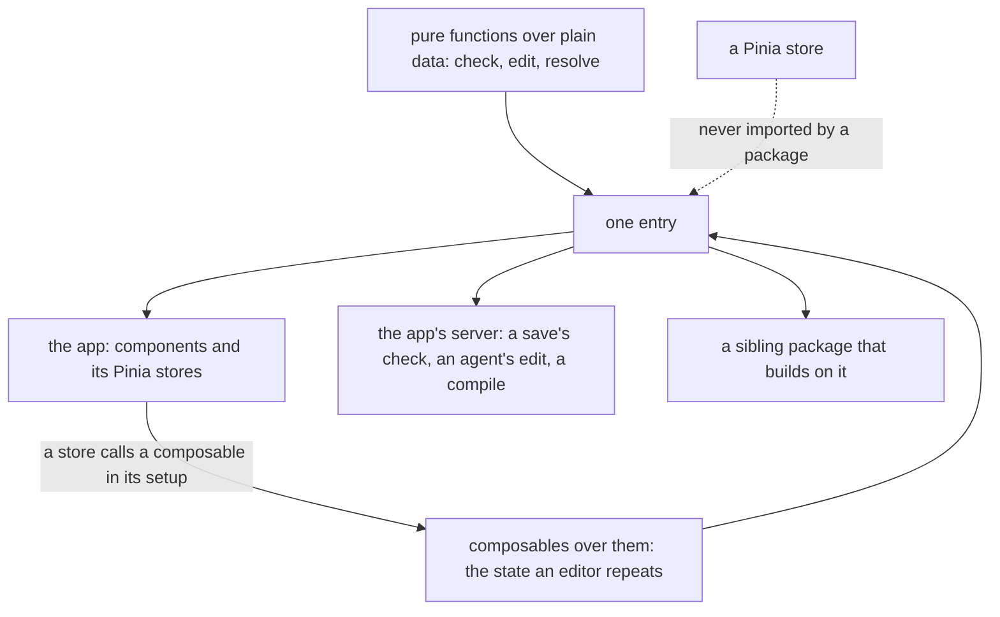

# Headless package shape

The one shape a headless package takes: a Vue package named `vue-<thing>-headless` that declares Vue as a peer and imports it, with one entry holding its functions and its composables together. It is a repo-wide standard, so it sits under the architecture area, and the [editor layout package](../../vue-editor-layout-headless/layout-engine/spec.md) is built to it.

## How it works

A package holds the pure functions over its document and, beside them, the composables that keep a document's state. Both are exported from the one entry, so a consumer imports a function or a composable from the same place, and a composable is written once in the package instead of once in each editor.

## Why a headless package can be a Vue package

Every consumer of these packages is Vue code or runs beside it. The Nuxt app and its sibling packages are Vue, and the app's server, which checks a save, applies an agent's edit and compiles an email, is the same Nuxt app with Vue installed. The Azure Functions app has no Vue, and none of these packages has a consumer there. A package that needs Vue costs the server nothing it does not already carry.

The functions stay pure. A function over a document is the same function with a reactive wrapper beside it, so nothing is rewritten to use a ref. The wrapper is the only part that moves: it lives in the package once, rather than in each editor.

## Which packages take the name

The block editor and the survey engine hold their logic in pure functions, and each keeps its reactive state in its package: the block editor's editing session, which the survey and whiteboard stores call, and the survey engine's runner, `useSurveyRunner`. Each of those packages ships a Vue abstraction, imports Vue, and takes the convention's name. The survey expression language and the MJML blocks are pure functions with no state for a composable to keep, and no wrapper of theirs exists in the app, so a Vue peer on either would be cargo.

| Package                                                                       | Name           | Why                                                                                                                             |
| :---------------------------------------------------------------------------- | :------------- | :------------------------------------------------------------------------------------------------------------------------------ |
| `vue-block-editor-headless`                                                   | the convention | The home of the editing session composable                                                                                      |
| `vue-survey-engine-headless`                                                  | the convention | The survey runner's composable                                                                                                  |
| `vue-grid-layout-headless`, `vue-pdfjs-headless`, `vue-canvas-frame-headless` | the convention | Already the convention                                                                                                          |
| `survey-expression`                                                           | keeps its own  | Pure functions over answers, with no Vue abstraction to claim                                                                   |
| `mjml-blocks`                                                                 | keeps its own  | Pure render and read functions, with no Vue abstraction to claim                                                                |
| `math-expression-compiler`                                                    | keeps its own  | A function of numbers with no state and a single consumer; a consumer that later wants reactive state takes the convention then |

## Pinia

The editors' stores are Pinia setup stores, and Pinia stays in the app. A package does not import it, since a package that did would force the store library on every consumer, and each store's id is its path under the app's store folder, which a test holds, so a package cannot own a store of its own.

Typing is not the obstacle. A store as a whole is not generic, and the repo's answer is a generic method on the store, as the to-do list's `setItemValue` is, and a generic composable for what several stores share. What the editor stores share is a shape: a document, an undo history held as a shallow ref, a commit that sets the two together, a load that clears the history and a selected id. The survey creator's store and the whiteboard's store hold that shape through the session, and the page builder keeps it per resource, with its documents in the document store. That is one piece of business logic repeated across stores, so it lives in one composable, generic over the document and the history's entry, called inside each store's setup. The composable forwards no store function, so the no-redirect rule does not touch it. Each store keeps what is its own: the page builder's keyed map and preview, and the whiteboard's content loading.

The composable lives in the block editor package, since every editor consumes that core and the history it edits. Its API is the union of what the stores use. The survey creator and the page builder each write their own insert and key commands over that core, and they share the move to a sibling index, which the package holds.

## The editing session's members

The editing session is the union of what the editors share: the members their stores hold, which each store either passes in or reads back. The session takes the members they share, and each store keeps the rest. The table lists each member, the store that holds it and where it lands.

| Member                      | Survey creator (`survey/creator.ts`)                                                            | Page builder history (`pageBuilder/history.ts`)                                           | Whiteboard (`resource/whiteboard/index.ts`)                                                                          | In the session                                                |
| :-------------------------- | :---------------------------------------------------------------------------------------------- | :---------------------------------------------------------------------------------------- | :------------------------------------------------------------------------------------------------------------------- | :------------------------------------------------------------ |
| `document`                  | a `ref` the store holds and passes in, set only by `commit`                                     | none in the history store: documents are held per resource by the document store          | `whiteboard`, the content ref that `createContentData` returns                                                       | the store's own ref, passed in                                |
| `history`                   | the session's `shallowRef` history                                                              | `historyMap`, a keyed `shallowRef` of one history per open resource                       | the session's `shallowRef` history                                                                                   | `history`, one shallow ref                                    |
| `commit(document, history)` | the session's, which sets both                                                                  | `commitEdit`: the document through the document store, the history, and a cleared preview | the `editState` setter calls the session's, which sets both                                                          | `commit`                                                      |
| `load`                      | the session's `load`: a commit with an empty history, and no selection                          | `clearHistory(resourceId)`, which the webpage and email stores call on load               | the session clears the history whenever the content is set outside a commit, so a read from the server starts afresh | `load`, and the watcher that clears on a set outside a commit |
| selected node               | the session's `selectedPointer`, over the store's port of node id helpers                       | none: the canvas store holds one selected node id per resource                            | none: the editor store holds `selectedIds`, which is many ids                                                        | `selectedPointer`, over an optional selection port            |
| `selectedNode`              | a computed over the pointer, in the store                                                       | none                                                                                      | none                                                                                                                 | stays with the survey store, which holds the children port    |
| `isUndoable`, `isRedoable`  | computed over the lengths of the history's two stacks                                           | `getUndoLabel` and `getRedoLabel`                                                         | none                                                                                                                 | stays with each store                                         |
| apply an edit               | `applyEdit` in the commands composable: the survey schema, the interaction merge, then `commit` | `applyEdit(resourceId, operations, label, interactionId)` in the history store            | `commitOperations`, which applies with no merge                                                                      | not in the session                                            |
| undo and redo               | the commands composable applies the inverse or the operations, then `commit`                    | `undo` and `redo` in the history store                                                    | `undo` and `redo` in the store, through `undoWhiteboardEdit` and `redoWhiteboardEdit`                                | not in the session                                            |
| preview                     | none: `isPreview` is the mode flag                                                              | `previewMap`, with `getPreview`, `setPreview` and `clearPreview`                          | the editor store's `preview`                                                                                         | not in the session                                            |

A session holds one document and one history, so a store that edits one document calls it in its setup. The page builder keeps one history per open resource, and its documents sit in another store, so it is not one session; the Decisions say why.

## Decisions

- **A package that ships a Vue abstraction is a Vue package.** Its consumers are Vue, so a second tier buys nothing, and the composables an editor repeats are written once in the package. Rejected: a framework-free core with an optional Vue subpath and an optional peer. It needs a check on which file is which, a second entry per package and a second place to look for every composable, to protect a consumer that does not exist.
- **One entry.** A function and a composable come from the same import, and the manifest exports the package entry and nothing else. Rejected: a subpath per concern, which is the same second tier under another name.
- **The name says the package ships a Vue abstraction, and a check holds it.** A package named `vue-<thing>-headless` declares Vue as a peer and imports it in its source, so the prefix is never a claim with nothing behind it. The block editor ships the editing session and the survey engine ships the survey runner. Rejected: renaming the survey expression language and the MJML blocks for uniformity with a Vue peer nothing imports, and keeping `headless-<thing>` for a package that holds no composable yet, which made the prefix mean "has a composable today".
- **The name follows the abstraction.** A package takes the convention's name only after its abstraction is built and its consumers use it, so the name never runs ahead of the code. Rejected: renaming first, which commits every consumer to a name before the abstraction behind it is proven, and moves every consumer twice if the abstraction changes the package's surface.
- **No old name is kept.** A package that takes a new name deletes its old name, its spec area and its inventory rows in the same change, and updates every consumer with it, as the repo's no-compatibility-debt rule asks. Rejected: a re-exporting package under the old name for a release.
- **No headless package imports Pinia.** A store is the app's, and a shared shape is a composable the app's store calls. The shape check holds it. Rejected: a rule in a skill alone, which is the [enforcement ladder](../enforcement-ladder/design.md)'s last rung when a test can hold it.
- **The editing session is one shared composable.** The document, history, commit, load and selection are business logic repeated across editor stores, which the repo's rule extracts, and a generic composable carries it with no store involved. Rejected: leaving each store its own copy because each is short, which is how a history-clearing watcher ends up in one store only; and a store factory taking a type parameter, which would give each instance an id the store-id test cannot read from the path.
- **The math expression compiler keeps its name.** It has no state and one consumer. Rejected: renaming it for uniformity, which adds a peer dependency and a prefix to a package with nothing for Vue to do.
- **A single layout engine for the grid and the editor chrome is not built.** The grid places items inside a canvas, and the editor engine places regions around it. They are separate packages that may share a size class and nothing else.
- **A session holds one document, so the page builder keeps its keyed history.** A session is created once in a store's setup, but the page builder's history is one per open resource, and each resource's document sits in the document store under the same id. A session per resource could only be made inside a callback, which a composable may not be, so the keyed history, its commit and its clear stay in the page builder's history store, as the Pinia section says. Rejected: a keyed session map in the package, which would move the document store's writes into the package and give a single-document editor a key it never uses.
- **The selection is a port, and a document without nodes has none.** The session reads the selected node through an optional port of two functions. The whiteboard passes none: its document is a list of elements rather than a block tree, and its selection is many ids in the editor store. Rejected: moving `selectedIds` into the session, which would change the editor store's API.
- **A document set from outside a commit clears the history.** The session clears its history whenever its document ref is set outside a commit, so a load that replaces the document starts afresh. The whiteboard's content loading relies on this. The survey creator's document is set only by `commit`, so the rule changes nothing it does. Rejected: clearing the history in `load` alone, which would leave the whiteboard's content loading to clear its own.
- **The apply, undo and redo steps stay with their commands.** The survey's commands and the page builder's history store each apply an edit through their schema with the interaction merge, and undo and redo through the same steps. Moving them would take the interaction merge into the package, and the merge reads the page builder's entry type, while the whiteboard does not merge at all. The steps remain in each caller.
- **The sibling move is one block-editor function.** The survey's and the page builder's moves to the index one away in the same slot are the same code over two documents, so both call `getSiblingMoveOperations` in the package, with their own registry and children. Rejected: keeping each copy, which the repo's duplicate-logic rule refuses.
- **The session earns its place on the shared shape, not on lines.** Extracting the session does not shorten the stores and command files taken together, since the package holds the shape and its tests cost lines of their own. What it earns is that the document, history, commit and load shape, with the whiteboard's history reset, is written once and tested in the package, and that the sibling move is one function both callers share, so the next editor of one document calls the session instead of writing a copy. The page builder, whose history is one per resource, does not call the session. The package names follow the convention because every consumer is Vue and a package may hold a composable, not because of the line count. Rejected: restoring one copy per store, which would put the whiteboard's history reset back in one store only and the duplicate move back in two files, to save lines the design never promised.

## Notes

- The survey's and the page builder's insert-target rules are not one function. The survey takes the first slot that accepts the type, and the page builder takes the selected container's empty slot first, so they differ in rule. The survey's `addUniqueName` and its copy renames have no page builder counterpart, since element names are a survey concept.

## Key files

| File                                                                          | Role                                                                                     |
| :---------------------------------------------------------------------------- | :--------------------------------------------------------------------------------------- |
| `packages/vue-block-editor-headless/package.json`                             | the manifest, with Vue as the peer and the entry as the only export                      |
| `packages/vue-block-editor-headless/src/composables/useEditSession.ts`        | the editing session composable, over one document                                        |
| `packages/vue-block-editor-headless/src/services/getSiblingMoveOperations.ts` | the move to the sibling index, which the survey's and the page builder's moves both call |
| `packages/vue-survey-engine-headless/package.json`                            | the manifest, with Vue as the peer and the entry as the only export                      |
| `packages/vue-survey-engine-headless/src/composables/useSurveyRunner.ts`      | the survey runner's composable, over the engine's functions                              |
| `packages/survey-expression/package.json`                                     | the manifest of a package with no Vue abstraction, so it keeps its name                  |
| `packages/mjml-blocks/package.json`                                           | the manifest of a package with no Vue abstraction, so it keeps its name                  |
| `packages/vue-grid-layout-headless/package.json`                              | the reference manifest for a headless package with Vue as a peer                         |
| `apps/web/app/store/survey/creator.ts`                                        | the survey creator's store, which calls the session                                      |
| `apps/web/app/store/pageBuilder/history.ts`                                   | the page builder's keyed history, one per open resource, which does not call the session |
| `apps/web/app/store/resource/whiteboard/index.ts`                             | the whiteboard's store, which calls the session without a selection port                 |
| `scripts/src/services/workspace/getHeadlessPackageFailures.ts`                | the shape check: name, Vue peer, Vue import, one entry and no Pinia import               |
| `scripts/src/services/workspace/getHeadlessPackageFailures.test.ts`           | the check's scenarios over fixture manifests and sources                                 |
| `scripts/src/workspace/headlessPackages.test.ts`                              | holds every headless package in the tree to the check                                    |
| `scripts/src/services/workspace/checkIsHeadlessPackage.ts`                    | which packages the shape check applies to: a headless name or keyword                    |
| `scripts/src/services/workspace/checkIsHeadlessPackage.test.ts`               | the cases of which packages count as headless                                            |
| `scripts/src/services/workspace/constants.ts`                                 | the headless keyword, the name rule and the Vue and Pinia import rules                   |
| `scripts/src/models/workspace/PackageShapeManifest.ts`                        | the manifest fields the check reads beyond PackageManifest                               |

## Sources

- The `pinia` skill's rules that a store cannot be generic as a whole, that a generic member is a method, and that a store function is never forwarded through a wrapper, which decide where a shared shape can live.
