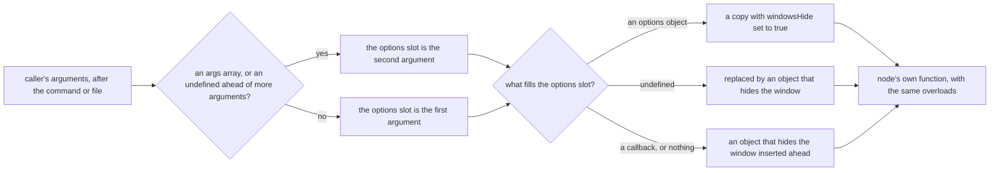

# Hidden Child Processes

Five wrappers in `@esposter/shared-node/child-process` start node's child processes with their console window hidden. On Windows a console child of a windowless parent, or any detached child, opens a terminal window of its own unless its options set `windowsHide`. The wrappers set it, and a lint rule keeps value imports of node's module pointed at them. The rules are the requirements in [the spec](spec.md).

## How it works

Each wrapper (`spawn`, `spawnSync`, `execFile`, `execFileSync` and `execSync`) takes the command or file first and passes the rest to `withHiddenWindow`, which works out the options slot by node's own argument shapes. An args array as the first of those arguments, or an undefined one with more arguments after it, means the options come second; otherwise they come first. The window flag is written after the caller's keys, so a caller passing `windowsHide: false` is overridden. The wrapper is typed as node's own function, so every overload callers rely on still type-checks. The wrapper adds an option and nothing else.

`execFile` carries one more thing. Node's promisified form resolves `{ stdout, stderr }` through a symbol on the function, and a plain wrapper would lose it and resolve stdout alone. The wrapper defines that symbol again, so `promisify(execFile)` keeps node's result and still hides the window. The package exports that promisified form once as `execFileAsync`, so no caller promisifies it again.

The lint rule sits beside the wrappers in `oxlint.config.ts`. It bans `child_process` and `node:child_process` in the restricted import list that every package, app and script override carries, and the root rules carry it too, so a value import is reported with advice to use the wrappers. A type-only import is allowed, since it generates no child process. Three parts of the workspace are exempt. The wrappers' own folder uses a shorter list without the child process entries. The genshin-persona source and the follow-ups scripts are the other two: both install without a workspace dependency on this package, and each passes `windowsHide` itself. Their config comment says they join the ban once `@esposter/shared-node` is on npm. The mod trees keep the ban.

## Notes

- The scenario titles are the names of the wrappers' own tests. Each wrapper's test file asserts the window flag on the arguments node receives, and the `execSync` and `execFile` tests cover the undefined-options and trailing-callback shapes.
- `scripts/src/workspace/childProcessImport.test.ts` runs the real oxlint over a probe file kept outside the repo, so the root pass never lints it. The probe sits outside every scope, so it is judged by the root rules alone. The test shows that the root entries fire, and it does not show that each scope's override carries them: a scope that dropped its entries would pass it.

## Key files

| File                                                                 | Role                                                          |
| -------------------------------------------------------------------- | ------------------------------------------------------------- |
| `packages/shared-node/src/childProcess.ts`                           | re-exports the five wrappers under the subpath                |
| `packages/shared-node/src/services/childProcess/withHiddenWindow.ts` | decides where the window flag goes in a call's arguments      |
| `packages/shared-node/src/services/childProcess/spawn.ts`            | wraps spawn; the other four wrappers follow the same shape    |
| `packages/shared-node/src/services/childProcess/execFile.ts`         | wraps execFile and keeps node's promisified result            |
| `oxlint.config.ts`                                                   | the restricted import entries for `child_process`             |
| `scripts/src/workspace/childProcessImport.test.ts`                   | the lint probe whose title is this capability's lint scenario |
