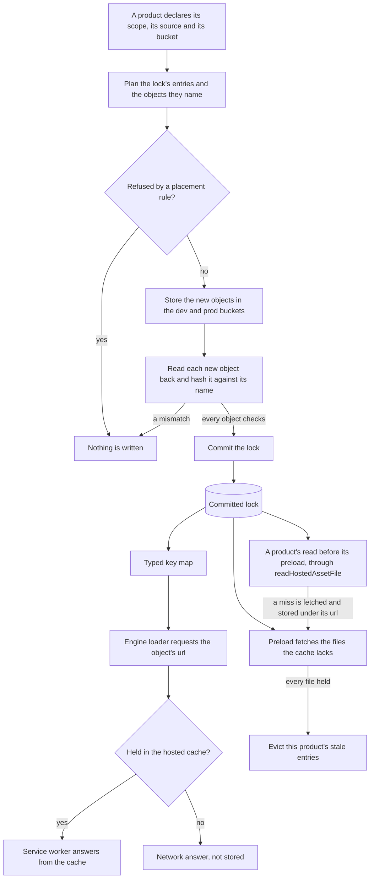

# Hosted assets

The one system behind every large or engine-read file a product loads by url: content-addressed objects in a shared public bucket, one committed lock per product, a typed key map, one url builder, one cache contract, one preloader and one local mirror. A product declares its scope and its files. It writes no publish, lock, url or cache code of its own.

## How it works

Which files are hosted rather than bundled or served from `public/` is decided by the placement rule on the [static assets](../static-assets/design.md) page. This page covers what a hosted file is once it is one.

A product is either a records product or a files product, and both are listed by `getHostedAssetProducts`. A records product's objects are JSON records that its own commands publish, each dataset under its own scope: [hosted game data](../../genshin/hosted-game-data/design.md) is the first. A files product's objects are the files of one repository folder under one scope: the [dungeons hosted assets](../../dungeons/hosted-assets/design.md) page is the first. A product is typed as `HostedAssetProduct`, which names its bucket, its committed lock and its scopes.

## Objects and names

An object is named by the sha256 of its decoded bytes, under its product's scope and with its extension, so the path is `<scope>/<sha256><extension>`. Under an origin the same path is the url, and `getHostedAssetUrl` builds it. The same bytes always have one url, a changed file has another, and the old url keeps resolving to the old bytes, because nothing in the system purges an object. Pruning is a separate retention rule (below).

The extension names the content type through the table `HOSTED_ASSET_CONTENT_TYPES` in `packages/hosted-assets/src/services/constants.ts`, and an extension the table lacks cannot be published. The table is one-way: a content type cannot name an extension, since two Tiled formats share one type, so the object keeps its extension and the type is derived from it. Every object is stored with the cache lifetime `HOSTED_ASSET_CACHE_CONTROL`.

Text objects, the extensions `HOSTED_TEXT_EXTENSIONS` lists, are stored Brotli-compressed with `Content-Encoding: br`, and the hash is taken over the decoded bytes so a reader that decodes gets the bytes the name hashes. A records product's JSON is stored as zstd. Every other object, which is already compressed, is stored as its bytes.

A lock is an object with two maps, `objects` and `indexes`, validated by `hostedAssetLockSchema`. Each object entry carries its sha256, its extension, its scope and its decoded byte count, which a preload plans by and a verify checks. An index is an object whose content maps each entry id to the sha256 of one entry, and each entry is then an object of the index's scope. A lock never carries a content type. The lock is the only committed record of what a product hosts: Genshin's is `packages/genshin-world/src/generated/gameDataLock.json`, and the dungeons game's is `apps/web/shared/generated/hostedAssets/dungeonsLock.json`. A files product's own files are not kept in git, so its working copy is restored from the lock.

## Products, scopes and the shared bucket

Every product's objects sit in one bucket, `public-hosted-assets` (`StorageBucket.PublicHostedAssets`), with one bucket per environment and one custom domain per environment. A product's scope is its key prefix, so a new product declares its scope and its files and needs no infrastructure change. The origin each environment serves is `HostedAssetOriginMap` in `packages/db-schema/src/services/storage/HostedAssetOriginMap.ts`.

Scopes are disjoint. A publish refuses a scope that equals another product's declared scope, is a prefix of one, or sits under one, and it names the scope it overlaps. A publish writes only under the scopes its product declares.

## Publish

A files product is published by `hosted-assets publish <product>`, and `--dry-run` names what would change without a credential. A records product publishes through its own commands, which call the same pipeline. The steps run in this order, and each stops the next:

1. The source is refused before any write. An uncompressed audio file is refused by the extensions in `UNCOMPRESSED_AUDIO_EXTENSIONS`, a file over `HOSTED_OBJECT_MAX_BYTES` is refused, and so is a file whose extension has no content type. A symbolic link under the product's folder is refused by its name rather than followed or skipped. Each refusal names the file (`assertHostedAssetSource`, `readHostedAssetSourceFolder`).
2. The next lock is merged onto the current one. If the two are equal, the publish reports the lock unchanged and makes no request to any bucket, dry or real.
3. A dry run stops here, so it needs no credential and writes nothing.
4. Both environments' buckets are written at the same time. Each bucket is listed first, and an object the current lock reaches, or one stored within `HOSTED_ASSET_REUSE_WINDOW_MS`, is kept. Any other object is written create-only, or rewritten with the same bytes when it is old and unreachable, which restarts its age so a prune cannot take it. Leaves are written before the indexes that name them.
5. Each object the publish stored, and each object the next lock names that the current lock did not, is read back from its bucket and checked against its name and its recorded length. An object the current lock already names was checked when that lock was committed, so it is not read again.
6. The lock is committed by merging the plan onto the lock as it stands at that moment, so a publish of another scope that finished in between is kept. A failure in either bucket, or a read-back mismatch, throws before the commit, so the committed lock never names an object a reader cannot fetch.

Four further commands serve the lock:

- `hosted-assets verify <product>` first checks that the lock on disk is the committed one, then fetches every object the lock reaches from both environments' origins, anonymously, and checks each against its name and length.
- `hosted-assets repair <product>` copies each object or index the lock names that one environment's bucket lacks from the other bucket, after verifying the source. A name neither bucket holds fails the repair and is named by its key, and the way back is to publish the product from its source again. `--dry-run` names each copy and writes nothing.
- `hosted-assets pull <product> <key>` or `--all` restores a files product's working copy from its objects, checking each against its name and recorded length before writing it under the product's folder.
- Pruning, `pruneHostedAssets`, is run by a records product's prune command. It deletes an object that no live lock reaches and that is older than `HOSTED_ASSET_RETENTION_MS`, and only under the product's own scopes. It lists the bucket once more just before the deletes, which narrows the race with a write that moved an object past the cutoff.

## The mirror and the checks in CI

The fill, `hosted-assets fill`, reads every object each product's lock reaches from the dev origin into the machine's content cache, `HOSTED_ASSETS_MIRROR_DIRECTORY`, which is `{cache-root}/content` and keys each object by its sha256 ([download cache](../download-cache/design.md)). Products are filled one after another, each with its own bounded wave of downloads. Every object is checked against its name as it is read, whether it came from the cache or the network, and a mismatch fails the fill.

The fill is a step of `build-packages`, which the CI workflow calls. It runs on the default branch and on `ai/queue`, and the other branches restore the newest mirror they can see. The Coverage job restores the same mirror. The cache key hashes every product's lock, so a changed lock misses the cache and fills again ([CI caches](../ci-caches/design.md)). A failing fill fails the run for that commit.

Test suites read hosted objects from the same mirror. The vitest setup of `genshin-world`, `packages/genshin-world/scripts/gameData/mirror/setupGameDataFetch.ts`, answers any fetch under `HOSTED_ASSETS_LOCAL_BASE_URL` from the mirror, so a suite that loads a hosted object runs without the network. The same setup stubs Cache Storage with an in-memory cache, since a node suite has none and the hosted reads go through one. The dungeons suites mock the loader and read no object, so they carry no mirror.

Two enforcers hold the placement rule, both in `scripts/src/workspace/staticAssets.test.ts`. The bundle check fails a file under the app's assets or its `public/` folder that is over `SIZE_LIMIT_BYTES` or uncompressed audio. The hosted check fails a dungeons engine loader that names a media file by its path, in a static import, a dynamic import or an `import.meta.glob`, since that file belongs in the key map.

## Load

Each game loads every object its lock names through the same three parts.

The **key map** is the literal union of a product's keys, so a key the code names must exist in the lock. Genshin's map, `packages/genshin-world/src/generated/gameDataKeys.ts`, is committed and rendered by the publish, because the root typecheck reads its union from source without a build. The dungeons map is written at install instead. The Nuxt module `packages/hosted-assets/src/internal/module.ts` is registered in `apps/web/configuration/modules.ts` with the dungeons options, and writes the map into the web app's gitignored `apps/web/shared/generated/hostedAssetKeys/` folder when `nuxt prepare` runs, which the app's postinstall runs. A files product's key is the lock key's path after its scope, each segment's first letter capitalised, with the extension dropped. A Tiled definition or map keeps its extension as a suffix, since a tileset's `.tsx` shares its stem with its image. The derivation is `toHostedAssetFileKey`.

The **preloader** is `useHostedAssetsPreload(readPreloadSet, onHeld)`, which returns `downloadProgress`, `isDownloading`, `preload` and `status`. `isDownloading` is true only while a planned file is still being fetched. A preload opens the one shared cache, `HOSTED_ASSETS_CACHE_NAME`, lists the urls it holds, and plans the files it lacks by exact url. It fetches those with bounded concurrency, retrying each file with exponential backoff up to a fixed number of attempts, and bounds each request by a timeout (`packages/hosted-assets/src/services/constants.ts`). Progress is the bytes held over the bytes it must fetch. When every file is held, `onHeld` runs, and only then does the preload evict the cached entries under its own scope prefixes that its set does not name. A file that fails its attempts stops the preload before `onHeld` and before any eviction, so the cache keeps every entry it held, and the error names the paths that failed. An eviction that fails is logged and left for a later preload. The cache is shared, so an entry under another product's prefix is neither read for eviction nor deleted. A product's read of an object before its preload starts is `readHostedAssetFile`, which hands the url to the preloader's own store (`packages/hosted-assets/src/services/storeHostedAssetFile.ts`). The store answers a url the cache holds from it, and otherwise fetches the object and keeps it under its url, so the preload plans that object as held. A store still in flight for the same url is joined rather than fetched again.

The **service worker** answers a request to any hosted origin from the `hosted-assets` cache when the cache holds its url, and passes a miss to the network without storing it. The page's own requests are the same urls the preloader and a product's read stored, so the engine loaders need no change. The worker claims the open pages on activation, so the page that installed it is controlled without a second navigation. Its activation keeps only the caches it owns, its precache, its pages, its app manifests and `hosted-assets`, and deletes every other cache of the origin. The worker's route is one generic route over the origins `HostedAssetOriginMap` declares ([PWA](../pwa/design.md)).

The hosted origin is another origin, so the Phaser loader requests each file with anonymous CORS (`loadDungeonsFiles` sets it first), and the bucket's CORS policy (`getPublicR2BucketCorsRules`) allows the GET and HEAD of any origin. The app's Content Security Policy lists the environment's hosted origin in `connect-src`, `font-src` and `media-src` ([security posture](../security-posture/design.md)). The origin reaches the app through the runtime config `hostedAssets.baseUrl` in `apps/web/configuration/runtimeConfig.ts`, so a development server reads the dev origin.

## Edge

The shared bucket is declared per environment beside the other buckets in `apps/infra/src/cloudflare/resources/r2Buckets/`. Each environment's custom domain serves the bucket's root at the hostname its origin names, in `apps/infra/src/cloudflare/resources/r2CustomDomains/`, and the bucket's CORS policy comes from the same rule set for both. One Cache Rule on the zone covers both hostnames and makes the text extensions eligible for the edge cache. Its edge TTL mode is `respect_origin`, so each object's own `Cache-Control` sets how long the edge keeps it. The edge's behaviour on the dev domain is recorded in the verification note of [the archived change](../../../changes/archive/2026-11-24-architecture-hosted-assets/verification.md).

The repository declares no certificate. Each hosted hostname is one label under a wildcard that the zone's existing certificates cover. The Worker's asset route serves only the app's own and the users' public buckets, so a request for the hosted bucket through it is a 404, and every hosted object is read from its custom domain ([Cloudflare services](../cloudflare-services/design.md)).

## Rejected

- **Everything remote, with git holding only code.** It is not the default because a deploy and a remote file that change independently can disagree, because `pnpm dev` and an offline session would need the network for an icon, because the service worker precache takes only the build's own files, and because every icon edit would need a publish. The system makes it a declaration if the owner later chooses it.
- **A new CI job for the lock check.** The fill already reads every object, and a job would add a runner and a wait for a check the fill makes.
- **A copy of the publish, the lock or the preloader per product.** Each product would carry its own duplicate of the mechanism.
- **`keyframe-store` as the object store.** Its lineage store keeps zstd keyframes and deltas, which a single binary object has no use for.
- **`@esposter/shared` as the home of the runtime.** The server reads that package, so a Cache Storage downloader and its types would enter server code that never runs them.
- **The Worker route with the Cache API as the edge.** Every request would invoke the Worker, and the Cache API is per data center, so a cold data center reads the bucket again.
- **The Worker route with `Cache-Control: public, max-age=3600`.** A lifetime that is not immutable makes the browser ask again after an hour, and the edge's behaviour for it is undocumented.
- **Every public bucket served by the Worker route, with or without a cache in front of it.** Its premise is that the asset hosts already reach the edge through the Worker, and the Cloudflare documentation does not establish that a Worker's response is cached at the edge by default. Its saving was also measured against a small first visit, while a game's first visit downloads its whole hosted set. A custom domain serves each object with no Worker invocation, and a hit reads nothing from the bucket, so the edge pays one bucket read per object per data center and then serves from its cache.
- **The HTTP cache as the held store.** The browser cannot list it, so a plan cannot tell which objects are held, and the browser may evict an entry without telling the page.
- **Blob urls for the engines.** Every loader call site would take a map of blob urls in place of the key map's urls, and the blob urls last only for one page.
- **A bucket and a custom domain per product.** Each product would need its own bucket, domain, CORS policy and Cache Rule, which is an infrastructure change for every new product.

## Notes

- A preload covers every object of a lock, so a first visit to a game downloads that whole set behind its loading bar.
- The committed binaries that remain in the repository are parity references and snapshots, the authored world files, and small typed JSON, each kept by its owner's rule ([static assets](../static-assets/design.md), [hosted game data](../../genshin/hosted-game-data/design.md)). The one Genshin binary the system hosts is the login's music recordings, which the lock names under its own scope.
- The mirror's content cache is shared by every checkout on a machine, and nothing removes an object from it, which is safe because a name matches only the bytes it was computed from ([download cache](../download-cache/design.md)).

## Sources

- [R2 CORS](https://developers.cloudflare.com/r2/buckets/cors/), for the bucket's CORS policy, which is what sends the origin headers on a custom domain's responses.
- [R2 pricing](https://developers.cloudflare.com/r2/pricing/), for the per-operation charges the rejections above weigh.

## Key files

| File                                                                                      | Role                                                                                            |
| :---------------------------------------------------------------------------------------- | :---------------------------------------------------------------------------------------------- |
| `packages/hosted-assets/src/models/HostedAssetLock.ts`                                    | the lock's shape: its objects and its indexes, validated by `hostedAssetLockSchema`             |
| `packages/hosted-assets/src/models/HostedAssetObject.ts`                                  | one lock entry: sha256, extension, scope and decoded byte count                                 |
| `packages/hosted-assets/src/services/constants.ts`                                        | the cache name, the download bounds, the retry timing and the content type table                |
| `packages/hosted-assets/src/services/getHostedAssetUrl.ts`                                | the url an object is served at under an origin                                                  |
| `packages/hosted-assets/src/services/getHostedAssetKeysSource.ts`                         | renders a product's key map from its lock                                                       |
| `packages/hosted-assets/src/internal/module.ts`                                           | the Nuxt module that writes the dungeons key map at `nuxt prepare`                              |
| `packages/hosted-assets/src/composables/useHostedAssetsPreload.ts`                        | the preload composable: `downloadProgress`, `preload` and `status`                              |
| `packages/hosted-assets/src/services/preloadHostedAssets.ts`                              | the preload: plan, download, `onHeld`, then the scoped eviction                                 |
| `packages/hosted-assets/src/services/evictStaleHostedAssets.ts`                           | deletes the cached entries under a product's scope prefixes that its set does not name          |
| `packages/hosted-assets/src/services/downloadHostedAssetFile.ts`                          | one file's fetch into the cache, with its retries                                               |
| `packages/hosted-assets/src/services/storeHostedAssetFile.ts`                             | one file's fetch into the cache, answered from it when held and joined when already in flight   |
| `packages/hosted-assets/src/services/readHostedAssetFile.ts`                              | a product's read of one object through the cache, which the preload then finds held             |
| `scripts/src/models/hostedAssets/HostedAssetProduct.ts`                                   | the product declaration: bucket, lock, name, scopes and source                                  |
| `scripts/src/services/hostedAssets/getHostedAssetProducts.ts`                             | the list of every product the tools cover                                                       |
| `scripts/src/services/hostedAssets/constants.ts`                                          | the object cap, the audio refusals, the reuse and retention windows, and the concurrency bounds |
| `scripts/src/services/hostedAssets/assertHostedAssetSource.ts`                            | refuses an uncompressed, oversized or untyped source file, naming it                            |
| `scripts/src/services/hostedAssets/readHostedAssetSourceFolder.ts`                        | walks a files product's folder, refusing symbolic links and skipping unhosted extensions        |
| `scripts/src/services/hostedAssets/assertScopeUnclaimed.ts`                               | refuses a scope that overlaps another product's declared scope                                  |
| `scripts/src/services/hostedAssets/publishHostedAssets.ts`                                | the publish pipeline, from the unchanged check to the two bucket writes                         |
| `scripts/src/services/hostedAssets/publishHostedAssetsToBucket.ts`                        | one bucket's writes and the read-back of each object the publish names                          |
| `scripts/src/services/hostedAssets/publishHostedAssetFiles.ts`                            | a files product's publish, and its dry run                                                      |
| `scripts/src/services/hostedAssets/commitHostedAssetLock.ts`                              | merges the plan onto the lock as it stands and writes it                                        |
| `scripts/src/services/hostedAssets/verifyHostedAssetObject.ts`                            | fetches one object from an origin and checks it against its name and length                     |
| `scripts/src/services/hostedAssets/fillHostedAssetMirror.ts`                              | reads every object a lock reaches into the content cache, checking each one                     |
| `scripts/src/services/hostedAssets/readMirroredHostedAsset.ts`                            | one object through the content cache, checked as it is read                                     |
| `scripts/src/services/hostedAssets/repairHostedAssets.ts`                                 | copies each object a bucket lacks from the other environment's bucket                           |
| `scripts/src/services/hostedAssets/pullHostedAssetFiles.ts`                               | restores a files product's working copy from its objects                                        |
| `scripts/src/services/hostedAssets/pruneHostedAssets.ts`                                  | deletes the unreachable objects older than the retention window, under the product's scopes     |
| `scripts/src/services/hostedAssets/commands/hostedAssetsCommand.ts`                       | the `hosted-assets` command with its fill, publish, pull, repair and verify subcommands         |
| `packages/shared-node/src/services/cache/constants.ts`                                    | the content cache folder every checkout on a machine shares                                     |
| `packages/db-mock/src/services/createMockCache.ts`                                        | the in-memory Cache Storage the preload suites use                                              |
| `packages/db-schema/src/services/storage/HostedAssetOriginMap.ts`                         | each environment's hosted origin                                                                |
| `packages/db-schema/src/models/storage/StorageBucket.ts`                                  | the shared hosted bucket's name                                                                 |
| `apps/infra/src/cloudflare/resources/r2Buckets/devR2EsposterPublicHostedAssets.ts`        | the dev environment's hosted bucket                                                             |
| `apps/infra/src/cloudflare/resources/r2Buckets/prodR2EsposterPublicHostedAssets.ts`       | the prod environment's hosted bucket                                                            |
| `apps/infra/src/cloudflare/resources/r2CustomDomains/hostedDevEsposterComCustomDomain.ts` | the dev environment's custom domain for the hosted bucket                                       |
| `apps/infra/src/cloudflare/resources/rulesets/esposterComHostedAssetsCache.ts`            | the one Cache Rule for both hosted hostnames                                                    |
| `apps/infra/src/cloudflare/services/getPublicR2BucketCorsRules.ts`                        | the bucket's CORS policy                                                                        |
| `apps/web/configuration/modules.ts`                                                       | registers the key map module with the dungeons options                                          |
| `apps/web/configuration/runtimeConfig.ts`                                                 | the hosted origin the app reads, by environment                                                 |
| `apps/web/configuration/security.ts`                                                      | the `connect-src`, `font-src` and `media-src` directives over the hosted origin                 |
| `apps/web/service-worker/sw.ts`                                                           | the cache-first route over the hosted origins, the activation claim and the owned-cache list    |
| `apps/web/server/services/storage/parsePublicBucket.ts`                                   | the public buckets the asset route serves, which exclude the hosted bucket                      |
| `apps/web/shared/generated/hostedAssets/dungeonsLock.json`                                | the dungeons game's committed lock                                                              |
| `packages/genshin-world/src/generated/gameDataLock.json`                                  | Genshin's committed lock                                                                        |
| `packages/genshin-world/src/generated/gameDataKeys.ts`                                    | Genshin's committed key map, rendered by the publish                                            |
| `packages/genshin-world/scripts/gameData/mirror/setupGameDataFetch.ts`                    | the vitest setup that answers a hosted url from the mirror                                      |
| `scripts/src/workspace/staticAssets.test.ts`                                              | the bundle check and the hosted check of the placement rule                                     |
| `.github/workflows/build-packages.yaml`                                                   | the mirror fill and the mirror cache, keyed on the locks                                        |
| `.github/workflows/CI.yaml`                                                               | the Coverage job's restore of the same mirror                                                   |
