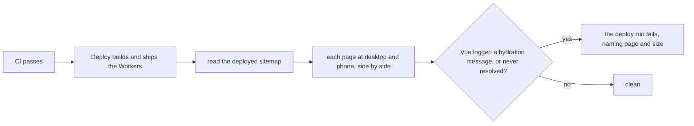

# Hydration — design

## Context

A server-rendered page is hydrated: the client renders the same tree again and adopts the server's DOM, and any node the two renders disagree on is a mismatch. Vue reports it, patches the node, and the reader sees a flash, a lost event handler or a wrong layout. The two renders run on different machines (a Cloudflare Worker with no screen, no clock zone and no storage, and the reader's browser), so every input one side has and the other lacks is a cause. Every route renders on the server unless `apps/web/configuration/routeRules.ts` turns `ssr` off for it.

## Decisions

### The rule: the first client render is a function of the payload alone

The client's first render reads only what the server rendered from: the payload, the cookies the server read, and the request headers it was handed. Anything only the browser knows (the viewport, the system colour scheme, the reader's zone, storage, a load event that fired before hydration) is read after hydration, or is carried into the payload by the server, or the route renders on the client alone.

### Every known cause has one mechanism

| Cause                                                                            | Mechanism                                                                                                             | Owner                                               |
| :------------------------------------------------------------------------------- | :-------------------------------------------------------------------------------------------------------------------- | :-------------------------------------------------- |
| A date formatted in the Worker's zone and locale                                 | `<NuxtTime>`, whose prehydrate script rewrites the text from the instant before Vue hydrates; other forms lint-banned | [date-time display](../date-time-display/design.md) |
| A label on the reader's own day boundary (`Yesterday at 14:03`)                  | The messaging routes render on the client (`ssr: false`)                                                              | [date-time display](../date-time-display/design.md) |
| The viewport, which a Worker does not have                                       | Vuetify 0's breakpoints start both renders at no width and measure once the root suspense resolves                    | [responsive](../responsive/design.md)               |
| An imported asset's URL, root-relative on the server and absolute on the client  | `viteHooks` has a client chunk ask Nuxt's `__buildAssetsURL`, as the server does                                      | [static assets](../static-assets/design.md)         |
| The system colour scheme, which only the browser can read                        | An explicit choice rides a cookie; a system reader is resolved by a head rule and an immediate watcher                | [design language](../design-language/design.md)     |
| Theme tokens written into adopted stylesheets, absent from the first HTML        | Vuetify 0's theme plugin with its Unhead adapter, so the tokens are in the server's HTML                              | [UI library](../ui-library/design.md)               |
| A keyed list read answered differently on the client's replay                    | A keyed read's result rides the payload; a client-rendered route passes no key                                        | the `pagination` skill                              |
| A value a keyed read's closure writes outside a store                            | It is written to Pinia state, which rides the payload                                                                 | the `pagination` skill                              |
| The game language, resolved from `Accept-Language` on the server                 | The resolved language and its text chunk ride the payload through `useGameText`                                       | [game text](../../genshin/game-text/design.md)      |
| An image that loaded before hydration never firing `load` in Vuetify 0's `` | `NuxtImg` as the image part's `as`, with `as="img"` lint-banned                                                       | the `styling` skill                                 |

The Vuetify 0 rows are where its defaults assume a browser-only app: its breakpoints measure the window at mount, its theme adapter writes stylesheets in the browser, and its image part listens for a `load` the server-rendered image already had. Each is configured in `apps/web/app/plugins/ui.ts` or replaced at the component, never patched per page.

### A deploy proves it, page by page

A unit test sees neither render: the asset URL mismatch existed only in a production build, and the viewport one only at a desktop width. So after each deploy, `pnpm -C apps/web hydration:check --origin <site>` loads every page the deployed sitemap lists (the site's server-rendered surface, with no route list to keep) in headless Chromium at Playwright's desktop and phone presets, and fails on any hydration message Vue logs or a page that never finishes. It knows completion as an event: an init script catches the Vue app as it mounts and awaits Nuxt's `app:suspense:resolve`, so nothing is timed. It is the Deploy workflow's last step, against the environment just deployed, so a mismatch fails the deploy run it shipped in.

**Rejected — a check against a local production build in CI:** the built Worker needs the environment's secrets, a migrated local D1 and prod-shaped bindings to serve a page at all, and the deployed site has all three. **Rejected — the screenshot suite's argument (`run-app` skill):** that suite paid a production build per run and found nothing; this check pays no build, since the deploy already built, and its first run found the `/clicker` mismatch.

## Key files

| Path                                             | Role                                                             |
| :----------------------------------------------- | :--------------------------------------------------------------- |
| `apps/web/scripts/hydration/index.ts`            | The check: the sitemap's pages at two sizes                      |
| `apps/web/scripts/hydration/observeHydration.ts` | The init script reporting Nuxt's hydration end as an event       |
| `.github/workflows/Deploy.yaml`                  | Runs the check against the environment it just deployed          |
| `apps/web/app/plugins/ui.ts`                     | Vuetify 0's breakpoints and theme configured for a server render |
| `apps/web/configuration/vite.ts`                 | `viteHooks`: one asset URL on both renders                       |
| `apps/web/configuration/routeRules.ts`           | The routes that render on the client alone                       |
