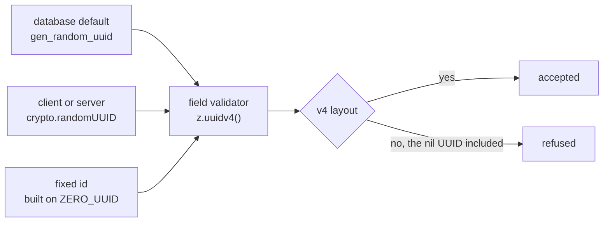

# Id validation

Every id a field holds is validated as a version-4 UUID, and every fixed id is built on the all-zero v4, so the fixed ids pass the same check as the real ones.

## How it works

Every id validator in the app and in the database schemas is `z.uuidv4()`. That validator accepts only the version-4 layout: a version digit of 4 and a variant digit of 8, 9, A or B. An id minted any other way is refused where it arrives, and the sources of ids below are each either made to mint a v4 or kept off every uuid validator.

A database uuid column is the one place the validator is not written by hand. drizzle-zod maps every Postgres `uuid` column to `z.uuid()` and offers no option to change that, so each uuid column names its own override in the select schema it is read through, `id: () => z.uuidv4()`, as the rooms select schema does. A foreign-key column takes the same override, since its value is the referenced row's id. A column in a new table takes it too. A field that holds another resource's id is that same validator registered in the resource-link registry, so the [resource-link index](../resource-links/design.md) finds it as well as validating it.

Fixed ids are built on one constant, `ZERO_UUID`, which is the all-zero v4 with the version digit 4 and the variant digit 8. The shared sentinels are that constant, so none of them changes shape. A second row of one table steps the last digits and leaves the version and variant digits alone. Ids of different tables share `ZERO_UUID`, since they never meet. The pure nil UUID is never a fixed id, because it is not a v4 and fails the check.

Tests hold to the same rule with one distinction. A test's real id is `crypto.randomUUID()`. A fixed id is for a value whose text the code reads: an outline seeded from an element's id, a seed that must be identical on every run, or a sentinel. Where a random id's text lands in an asserted output, the expectation interpolates the variable. The literal rules belong to the `test-values` skill (`references/canonical-values.md`), and the Zod form to the `zod` skill (`references/zod-4-apis.md`).

## Id sources

| Source                                                                                              | Reaches                                       | Answer                                                                                                                                        |
| :-------------------------------------------------------------------------------------------------- | :-------------------------------------------- | :-------------------------------------------------------------------------------------------------------------------------------------------- |
| Database default on uuid primary keys                                                               | The select schema override, `z.uuidv4()`      | A v4, since the database default mints a version-4 UUID.                                                                                      |
| Foreign-key uuid columns                                                                            | The same override                             | A v4 by copy: the value is the referenced row's id.                                                                                           |
| Client `crypto.randomUUID()`, such as placeholder rows, todo steps, canvas elements and session ids | The field's validator                         | A v4. The `checkIsUuidV4` test holds the runtime's random UUID to that pattern.                                                               |
| Server `crypto.randomUUID()`, such as file ids, custom emoji tags and survey participant tokens     | The entity's or the row's validator           | A v4 from the same runtime.                                                                                                                   |
| Claude Code session id carried by a todo's origin                                                   | The origin's `sessionId`                      | A v4. Claude Code mints the id outside the repo and names each session file by it, in the same v4 layout.                                     |
| Azure Table partition keys holding a room id                                                        | The message partition keys                    | A v4, through the room row the key names.                                                                                                     |
| Survey response id, minted by the respondent's browser                                              | The survey response id on create and update   | A v4: the respondent's client random seed, kept in the browser for that respondent.                                                           |
| Fixed ids, such as `ZERO_UUID` and its steps, the sentinels, the driven user and the seeded rows    | The seeded rows and the sentinels' validators | v4-shaped by construction. No id in the repo is the nil UUID.                                                                                 |
| better-auth ids, provider account ids, call session, invite and friendship ids                      | Nothing: text columns                         | Not uuids. better-auth's default is a string id, since the auth configuration sets no id generator, and no uuid validator reads any of these. |

## Key files

| File                                                                  | Role                                                                                                  |
| :-------------------------------------------------------------------- | :---------------------------------------------------------------------------------------------------- |
| `packages/shared/src/util/id/uuid/constants.ts`                       | `UUIDV4_REGEX`, the v4 pattern, and `ZERO_UUID`, the all-zero v4 every fixed id builds on             |
| `apps/web/shared/util/id/uuid/checkIsUuidV4.ts`                       | The client's check of an id against the v4 pattern                                                    |
| `apps/web/shared/util/id/uuid/checkIsUuidV4.test.ts`                  | Holds the runtime's random UUID to that check                                                         |
| `apps/web/shared/services/resource/link/createResourceLinkSchema.ts`  | The validator of a field holding another resource's id: `z.uuidv4()`, registered in the link registry |
| `packages/db-schema/src/schema/message/roomsInMessage.ts`             | A select schema overriding its uuid column with `z.uuidv4()`, the pattern every uuid column copies    |
| `packages/db-schema/src/services/message/constants.ts`                | `AUTOMOD_USER_ID`, the reserved moderation actor, built on `ZERO_UUID`                                |
| `apps/web/shared/services/pageBuilder/constants.ts`                   | `NO_SURVEY_ID`, the "no survey" sentinel, built on `ZERO_UUID`                                        |
| `packages/shared/src/services/devSeed/constants.ts`                   | `DRIVEN_USER_ID`, a v4-shaped id that is not the zero UUID                                            |
| `packages/db-schema/src/schema/resource/surveyResponsesInResource.ts` | The survey response's id, validated as v4 by its select schema                                        |
| `apps/web/shared/models/db/survey/ParticipantTokenInput.ts`           | The participant token a response names: empty, or a v4                                                |

## Notes

- **Trade:** the todo origin's validator depends on a session-id layout that Claude Code owns. The repo follows that layout rather than widening the validator to accept another one.
- **Rejected, `z.guid()`:** it accepts any value in the UUID layout, so it checks less than the ids are. Every real id is a v4, and the narrowest validator that accepts all of them is the one used.
- **Rejected, `z.uuid()`:** it accepts versions 1 to 8, which admits ids of versions the repo never mints.
- **Rejected, accepting the nil UUID:** the nil is the one value a broader validator would admit beyond the v4 layout, and no id in the repo is nil. Widening every validator to admit it buys nothing.
- **The headless block editor validates ids as v4 too.** Its element schemas reparse the whole document on every edit, so a consumer that mints ids of another version has its edits refused. Its ids come from the `createId` the consumer passes, and the app's is `crypto.randomUUID`.
- **A uuid column's select schema is overridden column by column**, since the database mapping accepts every version. A `z.uuid()` call is a lint error; the column mapping is held by the override alone.

## Sources

- [RFC 9562, Universally Unique IDentifiers](https://www.rfc-editor.org/rfc/rfc9562.html) (IETF): the version-4 layout, with a version field of 4 and a variant field of `10` in binary, so the variant digit is 8, 9, A or B; the nil UUID is all zeros and falls outside the variant the document defines. Grounds the pattern in `UUIDV4_REGEX` and the refusal of the nil.
- [Zod, UUIDs](https://zod.dev/api) (Zod): `z.uuid()` takes a version and accepts versions 1 to 8, and `z.guid()` does not check the variant bits. Grounds the choice of `z.uuidv4()` over the two.
