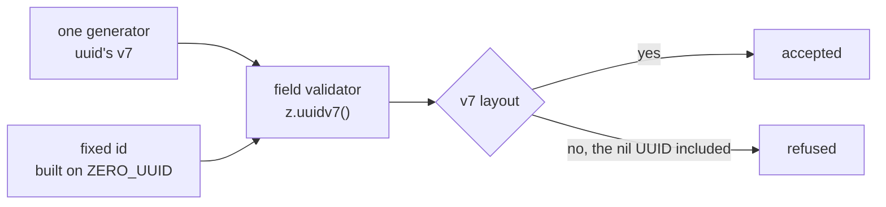

# Id validation

Every id a field holds is validated as a version-7 UUID, and every fixed id is built on the all-zero v7, so the fixed ids pass the same check as the real ones.

## How it works

Every id is minted by one generator, `v7` from the `uuid` package, which writes a UUIDv7 (RFC 9562): a millisecond timestamp, then a sequence the package keeps per process, then random bits. Ids of one process therefore sort by creation, even within a millisecond, so ordering by id is ordering by creation and a cursor pages on `id` alone. The lint rule bans the two other generators, `crypto.randomUUID()` and `uuid`'s `v4`, since each mints a version 4.

Every id validator in the app and in the database schemas is `z.uuidv7()`. That validator accepts only the version-7 layout: a version digit of 7 and a variant digit of 8, 9, A or B. An id minted any other way is refused where it arrives. The one exception is the todo origin's session id, which Claude Code mints outside the repo in the v4 layout, so it keeps `z.uuidv4()`.

A database uuid column is the one place the validator is not written by hand. drizzle-zod maps a D1 text column to a plain string and offers no option in its generator to change that, so each uuid column names its own override in the select schema it is read through, `id: () => z.uuidv7()`, as the rooms select schema does. A foreign-key column takes the same override, since its value is the referenced row's id. A column in a new table takes it too. A field that holds another resource's id is that same validator registered in the resource-link registry, so the [resource-link index](../resource-links/design.md) finds it as well as validating it.

Ids are text columns in D1, which drizzle-zod maps to a plain string. So each id column names its own override in the select schema it is read through, `id: () => z.uuidv7()`, as the rooms select schema does. A foreign-key column takes the same override, since its value is the referenced row's id. A column in a new table takes it too. A field that holds another resource's id is that same validator registered in the resource-link registry, so the [resource-link index](../resource-links/design.md) finds it as well as validating it.

A bearer credential is not an id, and it is not minted with `v7`: a webhook's token and a program participant's token are 256 random bits from `crypto.getRandomValues`, written as unpadded base64url (43 characters) by `generateSecretToken` in `@esposter/shared`, and checked by `secretTokenSchema`. A v7 carries 74 random bits and its ordering is public, so no credential is built from one. A stored credential is compared with `checkIsSecretEqual` where the app compares it itself, and is looked up by its value where the row is keyed by it.

Fixed ids are built on one constant, `ZERO_UUID`, which is the all-zero v7 with the version digit 7 and the variant digit 8. The shared sentinels are that constant, so none of them changes shape. A second row of one table steps the last digits and leaves the version and variant digits alone. Ids of different tables share `ZERO_UUID`, since they never meet. The pure nil UUID is never a fixed id, because it is not a v7 and fails the check.

Tests hold to the same rule with one distinction. A test's real id is `v7()`. A fixed id is for a value whose text the code reads: an outline seeded from an element's id, a seed that must be identical on every run, or a sentinel. Where a random id's text lands in an asserted output, the expectation interpolates the variable. The literal rules belong to the `test-values` skill (`references/canonical-values.md`), and the Zod form to the `zod` skill (`references/zod-4-apis.md`).

## Id sources

| Source                                                                                           | Reaches                                       | Answer                                                                                                                         |
| :----------------------------------------------------------------------------------------------- | :-------------------------------------------- | :----------------------------------------------------------------------------------------------------------------------------- |
| Column defaults (`$defaultFn`) on primary keys, in the Worker and the objects                    | The select schema override, `z.uuidv7()`      | A v7 from the one generator.                                                                                                   |
| Foreign-key id columns                                                                           | The same override                             | A v7 by copy: the value is the referenced row's id.                                                                            |
| Client `v7()`, such as placeholder rows, todo steps, canvas elements and session ids             | The field's validator                         | A v7 from the same generator. The `checkIsUuidV7` test holds the generator's id to that pattern.                               |
| Server `v7()`, such as file ids and custom emoji tags                                            | The entity's or the row's validator           | A v7 from the same generator.                                                                                                  |
| Claude Code session id carried by a todo's origin                                                | The origin's `sessionId`                      | A v4. Claude Code mints the id outside the repo and names each session file by it, in the v4 layout.                           |
| Survey response id, minted by the respondent's browser                                           | The survey response id on create and update   | A v7: the respondent's client random seed, kept in the browser for that respondent.                                            |
| Fixed ids, such as `ZERO_UUID` and its steps, the sentinels, the driven user and the seeded rows | The seeded rows and the sentinels' validators | v7-shaped by construction. No id in the repo is the nil UUID.                                                                  |
| better-auth model ids, such as users, sessions, accounts and verifications                       | Nothing: text columns                         | A v7 from `advanced.database.generateId`, the same generator. Better-auth's own tokens are not ids and do not pass through it. |

## Key files

| File                                                                  | Role                                                                                                  |
| :-------------------------------------------------------------------- | :---------------------------------------------------------------------------------------------------- |
| `packages/shared/src/util/id/uuid/constants.ts`                       | `ZERO_UUID`, the all-zero v7 every fixed id builds on                                                 |
| `apps/web/shared/services/id/checkIsUuidV7.ts`                        | The client's check of an id against the v7 pattern                                                    |
| `apps/web/shared/services/id/checkIsUuidV7.test.ts`                   | Holds the generator's id to that check, and refuses a v4                                              |
| `apps/web/shared/services/resource/link/createResourceLinkSchema.ts`  | The validator of a field holding another resource's id: `z.uuidv7()`, registered in the link registry |
| `packages/db-schema/src/schema/message/roomsInMessage.ts`             | A select schema overriding its id column with `z.uuidv7()`, the pattern every id column copies        |
| `packages/db-schema/src/services/message/constants.ts`                | `AUTOMOD_USER_ID`, the reserved moderation actor, built on `ZERO_UUID`                                |
| `apps/web/shared/services/pageBuilder/constants.ts`                   | `NO_SURVEY_ID`, the "no survey" sentinel, built on `ZERO_UUID`                                        |
| `packages/shared/src/services/devSeed/constants.ts`                   | `DRIVEN_USER_ID`, a v7-shaped id that is not the zero UUID                                            |
| `packages/db-schema/src/schema/resource/surveyResponsesInResource.ts` | The survey response's id, validated as v7 by its select schema                                        |
| `apps/web/shared/models/db/survey/ParticipantTokenInput.ts`           | The participant token a response names: empty, or a secret token                                      |
| `apps/web/shared/models/resource/todoList/TodoListItemOrigin.ts`      | The origin's session id, the one `z.uuidv4()`: Claude Code's id, not one the repo mints               |
| `apps/web/server/auth.ts`                                             | `advanced.database.generateId`, which gives better-auth's model ids the same generator                |

## Notes

- **Trade:** the todo origin's validator depends on a session-id layout that Claude Code owns. The repo follows that layout for that one field rather than widening the id validator, which stays `z.uuidv7()`.
- **Rejected, `z.guid()`:** it accepts any value in the UUID layout, so it checks less than the ids are. Every id the repo mints is a v7, and the narrowest validator that accepts all of them is the one used.
- **Rejected, `z.uuid()`:** it accepts versions 1 to 8, which admits ids of versions the repo never mints.
- **Rejected, accepting the nil UUID:** the nil is the one value a broader validator would admit beyond the v7 layout, and no id in the repo is nil. Widening every validator to admit it buys nothing.
- **Rejected, UUIDv4 for ids:** a random id scatters inserts across the index, and every cursor over it needs `createdAt` beside it to keep its order.
- **The headless block editor validates ids as v7 too.** Its element schemas reparse the whole document on every edit, so a consumer that mints ids of another version has its edits refused. Its ids come from the `createId` the consumer passes, and the app's is `v7`.
- **A uuid column's select schema is overridden column by column**, since the text column maps to any string. A `z.uuid()` call is a lint error; the column mapping is held by the override alone.

## Sources

- [RFC 9562, Universally Unique IDentifiers](https://www.rfc-editor.org/rfc/rfc9562.html) (IETF): the version-7 layout, with a version field of 7 and a variant field of `10` in binary, so the variant digit is 8, 9, A or B; the nil UUID is all zeros and falls outside the variant the document defines. Grounds the version check `checkIsUuidV7` makes through the `uuid` package's `validate` and `version`, and the refusal of the nil.
- [uuid, `v7`](https://www.npmjs.com/package/uuid) (uuid package): the generator the repo mints every id with, which keeps a per-process sequence so ids minted in one process stay in creation order.
- [Zod, UUIDs](https://zod.dev/api) (Zod): `z.uuid()` takes a version and accepts versions 1 to 8, and `z.guid()` does not check the variant bits. Grounds the choice of `z.uuidv7()` over the two.
