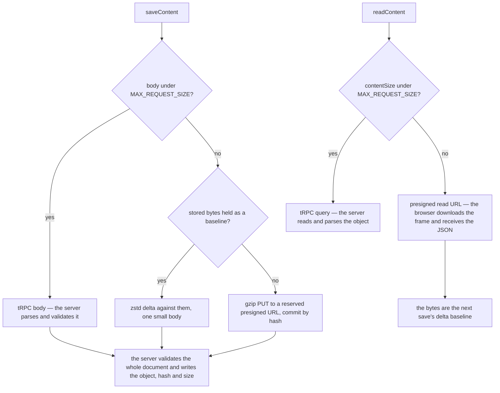

# Large documents

**The server carries a document only while one request body can hold it, and interprets it only where it has to.** Anything larger moves between the browser and R2 through a short-lived presigned url the server issues after checking ownership. The server signs, and R2 moves the bytes. This is the valet key pattern, and it is what keeps a large document from costing the server's memory, CPU and bandwidth on every read and every save. That matters most on a Worker, which is billed for the CPU and memory a request uses, so a document the server never touches costs it nothing.

The threshold is one number, `MAX_REQUEST_SIZE`: the body limit the security module enforces on every request. The same number decides both directions, measured the way each direction can measure it.

- **A save** measures its own body as the transformer will write it — never the content's JSON, which is smaller — and above the limit sends a delta against bytes the server confirmed storing, or stages the whole document in R2 and commits it by hash.
- **A read** measures the document by `resources.contentSize`, the JSON's length that every save writes with the object, and above the limit asks for a presigned read URL and downloads the object itself. The object is a zstd frame served with `Content-Encoding: zstd`, so the browser's network stack hands `fetch` the JSON bytes and the download is a fraction of the document's size ([compressed JSON blobs](../compressed-json-blobs/design.md)).

## Where the server still holds the document, and why

**Validation on write.** A document the server stores is one it has parsed with the type's content schema, because every server-side reader — a dashboard's dataset, a blueprint capture, a revision — trusts the object it reads. So a staged or delta save still costs the server one decompress, one parse and one validation of the whole document. It is bounded by `MAX_RESOURCE_CONTENT_SIZE`, and at that ceiling it blocks the isolate's event loop for a matter of seconds. The committed benches beside `apps/web/server/services/resource/readStagedResourceContent.ts` are the record. Moving that step off the event loop is written up as [commit off the event loop](../../../deferred/architecture/commit-off-event-loop/design.md), with the trigger that would earn it.

**Server-side readers.** A dataset read for a dashboard, a blueprint capture or a revision interprets content on the server. Its whole job is to compute something from the document, so no signed url can stand in for it.

**Real-time sync.** Every save sends its `{ apiKeyName, contentVersion, id }` through the owner's user object to the owner's sockets other than the saving tab's ([resource](../resource/design.md)). The event carries no document, so a device with that resource open reads the new content through the type's own read, and a large document never crosses the socket.

Nowhere else does the server hold a large document: carrying one from the browser to storage, or back, is never a reason to.

## A write that changes nothing stores nothing

Every stored copy is content-addressed or rewritten in place: `{id}/content.json` is overwritten, and a retained version deduplicates identical bytes and stores a near-duplicate as a delta ([resource version store](../../resource/resource-version-store/design.md)). That saving only exists if an unchanged document serializes to the same bytes. So **a write must not mint identity it did not need.** A random id or a fresh timestamp on an item whose values did not change makes a byte-identical document look new, and every history entry pays for all of it again. A Sheet import is the case the rule guards: a re-import that built each row anew, with a new UUID and new timestamps, would store every row id again. `reconcileDataSource` hands the replaced sheet's identities to the imported one — a column by the header it came from, a row by its position — so the same file imports to the same bytes, and a changed file costs its changed rows.

## Reusing it

A resource type gets all of this without writing anything. Every type's content moves through the resource store's `readContent` and `saveContent` and the procedures `createResourceProcedures` builds, so a new type is large-document safe the moment it is registered. The one thing a type owns is the rule above: a write that regenerates identity has to carry the previous identity over, the way `reconcileDataSource` does for a Sheet.

A large object outside resource content composes the same pieces rather than a second framework:

| Need                            | Piece                                                                 |
| ------------------------------- | --------------------------------------------------------------------- |
| a write the owner's quota holds | `generateReservedWriteSasUrl` on the server, one PUT from the browser |
| a read the server authorizes    | `createPresignedGetUrl` from `@esposter/db`, fetched by the browser   |
| the size a body will cross at   | `getRequestBodyByteLength`                                            |
| a hash both ends agree on       | `getSha256Hex` in the browser, `node:crypto` on the server            |
| a history that costs its edits  | the `keyframe-store` package                                          |

No generic transport abstraction sits above them, because resource content is the only document shape that grows past one body today. A second shape is what would earn one, and it would be shaped by the two it serves.

## Notes

- A browser reads R2 cross-origin, so each bucket needs CORS rules that allow `GET` beside the uploads' `PUT`, and a missing rule fails every large read with a CORS error the owner cannot act on. The Pulumi program declares no bucket CORS rules, so nothing in the repository sets or checks them.
- A row no save has yet sized carries the default of zero and is read inline until its next save writes the size. That inline read is the expected path for such a row, not a broken one.
- The presigned read URL lives minutes, like the one behind `/api/resource-assets`, because it is used the moment it is issued.

## Key files

| File                                                                     | Role                                                               |
| ------------------------------------------------------------------------ | ------------------------------------------------------------------ |
| `apps/web/app/store/resource/index.ts`                                   | picks each read's and save's transport by size, holds the baseline |
| `apps/web/app/services/resource/readStoredResourceContent.ts`            | reads a large document straight from R2                            |
| `apps/web/app/services/resource/saveStagedResourceContent.ts`            | stages a large save through a reserved presigned PUT               |
| `apps/web/app/services/resource/saveResourceContentDelta.ts`             | sends an edit as a delta against the stored bytes                  |
| `apps/web/server/trpc/procedure/resource/createResourceProcedures.ts`    | signs the read and write urls every resource type gets             |
| `apps/web/server/services/resource/saveResourceContent.ts`               | validates, then writes the object with its hash and size           |
| `apps/web/app/services/resource/sheet/dataSource/reconcileDataSource.ts` | carries a replaced sheet's identities into an import               |

## Sources

- [Valet Key pattern](https://learn.microsoft.com/en-us/azure/architecture/patterns/valet-key) (Azure Architecture Center) — a time- and scope-limited token lets the client move data directly to and from storage, taking compute, memory and bandwidth off the application. The pattern names validation of uploaded data as the application's remaining job, which is the one place this page keeps the server in the path.
- [Workers limits](https://developers.cloudflare.com/workers/platform/limits/) (Cloudflare) — the memory per isolate and the CPU time per request, which bound where the commit's validation could move if it left the web Worker.
