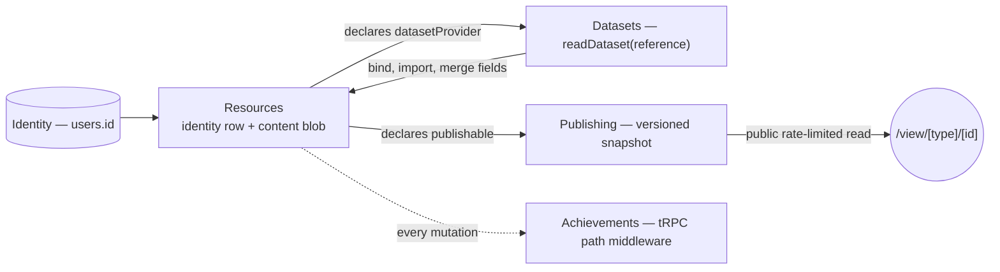

# Cross-Product Layer Model

How Esposter's products link together. Five layers; the Resources layer carries the products, and the others are capabilities or infrastructure it plugs into.

## Principle

> **Everything is a resource; capabilities are opt-in.** A resource exposes and consumes **datasets** if it declares so. Anything publishable gets a **public versioned read**. Every mutation is already an **achievement trigger**.

New products join the platform by adding one `ResourceType` and one `ResourceDefinitionMap` entry, not by adding services or bespoke pages. Games, anime, and the fluid simulator deliberately stay outside (achievements only) — a game save has nothing to gain from naming, sharing, or dataset semantics.

## Layer model

| Layer          | Contract                                                                                                              |
| -------------- | --------------------------------------------------------------------------------------------------------------------- |
| **Identity**   | `users.id` (better-auth) keys every row, object key, and session — shared by all products                             |
| **Resources**  | D1 identity row + content object + capability declaration → [resources](../resource/design.md)                        |
| **Datasets**   | Columns + rows served by DatasetProvider types → [datasets](../dataset/design.md)                                     |
| **Publishing** | Versioned publish copy + public rate-limited read at `/view/[type]/[id]` → [publishing](../publishing/design.md)      |
| **Events**     | tRPC mutation path = achievement trigger key (`achievementPlugin`) — every new procedure is automatically triggerable |

## Outside the resource model

**Posts** (relational D1, social feed semantics), **Esbabbler** (distribution channel for published links), **Achievements** (the events layer itself), and **games/anime/fluid** (blob save state or none; achievements only). Single-blob-per-user save state (`useSave`, blob `${userId}/save`) remains only for genuinely one-per-user saves.
