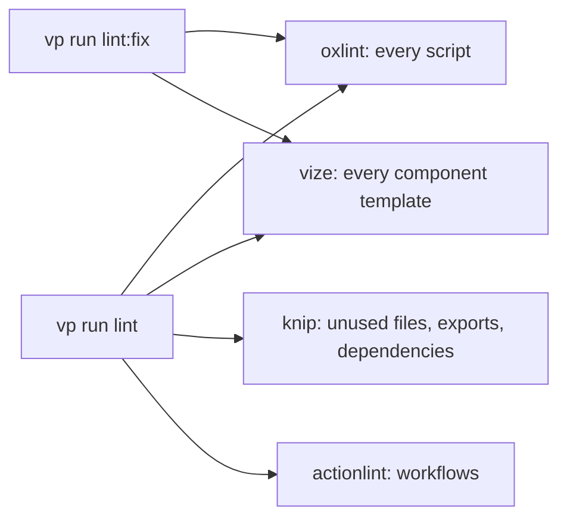
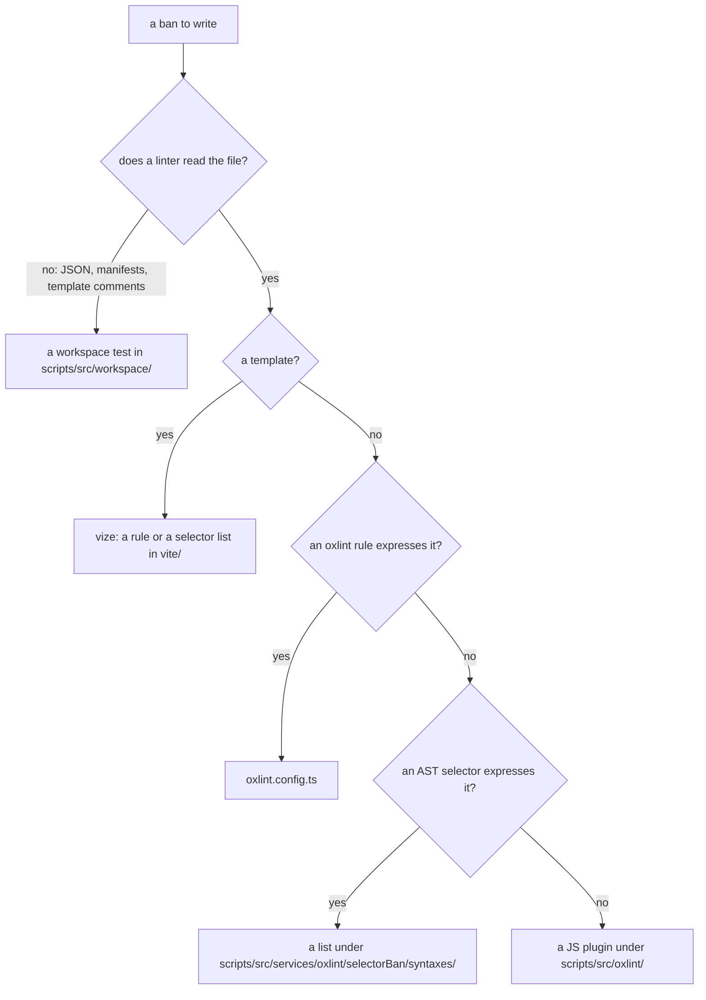

# Lint Toolchain

Lint is a set of passes, each reading the files it can parse and no other, so a rule runs in one pass only. Oxlint checks every script in the repository in one native pass, its type-aware rules included. Vize checks each component's template, which oxlint does not read. The workspace tests check what no linter reads: JSON files, banned dependencies, the reasons on template directives and the template text rules. Knip finds unused files, exports and dependencies, and actionlint checks the workflows. Oxfmt formats and sorts imports, and lints nothing.

The root `lint` task depends on the four checks above. `lint:fix` runs the two that rewrite files, oxlint's and vize's; knip and actionlint only report.

## The passes

- **Oxlint** runs once over the repository from `oxlint.config.ts`. Every category is listed explicitly at `error`, and `typeAware` runs the type-aware rules natively (see [The type-aware pass](#the-type-aware-pass)). Its rules are the native ones, the `selector-ban/no-restricted-syntax` lists, the local JS plugins, the Pinia rules among them in the `pinia` plugin. The local plugins are one entrypoint each under `scripts/src/oxlint/` (`selector-ban`, `sorting`, `props-interface`, `vue-type-imports`, `pinia` and the rest), and `oxlint/jsPlugins.ts` loads them by file, so a new one needs no entry.
- **Vize** runs each component's whole template from `vite/vueOptions.ts`. Its `incremental` preset runs only the rules that file names. Entries scope a rule set by path: the packages styled by scoped CSS alone take the template bans and the scoped-style bans, and the app takes its UnoCSS blocklist. The template ban lists are in `vite/services/`.
- **Knip** reads `knip.config.ts`. Its entries include the oxlint plugins, since oxlint loads them by path, and the sorting plugin's rules, which it imports from their folder at load.
- **Actionlint** checks the workflows, with its shellcheck and pyflakes passes off.
- **Workspace tests** are Vitest suites under `scripts/src/workspace/`, for what no linter reads: JSON and JSONC files (`jsonFiles.test.ts`), banned dependencies (`bannedDependencies.test.ts`), the reasons on template directives (`templateDirectiveReasons.test.ts`) and the template text rules vize cannot yet run (`templateTextRules.test.ts`).
- **Oxfmt** formats with `oxfmt.config.ts` at the root, whose settings live in `packages/configuration/oxfmt/`. Its `sortImports` puts type imports first and values after, with packages and `#` subpaths ahead of relative ones.

## Directives and reasons

Each pass has its own spelling, and both require a reason.

- A script directive is `// oxlint-disable-next-line <rule> -- <reason>`, or `/* oxlint-disable <rule> -- <reason> */` on a file's first line. A local plugin's rule is named by its `meta.name`, as `selector-ban/no-restricted-syntax`. `comments/require-directive-reason` reports a directive without a reason.
- A template directive is the HTML comment `<!-- oxlint-disable-next-line <rule> -- <reason> -->`, the same spelling as a script's. Vize's tree carries no comment for a linter to read, so `scripts/src/workspace/templateDirectiveReasons.test.ts` checks the reason.

## Where a ban is written

A ban goes to the first mechanism that can express it. The step is chosen by running a planted violation through the candidate, never by reading a rule list.

A JS plugin is the last linter step: it is surface this repo owns, tests and maintains. A few bans stay selector entries rather than native rules: `window.localStorage`, `stopImmediatePropagation` and `splice`, since oxlint reads a component's script and not its template; the `.then`/`.catch`/`.finally` chain, since `promise/prefer-await-to-then` is off (the `oxlint` skill's `references/plugin-rules.md`); and the naming bans, since oxlint does not implement the naming rules. The TypeScript `private` keyword ban has no linter that ships it, so it is permanent. A catalog bump is checked by planting a violation for each local plugin and selector list; the `oxlint` skill's `references/lint-configuration.md`, "Bumping oxlint", is the runbook.

## The type-aware pass

The type-aware rules run on `tsrs-lint`, which oxlint launches with no flags. The switches the typecheck scripts pass `tsrs` are therefore set in `oxlint.config.ts`, through the environment the backend inherits.

Every root oxlint script passes `--debug=timings`, so each run ends with a table of rule times. The top rule is a lead, not a verdict: the backend computes each type once and caches it, so the first rule to force an expensive type is charged for it. A slow file is found by timing per package, then per file.

`no-deprecated` runs on every lint. An engine marks a call `@deprecated` a release before removing it, and the rule catches the call before it is committed.

`packages/genshin-mods` and `packages/genshin-persona/mod` turn `typescript/strict-void-return` off through an `overrides` entry. Asking whether an async hook fits the engine's generic `On` overloads costs far more there than anywhere else in the repository. Every other type-aware rule still runs in those trees.

## Decisions

**The type-aware backend is `tsrs-lint`.** It is the Rust port of the type-aware linter, bundled by vite-plus, which points oxlint at it. Rejected: running a second type-aware backend beside it, which leaves two backends for one set of rules.

**The lint sets the typecheck's switches itself.** `oxlint.config.ts` sets the content-mapper switch and the fast preset in the environment before oxlint starts the backend, so a lint run and the typecheck scripts share one checker setting by statement rather than by default. Rejected: a launcher script or a wrapper that adds the flag, since the backend reads the variables itself. Rejected too: setting them in the root scripts and in CI, which the editor's lint never runs. The `@TODO` in `oxlint.config.ts` names the upstream change that would let the lint configuration pass the backend its options directly.

**A type-aware rule the backend lacks is `"off"` until the backend ships it.** Categories are on wholesale, so an oxlint release can enable a type-aware rule `tsrs-lint` does not implement, and the backend then fails the whole type-aware pass on "unknown rule" rather than skipping that rule. The rule is set `"off"` with the upstream request as its `@TODO` (`oxc-project/tsgolint` #1371 for `typescript/no-unsafe-class-instance-assignment`), and it is turned on again once the backend ships it. Rejected: holding oxlint at the release before, which freezes every other rule with it.

**A convention that needs types is enforced by review, not by a local rule.** The backend runs no JS rules, so a local rule has no types, and a type-aware JS plugin would need the parser to read a project for every file, which multiplies the pass. Rejected: a type-aware local plugin.

**A consequence of the content mapper: a generic component's props are typed.** The mapper types a generic `.vue` component's test-utils `props()`, so a type-aware rule can report an assertion over an optional wrapper as unnecessary. The fix narrows the wrapper first, never a disable.

## Key files

| File                                                | Role                                                                                  |
| --------------------------------------------------- | ------------------------------------------------------------------------------------- |
| `oxlint.config.ts`                                  | Categories, rules, `overrides`, `ignorePatterns` and the type-aware switches          |
| `oxlint/`                                           | The lists `oxlint.config.ts` reads, and `jsPlugins.ts`, which loads the local plugins |
| `scripts/src/oxlint/`                               | The local JS plugins, one entrypoint each                                             |
| `scripts/src/oxlint/pinia.ts`                       | The Pinia rules enabled under `pinia/<rule>`                                          |
| `scripts/src/services/oxlint/selectorBan/syntaxes/` | The selector-ban lists behind `selector-ban/no-restricted-syntax`                     |
| `vite/vueOptions.ts`                                | Vize's rules and its per-path entries                                                 |
| `vite/services/`                                    | Vize's template ban lists, and the HTML data behind the scoped-styles ban             |
| `vite/checkTasks.ts`                                | The `lint`, `lint:fix` and per-pass tasks                                             |
| `knip.config.ts`                                    | Knip's entries, which include the oxlint plugins                                      |
| `scripts/src/workspace/`                            | The tests for what no linter reads                                                    |
| `oxfmt.config.ts`, `packages/configuration/oxfmt/`  | The formatter and its import order                                                    |

## The HTML data behind the scoped-styles ban

`scopedStyleSyntaxes.ts` reads two static tables of the HTML standard: the tag names in `htmlTagNames.ts` and each element's attributes in `htmlElementAttributes.ts`. Both are typed constants copied from the upstream `html-tag-names` and `html-element-attributes` packages under their MIT notice, and each file's header names the upstream release it came from. A refresh re-crawls the standard and re-checks those headers.

The tag names do not yet include `selectedcontent`, which the standard defines, so the ban does not check it until a refresh adds it.
