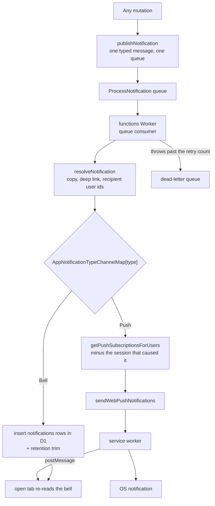

# Notifications

Everything that tells a person something happened is one thing here: a typed message, published through `publishNotification`, delivered by the `ProcessNotification` queue's consumer in the functions Worker, and fanned out to the surfaces its type declares. A chat message, a thread reply, a friend request, a `/remind` reminder, a todo that came due and a resource operation all travel that one path — so "is this a notification?" has exactly one answer, and a new one cannot accidentally pick a different pipeline.

The publisher states **what happened and who it concerns**. Everything about how it renders and where it lands is resolved at delivery, off the request path the person is waiting on.

## The pipeline

Two properties fall out of the shape rather than out of discipline:

- **Recipient resolution happens once, at delivery.** A publisher never asks who will receive what it publishes, so it never pays for that query and can never disagree with the delivery about the answer.
- **A reply raises one event.** A thread's followers widen the message's recipient set rather than becoming a second notification that the first has to be de-duplicated against, so no `excludedUserIds` handshake is needed between two messages.

## The envelope

`NotificationQueueMessage` is a discriminated union on `AppNotificationType`. Each member carries exactly what its own recipient resolution needs and nothing more — a message carries the message and, when it is a reply, its thread root; a friend request carries the two user ids. Nothing carries a rendered name or avatar: those are resolved at delivery from the ids, so the same room display-name rule applies to every notification and no publisher restates it.

`ResourceOperation` is the one member that carries its own copy, and deliberately: the wording depends on what the caller did — one resource or fifty, a version number, the name a row had before it was deleted — and none of that survives to delivery time. Its wording is shared with the tab that also shows it immediately, through `ResourceOperationTitleMap`, so the two can never drift.

## Channels

`AppNotificationTypeChannelMap` declares which surfaces each type reaches. It is exhaustive over `AppNotificationType`, so a new type has to state its surfaces rather than inherit a default that silently drops it from the bell or wakes a device it had no business waking.

| Type                | Bell | Push | Why                                                                       |
| ------------------- | ---- | ---- | ------------------------------------------------------------------------- |
| `Message`           | —    | ✓    | a room already carries its own unread count and mention badge             |
| `FriendRequest`     | ✓    | ✓    |                                                                           |
| `Reminder`          | ✓    | ✓    | [scheduled messages](../../esbabbler/scheduled-messages/design.md)        |
| `TodoReminder`      | ✓    | ✓    | [todolist due reminders](../../resource/todolist-due-reminders/design.md) |
| `ResourceOperation` | ✓    | ✓    | the operation happened on one device and is news on the others            |

Feedback about the tab's own action is **not** a member: it never leaves the tab and never becomes a row. That half of the bell, and why it is never written down, is [notifications bell](../../resource/notifications/design.md).

## The bell row

A type whose channels include the bell writes one `notifications` row per recipient, in one D1 statement. The row is the render shape the panel already uses, and its `severity` comes from `AppNotificationTypeSeverityMap` rather than from a field every publisher would restate identically.

Rows are trimmed to `NOTIFICATION_RETENTION_MS` on the write path, where the recipients are already known — nothing else trims them, and the only other delete is the cascade that takes a user's rows with the user, so an untrimmed bell is a table that only grows. The trim is best-effort, and so is everything past it: a trim that threw would fail the delivery and the queue would redeliver it, writing the rows a second time, so the bell insert is the one step allowed to fail, as [persist then notify](../persist-then-notify/design.md) states for this handler. The unread badge is a property of what the panel read, so no count rides on the push payload and no service worker writes one.

## Delivery

`sendWebPushNotifications` is the single caller of `web-push` and owns the retry logging and the `410 Gone` subscription cleanup. Its sends go out in waves of `MAX_CONCURRENT_PUSH_SENDS`, as other fan-outs are bounded in width, so a room's worth of subscriptions is never one open socket each. The device lookup behind them reads its users in waves of `MAX_USER_IDS_PER_STATEMENT`, and each wave binds its user ids as one JSON array rather than one parameter per user, so a wave is bounded by its size and never by the statement's parameter cap. `getPushNotificationPayload` is the single envelope the service worker parses: the body is capped and the deep link is made absolute there, so neither is something a new notification can forget, and `type` rides in `data` so a tab that receives one knows whether its bell is meant to show it.

A subscription is per-session, which is what lets a resource operation exclude the session that caused it: that tab showed the toast synchronously, and every other device of the same user is still owed the push.

Failure is the queue's once it has the message, not the publisher's. A notification is a queue job like every other: when its handler throws, the queue redelivers it up to the job's retry count, and then the message waits in the `ProcessNotification` dead-letter queue, which keeps what failed. No job replays it. The reminder is among them — it publishes a message like every other notification rather than calling `web-push` inline, and an inline send would have neither a retry nor a dead-letter queue. That covers accepted messages only: a publish the queue rejects has no message to retry or dead-letter, and is logged by the publisher as [persist then notify](../persist-then-notify/design.md) sets out. Publishes sit after the write they report and never fail it ([persist then notify](../persist-then-notify/design.md)).

## Adding a notification type

Three edits, and the type system asks for all three:

1. A member on `AppNotificationType`, and its data shape in the `NotificationQueueMessage` union.
2. An entry in `AppNotificationTypeChannelMap` and `AppNotificationTypeSeverityMap` — both exhaustive, so omitting one is a type error.
3. A `case` in `resolveNotification` returning the copy, the deep link and the recipient user ids.

There is no new queue, no new consumer and no new delivery path. The bell's type column is text, so the new member needs no migration: the set of types is held by TypeScript and the Zod schemas, not by the table.

## Key files

| File                                                                            | Role                                                 |
| ------------------------------------------------------------------------------- | ---------------------------------------------------- |
| `packages/db-schema/src/services/queue/publishNotification.ts`                  | the single publish path, sending to the queue        |
| `packages/db-schema/src/models/queue/NotificationQueueMessage.ts`               | the one envelope, discriminated by type              |
| `packages/db-schema/src/services/notification/AppNotificationTypeChannelMap.ts` | which surfaces each type reaches                     |
| `packages/db-schema/src/schema/notification/notificationsInNotification.ts`     | the persisted bell row, in D1                        |
| `apps/functions/src/handlers/processNotificationHandler.ts`                     | the queue handler that delivers one notification     |
| `apps/functions/src/services/notification/resolveNotification.ts`               | copy, deep link and recipients per type              |
| `apps/functions/src/services/notification/sendNotification.ts`                  | the fan-out — bell rows, then devices                |
| `packages/db/src/services/notification/getMessageRecipientUserIds.ts`           | a message's recipients, thread followers included    |
| `packages/db/src/services/notification/getPushSubscriptionsForUsers.ts`         | the one device lookup, minus the originating session |
| `apps/web/app/plugins/pushNotification.client.ts`                               | the tab end of the service worker's postMessage      |
