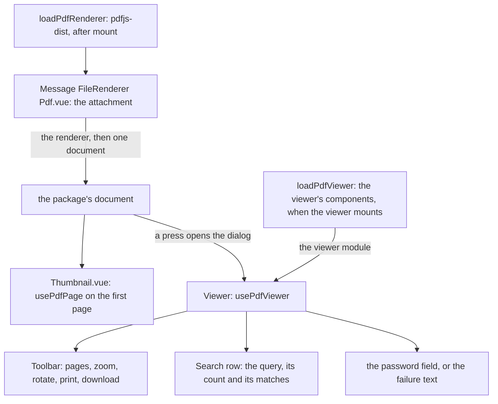

# PDF viewer

The app shows a PDF with its own look over the [vue-pdfjs-headless](../../vue-pdfjs-headless/README.md) package: a thumbnail of the first page in the message row, and a viewer for the whole document in a dialog on a click. A message's PDF attachment is their consumer ([file media](../../esbabbler/file-media/design.md)). The package owns the loading, the page drawing and the viewer's state; this page covers what the app supplies: the look, the controls and where each one lives.

## How it works

The app supplies the renderer, its worker and its folders, and the look. `loadPdfRenderer` imports `pdfjs-dist` after mount and names the worker the app loads by URL, which the package hands the renderer before each load. The viewer's components are a separate import that the viewer makes when it mounts. The character maps, the standard fonts and the image decoders sit at folders the server mounts from that same install, so the worker and the API cannot drift apart. The renderer then goes to the package, which the app never imports for its own work.

The attachment loads its document once with the package's `usePdfDocument`, and passes it to both views: the thumbnail, and the viewer in the dialog. The message's read link is minted again before it expires, and the attachment keeps the document it has loaded rather than loading it again from the new link, so an open viewer keeps its page, its zoom and the password it was given. A link that has loaded nothing yet is followed, so a load that failed on an expired link is tried again on the new one.

The thumbnail draws the first page with `usePdfPage` into its canvas. In a message it is a button, so a click, Enter or Space opens the dialog; in a preview it opens nothing, since the preview's own click opens its message.

The viewer mounts in the dialog over `usePdfViewer` on the app's container. Its controls are the app's, drawn with the UI library, and each one calls a function of the package. The toolbar, the search row, the sidebar, the watermark dialog and the page body are separate components under `apps/web/app/components/Pdf/Viewer/`, each with one responsibility, and they share the package's state object rather than a provided context. `Thumbnail.vue` is the message row's canvas, not part of the viewer.

## Surface

The surface is decided by where a reader's attention is: the bar holds what is used in every session, and everything else waits behind the one More menu or in the sidebar. Each visible control below has a task, a frequency and a reason it is where it is. A control that could not say how often it is used and why it is visible was removed from the surface; the removals are the last table. The table is the target surface: the controls it names that `Viewer.vue` does not draw yet (the sidebar and its toggle, the More menu, full screen, the watermark download, and rotate left and right) are recorded in the [PDF viewer surface change](../../../changes/architecture-pdf-viewer-surface/proposal.md).

### The controls

| Control                                                   | Task it serves                                         | How often                             | Where it lives                           | Why there                                                                                                                                                                     |
| :-------------------------------------------------------- | :----------------------------------------------------- | :------------------------------------ | :--------------------------------------- | :---------------------------------------------------------------------------------------------------------------------------------------------------------------------------- |
| Sidebar toggle (pressed while open)                       | Shows or hides the outline and the thumbnails          | Every session                         | Primary bar, first                       | It is the only way to open the sidebar, and its pressed state says whether it is open, so it stays out of the menu, as a toggle does                                          |
| Previous page                                             | Goes back a page                                       | Every session                         | Primary bar                              | Paging back is the most repeated move in a document                                                                                                                           |
| Page field, with "of N" beside it                         | Goes to a page by number, and says where the reader is | Every session                         | Primary bar                              | A number is typed here and Enter goes to it, so no Go button repeats the field's own job. "of N" is the page count, the one reading the reader needs to know how far is left  |
| Next page                                                 | Goes forward a page                                    | Every session                         | Primary bar                              | As Previous page                                                                                                                                                              |
| Zoom out                                                  | Makes the pages smaller                                | Often                                 | Primary bar, beside the readout          | Zoom is a primary task, and the pair of zoom buttons with the readout between them reads as one control                                                                       |
| Zoom readout, a percentage, which resets to fit the width | Shows the scale and returns it to fit                  | Sometimes, after zooming              | Primary bar, between the zoom buttons    | The readout is the reset, so no separate "Fit width" control is drawn; it is the state a document opens in, which the resize keeps                                            |
| Zoom in                                                   | Makes the pages larger                                 | Often                                 | Primary bar, beside the readout          | As Zoom out                                                                                                                                                                   |
| More (labelled "PDF actions")                             | Opens every command that is not used in every session  | Every session as the door to the rest | Primary bar, last                        | One menu holds the occasional commands, so the bar draws one mark for them and not five buttons. The menu's groups say what each is for                                       |
| Search field                                              | Finds text in the document                             | Every search                          | Search row, under the primary bar        | Its own row, so the field is never pushed out by the navigation, and it is the one place a query is typed                                                                     |
| Matches count, "2 of 5" or "No matches"                   | Says how many matches there are                        | Every search                          | Search row, after the field              | It is read beside the field it counts for, and is a live region so a screen reader hears each change                                                                          |
| Previous match                                            | Steps back to the match before                         | Every search                          | Search row                               | A step through matches is what a search is for; Enter takes the next one, and this button takes the previous one                                                              |
| Next match                                                | Steps on to the next match                             | Every search                          | Search row                               | As Previous match                                                                                                                                                             |
| Match case (menu item, marked while on)                   | Makes a search respect capitals                        | Sometimes                             | More menu, group "Search"                | A setting of a search, changed rarely, so it does not take a place in the row beside the field it changes                                                                     |
| Whole word (menu item, marked while on)                   | Finds a word and not part of a longer one              | Sometimes                             | More menu, group "Search"                | As Match case                                                                                                                                                                 |
| Rotate left                                               | Turns the pages a quarter turn counter-clockwise       | Sometimes                             | More menu, group "View"                  | Rotation is for a scan that was put in sideways, which is occasional; left and right are two items so each is a single choice                                                 |
| Rotate right                                              | Turns the pages a quarter turn clockwise               | Sometimes                             | More menu, group "View"                  | As Rotate left                                                                                                                                                                |
| Fit page                                                  | Fits a whole page in the view                          | Rarely                                | More menu, group "View"                  | Reading a full page is occasional, and the width is the default fit, so the page fit waits in the menu                                                                        |
| Actual size                                               | Shows the page at its own size                         | Rarely                                | More menu, group "View"                  | Used to check a print's scale; it is kept, and rarely needs a place on the bar                                                                                                |
| Full screen, reading Exit full screen while on            | Makes the whole viewer fill the screen                 | Sometimes                             | More menu, group "View"                  | It changes the whole viewer, not one control, so it is an action of the viewer; the menu item carries its own state in its label                                              |
| Print                                                     | Prints every page, one to a sheet                      | Sometimes                             | More menu, group "File"                  | A command that leaves the app, used when needed and not while reading                                                                                                         |
| Download                                                  | Saves the document under its name                      | Sometimes                             | More menu, group "File"                  | Saving is a file action, which sits with print; a download button on the bar would repeat it                                                                                  |
| Download with watermark                                   | Saves a copy with a text stamped on each page          | Rarely                                | More menu, group "File", then its dialog | A marked copy is a different file from the reader's own download, so it is named in the menu rather than as a second download button                                          |
| Watermark dialog: text field, Cancel, Download            | Asks the text before the file is made                  | Rarely, as the step of the above      | A dialog over the viewer                 | The text is one value asked before one file is made. A popover would hide the pages it sits over; the dialog is the owner's ruling, and its Download is the one accent action |
| Sidebar tabs, Outline and Thumbnails                      | Chooses what the sidebar lists                         | Sometimes                             | Sidebar header                           | A choice between two views of one thing is a set of tabs, drawn as the library draws them                                                                                     |
| Outline entries                                           | Goes to a section of the document                      | Sometimes                             | Sidebar, Outline tab                     | The document's own table of contents; each entry is a row that goes somewhere, so it is a row of the list                                                                     |
| Thumbnail cards                                           | Goes to a page by sight                                | Sometimes                             | Sidebar, Thumbnails tab                  | Each card is a whole page the reader chooses, so it is a card and not a row, and the page in view is marked                                                                   |
| Password field and Open                                   | Unlocks a protected document                           | When the document asks                | Between the search row and the pages     | It must come before any page, so it takes the place of the pages while it is asked                                                                                            |

### Removed from the surface

These were on the surface before and are not now, for the reason the second column gives.

| Removed control                      | Why it is gone                                                                                                                      |
| :----------------------------------- | :---------------------------------------------------------------------------------------------------------------------------------- |
| Go                                   | The page field commits on Enter, so a button repeating Enter is a second control for one job                                        |
| Fit width                            | The zoom readout resets to fit the width, so one control does both                                                                  |
| Rotate, Print, Download (icon)       | Occasional commands; they moved into the More menu so the bar holds only what every session uses                                    |
| Match case and Whole word checkboxes | Sometimes used; a checkbox pair beside the field took a row's width at a phone's width, so they moved into the menu as marked items |
| Text zoom buttons "−" and "+"        | Replaced by the icon pair with the readout between them, so the zoom reads as one control and not as three text buttons             |

### Layout at desktop width

At `md` and wider the viewer is the dialog's full width, and the sidebar is a column of 14rem at its start, beside the pages. The dialog is `min(64rem, 96vw)` wide and expands with its own control. The primary bar is one row: the sidebar toggle, the page controls on the start side, the zoom controls at the centre, and More at the end. The search row sits under it at full width. Nothing wraps: the bar's groups are kept whole, and the page count is what a narrower screen gives up first.

### Layout at phone width

Below `md` the sidebar is an overlay on the pages' start edge rather than a column, and it is closed unless the reader opened it. Below `sm` the page count yields, so the primary bar holds its controls in one row within the dialog's width: the sidebar toggle, the page controls, the zoom controls and the readout, and More at the end. The search row stays under the bar at full width, with the field taking the space the matches count and the two match buttons leave. The zoom controls stay visible at every width: they are primary, and a breakpoint does not move a primary control into the menu.

The sidebar's overlay has no close control of its own. The sidebar toggle, which stays on the bar, is its close, so the overlay never covers the control that closes it.

### States

- **Loading.** The viewer's module or the document is still arriving: a spinner stands over the pages, and the toolbar controls are disabled. The zoom readout is disabled with no document.
- **Empty outline.** The document has no outline: the Outline tab says so in its empty text. An outline still being read is shown as placeholder rows, never as the empty text, so the two are told apart.
- **No thumbnails yet.** A page whose thumbnail has not been drawn shows its card's placeholder with its page number; the card is drawn when it comes into view.
- **Error.** The document or the viewer's module failed: the failure text stands in place of the pages, the sidebar is hidden, and the toolbar controls are disabled.
- **Password.** The password field stands above the pages while the document asks for one, and its wrong-password text says so.
- **Full screen.** The whole viewer fills the screen. The layout is the same; the More menu's Full screen item reads Exit full screen.
- **Rotated.** Every page and every thumbnail turns with the rotation. The rotation is the viewer's own and is not remembered between viewers.
- **No match.** The matches count reads "No matches" and the match buttons are disabled.

### Focus order

Tab moves through the primary bar in this order: the sidebar toggle, Previous page, the page field, Next page, Zoom out, the zoom readout, Zoom in, and More. Then the search row: the search field, Previous match, Next match. Then, when the sidebar is open, its tabs, then the outline entries or the thumbnail cards in order. Then the pages. The menu opens with its first item focused, and closing it returns focus to More.

## Keyboard model

- **Enter in the page field** goes to the page typed. Enter in the search field goes to the next match, and the Previous match button goes back.
- **Enter or Space** on a thumbnail card or an outline entry chooses it, as a button does.
- **Arrow keys in the outline** move between its entries, as a list does, and Enter chooses one.
- **Escape** closes an open menu first, then the watermark dialog, then the viewer's own dialog. In full screen, the browser's Escape leaves full screen and the viewer stays open.
- **No shortcut of the viewer's own.** A key the viewer handled alone would need the library's keys mechanism, and every control here is reachable by Tab, so none was added.

## Narrow screens

A phone's width is below `md`, and the page count yields below `sm`, as the layout above sets out. The breakpoints are the app's, read through its display composable; no component is written for a device. A control moves into the More menu only where it is occasional, so no primary control changes place between widths.

## Accessibility

- **Every control has an accessible name.** Each icon button takes its name from its `label`, which is also its tooltip. The zoom readout's name carries its percentage, since the percentage is its visible text: "Zoom 125%, reset".
- **Toggles say whether they are on.** The sidebar toggle is pressed while open. Match case and Whole word are marked menu items, so a screen reader hears each one's state.
- **The menu is a menu.** Its trigger is named "PDF actions" and says it opens a menu; its items are menu items, and the marked ones are checkable.
- **Tabs and lists name what they hold.** The sidebar's tabs are named "Sidebar"; the outline is named "Outline"; the cards are named "Thumbnails" and the current card carries `aria-current`.
- **Live text.** The matches count is a polite live region, so a change of match is read out.
- **Focus is visible.** Every control takes the library's focus ring, and no control removes it.
- **Motion is not needed to read.** The viewer draws no animation of its own; the dialog's own motion is the library's, and it is held still under reduced motion.
- **The watermark dialog's field has a label**, "Watermark text", and its Download is disabled while the field is empty, so the reason is visible in the disabled state.

## Decisions

- **State and actions instead of components.** A styled viewer inside the package was rejected, because a toolbar with the package's own markup would have to be overridden by every consumer.
- **Overlay geometry comes from rendered pages.** The consumer is the one that knows what belongs on a page, so the viewer reports where each page sits and at what scale, and the consumer does the conversions.
- **The scroll under a pointer is computed here.** The renderer's own zoom keeps the current page in view and ignores the pointer, so the scroll is set by hand after the scale changes.
- **Thumbnails are a composable, not a component.** The rows belong to the consumer. The composable tracks them and draws only the ones in view, so the sidebar's appearance stays with the consumer.
- **Search waits for the viewer's hand-off.** The renderer gives each document to its find controller itself once its first page draws. A search typed before that waits for it, and a cleared viewer has nothing to search.
- **Print renders every page to an image.** Printing the live page elements would only print the pages currently on screen, which is why each page is rendered separately.
- **Full screen is the whole viewer, not the scrolling pages.** The package's container is the scroll region, so full screen on it would hide the toolbar and the sidebar, the controls a reader is using. The app takes full screen on the viewer's root with the browser's own composable, and the package keeps no fullscreen state of its own.
- **The sidebar's choices are remembered in the browser.** The open or closed state and the tab use the app's local storage keys, so a reader who keeps the thumbnails open sees them again.
- **The download with a watermark is a dialog, not a popover, because it asks for a value before it makes a file.** The owner's ruling names it a small dialog.
- **Highlight on load is the caller's option, with no caller yet.** The viewer takes the terms as a prop. No place in the app opens a PDF from a search result with a query: a message search result shows its attachment as a preview, and a preview opens its message and not the viewer. So the prop is exposed and passed by no one, which the Notes say.
- **Thumbnails turn with the pages.** A rail that stayed upright under a rotated page would show a different document from the one on screen.

## Key files

| File                                                         | Role                                                                                                                                                                                                                              |
| :----------------------------------------------------------- | :-------------------------------------------------------------------------------------------------------------------------------------------------------------------------------------------------------------------------------- |
| `apps/web/app/components/Message/Model/FileRenderer/Pdf.vue` | The attachment: loads the renderer and the document, then the thumbnail and the dialog holding the viewer                                                                                                                         |
| `apps/web/app/components/Pdf/Thumbnail.vue`                  | The message row's canvas over `usePdfPage`, with the failure text in place of the page                                                                                                                                            |
| `apps/web/app/components/Pdf/Viewer/Index.vue`               | The viewer's root: the package's state, the password, the failure, full screen, and the open state of the sidebar and the watermark dialog                                                                                        |
| `apps/web/app/components/Pdf/Viewer/Toolbar.vue`             | The primary bar: the sidebar toggle, the page and zoom controls, and the More menu of the occasional commands                                                                                                                     |
| `apps/web/app/components/Pdf/Viewer/SearchBar.vue`           | The search row: the field, the matches count and the match buttons                                                                                                                                                                |
| `apps/web/app/components/Pdf/Viewer/Sidebar.vue`             | The sidebar's Outline and Thumbnails tabs, the remembered tab, and the overlay at a phone's width                                                                                                                                 |
| `apps/web/app/components/Pdf/Viewer/Outline.vue`             | The outline's entries as a list, nested entries indented under their parent, and the loading and empty states                                                                                                                     |
| `apps/web/app/components/Pdf/Viewer/ThumbnailRail.vue`       | One card per page, drawn as it comes into view, turned with the pages and marked when current                                                                                                                                     |
| `apps/web/app/components/Pdf/Viewer/WatermarkDialog.vue`     | The text asked before a download with a watermark                                                                                                                                                                                 |
| `apps/web/app/composables/shared/useLazyLoad.ts`             | The mount-time load the renderer and the viewer's module both go through: the value kept, a failure logged and flagged for the failure text, and a load the component unmounts before it settles aborted with its outcome dropped |
| `apps/web/app/services/pdf/loadPdfRenderer.ts`               | `pdfjs-dist`, imported after mount, with the worker from the app's URL                                                                                                                                                            |
| `apps/web/app/services/pdf/loadPdfViewer.ts`                 | The viewer's components and stylesheet, imported when a viewer mounts                                                                                                                                                             |
| `apps/web/app/services/pdf/constants.ts`                     | The served folder paths the renderer's maps, fonts and decoders are read from                                                                                                                                                     |
| `apps/web/configuration/nitro.ts`                            | The renderer's maps, standard fonts and decoders, mounted from its install                                                                                                                                                        |
| `apps/web/configuration/security.ts`                         | `worker-src 'self'` for the renderer's worker, with no `data:` script source                                                                                                                                                      |
| `apps/web/configuration/vite.ts`                             | No pre-bundle entry for `pdfjs-dist` or its `web/pdf_viewer.mjs`: the dialog finds them mid-session, the trade [monorepo tooling](../monorepo-tooling/design.md) records                                                          |
| `packages/vue-pdfjs-headless/`                               | The loading, the page drawing and the viewer's state, see the [package](../../vue-pdfjs-headless/README.md)                                                                                                                       |

## Notes

- The `fullscreen` permissions grant stays in `apps/web/configuration/security.ts`, although the viewer's full screen is the browser's own on the viewer's root: the call view's stage calls `requestFullscreen` on its own element, and that grant is its.
- The viewer's `highlightTerms` prop is exposed with no caller. Nothing in the app opens a viewer from a search with a query, so the prop is the seam a later search result would pass through.
- Annotation editing and comments are the [PDF annotations change](../../vue-pdfjs-headless/annotations/design.md)'s, and are not on this surface.

## Sources

- [pdf.js viewer](https://github.com/mozilla/pdf.js/blob/master/web/pdf_viewer.js): where the renderer's page container and its event bus are defined. Its sidebar's Outline and Thumbnails tabs and its find bar's options menu are the reference for the surface above, departed from in the places the table names.
- [PDF.js API](https://mozilla.github.io/pdf.js/api/draft/module-pdfjsLib.html): the page viewport and its point conversion.
- [@vue-pdf-viewer](https://www.npmjs.com/package/@vue-pdf-viewer/viewer), read from its tracker and its documentation only.
