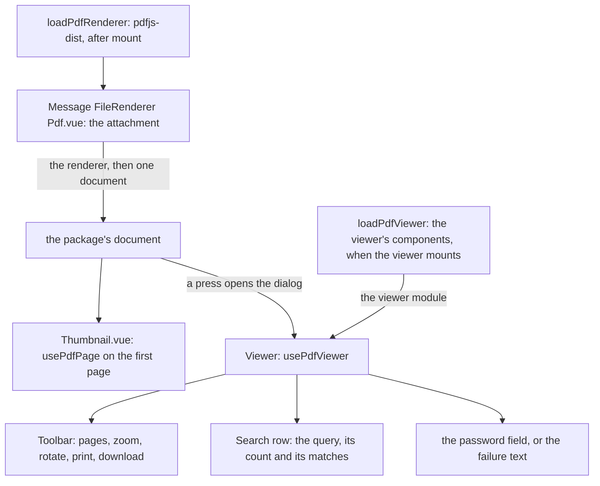

# PDF viewer

The app shows a PDF with its own look over the [vue-pdfjs-headless](../../vue-pdfjs-headless/README.md) package: a thumbnail of the first page in the message row, and a viewer for the whole document in a dialog on a click. A message's PDF attachment is their consumer ([file media](../../esbabbler/file-media/design.md)). The package owns the loading, the page drawing and the viewer's state; this page covers what the app supplies: the look, the controls and where each one lives.

## How it works

The app supplies the renderer, its worker and its folders, and the look. `loadPdfRenderer` imports `pdfjs-dist` after mount and names the worker the app loads by URL, which the package hands the renderer before each load. The viewer's components are a separate import that the viewer makes when it mounts. The character maps, the standard fonts and the image decoders sit at folders the server mounts from that same install, so the worker and the API cannot drift apart. The renderer then goes to the package, which the app never imports for its own work.

The attachment loads its document once with the package's `usePdfDocument`, and passes it to both views: the thumbnail, and the viewer in the dialog. The message's read link is minted again before it expires, and the attachment keeps the document it has loaded rather than loading it again from the new link, so an open viewer keeps its page, its zoom and the password it was given. A link that has loaded nothing yet is followed, so a load that failed on an expired link is tried again on the new one.

The thumbnail draws the first page with `usePdfPage` into its canvas. In a message it is a button, so a click, Enter or Space opens the dialog; in a preview it opens nothing, since the preview's own click opens its message.

The viewer mounts in the dialog over `usePdfViewer` on the app's container. Its controls are the app's, drawn with the UI library, and each one calls a function of the package. The toolbar, the search row, the sidebar, the watermark dialog and the page body are separate components under `apps/web/app/components/Pdf/Viewer/`, each with one responsibility, and they share the package's state object rather than a provided context. `Thumbnail.vue` is the message row's canvas, not part of the viewer.

## Surface

The viewer's root, `Pdf/Viewer/Index.vue`, draws a toolbar, a search row, the password field when the document asks for one, and the pages. The toolbar holds the sidebar toggle, the page and zoom controls and a More menu of the occasional commands; the sidebar lists the outline and the thumbnails; a watermark dialog asks the text of a download. Every control is built, so nothing on the surface waits (see `Not built`).

### The controls

| Control                           | What it does                                                                    | Where it is                                       |
| :-------------------------------- | :------------------------------------------------------------------------------ | :------------------------------------------------ |
| Previous page                     | Goes back a page                                                                | Toolbar, first                                    |
| Page field, with "of N" beside it | Holds the current page; Go goes to the number typed                             | Toolbar                                           |
| Go                                | Goes to the page typed in the field                                             | Toolbar, after the field                          |
| Next page                         | Goes forward a page                                                             | Toolbar                                           |
| Zoom out ("−")                    | Makes the pages smaller                                                         | Toolbar, a text button                            |
| Zoom in ("+")                     | Makes the pages larger; disabled at the largest scale                           | Toolbar, a text button                            |
| Fit width                         | Fits the pages to the width                                                     | Toolbar, a text button                            |
| Fit page                          | Fits a whole page in the view                                                   | Toolbar, a text button                            |
| Actual size                       | Shows the pages at their own size                                               | Toolbar, a text button                            |
| Rotate                            | Turns the pages                                                                 | Toolbar, a text button                            |
| Print                             | Prints the document, each page rendered to an image                             | Toolbar, a text button                            |
| Download                          | Saves the document under its file name                                          | Toolbar, last, an icon button                     |
| Search field                      | Holds the query                                                                 | Search row                                        |
| Match case, Whole word            | Set how a search matches                                                        | Search row, checkboxes                            |
| Previous match, Next match        | Step back and on through the matches                                            | Search row, icon buttons                          |
| Matches count                     | "current of total", or "No matches" when a query has none; a polite live region | Search row, after the buttons                     |
| Password field and Open           | Unlocks a protected document                                                    | Between the search row and the pages, while asked |

The viewer draws no zoom readout: the scale is not shown, and the two zoom buttons are text.

### Layout

The toolbar and the search row are flex rows that wrap onto further rows as the width narrows. The viewer has no breakpoint of its own. The dialog it sits in is `min(64rem, 96vw)` wide and expands with its own control, and takes the height the reader gives it, with the pages filling what is left.

### States

- **Error.** The document or the viewer's module failed: "The PDF could not be loaded." stands above the pages. A thumbnail whose document failed shows the same text in place of its canvas.
- **Password.** The password form stands above the pages while the document asks for one. A wrong password shows "The password is wrong." as the field's error.
- **No match.** The matches count reads "No matches".
- **No query.** The matches count is empty.

### Focus order

Tab moves in DOM order: the toolbar's controls, then the search row's, then the password form when it is asked, then the pages container.

### Accessibility

- **Every icon button has an accessible name** taken from its `label`, which is also its tooltip. The zoom buttons are named "Zoom out" and "Zoom in".
- **The toolbar is named** "PDF tools", and the search row is a search landmark.
- **Live text.** The matches count is a polite live region, so a change of match is read out.
- **The password field is labelled** "Password", and its wrong-password text is its error.

### Keyboard

The viewer adds no key handling of its own. Each control is a button or a field reached by Tab, and the Go button goes to the page typed.

## Not built

Nothing in the viewer's surface is unbuilt. The sidebar and its toggle, the More menu, rotation left and right, full screen, the download with a watermark and the zoom readout are all in `Pdf/Viewer/`, each with its tests. The change that designed them, the PDF viewer surface change, is archived under `openspec/changes/archive/`, and its decisions are kept under `Decisions` below.

## Decisions

The viewer's own decisions, its state, its overlay geometry, its scroll, its search and its print, are the package's, in its [design](../../vue-pdfjs-headless/viewer/design.md). The app's decision is the one below.

- **Highlight on load is the caller's option, with no caller yet.** The package's `usePdfViewer` takes `highlightTerms`, and the viewer's root forwards it from its own prop, which no caller passes. No place in the app opens a PDF from a search result with a query: a message search result shows its attachment as a preview, and a preview opens its message and not the viewer. So the option is exposed and passed by no one, which the Notes say.
- **The sidebar's choices are remembered in the browser.** Its open or closed state and its tab use the app's local storage keys, so a reader who keeps the thumbnails open sees them again. It starts closed at a phone's width and open otherwise, and overlays the pages at a phone's width.
- **Full screen is the whole viewer, not the scrolling pages.** The package's container is the scroll region, so full screen on it would hide the toolbar and the sidebar. The app takes full screen on the viewer's root with the browser's own composable, and the package keeps no fullscreen state.
- **The download with a watermark is a dialog, not a popover, because it asks for a value before it makes a file.** A popover would hide the pages it sits over.
- **Thumbnails turn with the pages.** A rail that stayed upright under a rotated page would show a different document from the one on screen.

## Key files

| File                                                         | Role                                                                                                                                                                                                                              |
| :----------------------------------------------------------- | :-------------------------------------------------------------------------------------------------------------------------------------------------------------------------------------------------------------------------------- |
| `apps/web/app/components/Message/Model/FileRenderer/Pdf.vue` | The attachment: loads the renderer and the document, then the thumbnail and the dialog holding the viewer                                                                                                                         |
| `apps/web/app/components/Pdf/Thumbnail.vue`                  | The message row's canvas over `usePdfPage`, with the failure text in place of the page                                                                                                                                            |
| `apps/web/app/components/Pdf/Viewer/Index.vue`               | The viewer's root: the package's state, the password, the failure, full screen, and the open state of the sidebar and the watermark dialog                                                                                        |
| `apps/web/app/components/Pdf/Viewer/Toolbar.vue`             | The primary bar: the sidebar toggle, the page and zoom controls, and the More menu of the occasional commands                                                                                                                     |
| `apps/web/app/components/Pdf/Viewer/SearchBar.vue`           | The search row: the field, the matches count and the match buttons                                                                                                                                                                |
| `apps/web/app/components/Pdf/Viewer/Sidebar.vue`             | The sidebar's Outline and Thumbnails tabs, the remembered tab, and the overlay at a phone's width                                                                                                                                 |
| `apps/web/app/components/Pdf/Viewer/Outline.vue`             | The outline's entries as a list, nested entries indented under their parent, and the loading and empty states                                                                                                                     |
| `apps/web/app/components/Pdf/Viewer/ThumbnailRail.vue`       | One card per page, drawn as it comes into view, turned with the pages and marked when current                                                                                                                                     |
| `apps/web/app/components/Pdf/Viewer/WatermarkDialog.vue`     | The text asked before a download with a watermark                                                                                                                                                                                 |
| `apps/web/app/composables/shared/useLazyLoad.ts`             | The mount-time load the renderer and the viewer's module both go through: the value kept, a failure logged and flagged for the failure text, and a load the component unmounts before it settles aborted with its outcome dropped |
| `apps/web/app/services/pdf/loadPdfRenderer.ts`               | `pdfjs-dist`, imported after mount, with the worker from the app's URL                                                                                                                                                            |
| `apps/web/app/services/pdf/loadPdfViewer.ts`                 | The viewer's components and stylesheet, imported when a viewer mounts                                                                                                                                                             |
| `apps/web/app/services/pdf/constants.ts`                     | The served folder paths the renderer's maps, fonts and decoders are read from                                                                                                                                                     |
| `apps/web/configuration/nitro.ts`                            | The renderer's maps, standard fonts and decoders, mounted from its install                                                                                                                                                        |
| `apps/web/configuration/security.ts`                         | `worker-src 'self'` for the renderer's worker, with no `data:` script source                                                                                                                                                      |
| `apps/web/configuration/vite.ts`                             | No pre-bundle entry for `pdfjs-dist` or its `web/pdf_viewer.mjs`: the dialog finds them mid-session, the trade [monorepo tooling](../monorepo-tooling/design.md) records                                                          |
| `packages/vue-pdfjs-headless/`                               | The loading, the page drawing and the viewer's state, see the [package](../../vue-pdfjs-headless/README.md)                                                                                                                       |

## Notes

- The `fullscreen` permissions grant in `apps/web/configuration/security.ts` is the call view's: its stage calls `requestFullscreen` on its own element. The viewer's full screen is the browser's own on its root (`Pdf/Viewer/Index.vue`), and leaving it on Escape is the browser's behaviour, which no app test pins.
- The package's `usePdfViewer` takes `highlightTerms`, and no caller passes it. Nothing in the app opens a viewer from a search with a query, so the option is the seam a later search result would pass through.
- Annotation editing and comments are the [PDF annotations change](../../vue-pdfjs-headless/annotations/design.md)'s, and are not on this surface.
