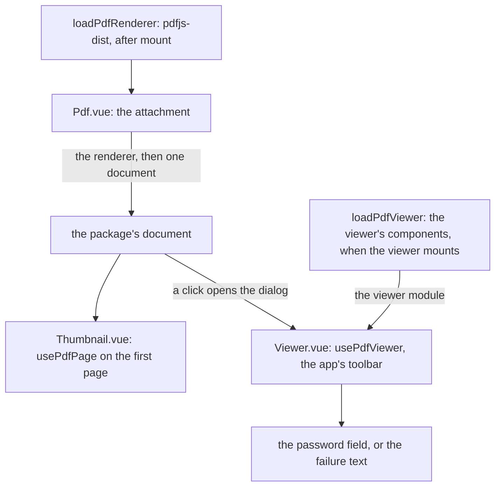

# PDF viewer

The app shows a PDF with its own look over the [vue-pdfjs-headless](../../vue-pdfjs-headless/README.md) package: a thumbnail of the first page in the message row, and a viewer for the whole document in a dialog on a click. A message's PDF attachment is their consumer ([file media](../../esbabbler/file-media/design.md)). The package owns the loading, the page drawing and the viewer's state; this page covers only what the app supplies.

## How it works

The app supplies the renderer, its worker and its folders, and the look. `loadPdfRenderer` imports `pdfjs-dist` after mount, and points the worker at the worker the app loads by URL. The viewer's components are a separate import that the viewer makes when it mounts. The character maps, the standard fonts and the image decoders sit at folders the server mounts from that same install, so the worker and the API cannot drift apart. The renderer then goes to the package, which the app never imports for its own work.

The attachment loads its document once with the package's `usePdfDocument`, and passes it to both views: the thumbnail, and the viewer in the dialog. Each view used to parse the file for itself.

The thumbnail draws the first page with `usePdfPage` into its canvas, and a click on it opens the dialog. The viewer mounts in the dialog over `usePdfViewer` on the app's container. Its toolbar is the app's own controls: page, zoom and fit, search with the match count, rotate, download and print. The password field is the app's, shown while the document asks for one, and a load that fails says so in place of the pages, whether the document failed or the viewer's own module never came.

## Decisions

- **Two wrappers become the renderer's components over one package.** The renderer's viewer components do the document's work: virtual scrolling, in-document search, the text layer and the tree a screen reader reads. The app's viewer is their state in a headless package, with the app's look over it. Rejected: keeping both wrappers, and a viewer of our own over the renderer's page drawing, which would rewrite the scrolling, the search and the text layer.
- **The package draws no chrome, so the app keeps the look.** The toolbar, the thumbnail's row and the password field are the app's, drawn with the UI library, so the keyboard and the labels are the library's and its menus open inside the dialog's top layer. Rejected: the renderer's own toolbar, whose menus portal to the body and so leave the dialog's top layer.
- **One document for both views.** The attachment owns the load, so the thumbnail and the dialog read the same document. A closed dialog keeps a password prompt until it is answered or the attachment unmounts, where the earlier viewer destroyed the load on close.
- **The renderer loads after mount.** `loadPdfRenderer` imports `pdfjs-dist` in the browser only, so nothing renders on the server and no module import runs at load. The viewer's components load only when a viewer mounts, so an attachment that is never opened loads no viewer code.
- **The renderer's data is served from its own install.** The character maps, the standard fonts and the image decoders' WebAssembly are Nitro public assets mounted from `pdfjs-dist`'s own folders, as the Temporal polyfill is mounted from its install, under base URLs named once as constants the loader reads too. They move with the renderer's version in the lockfile, so no committed copy is kept, and the control-character sweep needs no exclusion for one. Rejected: copying the folders in a build step, which is the committed copy again under another name.
- **The page itself is drawn as authored in either theme, and the chrome around it follows the app's.**
- **The dialog draws the controls an attachment's reader uses.** Download and print are the package's, and the toolbar's buttons call them. The thumbnail sidebar, bookmarks and fullscreen are built by the package and drawn by the dialog once an attachment needs them. Annotation editing and comments are the [PDF annotations change](../../../changes/vue-pdfjs-headless-annotations/design.md)'s.

## Key files

| File                                                         | Role                                                                                                           |
| :----------------------------------------------------------- | :------------------------------------------------------------------------------------------------------------- |
| `apps/web/app/components/Message/Model/FileRenderer/Pdf.vue` | The attachment: loads the renderer and the document, then the thumbnail and the dialog holding the viewer      |
| `apps/web/app/components/Pdf/Thumbnail.vue`                  | The row's canvas over `usePdfPage`, with the failure text in place of the page                                 |
| `apps/web/app/components/Pdf/Viewer.vue`                     | The pages' container and the app's toolbar over `usePdfViewer`, the password field, the viewer module on mount |
| `apps/web/app/services/pdf/loadPdfRenderer.ts`               | `pdfjs-dist`, imported after mount, with the worker from the app's URL                                         |
| `apps/web/app/services/pdf/loadPdfViewer.ts`                 | The viewer's components and stylesheet, imported when a viewer mounts                                          |
| `apps/web/app/services/pdf/constants.ts`                     | The served folder paths the renderer's maps, fonts and decoders are read from                                  |
| `apps/web/configuration/nitro.ts`                            | The renderer's maps, standard fonts and decoders, mounted from its install                                     |
| `apps/web/configuration/security.ts`                         | `worker-src 'self'` for the renderer's worker, with no `data:` script source                                   |
| `apps/web/configuration/vite.ts`                             | `pdfjs-dist/web/pdf_viewer.mjs` pre-bundled, since the dialog loads it mid-session                             |
| `packages/vue-pdfjs-headless/`                               | The loading, the page drawing and the viewer's state, see the [package](../../vue-pdfjs-headless/README.md)    |

## Notes

The `fullscreen` permissions grant stays in `apps/web/configuration/security.ts`, although the viewer has no fullscreen control: the call view's stage calls `requestFullscreen` on its own element, and that grant is its. The renderer's folders are served under `/pdfjs/character-maps/`, `/pdfjs/standard_fonts/` and `/pdfjs/wasm/`, the paths named once in `apps/web/app/services/pdf/constants.ts`.

## Sources

- [pdf.js](https://github.com/mozilla/pdf.js): the `web/pdf_viewer.mjs` components and the `getDocument` options.
- [vue-pdf-embed](https://github.com/hrynko/vue-pdf-embed), the thumbnail wrapper replaced.
- [@vue-pdf-viewer/viewer](https://www.npmjs.com/package/@vue-pdf-viewer/viewer), the full viewer replaced, read from its tracker and its documentation only.
