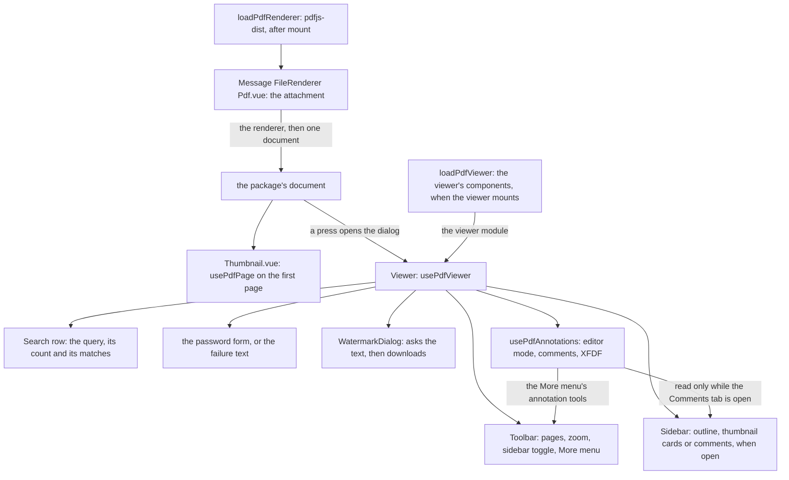

# PDF viewer

The app shows a PDF with its own look over the [vue-pdfjs-headless](../../vue-pdfjs-headless/README.md) package: a thumbnail of the first page in the message row, and a viewer for the whole document in a dialog on a click. A message's PDF attachment is their consumer ([file media](../../esbabbler/file-media/design.md)). The package owns the loading, the page drawing and the viewer's state; this page covers what the app supplies: the look, the controls and where each one lives.

## How it works

The app supplies the renderer, its worker and its folders, and the look. `loadPdfRenderer` imports `pdfjs-dist` after mount and names the worker the app loads by URL, which the package hands the renderer before each load. The viewer's components are a separate import that the viewer makes when it mounts. The character maps, the standard fonts and the image decoders sit at folders the server mounts from that same install, so the worker and the API cannot drift apart. The renderer then goes to the package, which the app never imports for its own work.

The attachment loads its document once with the package's `usePdfDocument`, and passes it to both views: the thumbnail, and the viewer in the dialog. The message's read link is minted again before it expires, and the attachment keeps the document it has loaded rather than loading it again from the new link, so an open viewer keeps its page, its zoom and the password it was given. A link that has loaded nothing yet is followed, so a load that failed on an expired link is tried again on the new one.

The thumbnail draws the first page with `usePdfPage` into its canvas. In a message it is a button, so a click, Enter or Space opens the dialog; in a preview it opens nothing, since the preview's own click opens its message.

The viewer mounts in the dialog over `usePdfViewer` on the app's container, and `usePdfAnnotations` reads the same state for the annotation tools and the comments. Its controls are the app's, drawn with the UI library, and each one calls a function of the package. The toolbar, the search row, the sidebar, the watermark dialog and the page body are separate components under `apps/web/app/components/Pdf/Viewer/`, each with one responsibility, and they share the package's state object rather than a provided context. `Thumbnail.vue` is the message row's canvas, not part of the viewer.

## Surface

The viewer draws a primary bar, a search row, the password form when the document asks for one, the sidebar when it is open, and the pages. The occasional commands sit in one More menu. Each visible control below has a task, a frequency and a reason it is where it is. A control that could not say how often it is used and why it is visible is not drawn.

### The controls

| Control                                                       | Task it serves                                                  | How often                             | Where it lives                           | Why there                                                                                                                                                                           |
| :------------------------------------------------------------ | :-------------------------------------------------------------- | :------------------------------------ | :--------------------------------------- | :---------------------------------------------------------------------------------------------------------------------------------------------------------------------------------- |
| Sidebar toggle (pressed while open)                           | Shows or hides the outline and the thumbnails                   | Every session                         | Primary bar, first                       | It is the only way to open the sidebar, and its pressed state says whether it is open, so it stays out of the menu, as a toggle does                                                |
| Previous page                                                 | Goes back a page                                                | Every session                         | Primary bar                              | Paging back is the most repeated move in a document                                                                                                                                 |
| Page field, with "of N" beside it                             | Goes to a page by number, and says where the reader is          | Every session                         | Primary bar                              | A number is typed here and Enter goes to it. "of N" is the page count, the one reading the reader needs to know how far is left                                                     |
| Next page                                                     | Goes forward a page                                             | Every session                         | Primary bar                              | As Previous page                                                                                                                                                                    |
| Zoom out                                                      | Makes the pages smaller                                         | Often                                 | Primary bar, beside the readout          | Zoom is a primary task, and the pair of zoom buttons with the readout between them reads as one control                                                                             |
| Zoom readout, a percentage, which resets to the opening scale | Shows the scale and returns it to the scale a document opens in | Sometimes, after zooming              | Primary bar, between the zoom buttons    | The readout is the reset, so no separate reset control is drawn; the opening scale is the state a document opens in, which the resize keeps                                         |
| Zoom in                                                       | Makes the pages larger                                          | Often                                 | Primary bar, beside the readout          | As Zoom out                                                                                                                                                                         |
| More (labelled "PDF actions")                                 | Opens every command that is not used in every session           | Every session as the door to the rest | Primary bar, last                        | One menu holds the occasional commands, so the bar draws one mark for them and not five buttons. The menu's groups keep the search settings, the view and the file apart            |
| Search field                                                  | Finds text in the document                                      | Every search                          | Search row, under the primary bar        | Its own row, so the field is never pushed out by the navigation, and it is the one place a query is typed                                                                           |
| Matches count, "2 of 5" or "No matches"                       | Says how many matches there are                                 | Every search                          | Search row, after the field              | It is read beside the field it counts for, and is a live region so a screen reader hears each change                                                                                |
| Previous match                                                | Steps back to the match before                                  | Every search                          | Search row                               | A step through matches is what a search is for; Enter takes the next one, and this button takes the previous one                                                                    |
| Next match                                                    | Steps on to the next match                                      | Every search                          | Search row                               | As Previous match                                                                                                                                                                   |
| Match case (menu item, marked while on)                       | Makes a search respect capitals                                 | Sometimes                             | More menu, first group                   | A setting of a search, changed rarely, so it does not take a place in the row beside the field it changes                                                                           |
| Whole word (menu item, marked while on)                       | Finds a word and not part of a longer one                       | Sometimes                             | More menu, first group                   | As Match case                                                                                                                                                                       |
| Rotate left                                                   | Turns the pages a quarter turn counter-clockwise                | Sometimes                             | More menu, second group                  | Rotation is for a scan that was put in sideways, which is occasional; left and right are two items so each is a single choice                                                       |
| Rotate right                                                  | Turns the pages a quarter turn clockwise                        | Sometimes                             | More menu, second group                  | As Rotate left                                                                                                                                                                      |
| Fit page                                                      | Fits a whole page in the view                                   | Rarely                                | More menu, second group                  | Reading a full page is occasional, and the width is the default fit, so the page fit waits in the menu                                                                              |
| Actual size                                                   | Shows the page at its own size                                  | Rarely                                | More menu, second group                  | Used to check a print's scale; it is kept, and rarely needs a place on the bar                                                                                                      |
| Print                                                         | Prints every page, one to a sheet                               | Sometimes                             | More menu, fourth group                  | A command that leaves the app, used when needed and not while reading                                                                                                               |
| Download                                                      | Saves the document under its name                               | Sometimes                             | More menu, fourth group                  | Saving is a file action, which sits with print; a download button on the bar would repeat it                                                                                        |
| Download with watermark                                       | Saves a copy with a text stamped on each page                   | Rarely                                | More menu, fourth group, then its dialog | A marked copy is a different file from the reader's own download, so it is named in the menu rather than as a second download button                                                |
| Watermark dialog: text field, Cancel, Download                | Asks the text before the file is made                           | Rarely, as the step of the above      | A dialog over the viewer                 | The text is one value asked before one file is made. A popover would hide the pages it sits over; the dialog is the owner's ruling, and its Download is the dialog's confirm action |
| Add text (menu item, marked while on)                         | Lets the reader type a free text onto a page                    | Sometimes                             | More menu, third group                   | It changes what a click on a page does, so it is a mode the menu marks while on; a button on the bar would spend its width on a command most sessions never use                     |
| Import annotations                                            | Reads the free texts of an XFDF file onto the document          | Rarely                                | More menu, third group                   | It takes a file the reader already holds, so it is occasional; a refused file is named in an alert                                                                                  |
| Export annotations                                            | Saves the document's free texts as an XFDF file                 | Rarely                                | More menu, third group                   | The file it writes is the one Import annotations reads, so the pair sits together, and a button on the bar would repeat the file group                                              |
| Sidebar tabs, Outline, Thumbnails and Comments                | Chooses what the sidebar lists                                  | Sometimes                             | Sidebar header                           | A choice between views of one thing is a set of tabs, drawn as the library draws them; Comments is the third view, beside the outline and the thumbnails                            |     |
| Outline entries                                               | Goes to a section of the document                               | Sometimes                             | Sidebar, Outline tab                     | The document's own table of contents; each entry is a row that goes somewhere, so it is a row of the list                                                                           |
| Thumbnail cards                                               | Goes to a page by sight                                         | Sometimes                             | Sidebar, Thumbnails tab                  | Each card is a whole page the reader chooses, so it is a card and not a row, and the page in view is marked                                                                         |
| Comment entries                                               | Goes to the page a comment is on                                | Sometimes                             | Sidebar, Comments tab                    | Each comment is a row that goes somewhere, named by its page and its text, so it is a row of the list and not a control of its own                                                  |
| Password field and Open                                       | Unlocks a protected document                                    | When the document asks                | Between the search row and the pages     | It must come before any page, so it stands above them while it is asked                                                                                                             |

### Layout at desktop width

From `md` the sidebar is a column of 14rem at the start of the row, beside the pages. The viewer is the dialog's full width, `min(64rem, 96vw)`, which the dialog expands with its own control. The primary bar is one row: the sidebar toggle and the page controls at the start, the zoom controls in the middle, and More at the end. The search row sits under it at full width. Nothing wraps; the page count is the one control that gives way first, below `sm`.

### Layout at phone width

Below `md` the sidebar is an overlay on the start edge of the pages, at most 18rem wide and 85% of the viewer, and it is closed unless the reader opens it. Below `sm` the page count is hidden, and the bar keeps its controls in one row within the dialog's width: the sidebar toggle, the page controls, the zoom controls and the readout, and More at the end. The search row stays under the bar at full width, the field taking the space left after the count and the two match buttons. The zoom controls stay visible at every width: they are primary, and a breakpoint does not move a primary control into the menu.

The sidebar's overlay has no close control of its own. The sidebar toggle, which stays on the bar, is its close, and choosing a page from the sidebar closes it too, so the overlay never covers the control that closes it.

### States

- **Loading.** The viewer's module or the document is still arriving: a spinner stands over the pages, and the page controls are disabled until a document opens. The zoom readout is disabled with no document.
- **Empty outline.** The Outline tab says "This PDF has no outline". An outline still being read shows three placeholder rows instead, so the two are told apart.
- **No thumbnails yet.** A card whose page has not been drawn shows a blank canvas with its page number, and the page is drawn once its card comes into view.
- **Error.** The document or the viewer's module failed: "The PDF could not be loaded." stands above the pages, which are not drawn, and the sidebar is hidden.
- **Password.** The password form stands above the pages while the document asks for one, and a wrong password shows "The password is wrong." as the field's error.
- **Rotated.** Every page and every thumbnail turns with the rotation. The rotation belongs to the viewer and is not remembered between viewers.
- **No match.** The matches count reads "No matches" and the match buttons are disabled.
- **No query.** The matches count is empty.
- **Loading comments.** The Comments tab shows three placeholder rows until its comments are read.
- **No comments.** The Comments tab says "This PDF has no comments".
- **Refused import.** A file the document refuses leaves the document as it was, and an error alert names the file and the reason.
- **No document.** Add text, Import annotations and Export annotations are disabled, as the page controls are.

### Focus order

Tab moves in this order: the sidebar toggle, Previous page, the page field, Next page, Zoom out, the zoom readout, Zoom in and More; then the search field, Previous match and Next match; then the password form when it is asked; then the sidebar when it is open, its tabs first, Outline, Thumbnails and Comments, and then the outline entries, the thumbnail cards or the comments; then the pages. A menu opens with its first item focused, as the library's menus do. Its items follow its groups in order: the search settings, the view, the annotation tools, then the file.

## Keyboard model

- **Enter in the page field** goes to the page typed. **Enter in the search field** goes to the next match, and Previous match goes back.
- **Enter or Space on a thumbnail card** chooses it, as a button does. An outline entry is a list row, so the arrow keys move between entries and Enter chooses one, as the library's lists do. A comment is a list row too, so it is chosen the same way.
- **Escape** closes an open menu or dialog first.
- **No shortcut of the viewer's own.** The viewer adds no key handling; every control is reached by Tab.

## Narrow screens

A phone's width is below `md`, and the page count yields below `sm`, as the layout sets out. The breakpoints are the app's, read through its display composable; no component is written for a device. A control moves into the More menu only where it is occasional, so no primary control changes place between widths. The annotation tools add nothing to the primary bar: they are menu items and a sidebar tab, which both exist at every width.

## Accessibility

- **Every control has an accessible name.** Each icon button takes its name from its `label`, which is also its tooltip. The zoom readout is named with its percentage, "Zoom 125%, reset", and before a document sets a scale it is named "Reset zoom".
- **Toggles say whether they are on.** The sidebar toggle is pressed while open. Match case, Whole word and Add text are marked menu items, so a screen reader hears each one's state.
- **The menu is a menu.** Its trigger is named "PDF actions"; its items are menu items, and the marked ones are checkable. The annotation tools are menu items named "Add text", "Import annotations" and "Export annotations".
- **Regions and lists name what they hold.** The toolbar is named "PDF tools" and the search row is a search landmark. The sidebar's tabs are named "Sidebar", the outline is named "Outline", and each thumbnail card is a button named by its page, with `aria-current` on the card of the page in view. The Comments tab and its list are named "Comments", and each comment row is named by its page and text.
- **Live text.** The matches count is a polite live region, so a change of match is read out.
- **Focus is visible.** Every control takes the library's focus ring.
- **The watermark dialog's field has a label**, "Watermark text", and its Download is disabled while the field is empty, so the reason is visible in the disabled state.
- **The password field is labelled** "Password", and its wrong-password text is its error.

## Decisions

The viewer's own decisions, its state, its overlay geometry, its scroll, its search and its print, are the package's, in its [design](../../vue-pdfjs-headless/viewer/design.md). The app's decisions are these.

- **Highlight on load is the caller's option, with no caller yet.** The package's `usePdfViewer` takes `highlightTerms`, and `Viewer/Index.vue` passes it on. No place in the app opens a PDF from a search result with a query: a message search result shows its attachment as a preview, and a preview opens its message and not the viewer. So the option is exposed and passed by no one, which the Notes say.
- **The sidebar's choices are remembered in the browser.** The open or closed state and the tab use the app's local storage keys, so a reader who keeps the thumbnails open sees them again. The sidebar starts closed at a phone's width and open otherwise, until the reader has chosen.
- **The dialog's expand is the viewer's full screen.** The viewer is hosted only by a dialog that expands over the screen, which keeps the toolbar and the sidebar in view, so the viewer's menu has no Full screen item of its own and the viewer does not call the browser's full screen API.
- **The download with a watermark is a dialog, not a popover, because it asks for a value before it makes a file.** The owner's ruling names it a small dialog.
- **An outline entry with no destination is text.** A URI entry has nothing in the document for the reader to follow, and its address is never followed, since an outline address can be a script. Its entries are drawn as text rows in the order of the outline, so the outline is cut into one list per run of entries with a destination and text rows between them; arrow keys stop at each run, and the lists share the label "Outline".
- **The thumbnail rail is the app's to draw.** The sidebar's card list is a component of the app, so its look follows the app's surfaces, while the package's composable supplies which cards are drawn at a time.
- **Thumbnails turn with the pages.** A rail that stayed upright under a rotated page would show a different document from the one on screen.
- **The bar holds only what every session uses.** Rotate, Print and Download sit in the More menu, so the bar draws no icon for them. Rejected: an icon on the bar for each occasional command, which spends the bar's width on commands most sessions never use.
- **Search settings are marked menu items, not checkboxes beside the field.** Match case and Whole word are the menu's first group, and each is marked while on. Rejected: a checkbox pair in the search row, which takes a row's width at a phone's width.
- **The annotation tools are a group of their own in the menu.** Add text, Import annotations and Export annotations sit before the file group. Adding text changes what a click on a page does, so it is a mode the menu marks while on. Rejected: a button on the bar for each tool, which spends the bar's width on commands most sessions never use.
- **Comments are listed, not added.** The viewer offers no add-comment control, because the renderer's save drops text annotations and a comment added would not reach the download. The [annotations design](../../vue-pdfjs-headless/annotations/design.md) states why.
- **The Comments tab decides whether the comments are read.** The dialog holds the sidebar's tab, so opening the tab is what asks for the comments, and a document nobody reads comments of reads none.
- **A refused import is an alert, not a dialog.** The alert names the file and the reason, since the reader has nothing else in the viewer to act on, and the document is left as it was.
- **Export names the file after the document.** It takes the document's name without its `.pdf` extension, and is saved through the same download the Download item uses.

## Key files

| File                                                         | Role                                                                                                                                                                                                                              |
| :----------------------------------------------------------- | :-------------------------------------------------------------------------------------------------------------------------------------------------------------------------------------------------------------------------------- |
| `apps/web/app/components/Message/Model/FileRenderer/Pdf.vue` | The attachment: loads the renderer and the document, then the thumbnail and the dialog holding the viewer                                                                                                                         |
| `apps/web/app/components/Pdf/Thumbnail.vue`                  | The message row's canvas over `usePdfPage`, with the failure text in place of the page                                                                                                                                            |
| `apps/web/app/components/Pdf/Viewer/Index.vue`               | The viewer's root: the package's state and annotations, the password, the failure, the open state of the sidebar and the watermark dialog, and the sidebar's tab, which decides whether the comments are read                     |
| `apps/web/app/components/Pdf/Viewer/Toolbar.vue`             | The primary bar: the sidebar toggle, the page and zoom controls, and the More menu of the search settings, the view, the annotation tools and the file commands                                                                   |
| `apps/web/app/components/Pdf/Viewer/SearchBar.vue`           | The search row: the field, the matches count and the match buttons                                                                                                                                                                |
| `apps/web/app/components/Pdf/Viewer/Sidebar.vue`             | The sidebar's Outline, Thumbnails and Comments tabs, and the overlay at a phone's width                                                                                                                                           |
| `apps/web/app/components/Pdf/Viewer/Outline.vue`             | The outline's entries as a list, nested entries indented under their parent, and the loading and empty states                                                                                                                     |
| `apps/web/app/components/Pdf/Viewer/Comments.vue`            | The document's comments as a list, each named by its page and text, with the loading and empty states                                                                                                                             |
| `apps/web/app/components/Pdf/Viewer/SidebarListSkeleton.vue` | The three rows a sidebar list draws while its first read is pending, shared by the outline and the comments                                                                                                                       |
| `apps/web/app/components/Pdf/Viewer/ThumbnailRail.vue`       | One card per page, drawn as it comes into view, turned with the pages and marked when current                                                                                                                                     |
| `apps/web/app/components/Pdf/Viewer/WatermarkDialog.vue`     | The text asked before a download with a watermark                                                                                                                                                                                 |
| `apps/web/app/services/pdf/flattenOutline.ts`                | The outline's entries flattened into the rows the sidebar lists, each keyed by its position in the tree                                                                                                                           |
| `apps/web/app/composables/shared/useLazyLoad.ts`             | The mount-time load the renderer and the viewer's module both go through: the value kept, a failure logged and flagged for the failure text, and a load the component unmounts before it settles aborted with its outcome dropped |
| `apps/web/app/services/pdf/loadPdfRenderer.ts`               | `pdfjs-dist`, imported after mount, with the worker from the app's URL                                                                                                                                                            |
| `apps/web/app/services/pdf/loadPdfViewer.ts`                 | The viewer's components and stylesheet, imported when a viewer mounts                                                                                                                                                             |
| `apps/web/app/services/pdf/constants.ts`                     | The served folder paths the renderer's maps, fonts and decoders are read from                                                                                                                                                     |
| `apps/web/configuration/nitro.ts`                            | The renderer's maps, standard fonts and decoders, mounted from its install                                                                                                                                                        |
| `apps/web/configuration/security.ts`                         | `worker-src 'self'` for the renderer's worker, with no `data:` script source                                                                                                                                                      |
| `apps/web/configuration/vite.ts`                             | No pre-bundle entry for `pdfjs-dist` or its `web/pdf_viewer.mjs`: the dialog finds them mid-session, the trade [monorepo tooling](../monorepo-tooling/design.md) records                                                          |
| `packages/vue-pdfjs-headless/`                               | The loading, the page drawing and the viewer's state, see the [package](../../vue-pdfjs-headless/README.md)                                                                                                                       |

## Notes

- The `fullscreen` permissions grant in `apps/web/configuration/security.ts` is written for the call view's stage, which requests full screen on its own element. The viewer does not request full screen, so the grant covers the call view alone.
- The package's `usePdfViewer` takes `highlightTerms`, and no caller passes it. Nothing in the app opens a viewer from a search with a query, so the option is the seam a later search result would pass through.

## Sources

- [pdf.js viewer](https://github.com/mozilla/pdf.js/blob/master/web/pdf_viewer.js): its sidebar's Outline and Thumbnails tabs and its find bar's options menu are the reference for the surface above, departed from where the controls table and the Decisions say so.
- [@vue-pdf-viewer](https://www.npmjs.com/package/@vue-pdf-viewer/viewer), read from its tracker and its documentation only.
