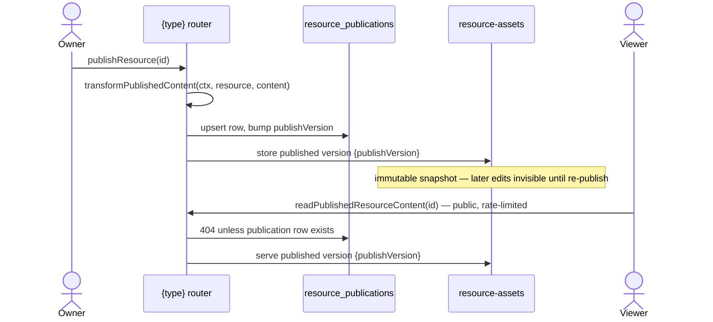

# Publishing

The **Publishable capability** ([resources](../resource/design.md)): the standard for making a resource publicly shareable — a versioned publish copy plus a public, rate-limited, read-only route. Whenever a product needs "share this with people who aren't logged in", it opts into this capability — never ad-hoc public reads of working data.

A type opts in by declaring `publishable: true` in `ResourceDefinitionMap` ([layer model](../layer-model/design.md#capabilities)); the derived `PublishableResourceType` union then _requires_ it to provide a view component and _grants_ it the publish procedures — a non-publishable type has no publish endpoints at the type level.

## How it works

Publish state lives in its own `resource_publications` table ([resources](../resource/design.md)) — a row exists iff the resource is currently published. This keeps publish attributes off resources that can't publish.

- **Publish = snapshot copy.** `publishResource` upserts the `resource_publications` row (bumping `publishVersion` in SQL), then stores the content as a published version — a row and a content-addressed object ([resource version store](../../resource/resource-version-store/design.md)). The version's files are not copied: its reference rows name the files its content embeds, and those are the working copy's own files, addressed by content ([content-addressed assets](../../resource/content-addressed-assets/design.md)). Edits after publish are invisible until re-publish — that is the feature (a stable public artifact), not a limitation.
- **Public reads serve only the publish copy**, never the working copy, and are rate-limited with no auth. A resource with no publication row 404s publicly.
- **Unpublish** removes the publication row and the published versions, releasing the files they named; the public URL 404s. A file the working copy or a revision still names stays.

## Procedures

| Procedure                      | Auth                 | Purpose                                                          |
| ------------------------------ | -------------------- | ---------------------------------------------------------------- |
| `publishResource`              | owner                | upsert publication + snapshot copy → `ResourcePublication`       |
| `unpublishResource`            | owner                | delete publication row + published versions, release their files |
| `readResourcePublication`      | owner                | current publish state (for editor UI), or undefined              |
| `readPublishedResourceContent` | public, rate-limited | serve the publish copy                                           |
| `readPublishedVersionContent`  | owner                | serve a **retained** snapshot by version number                  |
| `readResourceViewCount`        | owner                | total public views of the resource                               |

Publish state is also carried by the cross-type `resource.readResource`, whose `publication` field is the row or `null` — `resource_publications` is one table for every type, so the generic read resolves it whatever the resource turns out to be, and the ownership a separate publication read would resolve is the ownership that request already resolved. `null` is the answer "not published" rather than a missing one, so a surface opening a resource learns its publish state from that one response instead of following it with a second round trip. `readResourcePublication` remains the targeted re-read for a caller that wants publish state on its own.

`readPublishedVersionContent` is what the view route's `version` query param reads — `useReadPublishedResourceContent` reads the param itself and takes the versioned read as a required argument, so no type's view can serve the latest publish under a url naming another version: a url with no valid `version` param gets the latest publish from the public procedure, a url with one reads through the owner-only procedure — so an anonymous visitor handed a versioned url is refused rather than shown the latest — and the owner can open any published version whose row an unpublish has not removed ([resource snapshots](../../resource/resource-snapshots/design.md)).

One hook on `createResourceProcedures` supports publishing needs:

- `transformPublishedContent(ctx, resource, content)` — transform content at publish time with the **owner's** authority. It runs **before** the transaction that claims `publishVersion`, and must stay there: a hook may read through `ctx.db` (Dashboard resolves every bound dataset), and issuing that read while the connection holds an open transaction deadlocks. Dashboard resolves every bound visual and bakes the result, cut to the columns its query reads, into `VisualDatasetBinding.snapshot` (public viewers render the static snapshot, never resolve references — live viewer data stays [deferred](../../../deferred/resource/realtime-dataset-refresh/design.md)). Email's transform keeps its guard, which rejects publishing without compiled MJML html, and strips the owner-only `datasetReference` so the snapshot can never leak it. Survey and Webpage declare no transform: their content is published as it is, with its asset urls unchanged ([resource file assets](../../resource/resource-file-assets/design.md)).

The version and its reference rows are written inside the transaction that claims `publishVersion`. A reference row is written only for a file that exists at that moment, so a publish either names live files or fails. No file is written outside the transaction, so there is no separate repair step: the published page's images are kept by the reference rows the transaction committed with the version.

The read half of the same boundary is not a hook here at all: a type declares what stays live inside a frozen snapshot, and one shared reconstitution reapplies it on every path that reads one back ([resource snapshots](../../resource/resource-snapshots/design.md)). Only Survey declares anything, merging its live collection settings over the immutable snapshot. Asset urls need no read-time rewriting — content embeds stable app urls that never expire, served through `/api/resource-assets`.

## Route

One dynamic public page, `pages/view/[type]/[id].vue`, dispatches through `ViewComponentMap: Record<PublishableResourceType, Component>` — a missing renderer is a compile error. The survey respondent experience is simply Survey's published view (an interactive renderer that writes responses); Email and Webpage serve their save-time captured HTML through a sandboxed iframe, and Flowchart a read-only VueFlow render. The OG title is set by `useReadPublishedResourceContent` — the shared fetch-or-404 every view reads through — off the resource name it just read, so a published URL unfurls when shared and no view restates the derivation. The rest of the unfurl is resolved per route by `@nuxtjs/seo`. A published URL is the share unit everywhere: paste it in an esbabbler message, a post, or externally.

## Key files

| File                                                                       | Role                                             |
| -------------------------------------------------------------------------- | ------------------------------------------------ |
| `packages/db-schema/src/schema/resource/resourcePublicationsInResource.ts` | publish state table                              |
| `apps/web/server/trpc/procedure/resource/createResourceProcedures.ts`      | publish procedures + transform hook              |
| `apps/web/app/pages/view/[type]/[id].vue`                                  | public view route                                |
| `apps/web/app/composables/resource/useReadPublishedResourceContent.ts`     | shared view read — fetch-or-404 plus the og meta |
| `apps/web/app/services/resource/ViewComponentMap.ts`                       | `PublishableResourceType` → view page component  |

</content>
