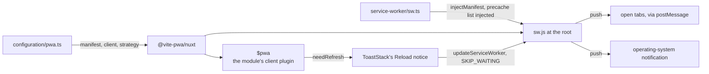

# PWA

The web app is installable, its service worker is one TypeScript file built into the app, and a new version waits for its reader. The behaviour is in [the spec](spec.md); this page is how it is built and why.

## How it works

`configuration/pwa.ts` sets the manifest, the client and the strategy. `@vite-pwa/nuxt` builds `service-worker/sw.ts` with [Workbox](https://developer.chrome.com/docs/workbox) through its `injectManifest` strategy, which injects the precache list into `self.__WB_MANIFEST`. The module's client plugin registers the worker and provides `$pwa`, whose `needRefresh` and `updateServiceWorker` drive the Reload notice.

**The reader decides when an update lands.** `registerType` is `"prompt"`. A worker that installs during a call or while text is unsent waits, and the notice in `ToastStack` lets the reader accept it. The worker answers the `SKIP_WAITING` message the notice sends, and the page reloads once the new worker takes control.

**Push lives in the worker.** `sw.ts` handles `push` and `notificationclick`. The payload is the `PushNotificationPayload` type from `@esposter/db-schema`, which the server writes through `getPushNotificationPayload` and the tab parses in `pushNotification.client.ts`. The worker imports the type only, so nothing from it reaches the bundle.

## Key files

| File                                                                    | Role                                                                          |
| ----------------------------------------------------------------------- | ----------------------------------------------------------------------------- |
| `apps/web/configuration/pwa.ts`                                         | The manifest, the client options, the strategy and the update policy          |
| `apps/web/configuration/pwa.test.ts`                                    | Every manifest icon exists in the public folder                               |
| `apps/web/service-worker/sw.ts`                                         | The worker: precache, offline navigation, `SKIP_WAITING`, push and click      |
| `apps/web/service-worker/tsconfig.json`                                 | The worker's typecheck, extending the shared Node base with the WebWorker lib |
| `oxlint.config.ts`                                                      | The `service-worker/**` override: no runtime import of a workspace library    |
| `apps/web/app/components/App/ToastStack.vue`                            | The Reload notice that shows a waiting update                                 |
| `apps/web/app/plugins/pushNotification.client.ts`                       | The tab's end of the worker's `postMessage`                                   |
| `apps/web/public/pwa/`                                                  | The manifest and Apple icons, each named by its path in `pwa.ts`              |
| `packages/db-schema/src/models/notification/PushNotificationPayload.ts` | The payload type both ends read                                               |

## Notes

- **Rejected: `registerType: "autoUpdate"`.** It skips waiting and reloads every open tab on install, which would end a call or drop unsent text. The notice keeps the reader in charge of the moment.
- **Rejected: `generateSW` with an `importScripts` push file.** The push handler was a separate JavaScript file the build could not check. The `injectManifest` worker is typed and checked with the app.
- **Declined: screenshots and shortcuts in the manifest.** Screenshots need captures of the real app, which this repo does not produce. Shortcuts add icons and an install surface nobody asked for.
- **Declined: a custom install prompt.** The browser's own install affordance is the one the reader already knows.
- **The worker imports no app package at runtime.** Its scope has no `window` and no `process`, and a library's top level can read either as it loads, which fails the worker's evaluation and leaves it unregistered. An oxlint override on `service-worker/**` bans the import, types stay allowed, and the bundle stays Workbox and the worker's own code. The `SKIP_WAITING` handler hands `skipWaiting()` to `event.waitUntil`, so the browser holds the worker open until it settles, and it needs no fire-and-forget helper from a package.
- **Orientation is unlocked.** The app has landscape surfaces, the Genshin world and the call stage, which a portrait lock would block on installed Android copies.
- **Maskable icons are drawn, not padded.** The mark sits at 70% scale on the light background, inside the safe zone, so no launcher's mask crops it. The `any` icons keep the unpadded artwork.
- **The offline home entry has no revision.** The `/` entry in the precache list carries `revision: null`, so each new worker fetches it at install rather than trusting a cached copy.
- The worker extends `packages/configuration/tsconfig.node.json`, which loads the shared `global.d.ts` (its `Object.groupBy` overload). Replacing `include` in the worker's config drops that file and breaks the typecheck of the server-side packages the payload type reaches.
