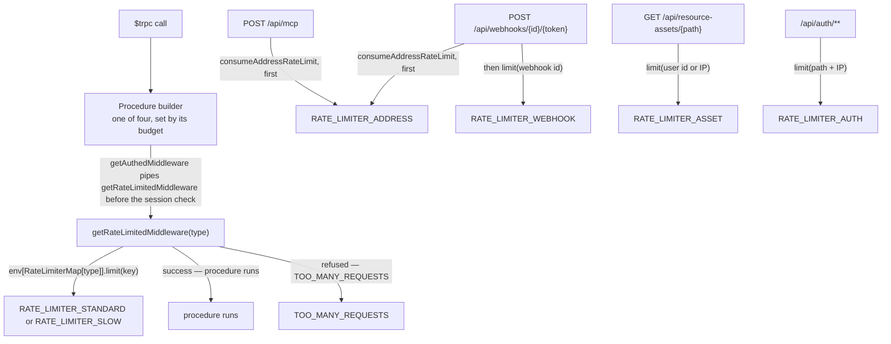

# Rate Limiting

When a feature page calls a procedure "rate-limited", this is the mechanism it means. Every budget in the app is a **Workers Rate Limiting binding** declared in the web Worker's wrangler configuration (`apps/web/configuration/wrangler.ts`). A binding is one counter namespace with one limit and one period, and a call is `env.<BINDING>.limit({ key })`, which resolves to `{ success }`: whether the key is still within its budget for the window. A binding is served by the platform, so no database row or process memory is written by a budget.

A binding's counts are kept per key, per namespace, and per Cloudflare location, and they are approximate: a location checks a locally cached count that is synchronised in the background, so a key can briefly exceed its budget and a key can be granted separately in two locations. The budgets are a brake on abuse, not a hard security boundary.

## The limiters

Every binding names its limit in `RateLimiterPointsMap` and its namespace in `RateLimiterNamespaceIdMap`, both in `@esposter/db-schema`, and the window is `RATE_LIMITER_DURATION_SECONDS` (one minute), the period every binding uses. A binding's name is its `RateLimiterBinding`.

| Binding                 | Points per minute | Keyed on                        | Guards                                             |
| ----------------------- | ----------------- | ------------------------------- | -------------------------------------------------- |
| `RATE_LIMITER_STANDARD` | 1000              | user id, else path + IP address | ordinary tRPC procedures                           |
| `RATE_LIMITER_SLOW`     | 100               | user id, else path + IP address | expensive or abuse-prone tRPC procedures           |
| `RATE_LIMITER_WEBHOOK`  | 30                | the webhook's id                | the inbound webhook push route                     |
| `RATE_LIMITER_ASSET`    | 10 000            | user id, else IP address        | the resource-asset redirect route                  |
| `RATE_LIMITER_ADDRESS`  | 10 000            | IP address                      | the webhook push route and the MCP endpoint, first |
| `RATE_LIMITER_AUTH`     | 1000              | endpoint path + IP address      | the better-auth endpoints under `/api/auth`        |

Each binding has its own namespace, and that is what keeps a budget independent. Counts are kept per key within a namespace, and the keys are not prefixed, so two limiters on one binding would spend each other's points: a signed-in caller's user id is the key of both the standard and the asset budget. `RATE_LIMITER_ASSET` and `RATE_LIMITER_ADDRESS` share a budget size and both key an anonymous caller on an IP address, which is why they are two bindings. `RATE_LIMITER_STANDARD` and `RATE_LIMITER_AUTH` share a budget size, and keep separate counts because better-auth's counts were never the procedures'. `RateLimiterBinding` is the one list of them, and a limiter cannot be added without a name, points and a namespace in each environment: the maps are typed `satisfies Record<RateLimiterBinding, …>`.

The asset and address bindings are the two with the largest budgets, and a burst is allowed to recover on its own within the minute rather than locking out an address. A binding has no lockout period: once a key is refused, it is granted again when its window has moved on.

## Enforcement

`server/trpc/middleware/getRateLimitedMiddleware.ts` is the whole tRPC enforcement path. It resolves the session first, then asks the binding: on the user id when a session exists, and otherwise on `` `${path}${ID_SEPARATOR}${ipAddress}` `` so an anonymous caller is budgeted per procedure per address rather than globally. A refusal throws `TOO_MANY_REQUESTS`. Outside production the middleware short-circuits after resolving the session. In production the bypass is narrower than it looks: only an **anonymous** request whose IP address cannot be determined is warned about and allowed through, because that is the one case with no key to spend a point against — a signed-in caller is keyed on its user id and is budgeted regardless. The address is the rightmost `X-Forwarded-For` entry, the one the front end appended, with any port dropped — every entry left of it is whatever the caller sent, and keying on one would let a caller mint a fresh budget per request. `getIpAddress` falls back to the socket's remote address, so the header being absent is not by itself enough to reach the bypass.

Because the middleware already resolved the session, `getAuthedMiddleware.ts` simply pipes it and then rejects when there is no session. Authentication and rate limiting are therefore a single middleware in one order: **a caller is charged before it is told it is unauthorized**, which is what stops an unauthenticated attacker from probing authed procedures for free.

A route that answers before it knows its caller spends the address budget through `consumeAddressRateLimit`, which applies the same production gate and the same bypass, so the rule is written once rather than per route. It resolves to whether the request may proceed.

Four procedure builders sit on top: `standardRateLimitedProcedure` (public, standard budget), `slowRateLimitedProcedure` (public, the tighter budget), `standardAuthedProcedure`, and `slowAuthedProcedure`. `AuthedProcedureMap.ts` maps the enum onto the latter two, and the room procedure builder `getPermissionsProcedure`, described in [RBAC](../../esbabbler/rbac/design.md), takes a `rateLimiterType` parameter defaulting to `Standard` and selects through it, so moving a room procedure onto the slow budget is a one-argument change at its declaration.

## Refusals

A binding answers only whether a key is within its budget, so a refusal is the whole answer. The Worker does not learn the points left or the time to the reset, and no `Retry-After` or `X-RateLimit-*` header is written. The earlier mechanism wrote them; no caller in the app read them.

A route answers a refusal with its own 429 (`/api/webhooks/{id}/{token}`, `/api/mcp`, `/api/resource-assets/{path}`, and the auth route), and a procedure with `TOO_MANY_REQUESTS`. A failure of the binding itself is not a refusal: `limit()` rejects, and the caller's error branch answers it.

## better-auth

`server/auth.ts` turns better-auth's own limiter off (`rateLimit: { enabled: false }`). Its default storage without secondary storage is the memory of the isolate that serves a request, which no other isolate shares, so it budgeted nothing across the Worker's instances. `server/api/auth/[...].ts` budgets the auth endpoints instead, through `RATE_LIMITER_AUTH`, keyed on the endpoint's path and the address as an anonymous procedure is.

The API key plugin keeps its own per-key budget (`server/services/auth/apiKeyPlugin.ts`), sized from the standard points and window. It is better-auth's, its counts are kept in the key's row through the adapter, and it answers a different question from the user budgets: a key's calls, not a user's. It is the one limiter in the app that is not a binding, and whether it moves onto one is an open question for the owner.

## Notes

- `nuxt-security-module` ships a rate limiter and it is explicitly turned off (`rateLimiter: false`) — see [security posture](../security-posture/design.md).

## Key files

Paths relative to `apps/web`; `packages/` ones to the repo root.

| File                                                                      | Role                                                       |
| ------------------------------------------------------------------------- | ---------------------------------------------------------- |
| `packages/db-schema/src/models/cloudflare/RateLimiterBinding.ts`          | the binding names, one per limiter                         |
| `packages/db-schema/src/services/cloudflare/RateLimiterPointsMap.ts`      | the points per minute, by binding                          |
| `packages/db-schema/src/services/cloudflare/RateLimiterNamespaceIdMap.ts` | the namespace each binding counts in, per environment      |
| `packages/db-schema/src/services/cloudflare/constants.ts`                 | `RATE_LIMITER_DURATION_SECONDS`, the one window            |
| `configuration/wrangler.ts`                                               | declares every binding in `ratelimits`, per environment    |
| `server/types/cloudflare.d.ts`                                            | types each binding as `RateLimit`                          |
| `server/models/rateLimiter/RateLimiterType.ts`                            | the `Slow` / `Standard` enum                               |
| `server/services/rateLimiter/RateLimiterMap.ts`                           | enum → binding for the procedure budgets                   |
| `server/services/rateLimiter/consumeAddressRateLimit.ts`                  | spends the address budget, with the production gate        |
| `server/services/rateLimiter/constants.ts`                                | the bypass log message                                     |
| `server/trpc/middleware/getRateLimitedMiddleware.ts`                      | the tRPC budget, refused with `TOO_MANY_REQUESTS`          |
| `server/trpc/middleware/getAuthedMiddleware.ts`                           | pipes the rate limiter, then requires a session            |
| `server/trpc/procedure/room/AuthedProcedureMap.ts`                        | enum → authed procedure builder                            |
| `server/api/webhooks/[id]/[token].post.ts`                                | inbound webhook route, 429 on overspend                    |
| `server/api/mcp.post.ts`                                                  | MCP endpoint, 429 on overspend of the address budget       |
| `server/api/resource-assets/[...path].get.ts`                             | asset redirect route, 429 on overspend                     |
| `server/api/auth/[...].ts`                                                | better-auth endpoints, 429 on overspend                    |
| `server/auth.ts`                                                          | better-auth's own limiter, turned off                      |
| `server/services/auth/apiKeyPlugin.ts`                                    | the API key plugin's per-key budget, sized from the points |
