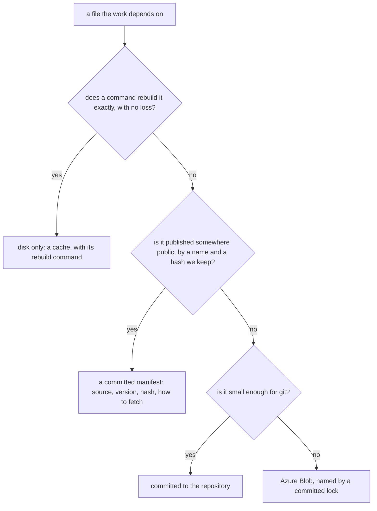

# Recoverability

Nothing the work depends on lives on one disk. A machine's disk holds only what a command can rebuild; everything else is reachable from a fresh clone and the two services' credentials, in the GitHub repository or in Azure Blob under a committed lock. The one exception is the game itself, the install, which only the machine that plays it holds, and everything derived from it is published so no other machine needs it.

## The new-machine test

A second computer, or the first one after a wipe, reaches the same working state from the same few steps: clone the repository, install, log in to GitHub and Azure, run the setup command. After that the references are on disk, the snapshots are in the tree, the game data, the text and the fitted records read from Blob by their lock, the public recordings can be fetched again from a committed list of sources, and the caches rebuild on first use. A person can set up either machine the same way, and the only thing that stays machine-bound is the install and the commands that read it.

A fact that fails the test is a defect, whether or not anything has been lost yet: the loss only shows on the day a disk goes, when the cause is no longer in anyone's hands.

## Where each kind of thing lives

| Kind                                                                                                               | Home                                                                                                                                     | Rebuilt or reached by                                    |
| :----------------------------------------------------------------------------------------------------------------- | :--------------------------------------------------------------------------------------------------------------------------------------- | :------------------------------------------------------- |
| Code, specs, skills, ledgers, the committed reports                                                                | git                                                                                                                                      | clone                                                    |
| Snapshot images (our own render) and their score report                                                            | git                                                                                                                                      | clone                                                    |
| Parity references (the game's frames) with their manifest of source, attribution and hash                          | the public Blob container, each object named by its hash in the committed manifest, deduped by hash; the manifest is in git              | clone, then the restore command fetches them             |
| Recordings a reference was cut from                                                                                | a committed manifest of each public source (video id, seconds, hash); one that is not public goes to the public container under the lock | the repo's clip tool                                     |
| Game data derived from the install (tables, text maps, extracted layouts, fitted records, authored worlds)         | Blob under `packages/genshin-world/src/generated/gameDataLock.json`                                                                      | the `genshin-data` skill's publish and read              |
| Raw dumps from public sources (the data repository's tables, wiki stills)                                          | not hosted: their source and the hash or commit that was read are recorded in the lock or the manifest                                   | fetch by that name                                       |
| Caches: the download cache, softness and plate files, shots, comparisons, the bundler's pre-bundled copy, installs | disk                                                                                                                                     | each one's command, on first use                         |
| The game install                                                                                                   | the machine that plays it, and nowhere else                                                                                              | the game's own launcher; published data stands in for it |

A folder outside the repository that is not a cache is a defect. `{data-root}/genshin-parity` is the standing example: its recordings and text dumps have no home outside it, and its references reach a home only once packed; the [download cache](../download-cache/design.md) is the model for what a disk-only folder may be, since every object in it is named by its own hash and rebuilt by asking again.

## What decides the home

- **Rebuildable exactly is a cache.** The test is whether the command gives the same bytes, or a result the work cannot tell apart, with nothing to look up that a person remembered. A frame cut from a public recording at a named second is rebuildable; a frame a person cropped by hand and never recorded is not, so it is committed.
- **Public and named is a manifest.** A source that stays reachable by a name and a hash needs only that name and hash committed. The manifest holds the attribution as well, since a reference is another party's picture.
- **Small enough for git is git.** The repository holds what a fresh clone reads at once, and a binary that changes rarely is cheap there. What does not fit goes to Blob under a lock committed beside the code that reads it, as the game data does, so a clone at any commit reads the bytes that commit was made with.
- **Both halves of a comparison are committed together.** A reference and the snapshot it is judged against ship in one change, with the score report's row, so a clone can run the whole compare. A snapshot alone says what we draw, and a reference alone says what we aim at; only the pair says how far apart they are.
- **A new kind of artifact names its home in the change that introduces it.** The proposal states which row of the table it is, and a kind that fits none adds a row here in that change.

## Enforced where it can be

The rule is prose until something can fail on it, and each row below says what does today.

| Fact                                             | What fails when it is false                                                 |
| :----------------------------------------------- | :-------------------------------------------------------------------------- |
| A committed reference matches its manifest hash  | the reference map's test                                                    |
| A reference is the frame its entry names         | `genshin:parity verify`, run on a machine that holds the recordings         |
| Game data read at a commit matches its lock      | the data readers and the lock check                                         |
| An entry with a reference has the file committed | the strict half of the reference map's test, once both machines have packed |
| A folder outside the repository is a cache       | nothing yet: see Open                                                       |

## Rejected

- **Backing the disk up.** A backup is a second disk. It recovers a loss that someone remembered to prepare for, and it is not reachability from a fresh clone.
- **Copying files between the two machines by hand.** The person is then the synchronisation, and the day they forget is the day the copy that mattered was the only one.
- **Hosting the install or the raw game files.** The size and the licence rule it out; what other machines need from the install is its derived data, which is published.
- **Hosting the public recordings.** They stay reachable at their public address, and a manifest with a hash proves a refetch is the same file. Hosting a copy would add a store to keep for no gain.
- **A references folder kept outside the repository because the images are large.** Size chooses between git and Blob. It never chooses a disk.
- **A private container for the references.** The private container holds only the players' saves. The game's frames and the recordings that cannot be fetched again go to the public container under the lock, like the rest of the game data, with the attribution in the manifest (the owner's decision, taken knowing the pictures are the game's own).

## Open

These have no home yet, or only part of one:

- **The references.** The folder holds about 1,600 files and a few hundred megabytes. Only the files a reference-map entry or a design names are references: about a hundred entries, most with a committed file and the rest pending. The `references pack` command publishes those to the public container under the lock and writes the manifest. The rest is softness and plate caches, Talent icons nothing reads, and install-derived name cards (`namecards/`, a couple of hundred megabytes), which belong to the game data lock. Some files named `.png` are WebP, so a manifest row takes its type from the bytes. A reference that only one machine holds reaches the container when `references pack` runs on that machine.
- **The recordings.** About 150 videos, several gigabytes, sit on disk. The manifest's `recordings` section has about two dozen rows, one for each of the user's own recordings, which cannot be fetched again. Their bytes go to the public container under the lock, as do a handful of recordings that no file, entry or design names. The frames cut from the recordings are a cache whose writer was removed; the recipe is in the genshin-parity skill's `motion.md`.
- **The public recordings.** Over a hundred public recordings have no row in the manifest's `recordings` section, so a refetch cannot be checked against a hash. The gap is those rows, which `genshin:parity recordings backfill` writes from the captures folder.
- **Fitted and authored records.** Four records have rows in the manifest's `records` section and publish by the same content-addressed route as the references: `extracted/login/placements.json` (about 14 MB, with no writer in the repository), `city-areas.json`, `asset-index/gi-7.1.0-derived.json` and `transfer/mondstadt-gate-walls.zip`. `extracted/maps/gi_map.bin` (about 200 MB, a day's run) is in no lock and has no row.
- **Versions nobody wrote down.** The install's version is in comments only; the text builders read the data repository's `main` with no commit recorded; the character packs' extraction manifests and the tool that wrote them are outside the repository; the lock records no size or commit per key. Each is a field the lock or the manifest should carry.
- **The text dumps.** `text/` rebuilds from the data repository and needs the install only for the account kit and the client decode. An older game version's dump, a couple of gigabytes, is held on one disk only. The repository's fetch cannot restore it, but GitHub serves old files by hash, so a committed list of path and hash would.
- **State that belongs to a person or a machine.** Claude's memory folder (about fifteen files), the fleet profile and peer list, the persona's saved picks and the `.env` files have no row. Memory and the profile are small and belong in git; the secrets' sources are not documented anywhere.
- **The setup command.** One command that does the new-machine steps after the logins is not written. The gaps it must close: the install's downloader, the AnimeStudio toolchain (dotnet, cmake, clang), `vkd3d-compiler` (its only copy is a cache folder no code reads), `ffmpeg`, `yt-dlp` and Edge, a macOS branch for `vgmstream`, and the GitHub, Claude and Pulumi logins. The parity root is restated in three files and must be set once.
- **A check that a folder outside the repository is a cache.** A listing of every path the code reads outside the repository and the caches, failing for one that is neither, could run in the session's resume report.
- **Unpushed work is not a home.** A local branch, a stash, a worktree's uncommitted edits and a backup tar can each hold work no remote has. Archived agent branches are kept under `refs/archive/` on origin; the resume report should list any ref or worktree with commits origin lacks.

## Key files

| File                                                     | Role                                                                                                                                    |
| :------------------------------------------------------- | :-------------------------------------------------------------------------------------------------------------------------------------- |
| `packages/genshin-world/src/generated/gameDataLock.json` | The lock that names the Blob objects the game data reads                                                                                |
| `scripts/src/services/gameData/`                         | Publishing and reading the hosted game data under that lock                                                                             |
| `scripts/src/services/genshinParity/reference/`          | The helpers the approve, verify, pack and restore commands call; fetch is `scripts/src/services/genshinParity/commands/fetchCommand.ts` |
| `packages/genshin-world/parity/references/`              | The committed manifest, which names each reference by its hash; the bytes are objects in the public container                           |
| `openspec/specs/architecture/download-cache/design.md`   | The shape of a disk-only folder that is allowed: every object named by its hash                                                         |
| `.agents/skills/genshin-data/SKILL.md`                   | The hosted game data's rules, the one place Blob holds derived data today                                                               |
