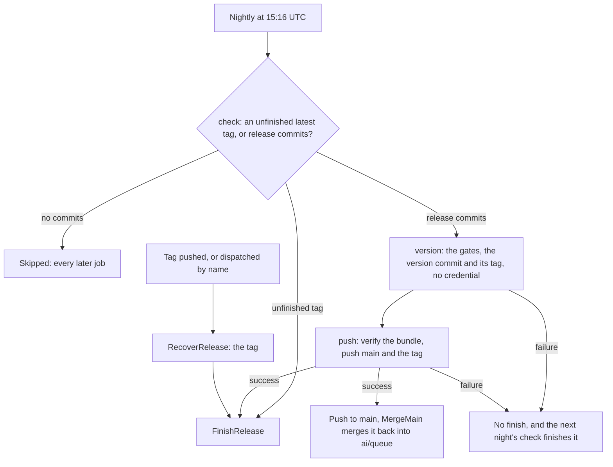

# Release flow

Three workflows tag, publish and release a version, and they share one finishing job list. `Release.yaml` is the nightly that ships `main`, so only what a review has passed reaches npm. `RecoverRelease.yaml` finishes a tag as soon as it is pushed, whether a manual `pnpm release` pushed it or a previous run did not finish it. `FinishRelease.yaml` is the reusable job list both call. The versioning mechanics and the `pnpm release:gate` gates are owned by [monorepo tooling](../monorepo-tooling/design.md); this page is the job graph.

Every finish is idempotent, so a version reaches npm only from a run that tagged it, and a release is made public only after its versions are on npm. The Windows host is attached to the draft before the release goes public.

## Workflows

- **`Release.yaml`** runs nightly, or by dispatch with no input. Its `check` reads the latest tag: a tag whose release is missing or still a draft is finished first, and no new version ships that night. Otherwise it counts the commits on `main` since the tag, and a count of zero skips every later job. `version` runs the gates and `lerna version --no-push` on `main` with no credential, and bundles the version commit and its tag. `push` runs no repository code: it verifies that the bundle is a fast-forward of `main` that changes only versions and changelogs, and pushes it as `REVIEW_COLLECTOR_TOKEN`, the identity `main`'s ruleset lets update it. `finish` then calls `FinishRelease.yaml` on the tag, and runs even when `version` and `push` were skipped for a recovery.
- **`RecoverRelease.yaml`** runs on a `v*.*.*` tag push, or by dispatch with a `tag` input. It calls `FinishRelease.yaml` for that tag and does nothing else. A tag pushed by the nightly starts it too, and it queues behind the nightly on the shared `release` group, then finds the release already published.
- **`FinishRelease.yaml`** is the reusable job list. `packages` checks out the tag, builds the packages and runs `lerna publish from-package --yes --loglevel verbose`, which publishes only the versions npm lacks. It is verbose so a failed token exchange names its reason, which lerna-lite otherwise hides. `draft` creates the draft release on the tag with `gh release create --draft --verify-tag`, or accepts an existing draft or an already-published release. `host-installer` runs on a Windows runner, builds the agent console host as a single executable and attaches it with `--clobber`, so a re-run replaces the asset. It is skipped once the release is public. `publish` makes the draft public with `gh release edit --draft=false`, after the host is attached.

## Gates

| Gate                              | Where                                   | Effect                                                                                  |
| --------------------------------- | --------------------------------------- | --------------------------------------------------------------------------------------- |
| Unfinished latest tag             | `Release.yaml` `check`                  | The night after a failed or manual release finishes that tag before anything new        |
| Commits since the latest tag      | `Release.yaml` `check`                  | A quiet night skips every job                                                           |
| One release at a time             | workflow `concurrency` (`release`)      | Nightly and tag-triggered runs share one group, so they never race onto the same tag    |
| Gates before the version          | `pnpm release:gate`                     | A failed gate bumps, tags and publishes nothing                                         |
| Only a version bump reaches main  | `Release.yaml` `push`                   | The bundle must be a fast-forward that changes only versions and changelogs             |
| npm success before the public tag | `FinishRelease.yaml` `draft`, `publish` | The draft exists only after `packages`, and the release goes public only after the host |
| Already-public release            | `FinishRelease.yaml` `draft`            | A re-run takes no further asset and does not publish twice                              |

## Notes

- The first publish of a new package is manual, because trusted publishing needs the package to exist on npm first. [Monorepo tooling](../monorepo-tooling/design.md) gives the command and the 48-hour expiry of an entry that has not yet published. A package with no live trusted publisher for the calling workflow, whether none was ever registered or it lapsed, fails `packages` with a 404 for the whole tag, so the finish stops before the draft.
- **npm matches the workflow that started the run, not the reusable `FinishRelease.yaml`.** Each caller needs its own trust entry, `Release.yaml` for the nightly and `RecoverRelease.yaml` for a pushed or dispatched tag. A recovery dispatched as `RecoverRelease.yaml` exchanged its token under the `RecoverRelease.yaml` entry, while the `Release.yaml` entry was lapsed, which settles it. An entry is permanent only once a publish has gone through it, and a version publishes under one caller, so the other caller's entry is the one that lapses first ([monorepo tooling](../monorepo-tooling/design.md)).
- A publish can hit a Sigstore transparency log conflict, `(409) an equivalent entry already exists`, on several packages at once. lerna-lite retries the signing three times, and when the run still fails, a re-run of the finish publishes what remains, since every finish is idempotent.
- A finish does not run the gates or bump versions again: `forcePublish` versions every member.
- The run the nightly's own tag starts costs a few runner minutes a night, and it is the price of one run that finishes every tag however it was pushed.

## Key files

| File                                    | Role                                                                           |
| --------------------------------------- | ------------------------------------------------------------------------------ |
| `.github/workflows/Release.yaml`        | the nightly: `check`, `version`, `push` and `finish` on the tag                |
| `.github/workflows/RecoverRelease.yaml` | the tag-triggered and dispatched finish                                        |
| `.github/workflows/FinishRelease.yaml`  | the reusable finish: publish missing versions, draft, host, public last        |
| `.github/workflows/MergeMain.yaml`      | the push to `main` that starts the review run merging it back into `ai/queue`  |
| `.github/actions/install-projects`      | the install step every publish and check job shares                            |
| `lerna.json`                            | the workspace globs lerna versions and publishes                               |
| `package.json`                          | `release:gate` and `release:version`, the nightly's; `release`, the manual one |
