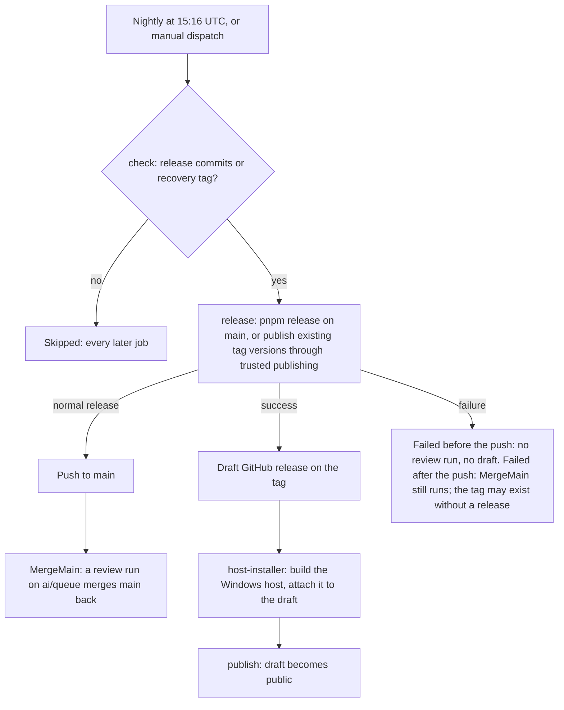

# Release flow

`.github/workflows/Release.yaml` is the only path that tags a release, publishes packages to npm and creates a GitHub release. It runs nightly and normally ships `main`, so only what a review has passed reaches npm. A manual dispatch can recover an existing version tag after a partial release. The versioning mechanics and the `pnpm release` gates are owned by [monorepo tooling](../monorepo-tooling/design.md); this page is the job graph.

The version, the tag, the npm publish and the draft release all happen in one `release` job, in that order, so a version reaches npm only from the same run that tagged it. Two jobs follow it: the Windows host is attached to the draft, and the release is made public last.

## Jobs

- **`check`** reads the latest tag and counts the commits on `main` since it. A count of zero skips the nightly run. A manual dispatch can instead provide `recover-tag`, which must name an existing tag and continues directly to publish that tag's package versions.
- **`release`** normally checks out `main` as `REVIEW_COLLECTOR_TOKEN`, the identity `main`'s ruleset lets update it, and runs `pnpm release`. That runs the gates, then `lerna version`, which commits and tags the version and pushes it, then `lerna publish from-package`, which publishes through npm trusted publishing (`id-token: write`, no token). A recovery dispatch checks out its tag and runs `lerna publish from-package --yes` without versioning or pushing. In both cases the job creates a draft release on the tag with `gh release create --draft --verify-tag`. A re-run accepts an existing draft or an already-published release. [Monorepo tooling](../monorepo-tooling/design.md) owns the reasons.
- **`host-installer`** runs on a Windows runner. It checks out the tag, builds the agent console host as a single executable, and attaches it to the draft with `--clobber`, so a re-run replaces the asset. It is skipped once the release is already public.
- **`publish`** makes the draft public with `gh release edit --draft=false`. It needs `release` and `host-installer` to have succeeded, so a public release always names a version that reached npm.

## Gates

| Gate                              | Where                  | Effect                                                                               |
| --------------------------------- | ---------------------- | ------------------------------------------------------------------------------------ |
| Commits since the latest tag      | `check`                | A quiet night skips every job                                                        |
| One release at a time             | workflow `concurrency` | A run waits behind an earlier one on the same tag, never racing it                   |
| Gates before the version          | `pnpm release`         | A failed gate bumps, tags and publishes nothing                                      |
| npm success before the public tag | `release`, `publish`   | The draft exists only after the publish, and the release goes public only after both |
| Already-public release            | `release`, `publish`   | A re-run takes no further asset and does not publish twice                           |

## Notes

- The first publish of a new package is manual, because trusted publishing needs the package to exist on npm first. [Monorepo tooling](../monorepo-tooling/design.md) gives the command.

- A failed `pnpm release` is not retried by a quiet night, because `check` skips the commits the tag covers. Dispatch this workflow with `recover-tag` set to that existing tag. It publishes only package versions npm lacks, creates or resumes the draft, attaches the host, and makes the release public after the asset arrives. It does not run `pnpm release` or bump versions again: `forcePublish` versions every member.

## Key files

| File                               | Role                                                                          |
| ---------------------------------- | ----------------------------------------------------------------------------- |
| `.github/workflows/Release.yaml`   | the release jobs, their gates and their order                                 |
| `.github/workflows/MergeMain.yaml` | the push to `main` that starts the review run merging it back into `ai/queue` |
| `.github/actions/install-projects` | the install step every publish and check job shares                           |
| `lerna.json`                       | the workspace globs lerna versions and publishes                              |
| `package.json`                     | `release`, the script the release job runs, gates included                    |
