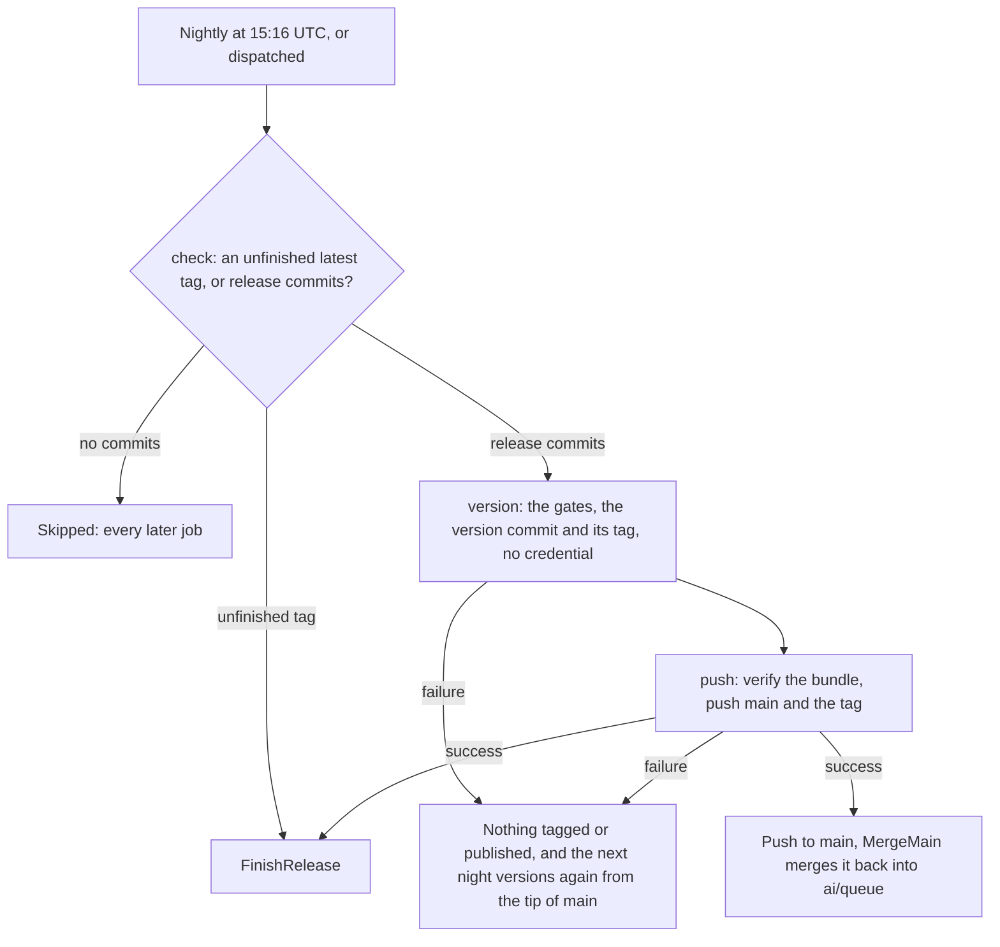

# Release flow

One workflow tags, publishes and releases a version: `Release.yaml`, the nightly that ships `main`, so only what a review has passed reaches npm. A dispatch of it starts the same run, so a tag left unfinished is finished at once rather than by the next night. `FinishRelease.yaml` is the reusable job list it calls. The versioning mechanics and the `pnpm release:gate` gates are owned by [monorepo tooling](../monorepo-tooling/design.md); this page is the job graph.

Every finish is idempotent, so a version reaches npm only from a run that tagged it, and a release is made public only after its versions are on npm.

## Workflows

- **`Release.yaml`** runs nightly, or by dispatch with no input. Its `check` reads the latest tag: a tag whose release is missing or still a draft is finished first, and no new version ships in that run. Otherwise it counts the commits on `main` since the tag, and a count of zero skips every later job. `version` runs the gates and `lerna version --no-push` on `main` with no credential, and bundles the version commit and its tag. `push` runs no repository code: it verifies that the bundle is a fast-forward of `main` that changes only versions and changelogs, and pushes it as `REVIEW_COLLECTOR_TOKEN`, the identity `main`'s ruleset lets update it. `finish` then calls `FinishRelease.yaml` on the tag, and runs even when `version` and `push` were skipped because `check` found an unfinished tag.
- **A release made by hand is finished by the next run.** `pnpm release` tags and publishes from the owner's machine and makes no draft, so the tag has no release until a run of `Release.yaml` finds it missing and finishes it, whether that run is the nightly or a dispatch.
- **`FinishRelease.yaml`** is the reusable job list. `packages` checks out the tag, builds the packages and runs `lerna publish from-package --yes --loglevel verbose`, which publishes only the versions npm lacks. It is verbose so a failed token exchange names its reason, which lerna-lite otherwise hides. `draft` creates the draft release on the tag with `gh release create --draft --verify-tag`, or accepts an existing draft or an already-published release. `publish` makes the draft public with `gh release edit --draft=false`.

## Gates

| Gate                              | Where                                   | Effect                                                                                              |
| --------------------------------- | --------------------------------------- | --------------------------------------------------------------------------------------------------- |
| Unfinished latest tag             | `Release.yaml` `check`                  | The next run finishes a failed or manual release's tag before anything new                          |
| Commits since the latest tag      | `Release.yaml` `check`                  | A quiet night skips every job                                                                       |
| One release at a time             | workflow `concurrency` (`release`)      | Nightly and dispatched runs share one group, so they never race onto the same tag                   |
| Gates before the version          | `pnpm release:gate`                     | A failed gate bumps, tags and publishes nothing                                                     |
| Only a version bump reaches main  | `Release.yaml` `push`                   | The bundle must be a fast-forward that changes only versions and changelogs                         |
| npm success before the public tag | `FinishRelease.yaml` `draft`, `publish` | The draft exists only after `packages`, and the release goes public only after its packages publish |
| Already-public release            | `FinishRelease.yaml` `draft`            | A re-run does not publish a version twice                                                           |

## Notes

- The first publish of a new package is manual, because trusted publishing needs the package to exist on npm first. [Monorepo tooling](../monorepo-tooling/design.md) gives the sequence, which ends in a dispatch of `Release.yaml`, and the 48-hour expiry of an entry that has not yet published. A package with no live trusted publisher for the calling workflow, whether none was ever registered or it lapsed, fails `packages` with a 404 for the whole tag, so the finish stops before the draft.
- **npm matches the workflow that started the run, not the reusable `FinishRelease.yaml`.** `Release.yaml` is the only caller, so each published package has one trust entry, for `Release.yaml`, and the nightly and a dispatch both exchange their token under it ([monorepo tooling](../monorepo-tooling/design.md)).
- A publish can hit a Sigstore transparency log conflict, `(409) an equivalent entry already exists`, on several packages at once. lerna-lite retries the signing three times, and when the run still fails, a re-run of the finish publishes what remains, since every finish is idempotent.
- A finish does not run the gates or bump versions again: `forcePublish` versions every member.

## Key files

| File                                   | Role                                                                              |
| -------------------------------------- | --------------------------------------------------------------------------------- |
| `.github/workflows/Release.yaml`       | the nightly or dispatched run: `check`, `version`, `push` and `finish` on the tag |
| `.github/workflows/FinishRelease.yaml` | the reusable finish: publish missing versions, draft, public last                 |
| `.github/workflows/MergeMain.yaml`     | the push to `main` that starts the review run merging it back into `ai/queue`     |
| `.github/actions/install-projects`     | the install step every publish and check job shares                               |
| `lerna.json`                           | the workspace globs lerna versions and publishes                                  |
| `package.json`                         | `release:gate` and `release:version`, the nightly's; `release`, the manual one    |
