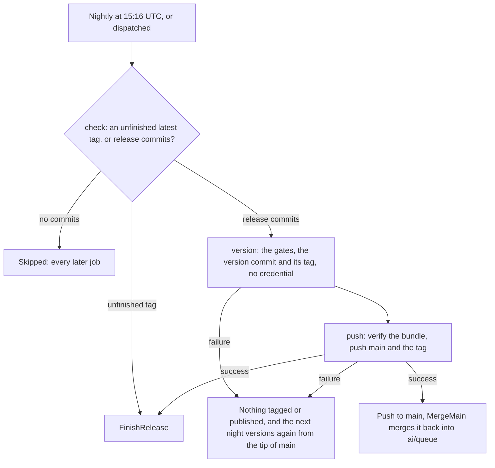

# Release flow

One workflow tags, publishes and releases a version: `Release.yaml`, the nightly that ships `main`, so only what a review has passed reaches npm. A dispatch of it starts the same run, so a tag left unfinished is finished at once rather than by the next night. `FinishRelease.yaml` is the reusable job list it calls. The versioning mechanics and the `pnpm release:gate` gates are owned by [monorepo tooling](../monorepo-tooling/design.md); this page is the job graph.

Every finish is idempotent, so a version reaches npm only from a run that tagged it, and a release is made public only after its versions are on npm.

## Workflows

- **`Release.yaml`** runs nightly, or by dispatch with no input. Its `check` reads the latest tag: a tag whose release is missing or still a draft is finished first, and no new version ships in that run. Otherwise it counts the commits on `main` since the tag, and a count of zero skips every later job. `version` runs the gates and `lerna version --no-push` on `main` with no credential, so a compromised script finds nothing to take, and bundles the version commit and its tag. `push` runs no repository code: it verifies that the bundle is a fast-forward of `main` that changes only versions and changelogs, and pushes it as `REVIEW_COLLECTOR_TOKEN`, the identity `main`'s ruleset lets update it. The token reaches git through the job's environment, so every checkout in the workflow persists nothing. A `main` that moved since `version` read it, or a rejected push, fails the job before anything is published, and the next night versions from the tip; nothing is rebased or retried. `finish` then calls `FinishRelease.yaml` on the tag, and runs even when `version` and `push` were skipped because `check` found an unfinished tag.
- **A release made by hand is finished by the next run.** `pnpm release` tags and publishes from the owner's machine and makes no draft, so the tag has no release until a run of `Release.yaml` finds it missing and finishes it, whether that run is the nightly or a dispatch.
- **`FinishRelease.yaml`** is the reusable job list. `packages` checks out the tag, builds the packages and runs `lerna publish from-package --yes --loglevel verbose`, which publishes only the versions npm lacks. It is verbose so a failed token exchange names its reason, which lerna-lite otherwise hides. `draft` creates the draft release on the tag with `gh release create --draft --verify-tag`, or accepts an existing draft or an already-published release. `publish` makes the draft public with `gh release edit --draft=false`.

## Gates

| Gate                              | Where                                   | Effect                                                                                              |
| --------------------------------- | --------------------------------------- | --------------------------------------------------------------------------------------------------- |
| Unfinished latest tag             | `Release.yaml` `check`                  | The next run finishes a failed or manual release's tag before anything new                          |
| Commits since the latest tag      | `Release.yaml` `check`                  | A quiet night skips every job                                                                       |
| One release at a time             | workflow `concurrency` (`release`)      | Nightly and dispatched runs share one group, so they never race onto the same tag                   |
| Gates before the version          | `pnpm release:gate`                     | A failed gate bumps, tags and publishes nothing                                                     |
| Only a version bump reaches main  | `Release.yaml` `push`                   | The bundle must be a fast-forward that changes only versions and changelogs                         |
| npm success before the public tag | `FinishRelease.yaml` `draft`, `publish` | The draft exists only after `packages`, and the release goes public only after its packages publish |
| Already-public release            | `FinishRelease.yaml` `draft`            | A re-run does not publish a version twice                                                           |

## Notes

- The first publish of a new package is manual, because trusted publishing needs the package to exist on npm first. The sequence, which ends in a dispatch of `Release.yaml`, is the `file-organization` skill's `references/npm-lifecycle.md`; the 48-hour expiry of an entry that has not yet published is below. A package with no live trusted publisher for the calling workflow, whether none was ever registered or it lapsed, fails `packages` with a 404 for the whole tag, so the finish stops before the draft.
- **npm matches the workflow that started the run, not the reusable `FinishRelease.yaml`.** `Release.yaml` is the only caller, so each published package has one trust entry, for `Release.yaml`, and the nightly and a dispatch both exchange their token under it ([monorepo tooling](../monorepo-tooling/design.md)).
- A publish can hit a Sigstore transparency log conflict, `(409) an equivalent entry already exists`, on several packages at once. lerna-lite retries the signing three times, and when the run still fails, a re-run of the finish publishes what remains, since every finish is idempotent.
- A finish does not run the gates or bump versions again: `forcePublish` versions every member.
- The version commit leaves `main` ahead of `ai/queue`, and the push starts `MergeMain.yaml`, which dispatches a review run that merges `main` into `ai/queue` ([review](../../infra/review/design.md)). The version reaches the queue with no session pulling it.
- **Rejected: releasing from `ai/queue`.** The first CI release versioned and published the queue's tip, which ships commits no review has read yet; the queue is where unreviewed work waits, and `main` is the reviewed prefix of it.
- **The packages publish through npm's trusted publishing.** `FinishRelease.yaml`'s `packages` job exchanges the job's GitHub OIDC token for each package through lerna-lite (`id-token: write`, with no long-lived npm token stored anywhere), and provenance is attached for a public package. That job builds the packages with the OIDC token in reach, the one place a credential meets the dependencies' code, so what bounds it is that the token is good only for the packages whose trust entry names the calling workflow, and each publish carries provenance naming the run. The GitHub release is created as a draft once the tag's versions are on npm, and it goes public only after npm succeeds, so a public release never names a version that did not publish.
- **A trust entry that has not yet published expires 48 hours after it is created, and one successful publish through it makes it permanent** ([GitHub's changelog](https://github.blog/changelog/2026-10-02-unvalidated-npm-trusted-publishing-configurations-now-expire)). `npm trust list` keeps listing a lapsed entry, so a complete-looking list proves nothing. The failure shows as the token exchange answering "OIDC token exchange error - package not found", and the cure is `npm trust revoke <package> --id=<id>`, a new entry, and a publish inside the window. lerna-lite logs a failed exchange at verbose level alone and then publishes without a token, which npm answers with a bare `E404`, so `FinishRelease.yaml` publishes with `--loglevel verbose` to keep the reason in the log.
- **A manual release stays available, and is not the routine.** `pnpm release` runs the whole chain on the owner's machine, with their own git credentials and npm login, for the night CI cannot ship. It is one more path that can drift from the tree CI tested, and a tarball it publishes carries no attestation that CI built it, which comes only with the CI publish, so the nightly is how a release ships.

## Key files

| File                                   | Role                                                                              |
| -------------------------------------- | --------------------------------------------------------------------------------- |
| `.github/workflows/Release.yaml`       | the nightly or dispatched run: `check`, `version`, `push` and `finish` on the tag |
| `.github/workflows/FinishRelease.yaml` | the reusable finish: publish missing versions, draft, public last                 |
| `.github/workflows/MergeMain.yaml`     | the push to `main` that starts the review run merging it back into `ai/queue`     |
| `.github/actions/install-projects`     | the install step every publish and check job shares                               |
| `lerna.json`                           | the workspace globs lerna versions and publishes                                  |
| `package.json`                         | `release:gate` and `release:version`, the nightly's; `release`, the manual one    |
