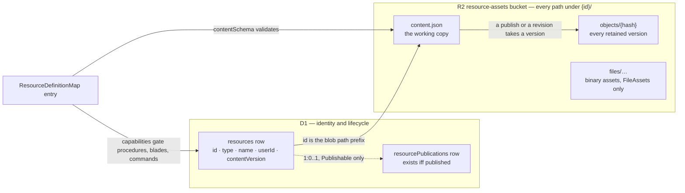
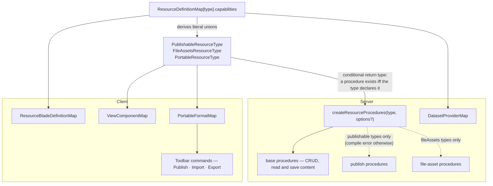
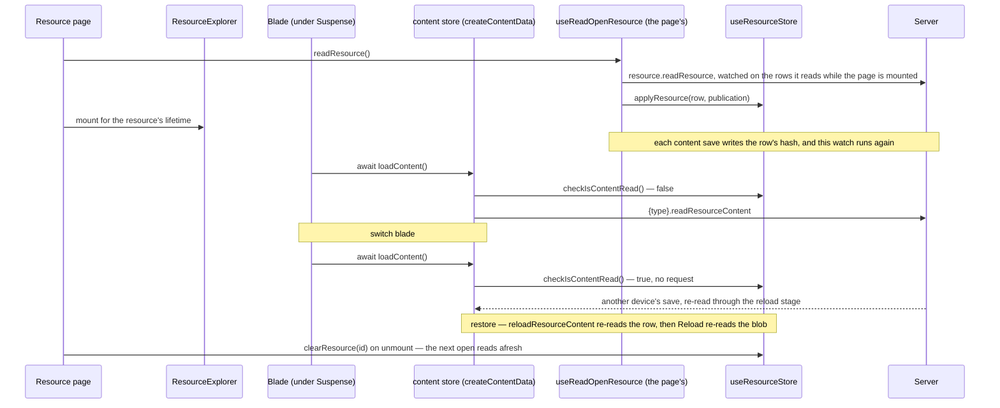

# Resources

The standard for product persistence and product surface. **Everything is a resource**: a file, a survey, a todo list, a dashboard, an email, a webpage, a whiteboard. One D1 table, one R2 bucket, one procedure factory, one explorer UI. Cross-cutting behaviors (publishing, dataset serving, asset hosting, import/export) are opt-in **capabilities**, never baked into the core.

## Anatomy

A resource is three things: an identity row (D1), a content blob (R2), and a definition (shared code).



**Settings vs data is a UX separation, not a storage separation.** A resource's parse settings and its actual data are distinct sections of one content blob, edited in distinct blades, saved through one procedure with one `contentVersion`. Never split one artifact across two write paths.

## Data model

Drizzle table `resources` (`packages/db-schema/src/schema/resource/resourcesInResource.ts`) — pure identity + content lifecycle:

| Column           | Type                          | Notes                                                                                              |
| ---------------- | ----------------------------- | -------------------------------------------------------------------------------------------------- |
| `id`             | UUIDv7 PK                     | becomes the blob path prefix                                                                       |
| `type`           | `ResourceType` text value set | one value per type in `ResourceDefinitionMap`                                                      |
| `name`           | text + length check           | `createNameSchema` pattern; ranked search reads the FTS5 index the triggers keep beside the table  |
| `tags`           | JSON text, not null, `{}`     | free-form key/value labels, indexed beside the name; a tag filter reads its pairs with `json_each` |
| `userId`         | FK → users, cascade           | owner; resources are single-owner                                                                  |
| `contentVersion` | integer                       | optimistic concurrency on content saves                                                            |

Publish state is **normalized into its own table**, `resourcePublications` — a row exists iff the resource is currently published. Publishing is a capability, not a base attribute, so publish columns do not belong on every resource row:

| Column           | Type                             | Notes                                            |
| ---------------- | -------------------------------- | ------------------------------------------------ |
| `resourceId`     | text PK, FK → resources, cascade | one publication per resource                     |
| `publishVersion` | integer, default 1               | the published channel's version row that is live |
| `publishedAt`    | timestamp, default now           | when the current publish happened                |

Every cross-resource reference a resource's content holds is indexed in `resourceLinks` — one row per source, role and target, written by the save that writes the content — so which resources point at one is a single lookup ([resource links](../resource-links/design.md)).

Content blobs live in one bucket, `StorageBucket.ResourceAssets` (the `resource-assets` R2 bucket), keyed by id only (type lives in the row; ids are UUIDs — a type prefix would duplicate authoritative data into path strings):

```text
{id}/content.json                      working copy (JSON as a zstd frame, validated by the type's content schema)
{id}/objects/{hash}                    every retained version's content, in either channel (the version store)
{id}/files/{sha256}                    binary assets, content-addressed (FileAssets types only)
```

Ownership is enforced through the D1 row, never inferred from the blob path. Deleting a resource is soft — identically for every type: it stamps `deletedAt` and drops the publication row, leaving the `{id}/` blob directory intact so a restore can hand the content back. Purging is what deletes the directory and then the row ([recycle bin](../../resource/recycle-bin/design.md)).

Each type owns one content schema (Zod, interface-first, one function per file) in `apps/web/shared/models/`. A content schema always produces an **object** (never a bare string/array) so future fields extend without a blob-shape break. A field holding another resource's id is declared with `createResourceLinkSchema(ResourceLinkType.X)`, never a bare `z.uuidv4()` — the declaration is what the [resource-link index](../resource-links/design.md) reads, so a reference written any other way is one nothing can find.

## Capabilities

A capability is a cross-cutting mechanism a resource type opts into via its definition. **Admission rule: a capability exists only when ≥2 resource types need the same mechanism, or when the type system must guarantee its absence** (a TodoList must not have publish endpoints). Anything used by exactly one type is type-specific code — promoting a single-consumer mechanism is over-engineering.

| Capability          | Contract                                                                                                                                                                                                                        |
| ------------------- | ------------------------------------------------------------------------------------------------------------------------------------------------------------------------------------------------------------------------------- |
| **Publishable**     | versioned snapshot + publish procedures + `/view/[type]/[id]` route + Publish command → [publishing](../publishing/design.md)                                                                                                   |
| **DatasetProvider** | registers a provider so `dataset.readDataset` resolves the type → [datasets](../dataset/design.md); a Program provides its participant status, a Survey its responses                                                           |
| **FileAssets**      | owner-only upload/download/delete of binary assets under `{id}/files/…` → [resource file assets](../../resource/resource-file-assets/design.md)                                                                                 |
| **Portable**        | import/export via declared formats (self-contained `export()` / `import()`) + Import/Export commands; a format is offered per type, so an Email exports its HTML, MJML source and personalized HTML, and a TodoList prints only |

Which types declare each capability is `ResourceDefinitionMap`'s to say ([layer model](../layer-model/design.md#capabilities)). Explicitly **not** capabilities: collecting public responses (Survey-only — stays survey-specific code) and dataset _consumption_ (just calling `dataset.readDataset` from a component; no per-type wiring to declare).

### Declaration — `ResourceDefinitionMap`

One shared as-const-satisfies map (`apps/web/shared/services/resource/ResourceDefinitionMap.ts`) is the single source of truth for what a type is: its `contentSchema`, `icon`, `title`, and `capabilities` (`{ datasetProvider?: true; fileAssets?: true; portable?: true; publishable?: true }`), keyed by `ResourceType`.

A generic mapped type derives the subset of types declaring each capability:

```ts
// apps/web/shared/models/resource/CapabilityResourceType.ts
export type CapabilityResourceType<TCapability extends keyof ResourceCapabilities> = {
  [T in ResourceType]: (typeof ResourceDefinitionMap)[T]["capabilities"] extends Record<TCapability, true> ? T : never;
}[ResourceType];
```

`PublishableResourceType`, `FileAssetsResourceType`, and `PortableResourceType` are its aliases, and `checkHasCapability(type, capability)` is the matching runtime type guard. Capability implementation maps are keyed by the derived unions — `ViewComponentMap: Record<PublishableResourceType, Component>`, `PortableFormatMap: Record<PortableResourceType, …>` — so a missing view page or format entry is a compile error, and adding one for a non-capable type is also a compile error.

### Wiring



Component wiring cannot live in shared code, so the client keeps one thin satellite map per surface a type can hand a component to: `ResourceBladeDefinitionMap` (type-specific blades), `ResourceEditorComponentMap` (the inline Editor blade), `ResourceOverviewComponentMap` (an Overview blade richer than the generic one) and `ViewComponentMap` (public view renderers). `PortableFormatMap` sits beside them and is deliberately not one of them: its entries are the import and export handlers a type offers the command bar, not components. **A component map is for components only** — everything else procedural reaches a type through its own router name (`useResourceRouter`), so a create, a rename or a publish never needs an entry anywhere. The two maps whose entries carry a vendor canvas — `ResourceEditorComponentMap` and `ViewComponentMap` — hold `defineAsyncComponent` loaders rather than imports, because a static entry lands every type's editor in the chunk of whoever reads the map: opening one resource would download all of them. The server-side publish transform is passed at router construction because it imports server code.

## Procedures

One factory, `createResourceProcedures(type, options?)` (`server/trpc/procedure/resource/createResourceProcedures.ts`), spread into each type's router. Content schema and bucket come from `ResourceDefinitionMap[type]` — callers never pass them. The schema is read through the correlated map: `getResourceContentSchema(type)` (`shared/services/resource/getResourceContentSchema.ts`) reads the definition map annotated as a mapped type over `ResourceType`, so a generic type reads its own entry and `ResourceContent<TType>` is that entry's output. Publish procedures are spread **conditionally with a conditional return type** (guarded by `checkHasCapability(type, "publishable")` at runtime), so a non-publishable type's router has no publish endpoints at the type level — a compile error on the client `$trpc` type, a 404 on the wire. The options argument is keyed by the same type: its type is `PublishableResourceProcedureOptions` for a publishable type and `never` for any other, so passing a hook to any other type is a compile error, with no overload.

| Procedure                                     | Auth                                      | Purpose                                                          |
| --------------------------------------------- | ----------------------------------------- | ---------------------------------------------------------------- |
| `createResource`                              | authed                                    | metadata row; content blob written on first save                 |
| `readResources`                               | authed                                    | cross-type cursor-paginated list, publication state joined along |
| `updateResource`                              | owner                                     | metadata edit — `{ id, name?, tags? }`, at least one of the two  |
| `deleteResource`                              | owner                                     | soft delete — stamps `deletedAt`, blobs survive until purge      |
| `readResourceContent` / `saveResourceContent` | owner                                     | blob read/write with `contentVersion` check                      |
| the publish set                               | see [publishing](../publishing/design.md) | Publishable types only                                           |

`updateResource` replaces the whole `tags` record rather than merging it, and only a changed `name` writes a `Renamed` [activity](../../resource/activity-log/design.md) entry — a tags-only edit is not a rename, so it leaves no trail entry. Both editable fields are optional (at least one is required) so a caller writes only the field it owns: a rename and a tag edit are independent writes to one row, and a tag edit that had to restate the name would put the pre-rename name back whenever the two overlap.

`saveResourceContent` claims the `contentVersion` bump in one guarded `UPDATE` — the version check is part of its `WHERE`, so concurrent saves cannot both pass and silently lose a write — and then writes the blob to R2. D1 and R2 share no transaction, so a failed blob upload puts the version back.

Every content write funnels through the `saveResourceContent` service (`server/services/resource/`), not just the procedure of the same name: the editor's save, [blueprint](../../resource/blueprint-resource/design.md) deploy, [duplicate](../../resource/resource-page-parity/design.md) and [restore](../../resource/resource-snapshots/design.md) all write their content through it. It parses the caller's content against `ResourceDefinitionMap[type].contentSchema` and then performs the blob write, the row's `contentHash` and `contentSize` that describe it, the [activity](../../resource/activity-log/design.md) entry and the type's after-save hook as one unit, because a path that writes content and misses one of them leaves a resource whose reminders, schedules or derived state exist or not depending on which door its content came through.

The parse belongs to that unit for the same reason. `content` arrives as `unknown` and the hook reads it as the type's own shape, so a caller that hands over content it never parsed — a blueprint manifest carries every entry's content as `z.unknown()` — reaches the hook with ISO strings where it declares `Date`s, and the hook's failure is best-effort and swallowed. Parsing at the one door means no caller can be the one that forgets; a caller that already parsed pays an idempotent second pass.

So real-time sync is the open row's watch. A content save writes the row's `contentHash` with the blob, and the write publishes the row's topic once it settles, so the page's watch of the open row runs again for every content write, whichever device made it. The row carries no content: the page applies it to the store, and the store reads the content through its type's read only when the row names a hash the store does not hold. A large document therefore crosses the way any read does, and the adoption takes the row's `contentVersion` with it, so a remote write keeps the next save from being rejected as stale. Client-side, the page holds that watch for as long as it is mounted, whatever the type, so every type adopts another device's save, and TodoList's item table operations are live, with no type-specific wiring. The watch lives with the page, never a blade — content is read once per open resource, so a watch that ended with its blade would leave the next blade rendering what it last heard.

The type's after-save hook is registered in `ResourceAfterSaveContentMap`, keyed by `ResourceType`, rather than handed to the procedure factory — a hook reachable from only one of the paths that write content is the failure above. It receives the prior content (read before the write overwrites it, `undefined` on a first write) so it can diff, and is fire-and-forget and best-effort: it must never fail or delay the write. TodoList registers [due reminders](../../resource/todolist-due-reminders/design.md) there.

The factory also accepts an optional publish-time content-transform hook, `transformPublishedContent` — see [publishing](../publishing/design.md). What a type declares **live** rather than frozen is not a hook but a declaration the snapshot mechanism owns — see [resource snapshots](../../resource/resource-snapshots/design.md).

`resource.readResource` answers with the row plus its `publication` (the `resourcePublications` row, or `null` when there is none) — see [publishing](../publishing/design.md).

Ownership middleware: `getOwnerProcedure(type, schema, resourceIdKey, isDeletedOnly = false)` in `server/trpc/procedure/resource/`, querying `resources` and exposing `ctx.resource`; a typeless overload (`type: undefined`) backs the cross-type `resource.readResource`. `isDeletedOnly` inverts which rows resolve, so the [recycle bin](../../resource/recycle-bin/design.md)'s `purgeResource` reaches only soft-deleted resources and every other procedure only live ones. The batch `restoreResources`, like `deleteResources`, scopes its own where to the owner and the bin instead.

### Router topology

Each type has its own router, and one cross-type `resource` router holds what must work without knowing the type. `apps/web/server/trpc/routers/index.ts` registers them all by name, and a type-specific procedure (a survey's responses, a program's participants, a blueprint's capture and deploy) lives on its type's router.

Router-per-type is load-bearing, not cosmetic: achievement `triggerPath`s key off the literal tRPC path, and type-specific procedures need a home.

## Client

- **Explorer** (`/resource-explorer`) is an Azure-portal-style shell: a Home landing (search + quick-create tiles + recent resources), a full list at `/resource-explorer/all`, and a route-driven create flow (`/resource-explorer/create` gallery → `/resource-explorer/create/[type]` form). Home and `/resource-explorer/all` read through the shared `useReadResources` composable (`resource.readResources`, whose first page answers the total; different sort/limit/filter per surface). Resource pages live at `/resource-explorer/[id]/[[blade]]`.
- **`useResourceStore`** (`apps/web/app/store/resource/index.ts`) is the open resource: it holds the row with its publication, which the page's `useReadOpenResource` (`apps/web/app/composables/resource/useReadOpenResource.ts`) reads with `resource.readResource` and applies to it. That read is the page's, not the store's, so its live watch on the rows it reads ends with the page and cannot outlive it. A refresh of the open row takes every field but `contentVersion`, since a content save wakes the same watch and only a save or a reload may move the version, so a refresh cannot skip adopting another device's save or drop its held notice. The blade's Refresh command is the one explicit full reload of the row: the store's `reloadResource` takes the current version and lifts the stale latch, as the page's read did before, and it is a raw read with no watch (a watch would re-run that full apply on every publish). The store reads typed content (`{type}.readResourceContent`), and owns every write against that resource — `saveContent` (optimistic `contentVersion`), `renameResource`, `updateResourceTags`, `deleteResource`, `duplicateResource` and the capability actions (`publishResource`/`unpublishResource`, no-ops for non-publishable types). It is **blade-scoped**: the store is app-lifetime, this state is one open resource's, so the page clears it on unmount, keyed by the id it opened because a keyed page swap mounts the next resource's page first.
- **A type's content store composes the resource store rather than loading its own copy** — `useSheetStore`, `useNoteStore`, `useDashboardStore` and the rest hold only their own parsed content and reach the row through the store's `readContent`/`saveContent`. The store cannot be generic over `ResourceType`, so the type parameter is passed at the one member whose content shape depends on it, as in `readContent<ResourceType.Sheet>(applyContent)` — it hands the content to `applyContent` only while the read is the latest one issued for the opening still open, so a read landing after a switch or a restore's re-read reaches no store; everything else about a resource row is identical for every type. One row, one publication, one loading flag, so a rename in the toolbar is the name the editor sees.
- **Content is read once per open resource, not once per blade.** The page reads the row before any blade mounts, and a content store's `loadContent` reads the blob only while `checkIsContentRead()` says the store holds none for this resource. Every blade of a type renders the one content, so switching blades renders from the store with no round trip; what changes the content after that reaches the store without a blade's re-read — its own saves, another device's save that the open row's watch brings in, and a restore's `ResourceContentHookMap.Reload`. Closing the resource resets it, so reopening reads afresh. Every content store is built on `createContentData`, which is where the guard and the Reload re-read live. A read that lands after another opening is dropped whole — another resource, or the same one closed and reopened, whose id alone cannot tell the two apart. Each opening carries its own token (`getOpening`), replaced when the row read brings a different resource and when the page clears it, but not by a refresh of the one open: `readContent` hands the content over and stamps the store as read only while the opening that issued it is still the open one and no later read of it was issued, and a write issued before an await goes through `getContentWriter`, bound to the opening it was issued under, so the survey store's saves adopt what lands, and build the next save on a pending one, only for that opening, so a late read never shows another opening's document under the contentVersion the blade holds now.
- **`save` skips content identical to what was last persisted**, compared as JSON, so an editor whose autosave fires per frame does not bump `contentVersion` for a document nobody changed. Nor does it write content that was never read for the open resource — a store still holding the previous resource's document, or its own empty default. Every content store seeds that comparison with `setPersistedContent` after hydrating, and nothing may stamp the content on the way in — a store that refreshed the content's own `updatedAt` before saving would make every comparison differ, and the modified time the explorer reads is the `resources` row's, which the server bumps per accepted write.
- Resource pages are auth-gated. There is no unauthenticated/localStorage editing path — one persistence mechanism, not two.

Opening a resource reads the row once and the blob once; a blade switch after that is a render from the store, and only a restore or closing the resource makes the next blade read again:



## Key files

| File                                                                       | Role                                       |
| -------------------------------------------------------------------------- | ------------------------------------------ |
| `packages/db-schema/src/schema/resource/resourcesInResource.ts`            | identity table                             |
| `packages/db-schema/src/schema/resource/resourcePublicationsInResource.ts` | publish state table                        |
| `apps/web/shared/services/resource/ResourceDefinitionMap.ts`               | type definitions + capability declarations |
| `apps/web/shared/models/resource/CapabilityResourceType.ts`                | derived capability unions                  |
| `packages/db-schema/src/services/storage/getResourceFilesDirectoryName.ts` | the `{id}/files` path convention           |
| `apps/web/shared/services/resource/checkHasCapability.ts`                  | runtime capability guard                   |
| `apps/web/server/trpc/procedure/resource/createResourceProcedures.ts`      | the procedure factory                      |
| `apps/web/server/trpc/procedure/resource/getOwnerProcedure.ts`             | ownership middleware                       |
| `apps/web/app/store/resource/index.ts`                                     | the open resource — state and every write  |
| `apps/web/app/services/resource/ResourceBladeDefinitionMap.ts`             | type-specific blades                       |
| `apps/web/app/services/resource/ViewComponentMap.ts`                       | public view renderers (Publishable)        |
| `apps/web/app/services/resource/PortableFormatMap.ts`                      | import/export formats (Portable)           |
