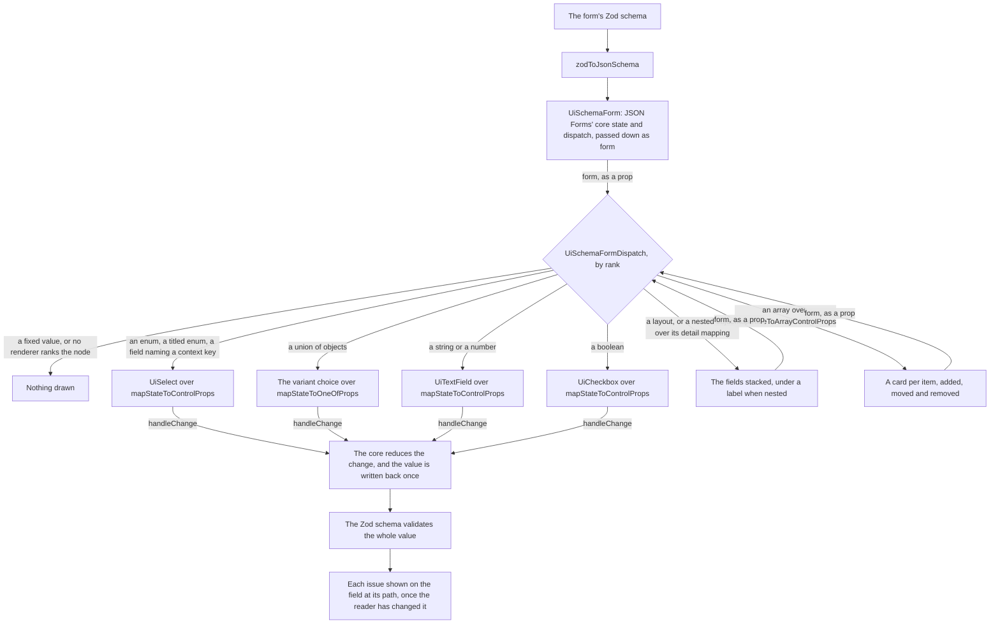

# Schema Forms

The sheet's settings, its column dialogs and the dashboard's visual editor render their forms from a Zod schema, which `UiSchemaForm` draws through JSON Forms' core: the core lays each form out and keeps its value in step, and the app's own components draw every node.

## How it works

- **JSON Schema is the input.** JSON Forms generates the layout from the schema where no UI schema is given, which is every form the app has, and `zodToJsonSchema`'s inline snapshot tests pin the schema each form receives.
- **The root holds the state, and each renderer takes it as a prop.** `UiSchemaForm` keeps JSON Forms' core state in a shallow reactive object and passes it with its dispatch to `UiSchemaFormDispatch` as one form prop. The dispatch draws each node with the renderer whose tester ranks it highest in `SchemaFormRenderers`, and passes `form` on to the renderer it picks and to every nested dispatch. A new kind of node is one entry in that list.
- **Each renderer maps its own props.** A layout, an object, an array or a variant calls its one core mapping function in a computed. A field calls `mapStateToControlProps` and `mapDispatchToControlProps` through `useSchemaFormControl`, which adds the field's layout meta and its issue. The state is shallow: JSON Forms' reducers return a new core for every change, so the replaced property is the only change to track, and the renderer components are never proxied.
- **Layout meta is typed data.** A field that wants several lines, or a choice among items only the dialog knows, says so in its `layout` meta, a flag or a key of the dialog's context interface, never an expression string evaluated at runtime.
- **The Zod schema validates.** JSON Forms runs with its validation off. The form's Zod schema checks the whole value on every change, as the dialog's error icon does, and each issue reaches the field at its path through the form's config, shown once the reader has changed that field. A rule that reads live state, a column name unique among the sheet's, is a refinement the dialog's composable builds.
- **A variant is its discriminant.** A union's variants each fix their discriminant to a literal, which the form hides and the variant choice sets. Switching keeps the fields the variants share and anything the schema does not describe, such as a column's id, and drops the old variant's own, and a shared field the two variants pick from different lists of the dialog's context, since the new picker never offered the old choice.

## Decisions

- **The core is adopted, and the Vue shell is ours.** A schema form engine is most of the work: laying a form out from its schema, ranking each node's renderer, detecting which variant of a union the data is in, and applying every change to a nested value immutably. Writing that for a handful of dialogs would put an engine in the repository that nothing else maintains, so JSON Forms' core is adopted. Its Vue components are not. The JsonForms root keeps its state in data(), its dispatch picks a renderer in a computed, and the vanilla renderers are written the same way, all in the Options API, which the app compiles out. Mounted there, the root rendered off an undefined store and aborted the patch around it.
- **The @jsonforms/vue bindings are rejected.** Their composables read the state and the dispatch with inject from a provide on the root, so every renderer depends on a provider its signature does not name, and a test must mount that provider. The [Vue conventions](../../../../.agents/skills/vue/SKILL.md) ban that for an input a component could take as a prop. The form adopted the bindings first. Each one also brings its own copy of the core's mapping, a control id per scope, and lodash as the package's only runtime dependency. Rejected too: keeping the composables under our own names, which keeps the injection for no library's sake.
- **Each binding is the core's mapping function.** A composable wrapping one call would be a one-line composable, which the app does not write. `useSchemaFormControl` is the only composable, because every field reads the same layout meta and issue beside its control. The array's `addItem`, `removeItems`, `moveUp` and `moveDown` stay thunks, as the core returns them, and the renderer calls them.
- **One change per edit.** The root reduces each action and writes the value back only when it differs, so an edit emits once (#2003), and the renderers add no emit of their own.
- **Nothing proxied deeply.** The state stays shallow, so the renderer registry and the Ajv instance inside the core are never made reactive (#1832, #2025).
- **A node no renderer ranks draws nothing.** The library's UnknownRenderer printed its notice into the form instead. The schemas the app writes rank every node, which the schema snapshot tests pin, so the skip only ever meets a node the app did not mean to write, and the rest of the form still draws.
- **No control ids.** The library's useControl created an id per scope and released it on unmount (#2213). The renderers name their groups with `useId`, so no id registry is kept.
- **Alternatives to the core, rejected.** vjsf is bound to Vuetify as a peer dependency, so Vuetify could not leave while it stayed, and its fields could not wear the library's look. [shadcn-vue's AutoForm](https://radix.shadcn-vue.com/docs/components/auto-form) walks the Zod schema itself, but it is copied into the repository rather than installed, a renderer of our own under another name, and it brings Reka UI and vee-validate beside Vuetify 0. [FormKit](https://formkit.com/) is a whole form framework whose inputs, validation and schema format would replace the library's fields and the app's JSON Schema.

## Upstream

Every issue and pull request the audit of @jsonforms/vue selected from [eclipsesource/jsonforms](https://github.com/eclipsesource/jsonforms), open and closed, has one verdict, read from its comments, the pull request diffs and the installed 3.8.0 source. Four defects are in scope. #1832, #2025 and PR 2623 are settled by the shallow state, and #2250 by construction, since the bindings are the app's own modules with no CommonJS build that evaluates its components eagerly. #2025 and PR 2623 are checked by one test that names them, and #1832 and #2250 by construction. Six feature requests are in the audit's scope and none is built: the bindings have one consumer, so no Nuxt module, side-effect flag or exposed validator ships. A row fixed upstream is a report the package has since answered with a change, and where this form does not take that change, the Notes section says so.

| Upstream                                                        | Verdict                               | Proof                                                                                                                                                                                    |
| :-------------------------------------------------------------- | :------------------------------------ | :--------------------------------------------------------------------------------------------------------------------------------------------------------------------------------------- |
| [#646](https://github.com/eclipsesource/jsonforms/issues/646)   | False positive — duplicate            | Closed in favour of #766 and #767; a cross-framework docs plan, Vue only listed as a candidate target                                                                                    |
| [#1681](https://github.com/eclipsesource/jsonforms/issues/1681) | False positive — usage                | Question answered 2021-01-21; @jsonforms/vue released 2021-01-26 (6dd2af444f)                                                                                                            |
| [#1686](https://github.com/eclipsesource/jsonforms/issues/1686) | Out of scope — @jsonforms/core        | Rule with const null on an absent property; comments (2026-01-12/13) say the result follows JSON Schema and ajv gets undefined data                                                      |
| [#1706](https://github.com/eclipsesource/jsonforms/issues/1706) | False positive — not binding          | Example-app tracker; all points resolved by 2023-03-15                                                                                                                                   |
| [#1718](https://github.com/eclipsesource/jsonforms/issues/1718) | False positive — fixed upstream       | rootschema="[object Object]" on layout elements; fixed by #1733 (only expected props handed to renderers)                                                                                |
| [#1726](https://github.com/eclipsesource/jsonforms/issues/1726) | False positive — fixed upstream       | Layouts not rerendering when schema or uischema is replaced; fixed by #1733 (computed composition instead of ref)                                                                        |
| [#1744](https://github.com/eclipsesource/jsonforms/issues/1744) | Out of scope — vite                   | Production tree-shaking of renderer modules; maintainer: no JSON Forms issue, closed 2022-11-08 with the export workaround (comment 2024-04-09)                                          |
| [#1751](https://github.com/eclipsesource/jsonforms/issues/1751) | False positive — fixed upstream       | Full translation customization delivered by the i18n rework #1825 (2778f01aaa)                                                                                                           |
| [#1753](https://github.com/eclipsesource/jsonforms/issues/1753) | Out of scope — @jsonforms/vue2        | Vue 2 production build; the vue2 package, fixed in 2.5.2-alpha.0                                                                                                                         |
| [#1759](https://github.com/eclipsesource/jsonforms/issues/1759) | Out of scope — @jsonforms/vue-vanilla | Combinators missing from the vanilla renderer set; the UnknownRenderer "No applicable renderer found" is the designed fallback (maintainer comment 2021-05-27)                           |
| [#1832](https://github.com/eclipsesource/jsonforms/issues/1832) | In scope — defect                     | by construction: the form's state is shallow, so the Ajv instance on its core is never proxied                                                                                           |
| [#1837](https://github.com/eclipsesource/jsonforms/issues/1837) | Out of scope — @jsonforms/vue2        | Vue 2 production build; fixed by the 3.0.0-beta.0 build rework (comment 2021-12-22)                                                                                                      |
| [#1852](https://github.com/eclipsesource/jsonforms/issues/1852) | False positive — docs                 | README sweep for 3.0, done by c15d5420d2                                                                                                                                                 |
| [#1859](https://github.com/eclipsesource/jsonforms/issues/1859) | False positive — fixed upstream       | renderers prop typing error; fixed by MaybeReadonly in 1703de676a (2022-04-07); types.ts defines MaybeReadonly                                                                           |
| [#1884](https://github.com/eclipsesource/jsonforms/issues/1884) | False positive — fixed upstream       | enabled not mapped like React; closed by #1968, which adds the example packages/examples/src/examples/1884.ts and no core change (2022-07-18)                                            |
| [#1887](https://github.com/eclipsesource/jsonforms/issues/1887) | False positive — not binding          | Svelte adapter request; Vue only mentioned as a comparison                                                                                                                               |
| [#1894](https://github.com/eclipsesource/jsonforms/issues/1894) | False positive — not binding          | Svelte support request; Vue only mentioned as a comparison                                                                                                                               |
| [#1906](https://github.com/eclipsesource/jsonforms/issues/1906) | Out of scope — `@jsonforms/core`      | A lit binding is a sibling of ours over the same core, which the core's project would host; ours are Vue's                                                                               |
| [#1907](https://github.com/eclipsesource/jsonforms/issues/1907) | Out of scope — @jsonforms/core        | Control path for properties added by conditional schemas; closed 2022-05-12 with no Vue-side change                                                                                      |
| [#1917](https://github.com/eclipsesource/jsonforms/issues/1917) | Out of scope — @jsonforms/core        | core mapStateToArrayControlProps (packages/core/src/mappers/renderer.ts:803-808) reads only childLabelProp; elementLabelProp is handled per renderer set in #2619                        |
| [#1967](https://github.com/eclipsesource/jsonforms/issues/1967) | False positive — fixed upstream       | Typing of useControl's control; installed src overloads return ComputedRef<Required
>                                                                                              |
| [#1978](https://github.com/eclipsesource/jsonforms/issues/1978) | Out of scope — @jsonforms/vue2        | Peer dependency upgrade of the vue2 package to Vue 2.7                                                                                                                                   |
| [#1989](https://github.com/eclipsesource/jsonforms/issues/1989) | Out of scope — @jsonforms/vue-vuetify | Nuxt 3 with a Vuetify 3 renderer set; maintainers moved Vuetify work to jsonforms-vuetify-renderers (comment 2022-11-08)                                                                 |
| [#1997](https://github.com/eclipsesource/jsonforms/issues/1997) | Out of scope — `@jsonforms/core`      | A Quasar renderer set is a sibling of ours over the same core; ours draws with the app's UI library                                                                                      |
| [#2003](https://github.com/eclipsesource/jsonforms/issues/2003) | False positive — fixed upstream       | change event fired twice; fixed by 5e8c860948 (#2084, 2023-03-01) with proxied additionalErrors and data                                                                                 |
| [#2022](https://github.com/eclipsesource/jsonforms/issues/2022) | False positive — not binding          | 3.0 release tracker                                                                                                                                                                      |
| [#2025](https://github.com/eclipsesource/jsonforms/issues/2025) | In scope — defect                     | "#2025 and PR 2623: renders its fields without Vue proxying the renderer components"                                                                                                     |
| [#2077](https://github.com/eclipsesource/jsonforms/issues/2077) | Out of scope — vite                   | Production-only loss of a custom array renderer; the tester declared in an SFC is dropped by the build (reporter's workaround, comments 2023-01); same family as #1744                   |
| [#2108](https://github.com/eclipsesource/jsonforms/issues/2108) | False positive — fixed upstream       | The error was in the repository's own dev app, which no package ships; a workaround merged in #2114                                                                                      |
| [#2153](https://github.com/eclipsesource/jsonforms/issues/2153) | Out of scope — @jsonforms/core        | Design issue to unify scope and data-path handling; core state, open                                                                                                                     |
| [#2158](https://github.com/eclipsesource/jsonforms/issues/2158) | False positive — not binding          | Move of the vue packages up one folder, done by dab94d0706                                                                                                                               |
| [#2213](https://github.com/eclipsesource/jsonforms/issues/2213) | False positive — fixed upstream       | Control.id not refreshed on schema change; fixed by c0549f2f55 (#2307, 2024-04-16); installed useControl watches props.schema                                                            |
| [#2215](https://github.com/eclipsesource/jsonforms/issues/2215) | Out of scope — ajv                    | Uncaught SyntaxError from ajv code generation on remount; not reproducible on current browsers (comment 2026-04-08)                                                                      |
| [#2234](https://github.com/eclipsesource/jsonforms/issues/2234) | False positive — fixed upstream       | Vue 3.4+ request; fixed by 6662a51114 (#2318, vue 3.4.21)                                                                                                                                |
| [#2245](https://github.com/eclipsesource/jsonforms/issues/2245) | False positive — not binding          | 3.2 release tracker                                                                                                                                                                      |
| [#2250](https://github.com/eclipsesource/jsonforms/issues/2250) | In scope — defect                     | by construction: the bindings are the app's own modules, with no CommonJS build to evaluate eagerly                                                                                      |
| [#2263](https://github.com/eclipsesource/jsonforms/issues/2263) | False positive — usage                | Custom array renderer should read props.path; answered 2024-02-02                                                                                                                        |
| [#2290](https://github.com/eclipsesource/jsonforms/issues/2290) | Out of scope — @jsonforms/core        | deriveLabelForUISchemaElement returns undefined for an i18n-only category (packages/core/src/i18n/i18nUtil.ts:147); open                                                                 |
| [#2311](https://github.com/eclipsesource/jsonforms/issues/2311) | In scope — feature                    | by construction: the app's bindings import no lodash; the CommonJS lodash still installed is `@jsonforms/core`'s own                                                                     |
| [#2361](https://github.com/eclipsesource/jsonforms/issues/2361) | False positive — usage                | Zero value dropped by the reporter's own isEqual check; closed 2024-07-25                                                                                                                |
| [#2369](https://github.com/eclipsesource/jsonforms/issues/2369) | In scope — defect                     | By construction: the form generates its UI schema, which carries no rules, so no control is ever hidden to keep its space                                                                |
| [#2373](https://github.com/eclipsesource/jsonforms/issues/2373) | Out of scope — @jsonforms/core        | config vs UI Schema options refactor; the config reducer lives in core; open                                                                                                             |
| [#2374](https://github.com/eclipsesource/jsonforms/issues/2374) | Out of scope — @jsonforms/core        | Move detail out of layout options; UI Schema shape; open                                                                                                                                 |
| [#2412](https://github.com/eclipsesource/jsonforms/issues/2412) | Out of scope — @jsonforms/core        | Clearing data on disable; maintainers decline automatic data manipulation (comments 2025-01-29, 2025-05-14); open                                                                        |
| [#2467](https://github.com/eclipsesource/jsonforms/issues/2467) | False positive — usage                | useJsonFormsMultiEnumControl onChange; closed 2025-07-23 as not a bug (use the multi-enum renderer)                                                                                      |
| [#2484](https://github.com/eclipsesource/jsonforms/issues/2484) | Out of scope — @jsonforms/vue2        | Error on a Vue 2 seed app; the vue2 package                                                                                                                                              |
| [#2490](https://github.com/eclipsesource/jsonforms/issues/2490) | In scope — feature                    | by construction: the bindings are the app's own components, which Nuxt registers and renders on the server like any other, so a module has nothing left to register                      |
| [#2627](https://github.com/eclipsesource/jsonforms/issues/2627) | In scope — feature                    | by construction: the bindings are app components, which the bundler tree-shakes with the rest of the app's code, so no package is left to flag                                           |
| [#2633](https://github.com/eclipsesource/jsonforms/issues/2633) | False positive — fixed upstream       | One change re-rendered every renderer; fixed on master by 092f3582d1 (#2634, 2026-10-13), not in 3.8.0 or v3.9.0-alpha.1 (installed 3.8.0 useControl still uses computed)                |
| [PR 1680](https://github.com/eclipsesource/jsonforms/pull/1680) | False positive — not binding          | Windows build tooling; merged as 8f14b23c6b "Improve build setup", no binding behaviour                                                                                                  |
| [PR 1682](https://github.com/eclipsesource/jsonforms/pull/1682) | False positive — fixed upstream       | Initial Vue support PR, merged as 6dd2af444f (2021-01-26)                                                                                                                                |
| [PR 1703](https://github.com/eclipsesource/jsonforms/pull/1703) | False positive — fixed upstream       | Vanilla renderers PR merged as 720e9e3845; its packages/vue part is the deep watch on JsonForms config (JsonForms.vue)                                                                   |
| [PR 1733](https://github.com/eclipsesource/jsonforms/pull/1733) | False positive — fixed upstream       | Layout reactivity and Vue HTML output, merged as 6b7b2422fa and 2375f365b3 (2021-04-26)                                                                                                  |
| [PR 1755](https://github.com/eclipsesource/jsonforms/pull/1755) | Out of scope — @jsonforms/vue2        | Vue 2 module system change (commonjs); vue2 package, closed unmerged                                                                                                                     |
| [PR 1762](https://github.com/eclipsesource/jsonforms/pull/1762) | Out of scope — @jsonforms/core        | Removes json-schema-ref-parser (merged as 2594df3948); resolving lives in core                                                                                                           |
| [PR 1858](https://github.com/eclipsesource/jsonforms/pull/1858) | False positive — fixed upstream       | Build ESM and CJS, merged as ef7c79a7a8; installed lib has jsonforms-vue.esm.js and jsonforms-vue.cjs.js                                                                                 |
| [PR 1860](https://github.com/eclipsesource/jsonforms/pull/1860) | False positive — fixed upstream       | Readonly type for the renderers prop, merged as 1703de676a                                                                                                                               |
| [PR 1912](https://github.com/eclipsesource/jsonforms/pull/1912) | False positive — not binding          | Dependabot nanoid bump of packages/vue; closed unmerged                                                                                                                                  |
| [PR 1919](https://github.com/eclipsesource/jsonforms/pull/1919) | False positive — fixed upstream       | oneOf enum cell binding, merged as 1410b58423 (installed src has useJsonFormsOneOfEnumCell)                                                                                              |
| [PR 1932](https://github.com/eclipsesource/jsonforms/pull/1932) | False positive — fixed upstream       | Multiple-choice enum binding and config/enabled mapper params; merged as 8998f91d5c and f59f7c4e1e                                                                                       |
| [PR 1940](https://github.com/eclipsesource/jsonforms/pull/1940) | False positive — fixed upstream       | findUISchema given all options so options.detail is honoured; merged as 44070b3251                                                                                                       |
| [PR 1945](https://github.com/eclipsesource/jsonforms/pull/1945) | False positive — not binding          | Dev-container tooling; closed 2022-05-25                                                                                                                                                 |
| [PR 1968](https://github.com/eclipsesource/jsonforms/pull/1968) | False positive — fixed upstream       | Fix for #1884 merged as 7d0bf34b06; the PR's files are the 1884 example and the vue-vanilla dev app                                                                                      |
| [PR 1975](https://github.com/eclipsesource/jsonforms/pull/1975) | False positive — fixed upstream       | TesterContext {rootSchema, config} for testers, merged as 9896e9400d; installed DispatchRenderer.vue passes testerContext                                                                |
| [PR 1980](https://github.com/eclipsesource/jsonforms/pull/1980) | Out of scope — @jsonforms/vue2        | Composition-api plugin removal for vue2; closed unmerged (superseded by 1981)                                                                                                            |
| [PR 1981](https://github.com/eclipsesource/jsonforms/pull/1981) | Out of scope — @jsonforms/vue2        | Composition-api plugin removal and Vue 2.7 upgrade, merged as f4b51e6040 (vue2 package)                                                                                                  |
| [PR 1986](https://github.com/eclipsesource/jsonforms/pull/1986) | False positive — not binding          | Dependabot nanoid bump; closed unmerged                                                                                                                                                  |
| [PR 2041](https://github.com/eclipsesource/jsonforms/pull/2041) | Out of scope — @jsonforms/vue2        | Dependabot bump of packages/vue2/vue2; closed unmerged                                                                                                                                   |
| [PR 2057](https://github.com/eclipsesource/jsonforms/pull/2057) | Out of scope — @jsonforms/vue2        | Dependabot bump of packages/vue2/vue2; closed unmerged                                                                                                                                   |
| [PR 2065](https://github.com/eclipsesource/jsonforms/pull/2065) | Out of scope — @jsonforms/vue2        | Dependabot bump of packages/vue2/vue2; closed unmerged                                                                                                                                   |
| [PR 2074](https://github.com/eclipsesource/jsonforms/pull/2074) | False positive — not binding          | Example bundles for Angular Material and Vue Vanilla, merged as 1b22f55dce                                                                                                               |
| [PR 2084](https://github.com/eclipsesource/jsonforms/pull/2084) | False positive — fixed upstream       | Fix for #2003, merged as 5e8c860948 (2023-03-01)                                                                                                                                         |
| [PR 2088](https://github.com/eclipsesource/jsonforms/pull/2088) | Out of scope — @jsonforms/vue2        | vue2 control type fix, merged as b77a4be169                                                                                                                                              |
| [PR 2114](https://github.com/eclipsesource/jsonforms/pull/2114) | False positive — usage                | Example app missing a key on JsonForms, merged as d44e359dd4                                                                                                                             |
| [PR 2148](https://github.com/eclipsesource/jsonforms/pull/2148) | Out of scope — @jsonforms/vue2        | Build stack PR that also removes vue2 (BREAKING), merged as 9acbbabf4d                                                                                                                   |
| [PR 2162](https://github.com/eclipsesource/jsonforms/pull/2162) | False positive — not binding          | Layout move and dependency cleanup, merged as dab94d0706                                                                                                                                 |
| [PR 2225](https://github.com/eclipsesource/jsonforms/pull/2225) | False positive — duplicate            | Superseded by #2246; closed unmerged 2024-01-09                                                                                                                                          |
| [PR 2240](https://github.com/eclipsesource/jsonforms/pull/2240) | False positive — not binding          | Issue templates after the vue2 removal                                                                                                                                                   |
| [PR 2241](https://github.com/eclipsesource/jsonforms/pull/2241) | False positive — not binding          | TypeScript and typedoc toolchain update, merged as c8d3ecf225                                                                                                                            |
| [PR 2246](https://github.com/eclipsesource/jsonforms/pull/2246) | False positive — fixed upstream       | Middleware prop for Vue, merged as dca7aaaf72; installed JsonForms.vue has the middleware prop                                                                                           |
| [PR 2318](https://github.com/eclipsesource/jsonforms/pull/2318) | False positive — fixed upstream       | Vue 3.4.21 and dependency upgrades, merged as 6662a51114                                                                                                                                 |
| [PR 2381](https://github.com/eclipsesource/jsonforms/pull/2381) | False positive — docs                 | Updated jsonforms/vue reference after the README move; docs only                                                                                                                         |
| [PR 2468](https://github.com/eclipsesource/jsonforms/pull/2468) | False positive — fixed upstream       | Vue ^3.5 and Vuetify ^3.9 peer update, merged as e71a70a065                                                                                                                              |
| [PR 2491](https://github.com/eclipsesource/jsonforms/pull/2491) | In scope — feature                    | by construction: the bindings are the app's own components, which Nuxt registers and renders on the server like any other, so a module has nothing left to register                      |
| [PR 2522](https://github.com/eclipsesource/jsonforms/pull/2522) | False positive — fixed upstream       | Categorization stepper, tester config and new composition functions, merged as c0c33f514b (2026-06-12); packages/vue composition and DispatchRenderer                                    |
| [PR 2532](https://github.com/eclipsesource/jsonforms/pull/2532) | False positive — fixed upstream       | separateReadonlyFromDisabled config option, merged as fd7979a83e; packages/vue/src/jsonFormsCompositions.ts                                                                              |
| [PR 2554](https://github.com/eclipsesource/jsonforms/pull/2554) | False positive — not binding          | UI testing guide and dev-script rename, merged as effb45cdbc                                                                                                                             |
| [PR 2568](https://github.com/eclipsesource/jsonforms/pull/2568) | False positive — docs                 | Jest testing hints in packages/vue READMEs (documents #2250), merged as cec6ce5d79                                                                                                       |
| [PR 2597](https://github.com/eclipsesource/jsonforms/pull/2597) | False positive — fixed upstream       | Explicit undefined defaults for optional injections, merged as 6db5bc87e7 (2026-07-03, after v3.8.0); packages/vue/src/jsonFormsCompositions.ts                                          |
| [PR 2600](https://github.com/eclipsesource/jsonforms/pull/2600) | False positive — not binding          | Fork planning docs (docs/superpowers); closed unmerged                                                                                                                                   |
| [PR 2623](https://github.com/eclipsesource/jsonforms/pull/2623) | In scope — defect                     | "#2025 and PR 2623: renders its fields without Vue proxying the renderer components"                                                                                                     |
| [PR 2631](https://github.com/eclipsesource/jsonforms/pull/2631) | In scope — feature                    | by construction: the bindings are app components, which the bundler tree-shakes with the rest of the app's code, so no package is left to flag                                           |
| [PR 2634](https://github.com/eclipsesource/jsonforms/pull/2634) | False positive — fixed upstream       | Renderer bindings kept stable (stableComputed/reuseIfEqual), merged on master as 092f3582d1; packages/vue/src/components/DispatchRenderer.vue and jsonFormsCompositions.ts; not in 3.8.0 |
| [PR 2644](https://github.com/eclipsesource/jsonforms/pull/2644) | Out of scope — @jsonforms/core        | Pluggable Form Validator next to Ajv; core only (its files are all packages/core); open                                                                                                  |
| [PR 2646](https://github.com/eclipsesource/jsonforms/pull/2646) | In scope — feature                    | by construction: the form validates through its Zod schema, whose errors the form already holds, so JSON Forms' validator is switched off and nothing is left to expose                  |
| [PR 2648](https://github.com/eclipsesource/jsonforms/pull/2648) | Out of scope — @jsonforms/core        | No default Ajv when a Form Validator is set; core (the vue files are only the binding side); open                                                                                        |

## Key files

| File                                                               | Role                                                                                        |
| :----------------------------------------------------------------- | :------------------------------------------------------------------------------------------ |
| `apps/web/app/components/Ui/SchemaForm/Index.vue`                  | JSON Forms' core state and dispatch, passed down as form, with the Zod issues in its config |
| `apps/web/app/components/Ui/SchemaForm/Dispatch.vue`               | Draws a node with the renderer that ranks it highest, and nothing when none does            |
| `apps/web/app/components/Ui/SchemaForm/Layout.vue`                 | A layout's elements stacked, or framed under a label when nested                            |
| `apps/web/app/components/Ui/SchemaForm/Object.vue`                 | A nested object as its own fields                                                           |
| `apps/web/app/components/Ui/SchemaForm/Array.vue`                  | A list's items, added, moved and removed                                                    |
| `apps/web/app/components/Ui/SchemaForm/OneOf.vue`                  | A union's variant, chosen in the library's select, over the chosen variant's fields         |
| `apps/web/app/components/Ui/SchemaForm/Index.test.ts`              | The form's suite, mounted through the root                                                  |
| `apps/web/app/composables/ui/useSchemaFormControl.ts`              | What every field reads: its control over the core's mapping, its layout meta and its issue  |
| `apps/web/app/models/ui/UiSchemaFormBinding.ts`                    | The form a renderer takes: the core state it maps, and the dispatch its changes go through  |
| `apps/web/app/models/ui/UiSchemaFormRendererProps.ts`              | What every renderer takes, the form among it                                                |
| `apps/web/app/services/ui/schemaForm/SchemaFormRenderers.ts`       | Which renderer draws which node, by rank                                                    |
| `apps/web/app/services/ui/schemaForm/getSchemaFormVariantValue.ts` | The value a union switched to another variant keeps                                         |
| `apps/web/app/services/ui/schemaForm/getSchemaFormLayout.ts`       | The layout meta read off a node, which JSON Forms' types leave out                          |
| `apps/web/app/services/jsonSchema/zodToJsonSchema.ts`              | The form's JSON Schema, with its layout meta                                                |
| `apps/web/shared/models/schemaForm/SchemaFormLayout.ts`            | The layout meta a field may carry                                                           |
| `apps/web/app/composables/resource/sheet/useColumnForm.ts`         | The column dialogs' context and their refined form schema                                   |
| `packages/configuration/vitest/registerVueEsmBundler.js`           | Every test's Vue with the Options API off, as the app ships it                              |

## Notes

- **AJV is JSON Forms'.** JSON Forms' core imports AJV and builds an instance when a form mounts, even with its validation off, to match a union's variants. So AJV and its formats stay, as JSON Forms' own dependencies rather than the app's. Their CommonJS needs nothing of ours: rolldown wraps it in its own interop helper in the production build, and the dev pre-bundle names them through their importer (`apps/web/configuration/vite.ts`). The app writes nothing on top of AJV: it carries no validation keywords of its own and no error-message or translation package.
- **Every change runs each renderer's mapping again.** The reuse that keeps an unchanged binding the same object, so that a change re-renders only the fields it touches, is in the package's master branch and not taken here, so a change re-runs every mapping on the form. The package's 3.8.0 bindings did the same.

## Sources

- [JSON Forms](https://github.com/eclipsesource/jsonforms): the core package's `mapStateTo*` and `mapDispatchTo*` functions, which each renderer calls, and the Vue package's bindings, read for the behaviour they keep.
- [JSON Forms' core](https://github.com/eclipsesource/jsonforms/tree/master/packages/core): `coreReducer`, `rankWith` and the `NoValidation` mode.
- [JSON Schema in Zod](https://zod.dev/json-schema): the conversion the form's input comes from.
