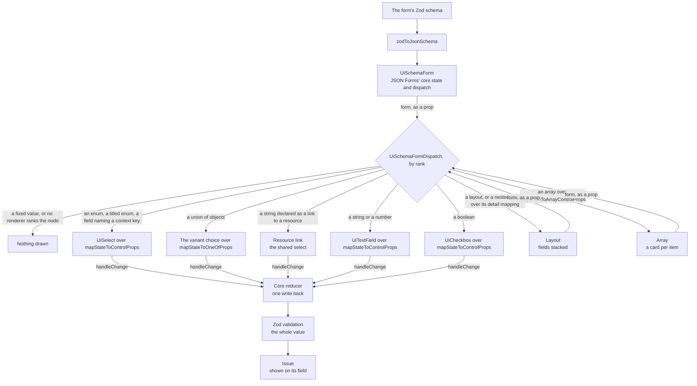

# Schema Forms

The sheet's settings, its column dialogs and the dashboard's visual editor render their forms from a Zod schema, which `UiSchemaForm` draws through JSON Forms' core: the core lays each form out and keeps its value in step, and the app's own components draw every node.

## How it works

- **JSON Schema is the input.** JSON Forms generates the layout from the schema where no UI schema is given, which is every form the app has, and `zodToJsonSchema`'s inline snapshot tests pin the schema each form receives.
- **The root holds the state, and each renderer takes it as a prop.** `UiSchemaForm` keeps JSON Forms' core state in a shallow reactive object and passes it with its dispatch to `UiSchemaFormDispatch` as one form prop. The dispatch draws each node with the renderer whose tester ranks it highest in `SchemaFormRenderers`, and passes `form` on to the renderer it picks and to every nested dispatch. A new kind of node is one entry in that list.
- **Each renderer maps its own props.** A layout, an object, an array or a variant calls its one core mapping function in a computed. A field calls `mapStateToControlProps` and `mapDispatchToControlProps` through `useSchemaFormControl`, which adds the field's layout meta and its issue. The state is shallow: JSON Forms' reducers return a new core for every change, so the replaced property is the only change to track, and the renderer components are never proxied.
- **Layout meta is typed data.** A field that wants several lines, or a choice among items only the dialog knows, says so in its `layout` meta, a flag or a key of the dialog's context interface, never an expression string evaluated at runtime.
- **The Zod schema validates.** JSON Forms runs with its validation off. The form's Zod schema checks the whole value on every change, as the dialog's error icon does, and each issue reaches the field at its path through the form's config, shown once the reader has changed that field. A rule that reads live state, a column name unique among the sheet's, is a refinement the dialog's composable builds.
- **A variant is its discriminant.** A union's variants each fix their discriminant to a literal, which the form hides and the variant choice sets. The variant the data is in is the one whose literals it carries (`getSchemaFormVariantIndex`), never the one JSON Forms' validation accepts: data holding a column's id, or a name cleared below its minimum length, fits no variant by validation, and no variant would draw. Only a union with no literal falls back to JSON Forms' pick. Switching keeps the fields the variants share and anything the schema does not describe, such as a column's id, and drops the old variant's own, and a shared field the two variants pick from different lists of the dialog's context, since the new picker never offered the old choice.

## Decisions

- **The core is adopted, and the Vue shell is ours.** A schema form engine is most of the work: laying a form out from its schema, ranking each node's renderer, detecting which variant of a union the data is in, and applying every change to a nested value immutably. Writing that for a handful of dialogs would put an engine in the repository that nothing else maintains, so JSON Forms' core is adopted. Its Vue components are not. The JsonForms root keeps its state in data(), its dispatch picks a renderer in a computed, and the vanilla renderers are written the same way, all in the Options API, which the app compiles out. Mounted there, the root rendered off an undefined store and aborted the patch around it.
- **The @jsonforms/vue bindings are rejected.** Their composables read the state and the dispatch with inject from a provide on the root, so every renderer depends on a provider its signature does not name, and a test must mount that provider. The [Vue conventions](../../../../.agents/skills/vue/SKILL.md) ban that for an input a component could take as a prop. Each one also brings its own copy of the core's mapping, a control id per scope, and lodash as the package's only runtime dependency. Rejected too: keeping the composables under our own names, which keeps the injection for no library's sake.
- **Each binding is the core's mapping function.** A composable wrapping one call would be a one-line composable, which the app does not write. `useSchemaFormControl` is the only composable, because every field reads the same layout meta and issue beside its control. The array's `addItem`, `removeItems`, `moveUp` and `moveDown` stay thunks, as the core returns them, and the renderer calls them.
- **One change per edit.** The root reduces each action and writes the value back only when it differs, so an edit emits once (#2003), and the renderers add no emit of their own.
- **Nothing proxied deeply.** The state stays shallow, so the renderer registry and the Ajv instance inside the core are never made reactive (#1832, #2025).
- **A node no renderer ranks draws nothing.** The library's UnknownRenderer printed its notice into the form instead. The schemas the app writes rank every node, which the schema snapshot tests pin, so the skip only ever meets a node the app did not mean to write, and the rest of the form still draws.
- **No control ids.** The library's useControl created an id per scope and released it on unmount (#2213). The renderers name their groups with `useId`, so no id registry is kept.
- **Alternatives to the core, rejected.** vjsf is bound to Vuetify as a peer dependency, so Vuetify could not leave while it stayed, and its fields could not wear the library's look. [shadcn-vue's AutoForm](https://radix.shadcn-vue.com/docs/components/auto-form) walks the Zod schema itself, but it is copied into the repository rather than installed, a renderer of our own under another name, and it brings Reka UI and vee-validate beside Vuetify 0. [FormKit](https://formkit.com/) is a whole form framework whose inputs, validation and schema format would replace the library's fields and the app's JSON Schema.

## Upstream

Every issue and pull request the audit of @jsonforms/vue selected from [the JSON Forms repository](https://github.com/eclipsesource/jsonforms), open and closed, has one verdict, read from its comments, the pull request diffs and the installed 3.8.0 source. Five defects are in scope. #1832, #2025 and PR 2623 are settled by the shallow state, #2250 by construction, since the bindings are the app's own modules with no CommonJS build that evaluates its components eagerly, and #2369 by construction, since the UI schema the form generates carries no rules, so no control is hidden to keep its space. #2025 and PR 2623 are checked by one test that names them, and #1832, #2250 and #2369 by construction. Six feature requests are in the audit's scope and none is built: the bindings have one consumer, so no Nuxt module, side-effect flag or exposed validator ships. A fixed-upstream verdict is a report the package has since answered with a change, and where this form does not take that change, the Notes section says so.

The other 85 items are counted here and stay on [the tracker](https://github.com/eclipsesource/jsonforms/issues?q=is%3Aissue):

- False positive: 55 (fixed upstream 29, not binding 16, usage 5, docs 3, duplicate 2).
- Out of scope: 30 (@jsonforms/core 13, @jsonforms/vue2 12, vite 2, vue-vanilla 1, vue-vuetify 1, ajv 1).

The in-scope items are listed below, each with its proof.

| Upstream                                                        | Verdict            | Proof                                                                                                                                                                   |
| :-------------------------------------------------------------- | :----------------- | :---------------------------------------------------------------------------------------------------------------------------------------------------------------------- |
| [#1832](https://github.com/eclipsesource/jsonforms/issues/1832) | In scope — defect  | by construction: the form's state is shallow, so the Ajv instance on its core is never proxied                                                                          |
| [#2025](https://github.com/eclipsesource/jsonforms/issues/2025) | In scope — defect  | "#2025 and PR 2623: renders its fields without Vue proxying the renderer components"                                                                                    |
| [#2250](https://github.com/eclipsesource/jsonforms/issues/2250) | In scope — defect  | by construction: the bindings are the app's own modules, with no CommonJS build to evaluate eagerly                                                                     |
| [#2311](https://github.com/eclipsesource/jsonforms/issues/2311) | In scope — feature | by construction: the app's bindings import no lodash; the CommonJS lodash still installed is `@jsonforms/core`'s own                                                    |
| [#2369](https://github.com/eclipsesource/jsonforms/issues/2369) | In scope — defect  | By construction: the form generates its UI schema, which carries no rules, so no control is ever hidden to keep its space                                               |
| [#2490](https://github.com/eclipsesource/jsonforms/issues/2490) | In scope — feature | by construction: the bindings are the app's own components, which Nuxt registers and renders on the server like any other, so a module has nothing left to register     |
| [#2627](https://github.com/eclipsesource/jsonforms/issues/2627) | In scope — feature | by construction: the bindings are app components, which the bundler tree-shakes with the rest of the app's code, so no package is left to flag                          |
| [PR 2491](https://github.com/eclipsesource/jsonforms/pull/2491) | In scope — feature | by construction: the bindings are the app's own components, which Nuxt registers and renders on the server like any other, so a module has nothing left to register     |
| [PR 2623](https://github.com/eclipsesource/jsonforms/pull/2623) | In scope — defect  | "#2025 and PR 2623: renders its fields without Vue proxying the renderer components"                                                                                    |
| [PR 2631](https://github.com/eclipsesource/jsonforms/pull/2631) | In scope — feature | by construction: the bindings are app components, which the bundler tree-shakes with the rest of the app's code, so no package is left to flag                          |
| [PR 2646](https://github.com/eclipsesource/jsonforms/pull/2646) | In scope — feature | by construction: the form validates through its Zod schema, whose errors the form already holds, so JSON Forms' validator is switched off and nothing is left to expose |

## Key files

| File                                                               | Role                                                                                        |
| :----------------------------------------------------------------- | :------------------------------------------------------------------------------------------ |
| `apps/web/app/components/Ui/SchemaForm/Index.vue`                  | JSON Forms' core state and dispatch, passed down as form, with the Zod issues in its config |
| `apps/web/app/components/Ui/SchemaForm/Dispatch.vue`               | Draws a node with the renderer that ranks it highest, and nothing when none does            |
| `apps/web/app/components/Ui/SchemaForm/Layout.vue`                 | A layout's elements stacked, or framed under a label when nested                            |
| `apps/web/app/components/Ui/SchemaForm/Object.vue`                 | A nested object as its own fields                                                           |
| `apps/web/app/components/Ui/SchemaForm/Array.vue`                  | A list's items, added, moved and removed                                                    |
| `apps/web/app/components/Ui/SchemaForm/OneOf.vue`                  | A union's variant, chosen in the library's select, over the chosen variant's fields         |
| `apps/web/app/components/Ui/SchemaForm/ResourceLink.vue`           | A link field drawn as the shared select over the owner's resources of its type              |
| `apps/web/app/services/resource/link/getResourceLinkSource.ts`     | The source a field's link type is listed from, read off its JSON Schema                     |
| `apps/web/app/services/resource/link/ResourceLinkTypeSourceMap.ts` | Each link type's router, mark, empty message and unbound id                                 |
| `apps/web/app/components/Ui/SchemaForm/Index.test.ts`              | The form's suite, mounted through the root                                                  |
| `apps/web/app/composables/ui/useSchemaFormControl.ts`              | What every field reads: its control over the core's mapping, its layout meta and its issue  |
| `apps/web/app/models/ui/schemaForm/UiSchemaFormBinding.ts`         | The form a renderer takes: the core state it maps, and the dispatch its changes go through  |
| `apps/web/app/models/ui/schemaForm/UiSchemaFormRendererProps.ts`   | What every renderer takes, the form among it                                                |
| `apps/web/app/services/ui/schemaForm/SchemaFormRenderers.ts`       | Which renderer draws which node, by rank                                                    |
| `apps/web/app/services/ui/schemaForm/getSchemaFormVariantIndex.ts` | The variant a union's data is in, read from its fixed discriminant                          |
| `apps/web/app/services/ui/schemaForm/getSchemaFormVariantValue.ts` | The value a union switched to another variant keeps                                         |
| `apps/web/app/services/ui/schemaForm/getSchemaFormLayout.ts`       | The layout meta read off a node, which JSON Forms' types leave out                          |
| `apps/web/app/services/jsonSchema/zodToJsonSchema.ts`              | The form's JSON Schema, with its layout meta                                                |
| `apps/web/shared/models/schemaForm/SchemaFormLayout.ts`            | The layout meta a field may carry                                                           |
| `apps/web/app/composables/resource/sheet/useColumnForm.ts`         | The column dialogs' context and their refined form schema                                   |
| `packages/configuration/vitest/registerVueEsmBundler.js`           | Every test's Vue with the Options API off, as the app ships it                              |

## Notes

- **AJV is JSON Forms'.** JSON Forms' core imports AJV and builds an instance when a form mounts, which picks the variant of a union with no fixed discriminant. So AJV and its formats stay, as JSON Forms' own dependencies rather than the app's. Their CommonJS needs nothing of ours: rolldown wraps it in its own interop helper in the production build, and the dev pre-bundle names them through their importer (`apps/web/configuration/vite.ts`). The app writes nothing on top of AJV: it carries no validation keywords of its own and no error-message or translation package.
- **Every change runs each renderer's mapping again.** The reuse that keeps an unchanged binding the same object, so that a change re-renders only the fields it touches, is in the package's master branch and not taken here, so a change re-runs every mapping on the form. The package's 3.8.0 bindings did the same.

## Sources

- [JSON Forms](https://github.com/eclipsesource/jsonforms): the core package's `mapStateTo*` and `mapDispatchTo*` functions, which each renderer calls, and the Vue package's bindings, read for the behaviour they keep.
- [JSON Forms' core](https://github.com/eclipsesource/jsonforms/tree/master/packages/core): `coreReducer`, `rankWith` and the `NoValidation` mode.
- [JSON Schema in Zod](https://zod.dev/json-schema): the conversion the form's input comes from.
